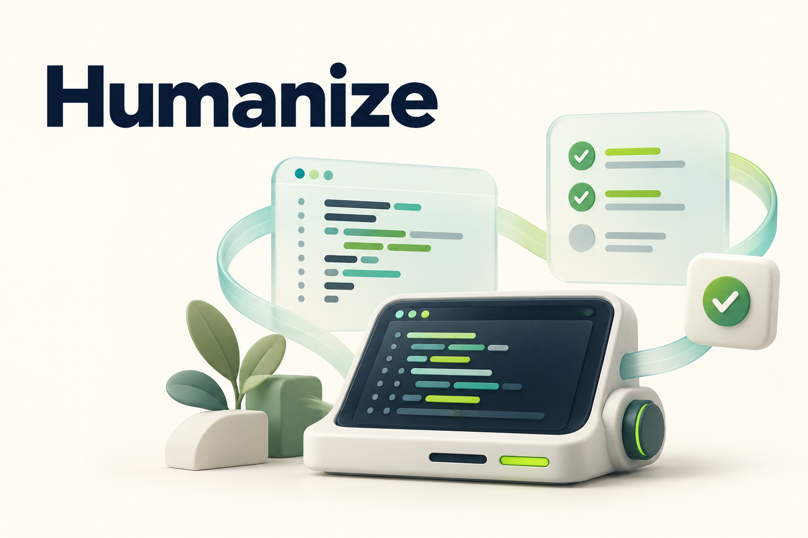

PROCESS MISSION · OPEN SOURCE

<h1>Mission Forge Contributor Program（MFCP）</h1>

  <strong>Learn · Build · Contribute · Grow</strong> 
  Develop engineering skills through real open-source contributions.

  
  
  
  
  

<strong>English</strong> · <a href="README.zh-CN.md">简体中文</a>

  <a href="https://missionhub-oss.github.io/mfcp/">Website</a> ·
  <a href="docs/program.md">Get started</a> ·
  <a href="projects/README.md">Explore projects</a> ·
  <a href="programs/2026/README.md">Program 2026</a> ·
  <a href="CONTRIBUTING.md">Contribute</a>

---

MFCP is a contributor development program initiated by **Process Mission**.
It brings together open-source learning, mentorship, practical project work,
and contribution assessments to help participants build engineering experience.

This repository hosts participation guidelines, project resources, program
records, and contribution tracking. Code contributions go to the corresponding
upstream projects. Supporting guides are currently available in Chinese.

## Getting started: your first PR

> [!IMPORTANT]
> **Every commit must include your DCO sign-off**, confirming your right to
> contribute the work. Use your real full name in English; for a Chinese
> name, use the full Pinyin spelling of your real name.

Fork this repository, follow the [registration guide](participants/README.md)
to add your identity file, and open a PR against `main`.

## Explore the projects

Choose a project and build experience through practical contributions.

<table width="100%">
  <tr>
    <td width="50%" valign="middle">
      <h3><a href="projects/zephyr/README.md">Zephyr</a></h3>
      
<strong>Build for the real-time world.</strong>

      
Explore board support, drivers, and samples. Validate behavior on embedded platforms and improve tests and documentation.

      
<a href="projects/zephyr/README.md">Explore Zephyr →</a>

    </td>
    <td width="50%" align="center" valign="middle">
      
    </td>
  </tr>
  <tr>
    <td width="50%" align="center" valign="middle">
      
    </td>
    <td width="50%" valign="middle">
      <h3><a href="projects/linux/README.md">Linux</a></h3>
      
<strong>Build experience with kernels and distributions.</strong>

      
Investigate kernel issues, work on drivers, and contribute tests and documentation. Maintain openRuyi packages and validate RISC-V systems within the Linux track.

      
<a href="projects/linux/README.md">Explore Linux →</a>

    </td>
  </tr>
  <tr>
    <td width="50%" valign="middle">
      <h3><a href="projects/yocto/README.md">Yocto Project</a></h3>
      
<strong>Build an embedded Linux system.</strong>

      
Work with recipes and layers, assemble images, and validate builds for a target platform.

      
<a href="projects/yocto/README.md">Explore Yocto Project →</a>

    </td>
    <td width="50%" align="center" valign="middle">
      
    </td>
  </tr>
  <tr>
    <td width="50%" align="center" valign="middle">
      
    </td>
    <td width="50%" valign="middle">
      <h3><a href="projects/humanize/README.md">Humanize</a></h3>
      
<strong>Build reliable coding-agent workflows.</strong>

      
Contribute to agent workflows, CLI and desktop tools. Improve agent integrations, tests and documentation, and validate changes through upstream review.

      
<a href="projects/humanize/README.md">Explore Humanize →</a>

    </td>
  </tr>
</table>

## Start contributing

1. **Register through a PR.** Fork this repository, add your GitHub identity
   file under [`participants/`](participants/README.md), and submit a registration
   PR. Participation starts after maintainer review and merge.
2. **Choose a project.** Read the [participation guidelines](docs/program.md),
   explore the project guides and review the
   [Program 2026](programs/2026/README.md).
3. **Claim a task.** Find an open Issue with native type `Task`, then filter
   by project and difficulty.
   Comment with your experience, availability and development environment.
   After mentor confirmation, a maintainer assigns the Issue to you and records
   the agreed scope and goals. See the [claiming guide](CONTRIBUTING.md#申领任务).
4. **Build and share evidence.** Complete the work, record actual validation
   results, and link upstream submissions for review and assessment.

Unregistered accounts' issues are automatically closed and their issue comments
are automatically deleted. PR discussions remain open. Processing occurs after
submission, so content may briefly be visible. Registration is a participation
prerequisite; contributor levels are assessed through task outcomes.

**2026 status:** Recruitment has yet to be announced. Dates, mentors, available
tasks, and incentives will be published in the [annual program](programs/2026/README.md).

## Grow through practice

| Area | What you will find |
| --- | --- |
| [Contributor levels](docs/levels.md) | L0–L4 capability descriptions and evidence for progression |
| [Assessments](docs/assessment.md) | Criteria for engineering quality, validation, collaboration, and impact |
| [Mentorship](docs/mentorship.md) | Mentor and participant responsibilities, communication, and coordination |
| [Stipends and rewards](docs/stipends.md) | Requirements for announcing incentives and payment conditions |

## Find your way around

| Directory | Contents |
| --- | --- |
| [`docs/`](docs/program.md) | Participation, levels, assessments, incentives, and mentorship |
| [`projects/`](projects/README.md) | Long-term learning resources and practical guidance for each project |
| [`programs/`](programs/README.md) | Annual program announcements, assessments, and contribution records |

The repository organization draws on [CNCF Mentoring](https://github.com/cncf/mentoring),
keeping program guidance and historical records together in one repository.

## Join the contributor group

  Scan with Feishu to join 
  the MFCP contributor group. 
  Ask questions and share your progress.

   
  Click the image to view it at full size.

  
Explore resources in the group

  

    Past community discussions 
    Meeting and event recordings 
    Presentation slides and learning materials
  

