> This post is adapted from my November 13, 2026 talk at the MFCP Open-Source Practice Sharing session, *Humanize: Moving AI Agents from Single Tasks to Complex Engineering Collaboration*.

Hi everyone, I'm Zijian Zhang. Chao was a bit too generous in his introduction—I'm still a PhD student, not a doctor yet! I'm studying at the College of AI at Tsinghua University, interning at NVIDIA Research Singapore, and working as a core developer at Humanfia. I wrote most of the code for Humanize 2.0, the version we are actively shipping today. In this post, I want to walk through how Humanize evolved over the past year, how our **Agent Flow runtime** works under the hood, what we have uncovered through **Flow Science**, and where we are heading next with scalable infrastructure.


I'll break the story into three stages: first, **Humanize 1**, back when Humanize itself was a single workflow; second, **Humanize 2**, where we generalized it into a unified Flow runtime and began studying Flow Science systematically; and third, **Humanize NEXT**, our push toward large-scale, distributed Flow infrastructure—followed by a few candid engineering questions that came up during the live Q&A.

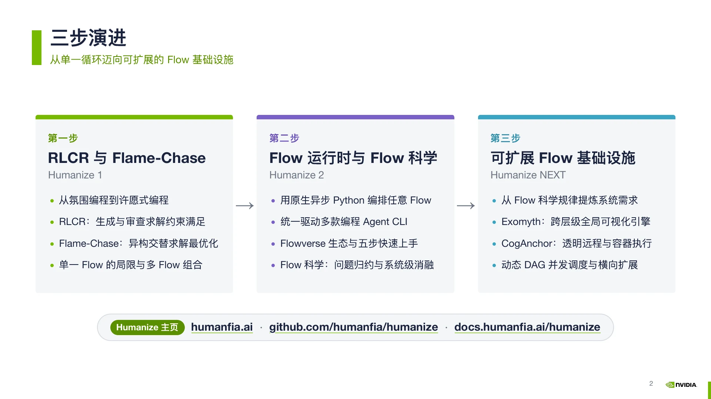

## From Session to Flow

Anyone who has pushed modern coding agents hard over the past year has run into the same wall. Even with frontier models like Claude Opus 5, Claude Fable 5, or GPT-5.6 Sol, handing an agent a single prompt—or firing off `/goal`—often falls apart once a task stretches across hours or days. Left in one long session, a model rarely stays locked onto your intent all the way to the finish line.

That is why we introduce **Flows**: explicit workflows that orchestrate one or more agents—working either cooperatively or competitively—to tackle problems far larger than any single session can handle.

Take Anthropic's [original_performance_takehome](https://github.com/anthropics/original_performance_takehome) interview benchmark, released earlier this year. The task is to optimize a batched tree-walk CPU kernel on a simulated VLIW + SIMD machine, scored purely by clock cycles (lower is better). Because VLIW + SIMD architectures barely exist in model training corpora, it is deliberately AI-resistant and tests how quickly an agent can build a harness and iterate in unfamiliar territory. Anthropic's hiring bar is **1,487 cycles**—measured by running Claude Opus 4.5 in Anthropic's own harness for 11.5 hours.

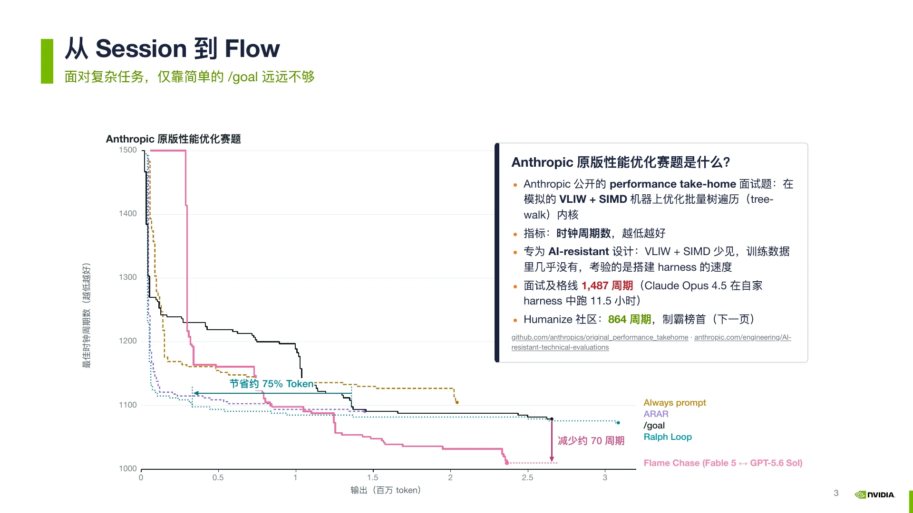

Look at the comparison curve above. The baseline is a bare `/goal` with no workflow orchestration at all. Simply adding a structured loop like `Ralph Loop` or `ARAR` reaches the same cycle count while cutting token consumption by nearly **75%**. Switching to `Flame-Chase`—alternating Claude Fable 5 and GPT-5.6 Sol—shaves off another **~70 cycles** within the same budget.

And those curves were just our early results. Across the full progression—from `DeepSeek-V4-Pro` via raw API (2,401 cycles), standalone `GPT-5.3-Codex` (1,711), the 1,487 hiring bar, and a plain `/goal` (1,311), down through Humanize 1.0 (1,250), 1.5 (1,001), 2.0 (994), and 2.5 (979)—our community reached **864 cycles** about a month ago, **1.72× faster** than Anthropic's hiring bar. As of November 7, 2026, Humanize community members hold 5 of the 9 tied first-place slots on [vliw-challenge.fly.dev](https://vliw-challenge.fly.dev) (Without Indices). Without a well-designed Flow, you stay stuck above a performance floor while burning through tokens.

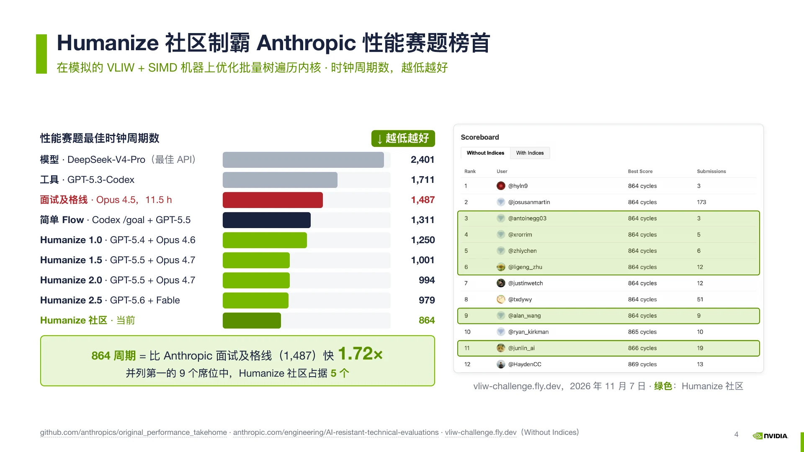

## Humanize 1

Humanize 1 was originally created by Sihao Liu (now a Research Scientist at NVIDIA), and we documented that work in [Humanize: Judgement Engineering for Agentic Coding](https://arxiv.org/abs/2610.08900). At the time, we weren't trying to build a general Flow platform; we just wanted to see whether we could achieve **wishful coding** on top of the weaker models available at the beginning of the year.


### RLCR and Wishful Coding

In classic *vibe coding*, a human states an idea, an agent writes code, the human inspects it, spots issues, and nudges it again. With **RLCR (Ralph Loop with Codex Review)**, we aimed to automate that review loop so you could simply state a wish and let agents drive the implementation all the way to completion:

1. You describe an idea, and `gen-idea` expands it into a grounded multi-direction draft based on the codebase.
2. In `gen-plan`, multiple agents debate back and forth across several rounds until they converge on a solid `plan.md`.
3. A swarm of Claude sub-agents implements the different components of the plan in parallel.
4. **Crucially**, Claude never signs off on its own work. Everything goes to an independent **Codex** reviewer to judge whether the implementation actually meets the bar.

Anyone who uses both tools heavily knows their strengths complement each other: Codex lags behind Claude at writing large swaths of code from scratch, yet it is consistently sharper at finding subtle bugs and spotting incomplete work. RLCR leans directly into that asymmetry—Codex keeps rejecting drafts until every requirement passes scrutiny.

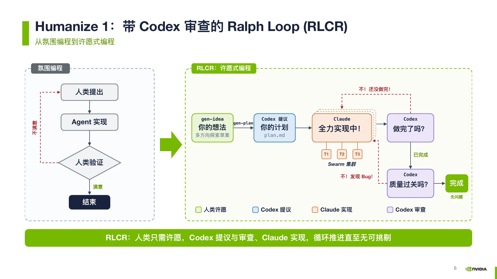

### Limits of a Single Flow

RLCR got us remarkably close to wishful coding for full software projects. Then we tried carrying it over to other domains and immediately hit a wall: **there is no free lunch, and a single Flow cannot solve every class of problem**.

RLCR shines at building applications from scratch because conventional software engineering is fundamentally a **constraint satisfaction problem (CSP)**. You specify features, tests, and static lint checks; once all constraints pass, you have a valid **feasible solution**. Even if the generated code has rough edges—a bit of "AI slop"—as long as it runs reliably and satisfies every requirement, it gets the job done.

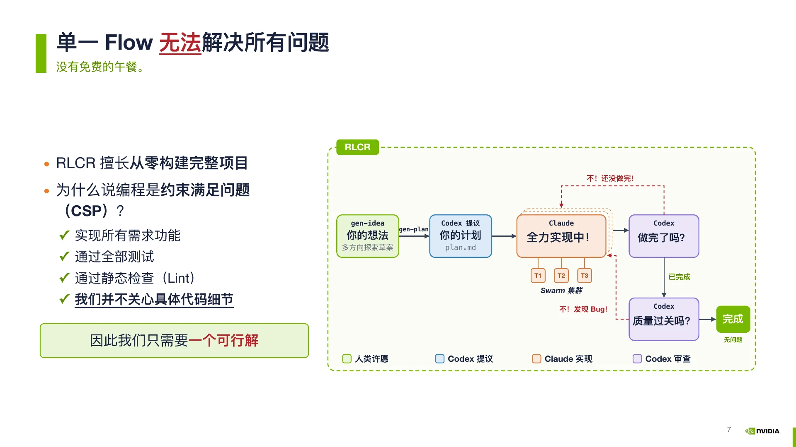

Move over to writing CUDA kernels or low-level operators, and AI slop is dead on arrival because any extra overhead wrecks performance. Two deeper differences come into play:

First, kernel optimization is an **optimization problem** with an unknown lower bound. You cannot tell an agent, "stop once you hit 1,000 cycles"—you have to keep probing downward for faster implementations.

Second, verification changes completely. For general software, no mechanical checker can catch every logic bug, which is why a Codex reviewer pays off. For kernels, you compile the code and run it on an actual GPU: numerical correctness and runtime pop out immediately. Hardware execution itself guarantees constraint satisfaction. Spending budget on a text-based Codex reviewer becomes pure drag; every ounce of compute should go toward discovering faster implementations.

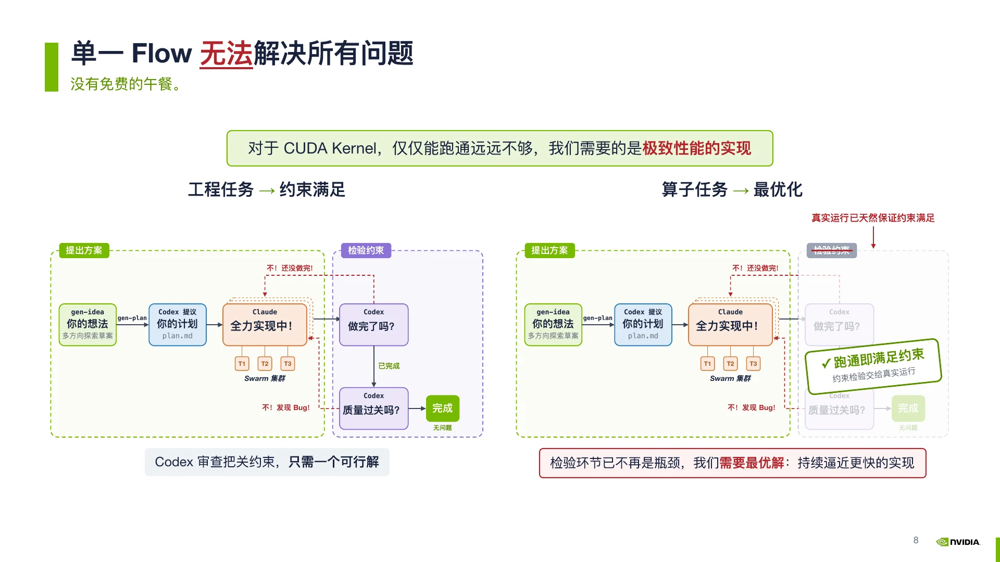

### Flame-Chase and Model Diversity

Around April, I designed a new Flow specifically for optimization problems and named it **Flame-Chase**, inspired by the *Flame-Chase Journey* in *Honkai: Star Rail*, where thirteen Chrysos Heirs each undergo trials to pass on their coreflames.

In our workflow, heterogeneous agents—such as `Claude Code + Claude Fable 5` paired with `Codex + GPT-5.6 Sol` (or additional models like `Kimi K3`)—take turns optimizing the same shared codebase:

- `Claude Code + Claude Fable 5` favors bold structural rewrites—great for unlocking new territory, though prone to temporary regressions.
- `Codex + GPT-5.6 Sol` excels at fine-grained micro-tuning—steady gains, though prone to getting trapped in local optima.

Whenever a round beats the current best benchmark, its result is committed to the shared state so the best version is always preserved. A single model has limited behavioral diversity and quickly settles into a local optimum. Mixing distinct models introduces genuinely different reasoning and output distributions, steadily raising the odds of jumping out of the current basin into a much better one.

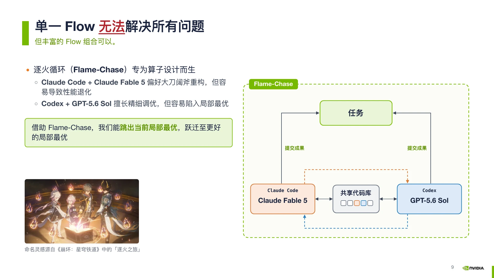

At that point we had two distinct Flows: RLCR for constraint satisfaction, and Flame-Chase for optimization. The next question was obvious—if we already had two, there would soon be three, four, and dozens more. We needed a clean, general runtime to host all of them.

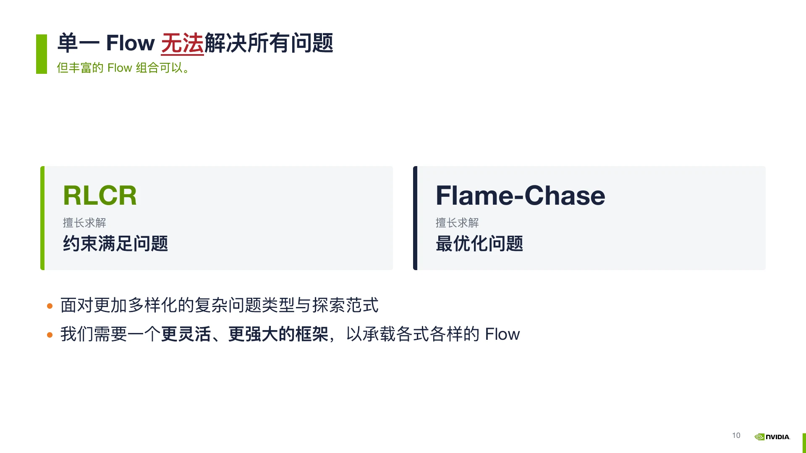

## Humanize 2 Runtime

Over the summer, we rebuilt Humanize from a single workflow into a unified Flow runtime: **Humanize 2**, open-sourced under Apache-2.0 at [github.com/humanfia/humanize](https://github.com/humanfia/humanize) alongside the community Flow registry `Flowverse`. Having this runtime is also what made our later Flow Science experiments fast enough to run at scale.

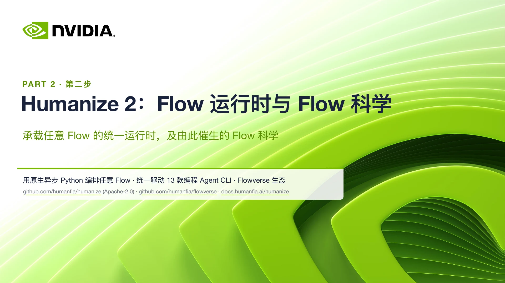

### Three-Layer Architecture

Humanize 2 separates the entire agent lifecycle into three clean layers:

1. **Models**: token providers such as OpenAI (GPT-6 Astra, GPT-5.6 Sol), Anthropic (Claude Fable 5.1, Claude Opus 5), and OpenRouter (Kimi K3, DeepSeek-V4 Pro, and more).
2. **Harness & Flow Runtime**: Humanize pulls Flows from `Flowverse` or your local project and schedules individual coding Agent CLI nodes.
3. **Environments**: where commands run and files live—local machines, remote servers, or containers, isolated via directories and Git worktrees.

Unlike many agent frameworks that talk directly to raw LLM APIs and re-implement tool loops from scratch, **we deliberately avoid rebuilding the underlying harness**. Every model lab trains and tunes its models specifically for its own native CLI harness. Treating each CLI (Claude Code, Codex, Grok Build, and others) as a black-box execution node gives us strong single-agent performance out of the box and frees us to focus on higher-level orchestration, scheduling, and environment mapping.

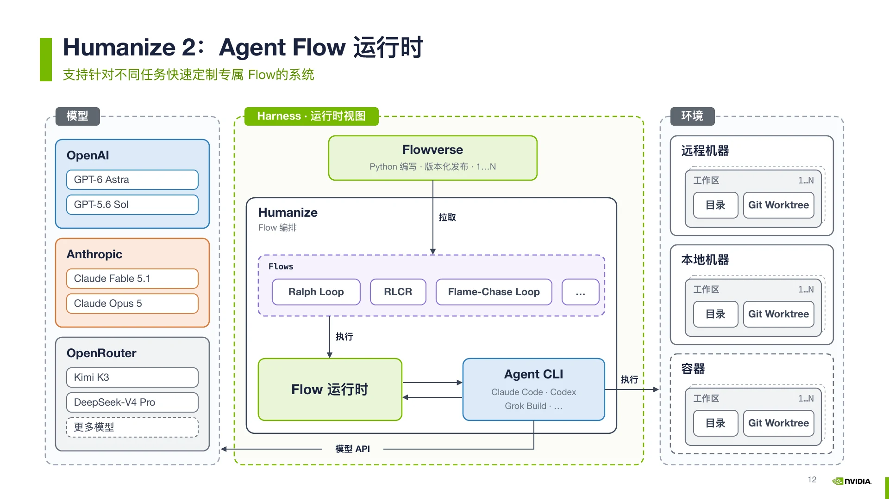

### Built-in Flows and Flowverse

With Humanize 2 in place, running ablations became effortless, and we quickly built out a rich set of built-in and community Flows indexed at [github.com/humanfia/flowverse](https://github.com/humanfia/flowverse):

| Category | Representative Flows | Core Mechanism |
| --- | --- | --- |
| Built-in Loops | `ralph_loop`, `stateful_ralph`, `continue_loop`, `goal`, `flame_chase`, `rlar` | Fresh-session loops, stateful continuation, heterogeneous alternation, and per-round review |
| Humanize 1 Stages | `humanize1:gen-idea`, `humanize1:gen-plan`, `humanize1:rlcr` | The full three-stage Humanize 1 workflow rewritten in Humanize 2's native format |
| Flame-Chase Variants | `agent_cleanup_ralph_loop`, `agent_cleanup_flame_chase`, `fixed_interrupt`, `parallel_git_pr`, `parallel` | Workspace compaction, timed session resets, multi-branch parallelism, and metric-gated Git PR merges |
| Meta & Math Flows | `aot`, `recursive_lean_prover` | A meta-Flow that writes, smoke-tests, and reviews new Flows; recursive Lean theorem proving |

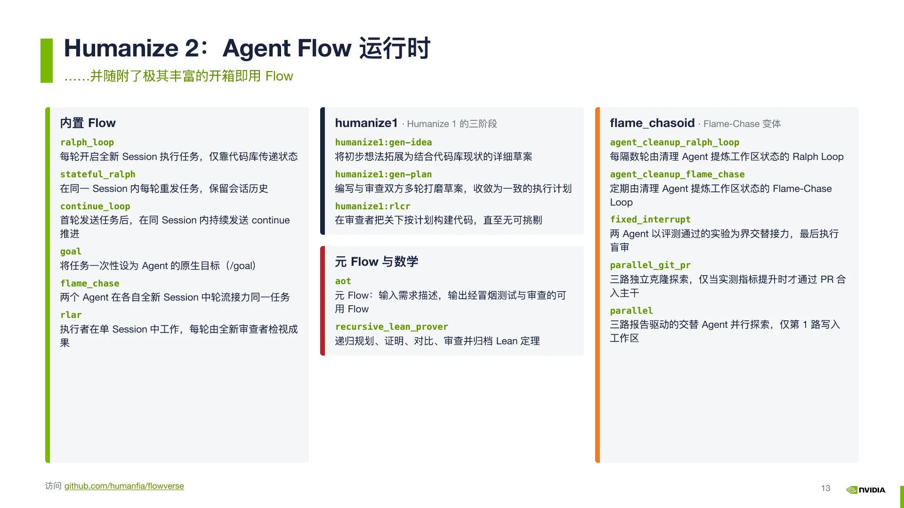

### Getting Started in Five Steps

The reason we could iterate on so many Flows is how little friction Humanize 2 imposes. Onboarding takes five quick stages: install, first run, unattended execution, reusing Flows, and writing your own.

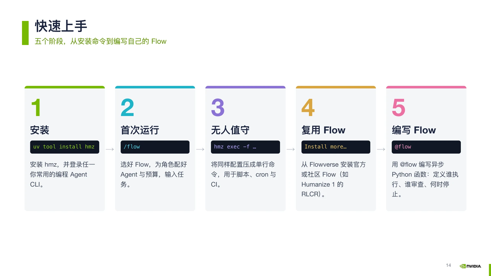

**1. Install.** `hmz` is published on PyPI—one command (`uv tool install hmz`) gets the CLI running, and a desktop GUI is also available in the repo. Importantly, **Humanize 2 natively reuses your existing local logins for each coding Agent CLI** without storing API keys or hijacking third-party auth sessions, so you avoid policy violations and account bans. Today we support **13 coding Agent CLIs**: `claude`, `codex`, `cursor-agent`, `agy`, `grok`, `kimi`, `qwen`, `opencode`, `dsh`, `mimo`, `mcode`, `pi`, and `omp`.

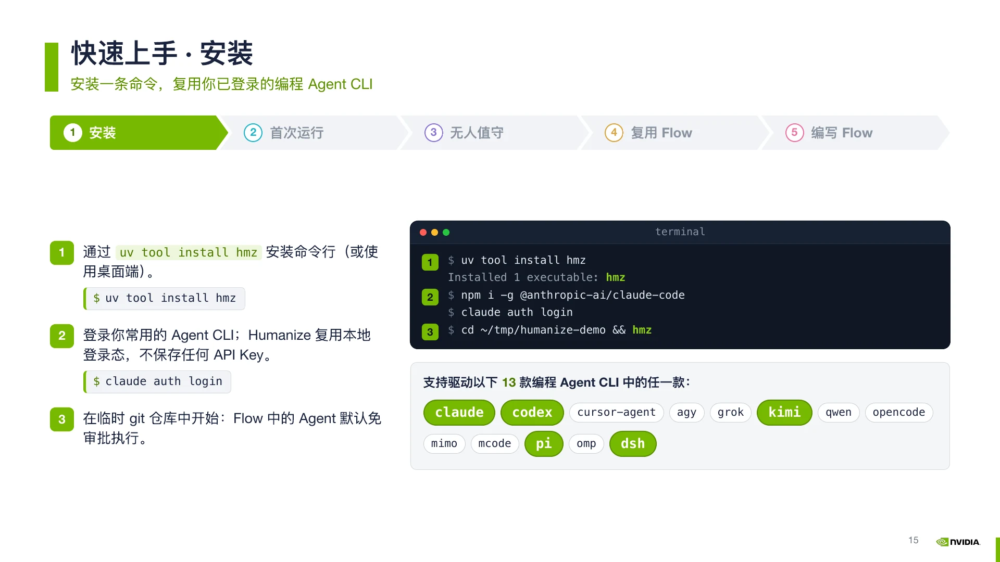

**2. First Run.** Launch `hmz` inside a repository (both the CLI and the GUI follow the same layout), type `/flow` to pick a workflow such as `ralph_loop`, assign a harness, model, and reasoning effort to each role (e.g., `claude/claude-opus-5:high`), and set time/cost budgets (e.g., `20m, $0.50`) so nothing runs away with your wallet. Hit Save, type your task, press Enter, and let it work. Double-tap `ctrl+c` anytime to stop and inspect changes with `git diff start`.

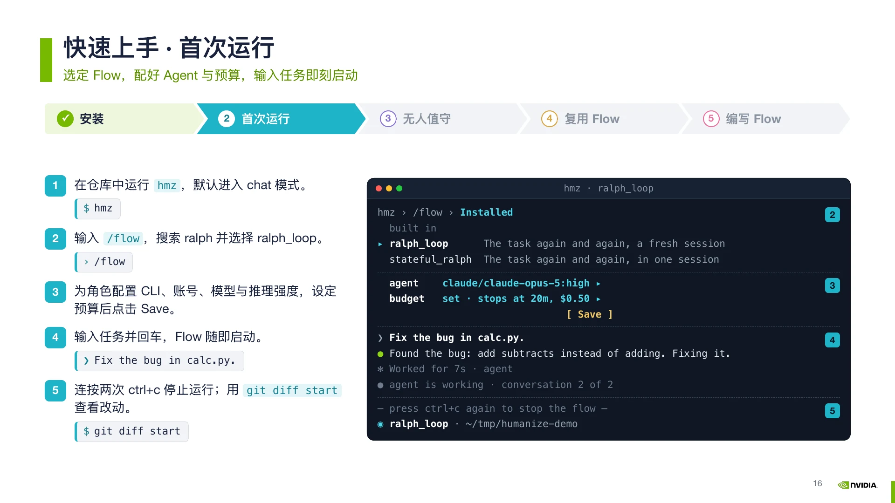

**3. Unattended Mode.** Realistically, nobody wants to SSH into a fleet of remote machines and drive interactive prompts by hand. With `hmz exec`, the exact same configuration collapses into a single command ready for scripts, cron jobs, CI pipelines—or for a local Claude agent on your laptop to dispatch jobs onto remote servers:

```bash
hmz exec -f ralph_loop \
  -a agent=claude/claude-opus-5:high \
  -p budget.duration=2h,budget.cost=10 \
  "$(cat TASK.md)"
```

In a nightly CI job, it is the same four steps: install `hmz` and the target CLI, inject credentials from Secrets, run `hmz exec`, and push the resulting branch as a Pull Request.

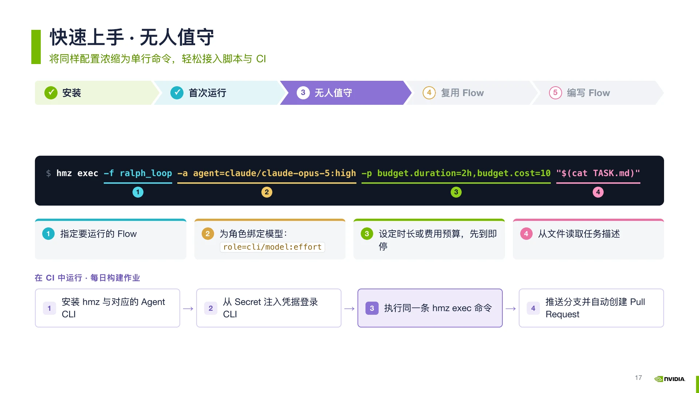

**4. Reuse Flows.** Open `/flow → Install more…` to pull official or community Flows from `Flowverse`, or run any pinned git ref directly without pre-installing (for example, `git+https://github.com/humanfia/humanize1-flow@v0.2.0#humanize1:gen-idea`). Our rewritten Humanize 1 pipeline runs as three clean stages—`gen-idea`, `gen-plan`, and `rlcr`—passing human-readable drafts and plans through files in the workspace.

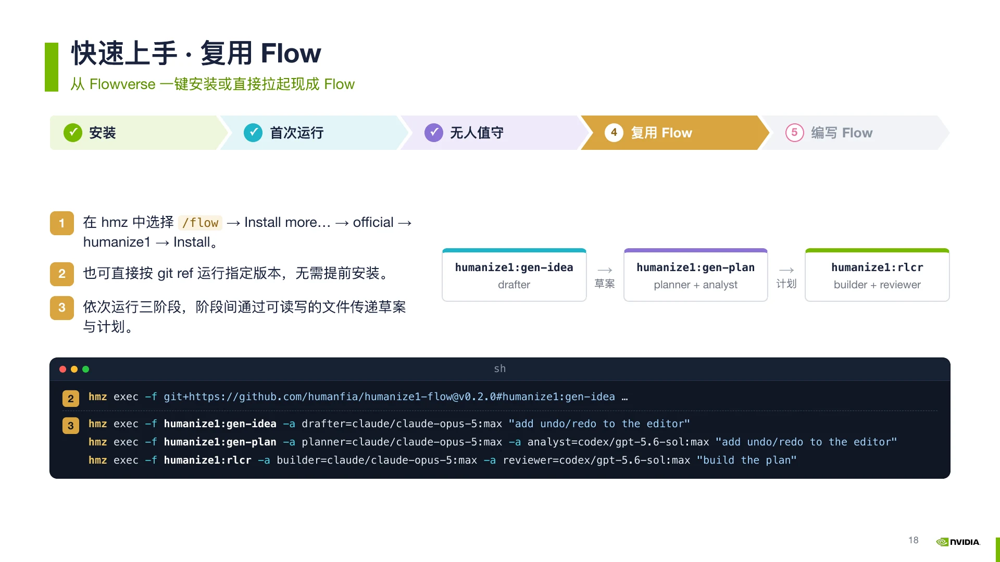

### From 118 Files Down to 7

To appreciate how much complexity the runtime strips away, compare our old implementation against the new one. In `PolyArch/Humanize`, implementing Humanize 1 took **118 files**: 14 hooks, 22 scripts, 4 agent configs, 5 commands, 6 skills, 2 config files, and 64 prompt templates. `setup-rlcr-loop.sh` alone ran 1,541 lines, and `loop-codex-stop-hook.sh` hit 2,221 lines—a tangle of bash, `jq`, JSON parsing, regexes, environment variables, and process signals gluing stop hooks to Codex CLI.

In Humanize 2, the exact same `humanfia/humanize1-flow` takes **7 files**: one Flow Python file and six prompt files. Permission guards and stop hooks are first-class Python APIs (`builder.on_permission_request(guard)`), so the code *is* the workflow—what you read is what runs.

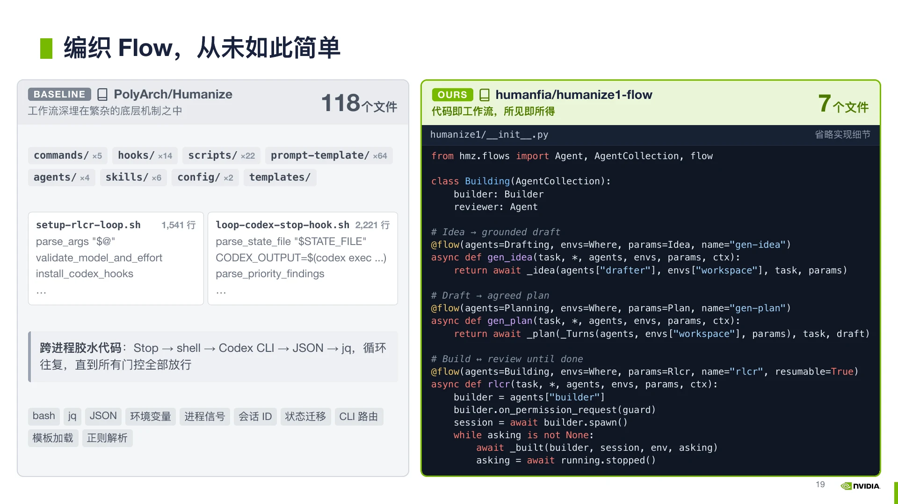

**5. Write Your Own Flow.** Create `.hmz/flows/twice/__init__.py`, declare your `AgentCollection` and `EnvCollection`, and decorate an async Python function with `@flow`. Call `await builder.spawn()` to create a session, run the task once with `await builder.run(...)`, then run a second pass asking the agent to review and fix its own work. In roughly twenty lines of standard async Python, you have a reusable implement-then-review Flow—far cleaner than wiring bespoke CLI hooks by hand.

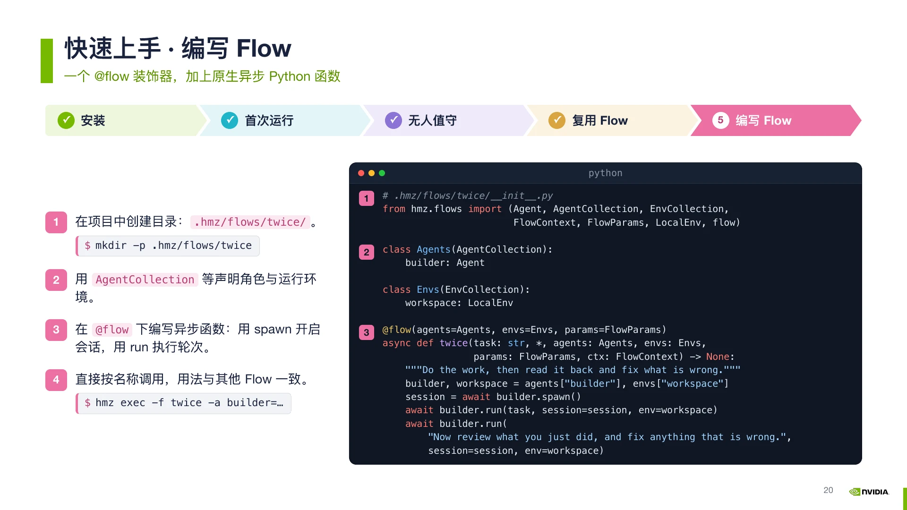

### Results Across Four Domains

Once writing and iterating on Flows stops being a chore, you can focus entirely on pushing frontiers. Between June and October this year, a small team of around ten people used Humanize 2 to deliver major results across four areas:

1. **Mathematics & Formal Verification**: #1 on `Lean-Eval` (266/304), 100% on `PutnamBench`, perfect score on IMO 2026 (6/6), the first Lean formalizations of 8 OpenAI research problems including the 4D Kakeya conjecture, and a Lean formalization of the Hamilton–Perelman proof of Thurston's Geometrization Conjecture.
2. **Science Olympiads & Reasoning**: Perfect scores on IOI 2026 (6/6), IPhO 2026 (23/23), IChO 2026 full formalization (68/68), and IBO 2024; 100% on both quantum algorithms and quantum information theory benchmarks; 80% on Physics Cup, 63% on HLE, and 62.4% on SuperChem.
3. **GPU Kernels & Systems Performance**: Surpassed human SOTA across all tracks of MLSys FlashInfer; #1 on SOLExecBench L1 with 71 leaderboard-topping kernels; up to 14× speedup on MSA Prefill and 2.7× on VAE decoding; optimized 40+ SGLang kernels and uncovered a subtle cuDNN bug along the way.
4. **Machine Learning Engineering**: 78.2% medal rate on `MLE-bench` (#1 among five baselines), 53.8% gold medal rate, beating the human median on 90.7% of tasks; +6.4 percentage points average gain across six model combinations over single agents; and three top-5% finishes across 39 live Kaggle competitions with its predecessor.

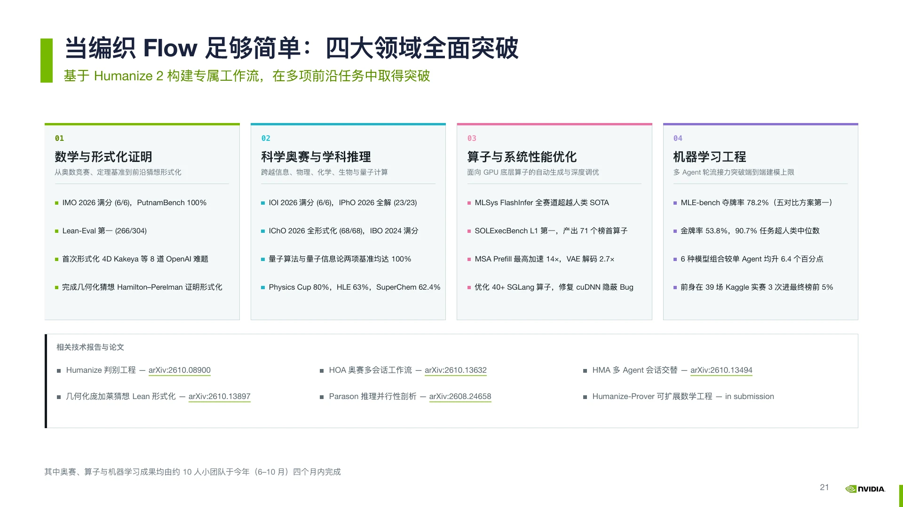

## Flow Science

After seeing so many task-specific Flows, a fair question naturally comes up: are Flows just another round of case-by-case glue work—like ad-hoc prompt, context, or skill tweaking—or are there underlying principles that generalize? Put simply: **is Flow purely engineering, or is it also a science?**

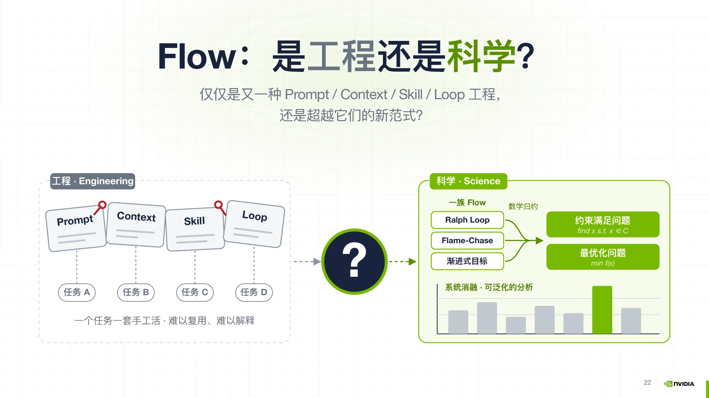

Our answer is clear: **Flow is both engineering and science (Flow Science)**. Once you reduce concrete tasks to shared mathematical formulations—constraint satisfaction (`find x s.t. x ∈ C`) for software engineering, optimization (`min f(x)`) for kernel tuning—an entire family of Flows generalizes across every task sharing that structure, opening the door to controlled ablations and theory.

At its core, **Flow Science is the management science of agents** (*the art of agents' management*). Picture each frontier agent as a brilliant engineer, and the harness as their desk. In the real world, one person and one desk can only carry you so far—to build something ambitious, you form a company with structure, handoffs, and review processes. The same token budget produces dramatically different outcomes depending on how you organize the agents spending it. Taking `Flame-Chase` as a case study, we can systematically ablate six dimensions: **participating models, model ordering, invocation ratios, parallelism, collaboration protocols, and progress tracking**.

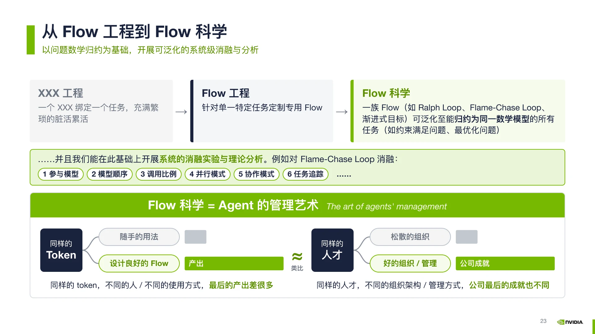

Here are the five core findings that emerged from our experiments.

### Matching Flows to Problems

Across four diverse benchmarks—`MLE-Bench`, `HLE`, `ProgramBench`, and Anthropic's performance take-home—no single workflow wins everywhere. Software implementation tasks benefit from RLCR's reviewer-gated loop, while open-ended optimization tasks strongly favor `Flame-Chase` and its parallel variants. Looking ahead to decision, prediction, and game-theoretic problems, each problem class will call for its own Flow family.

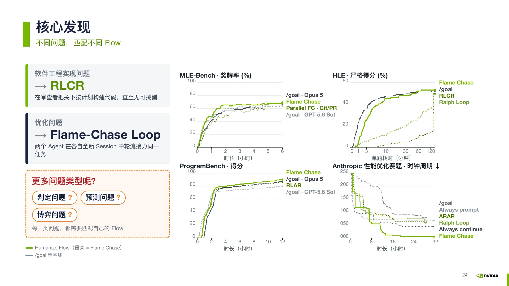

### Higher Diversity, Better Scores

This is the central claim of `Flame-Chase`. Its simplest form changes just one thing in a `Ralph Loop`: instead of invoking the same model every round, alternate between two different models and harnesses while handing off only the codebase. On Anthropic's performance take-home:

- Single-model `Ralph · GPT-5.6 Sol` and `Ralph · Fable 5` both plateau around **1,040–1,060 cycles**.
- Alternating them in `Flame-Chase` drives the score down to **~1,000 cycles** while using fewer output tokens (**~2.7M vs. 3.4–4.1M**) and less wall-clock time (**~24h vs. 28–29h**).

Different models fail in different ways; handing off across distinct models stops any single blind spot from compounding round after round.

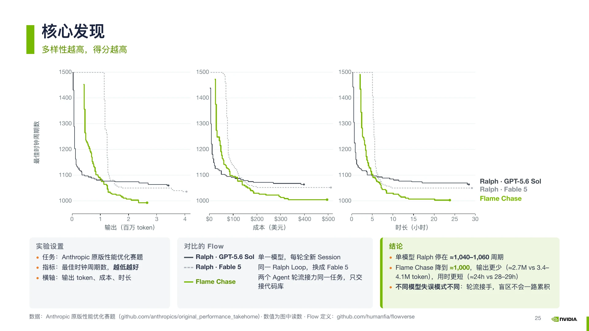

### Collaboration Over Raw Parallelism

We compared three `Flame-Chase` setups over a 12-hour window:

1. **Single-track Flame-Chase**: two agents alternating on one workspace, averaging **~1,012 cycles**.
2. **Parallel Flame-Chase**: three parallel tracks exchanging text reports while only Track 1 writes to the workspace. Despite burning **more than 3× the output tokens** (**~4.9M vs. 1.5M**), it barely nudged the average to **~1,005 cycles**.
3. **Parallel FC · Git/PR Lite**: one tiny protocol change—each of the three tracks explores in its own isolated clone, and **changes merge into main via a Git PR only when measured performance strictly improves**, allowing subsequent agents to read past winning PRs. Within the same 12 hours, the average dropped sharply to **~985 cycles**.

Throwing more parallel workers at a problem isn't enough; multi-branch exploration only compounds when merges are gated by real measurements.

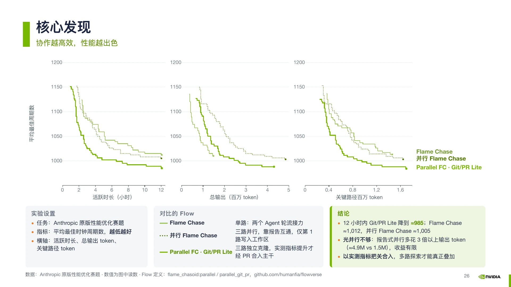

### Progressive Goals

We also tested **fixed goals** against **progressive goals** on `Ralph Loop`. When your kernel sits at 1,500 cycles and you only ever tell the agent "reach 1,000 cycles," it frequently discards genuinely helpful ideas simply because a single step only saves 100 cycles and looks far short of 1,000.

Just like gradient descent moves step by step rather than teleporting to the minimum, **Progressive Goal** ratchets the target downward as the agent improves: 1,500 → 1,300 → 1,200 → 1,100 → 1,000. In our experiments, fixed goals stalled around **1,060 cycles** (~3.45M output tokens, ~$400, ~28.7h), whereas progressive goals reached **~1,000 cycles** while spending less across every axis (**~2.3M tokens**, **~$325**, **~24h**).

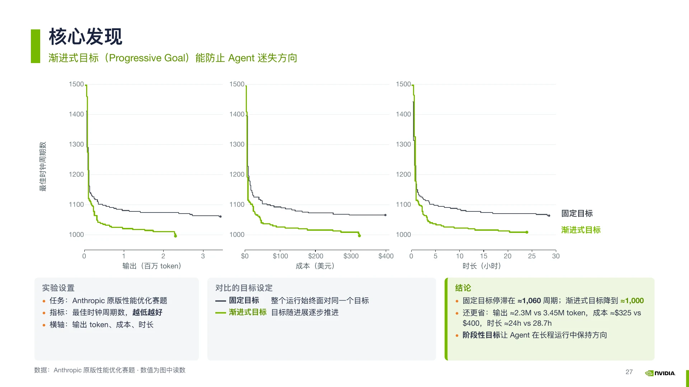

### Shrinking Thinking Budgets

Our most striking empirical result—detailed in [Humanize MLE Agents: Multi-Agent Session Alternation Beyond Single-Agent Limits](https://arxiv.org/abs/2610.13494)—explains why long single sessions perform so poorly. Across models and workflows, **running a single session for hours causes agents to progressively "go shallow"**: the average output tokens per turn steadily shrink.

Tracking six models (`GPT-5.6-sol`, `Claude Opus 5`, `DeepSeek V4 Flash`, `Kimi K3`, `GLM-5.3`, and `DeepSeek V4.1 Flash`) with a 30-minute sliding window, mean output per response dropped **29.8% to 45.0%** between hours 0–2 and hours 3–5. Line up Claude Fable 5's per-turn output directly above its benchmark curve, and the correlation jumps off the page: **the moment single-turn output collapses toward ~100 tokens, performance flatlines completely**.

Resetting context (HMA) retains **86.4%** of per-turn output compared to just **60.7%** under single-session `/goal`, and `Flame-Chase` markedly slows this decay by refreshing diversity. The takeaway is blunt: **don't stretch a single session forever—end it, keep the artifacts in the workspace, and start fresh.**

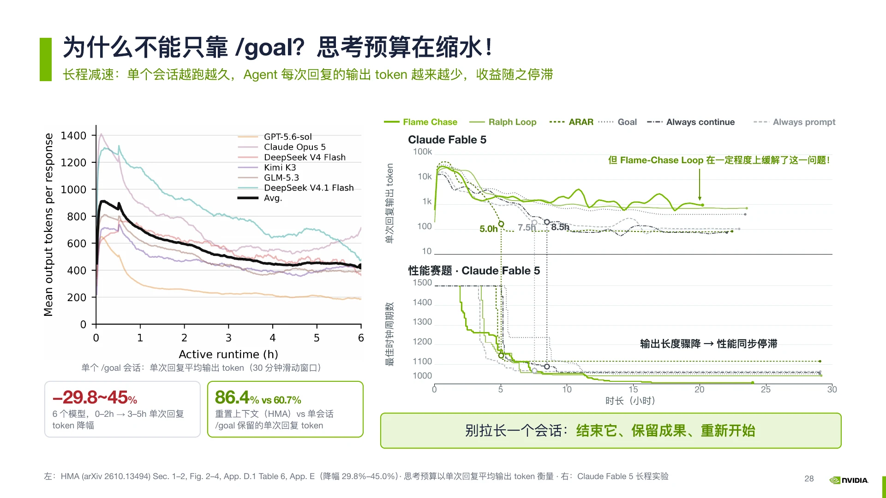

## Humanize NEXT

As frontier labs distill early single-machine workflows directly into newer models, simpler local tasks will increasingly work from a single prompt. Does Humanize still matter in that world?

More than ever—because the real frontier is **scalable Flow infrastructure**. When people talk about AI Infra today, they almost exclusively mean Serving Infra: pushing more tokens per second out of a model. Almost no one is building the runtime to reliably host massive Agent Flows. OpenAI spun up 10,000 agents on Navier–Stokes equations; Anthropic ran 1,000 agents on Fermat's Last Theorem formalization. **Humanize NEXT** is our push from two-agent alternation to large-scale, dynamic DAG concurrency.

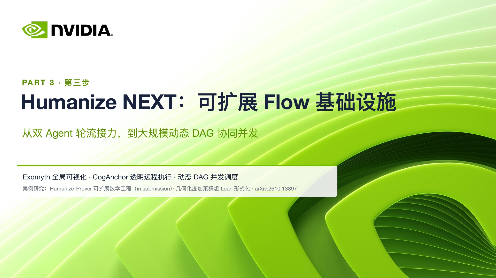

### Four System Requirements

Every empirical law from Flow Science maps directly onto an infrastructure requirement:

- **Context resets beat marathon sessions** → Sessions must be lightweight and disposable, with state anchored in the workspace. Humanize already provides `spawn / run`, Git `worktree` and `reflink`, plus `git ref`-based snapshotting and rollback for safe recovery during massive parallel exploration.
- **Model diversity pays off** → A unified interface must abstract heterogeneous model pools with automatic fallback. We integrate multiple CLIs and `LiteLLM` with cross-CLI, cross-account, and cross-model fallback chains.
- **AND/OR parallelism works** → We need a dynamic DAG scheduler supporting speculation, pausing, and cancellation, built today on `asyncio` call trees (`gather`, `TaskGroup`), nested budgets, and an upper-layer DAG controller.
- **Verification becomes the bottleneck** → Execution environments and verifiers must scale horizontally alongside agents. Humanize supports local, SSH, Docker, Swarm, and Slurm backends with per-role CPU, GPU, and memory quotas.

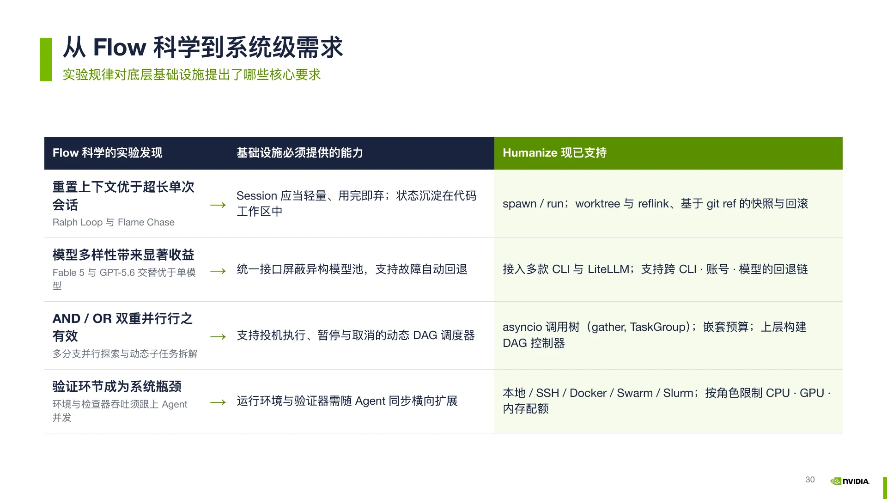

### Exomyth Global Profiling

An Agent Flow is just a program—and any program deserves a proper profiler. Well before similar trace viewers showed up elsewhere in the ecosystem, we built **Exomyth** to unify the full execution trace on one timeline (`EPIC → SESSION → LANE → SPAN`).

At the top sits the Flow invocation and its rounds; drill down to see every builder (`Claude Code`) and reviewer (`Codex`) thinking span and tool call (`Bash`, `Edit`); drill down one level further to inspect the actual OS subprocesses spawned by those tools—how long `pytest -q` took, how long `bench.py` ran, and what executed inside them. Exomyth renders **50,000 spans** smoothly in a terminal timeline and flamegraph with zoom, pan, and search, letting you pinpoint bottlenecks and idle environments in massive Flows immediately.

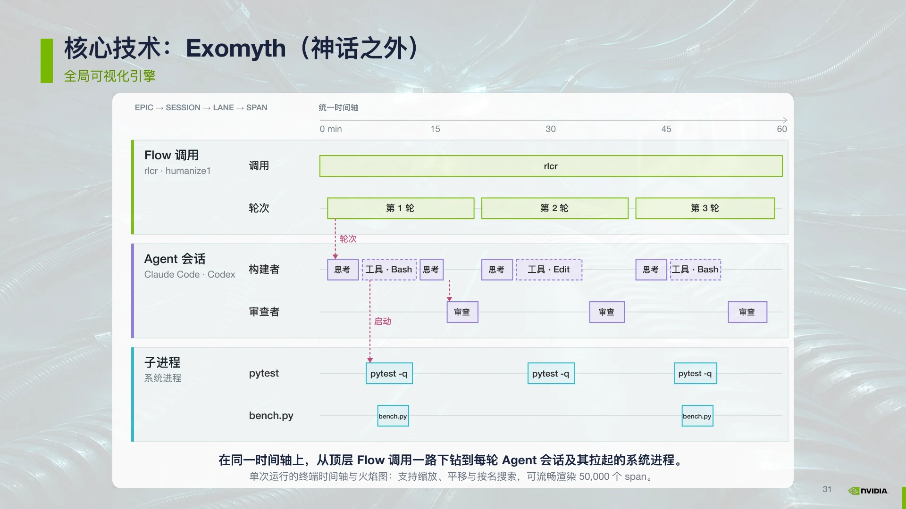

### CogAnchor Remote Execution

To cleanly decouple where an Agent CLI runs from where commands execute, we built **CogAnchor**, an action-routing gateway. A `CogAnchor Hook` intercepts every action and observation from the selected Agent CLI, routes it to a `CogAnchor Worker` running on a remote host or inside a container, and streams the result right back.

This unlocks two practical superpowers:

First, if your target environment sits behind an intranet or runs on specialized hardware like an FPGA host where installing a full agent harness is impractical, CogAnchor maps every action straight across—the agent debugs as if it were sitting natively on that machine.

Second, **a single session can "fly" across environments**. Imagine building an FPGA design: the agent compiles the project on a beefy multi-core build server, hops the live session over to the FPGA board to run hardware tests, and hops back to the build server with the telemetry to iterate.

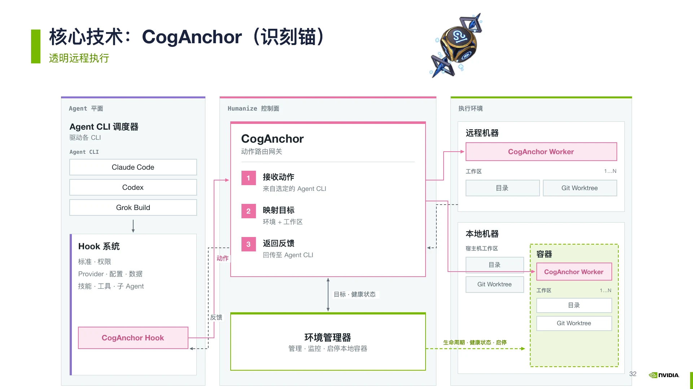

### Humanize-Prover Case Study

Putting these pieces together produced our first large-scale showcase, **Humanize-Prover**, which treats formal theorem proving as a concurrent scheduling problem across four tightly coupled components:

- **(A) Lemma AND Decomposition**: recursively breaks a research-level theorem into sub-lemmas whose required branches execute in parallel.
- **(B) Multi-Way OR Speculation**: races "decompose further" against direct proof attempts by models such as `GPT-6.1-Sol` and `Fable 5.1`—first verified proof wins and cancels the rest, while parent theorems draft ahead speculatively assuming child lemmas hold.
- **(C) Real-Time Lemma Search Engine**: indexes 3.5M+ existing and newly proved lemmas with five latency tiers from 4.9 ms (`instant`) to 4.3 s (`best`), making every freshly proved lemma searchable across the swarm immediately.
- **(D) Lean Core & Systems Optimizations**: subtree coalescing, master–worker task queues, compiled module caching, a verified-constant ledger, and one-pass concurrent kernel replay verified by both Lean and Nanoda.

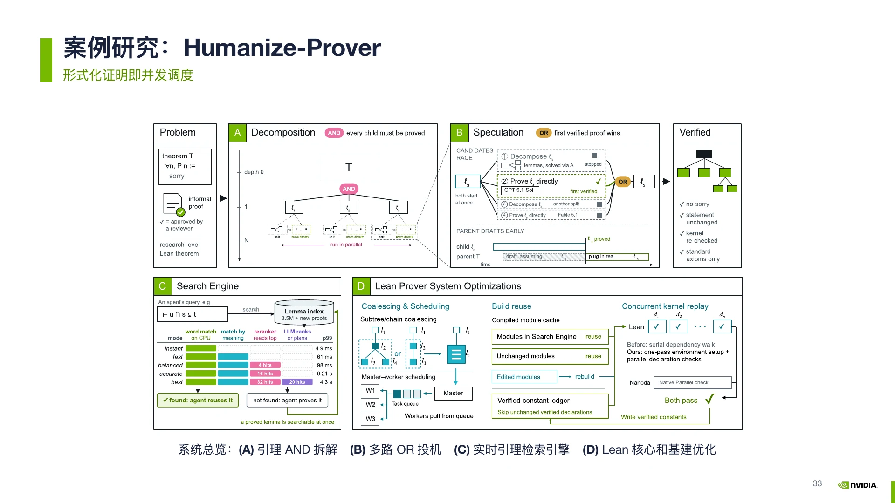

Using Humanize-Prover, we produced the **first Lean formalization of the 4D Kakeya conjecture (OpenAI Problem 074)**:

- **141 peak concurrent agents** finishing in **40.6 hours** of wall-clock time;
- **296 lemmas** processed (**241 accepted**), generating **1.38 million lines** of Lean proof;
- At roughly 1,000 tokens per line of Lean (including exploration), that totals **~1.38 billion tokens**—equivalent to **~13 years** of non-stop work by a human expert (200 tokens/min) or **~160 days** for a single Opus 5.5 agent running flat out (100 tokens/sec), achieving roughly a **94× end-to-end speedup** over a single agent.

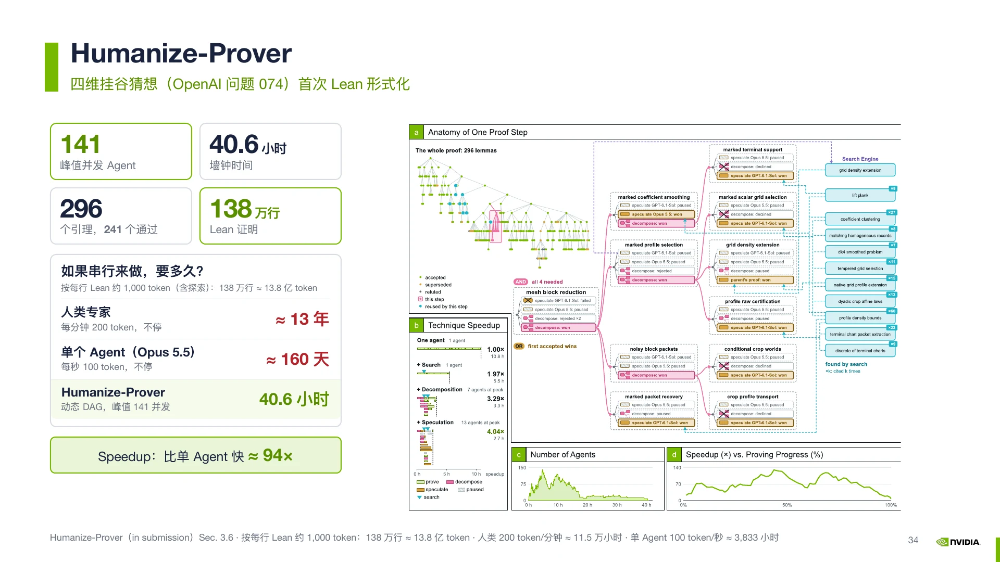

### Scaling Roadmap

Today, `hmz` ships with async call trees, append-only logs, resume-from-checkpoint, multi-backend execution (`local`, `SSH`, `Docker`, `Swarm`, `Slurm`, `Apple container`) with per-role resource quotas and orphan container cleanup, `Fence` sandboxing (`Landlock + seccomp / Seatbelt`) with a unified network proxy, and `CogAnchor` with on-demand syscall mirroring, NAT traversal, and `EasyTier` mesh networking. Through our upper-layer DAG controller, a single host already sustains up to **194 concurrent sessions**.

Next, we are pursuing the **Scaling Law of Flows**: promoting dynamic DAGs and speculation into native first-class primitives, building quota-aware multi-host and cross-datacenter scheduling, maintaining cloud-native warm environment pools with cross-run caching, and constructing a distributed multi-node control plane aimed at million-agent infrastructure.

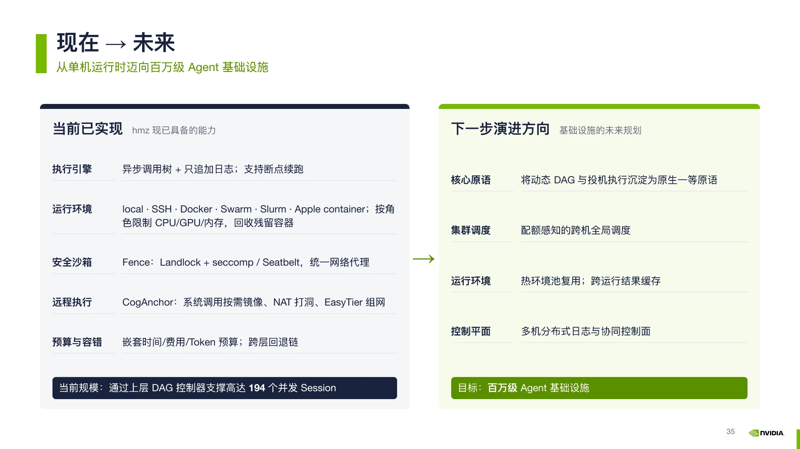

### Community and Vision

We warmly welcome contributors to help build out the Humanize ecosystem. Right now, three areas stand out most:

1. **UI/UX & Mobile Experience**: everyone wants to check on their running experiments or coding jobs from their phone at the gym—we need crisp status visualization and a lightweight mobile control surface.
2. **Cross-Network Client–Server Connectivity**: integrating Tailscale, EasyTier, and similar mesh tools to securely connect to remote runtimes from anywhere, laying groundwork for multi-cluster orchestration.
3. **Domain-Specific Flows**: multimodal workflows for 3D modeling, video, and animation using the latest models, plus large-scale long-horizon software engineering Flows such as cross-language codebase migrations.

Come claim an issue or open a PR at [github.com/humanfia/humanize](https://github.com/humanfia/humanize)—honestly, opening a detailed issue is almost as good as a PR these days, since I can always spin up an agent to implement it! If you build an interesting custom Flow, host it in your own repo and submit a PR to list it in [github.com/humanfia/flowverse](https://github.com/humanfia/flowverse), or pick up one of the scoped Humanize tasks on MFCP.

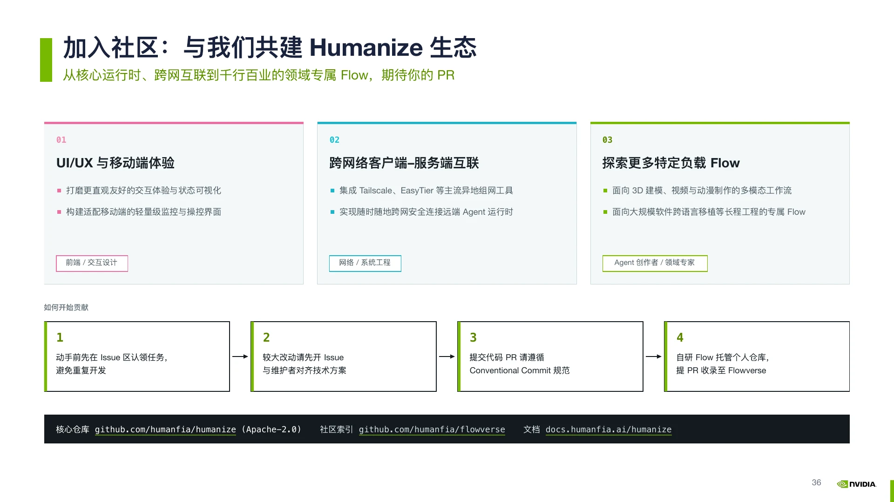

Looking five to ten years ahead, our vision is bold: one unified Flow framework orchestrating **100T-parameter models** at **1K TPS**, driving **1 million concurrent agents** across **1 million environments and containers** for **1 million minutes**—working together to crack humanity's hardest problems, from controlled nuclear fusion to curing cancer. *Ad Astra*—let's scale toward the stars!

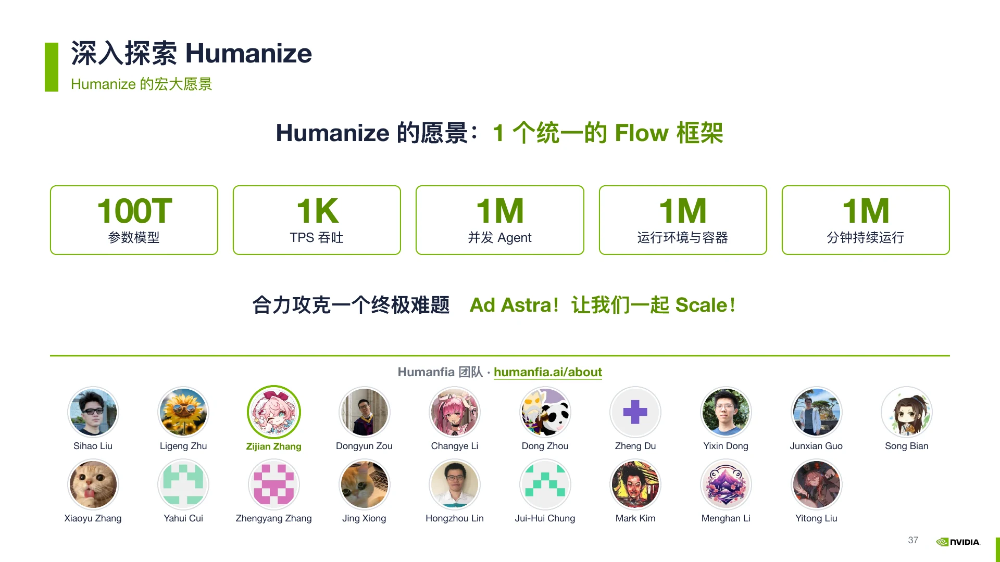

## Live Q&A

After the talk, our host Chao Liu (Zevorn) and community member Kai Liu raised several sharp questions grounded in day-to-day research and systems engineering. Here is a recap of our discussion:

### Auto-Research Flows

**Context (Chao Liu)**: Coding and planning in Humanize 2.0 already feel solid, but many students want to use it for academic research. What would an Auto-Research Flow look like?

**My take**: Auto-Research has exploded over the last two or three months—look at the 60,000 submissions to ICLR this year, a huge fraction of which clearly involved automated research pipelines. We originally considered building one ourselves, but with limited bandwidth we chose to stay focused on the runtime, kernels, and formal math.

End-to-end research also needs upstream literature surveys and downstream paper writing. We haven't shipped official Flows for those stages yet, and as a PhD student myself I would love to see the community build them—I'll probably explore this when I find time too. One real pain point remains: current models still struggle to write academic prose that sounds genuinely human, so you usually need an extra polishing pass on top.

### Systems Infra and Outworlder

**Context (Chao Liu & Kai Liu)**: Kernel optimization has cycle counts and Lean has a proof kernel, whereas operating systems, compilers, and Kubernetes backends involve scheduling, interrupts, signals, and multiple interacting services. There is no single benchmark to converge on, and maintainability matters enormously. Given only a rough initial blueprint, models frequently wander off into an architecture that technically works yet feels completely wrong to an experienced engineer. Chao also noted his own workflow: using an outer agent to customize `Flame-Chase` variants, running multiple parallel exploratory implementations first, diffing them manually to pick the cleanest architecture, and only then iterating deeply with `Flame-Chase`.

**My take**: Software engineering—especially OS and core infrastructure—lacks a purely objective metric, which means human-in-the-loop ergonomics matter much more. Here is something I didn't even put in the slides: about a month ago, **we elevated humans to first-class peers alongside agents inside Humanize**. Historically, systems treated humans as external observers looking down on agents. We introduced a component called **`Outworlder`**, which represents a human directly as a standard Agent node inside a Flow.

With `Outworlder` in place at the infrastructure layer, you can build `RLCR` variants that pause at critical architectural forks or review checkpoints to consult a human before drifting off course. The underlying plumbing is shipped, though we haven't had the headcount to write the full suite of `Outworlder`-powered Flows yet. Alongside that, we are building **Humanize Desktop** with a "by-the-way Agent" pattern—instead of manually monitoring every worker node, you talk to one coordinator agent that queries the workers on your behalf and summarizes decisions for your review.

As for a frustration everyone on the call echoed—"why do agent question prompts always fire when you don't need them and stay silent when you actually want them to ask?"—that is first and foremost a model alignment problem. An ideal model knows instinctively when to stop and clarify. At the harness and Flow layer, all we can do is expose the right interaction primitives and wait for the next generation of models to train those instincts in.

### Migrating Existing Controllers

**Context (Kai Liu)**: We already run a deterministic event-driven code-review controller internally that ingests events, makes rule-based checks, and invokes an agent with a prompt. If we port it to Humanize, do we still need external tooling to talk to databases and APIs?

**My take**: Not at all—remember that **a Humanize Flow is just a regular Python file**. Anything you can do in Python, you can write right inside a Flow: import your MySQL driver, internal SDKs, or any external API. The only thing Humanize adds is turning coding Agent CLI executions and environment allocations into ordinary async function calls and parameters, so a Flow can cleanly serve as the core orchestration loop of your entire review service.

### Keeping Long Runs on Track

**Context (Kai Liu)**: When running CLI loops or `/goal` with a single end goal, agents sometimes go off on wild tangents I never asked for. Can Humanize Flows rein that in, or do you always need progressive goals?

**My take**: Two things are going on. First—as we confirmed on the call when Kai mentioned using a GPT-series model—going off-script over long horizons is partly a model-specific failure mode, and a Flow can only mitigate rather than eliminate it entirely.

Second, on the Flow side, beyond progressive goals we rely heavily on **`fixed_interrupt`**: forcibly interrupting a session after a fixed interval (say, 30 minutes) and restarting a fresh session with the exact same goal. In real engineering tasks, long conversational history matters far less than people think—everything important already lives in the workspace. Periodically wiping the drifting conversation brings the agent right back to the actual codebase and the original objective.

Progressive goals are easy when you have a clear numeric metric like cycles, and harder in sprawling system builds. Once a project reaches that scale, you need a strong agent to decompose the top-level objective into smaller sub-tasks—which brings us right back to `Humanize-Prover`'s pattern of combining AND decomposition with OR speculation.

## Resources

- **Full Session Replay (Bilibili)**: [Humanize: From Single Tasks to Complex Engineering Collaboration](https://www.bilibili.com/video/BV1eyWB6FEkn/)
- **Core Repository**: [github.com/humanfia/humanize](https://github.com/humanfia/humanize) (Apache-2.0)
- **Flowverse Registry**: [github.com/humanfia/flowverse](https://github.com/humanfia/flowverse)
- **Documentation & Homepage**: [docs.humanfia.ai/humanize](https://docs.humanfia.ai/humanize) · [humanfia.ai](https://humanfia.ai)
- **Technical Reports & Papers**:
  - [Humanize: Judgement Engineering for Agentic Coding](https://arxiv.org/abs/2610.08900)
  - [A Lean Formalization of the Hamilton–Perelman Proof of Thurston's Geometrization Conjecture](https://arxiv.org/abs/2610.13897)
  - [Humanize Olympiad Agents: A Multi-Session Workflow for Olympiad Problem Solving with Solve, Review, Wiki, Verify](https://arxiv.org/abs/2610.13632)
  - [Parason: Revealing Subtask and Trial Parallelism in LLM Reasoning](https://arxiv.org/abs/2608.24658)
  - [Humanize MLE Agents: Multi-Agent Session Alternation Beyond Single-Agent Limits](https://arxiv.org/abs/2610.13494)
  - Humanize-Prover (in submission)
