> 这篇博客文章整理自 2026 年 11 月 13 日 MFCP 开源实践分享《Humanize：让 AI Agent 从单次任务走向复杂工程协作》。

我是张子健，清华大学人工智能学院博士研究生，NVIDIA Research Singapore 的 Research Intern，也是 Humanfia 核心开发者与 Humanize 2.0 主要代码实现者。这篇文章系统梳理 Humanize 一年来的演进脉络、统一 Agent Flow 运行时的底层实现、我们在 Flow 科学上的实验发现，以及面向大规模并发基础设施的探索。

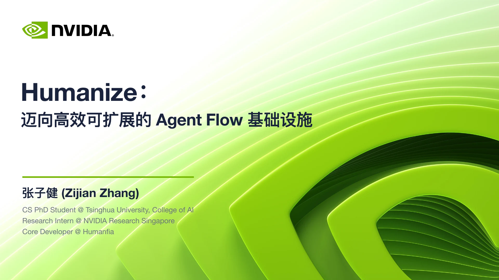

整篇内容我按三个阶段来展开：第一步讲今年年初我们设计第一版 Humanize——也就是把 Humanize 当作一个具体 Flow 时是怎么做的；第二步讲现在的 Humanize 2——也就是作为统一 Flow Runtime 是如何实现的，以及在这个平台上催生出的 Flow 科学；第三步聊一聊我们目前正在探索的、面向更大规模的 Flow 基础设施，以及分享后大家讨论的几个一线工程问题。

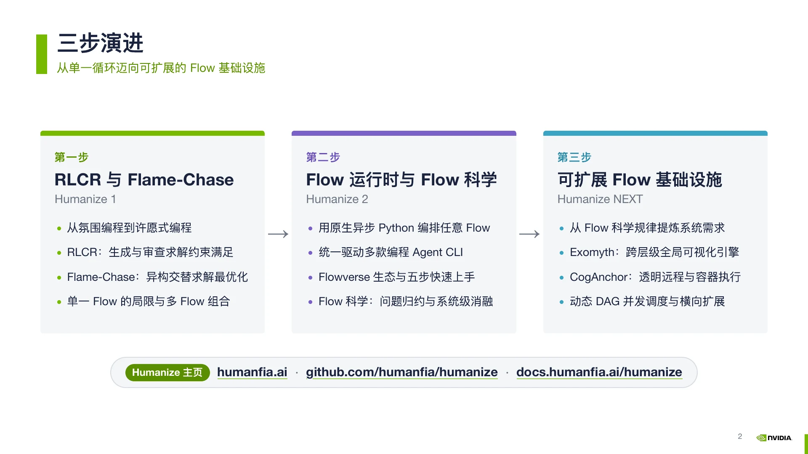

## 从 Session 到 Flow

从年初到现在，大家在深度使用各种编程 Agent 的过程中都会有一个共同的感受：很多时候我们直接敲一个 `/goal`，或者丢给它一句话，它并不一定能把事情做好。哪怕我们现在已经用上了像 Claude Opus 5、Claude Fable 5、GPT-5.6 Sol 这样非常先进的模型，可一旦碰到动辄要跑上好几天的复杂任务，仅仅写一段 prompt，模型很难始终按照我们的想法一直稳步推进下去。

这时候就需要引入 **Flow** 的概念——我们需要一个显式的工作流，去调度一个或多个不同的 Agent 进行合作或者竞争，共同完成足够庞大的任务。

拿年初 Anthropic 公布的那道 [original_performance_takehome](https://github.com/anthropics/original_performance_takehome) 面试题来说，这道题要求面试者在模拟的 VLIW + SIMD 机器上优化一个批量树遍历（tree-walk）CPU 内核，评测标准很直接：算法跑完所花的时钟周期数越少越好。因为 VLIW + SIMD 架构非常少见，模型的训练数据里几乎没有现成套路，这道题专门用来测试 AI 在陌生环境里搭建 harness、持续试错的能力。Anthropic 给出的面试及格线是 **1,487 周期**（Claude Opus 4.5 在自家 harness 里跑了 11.5 小时）。

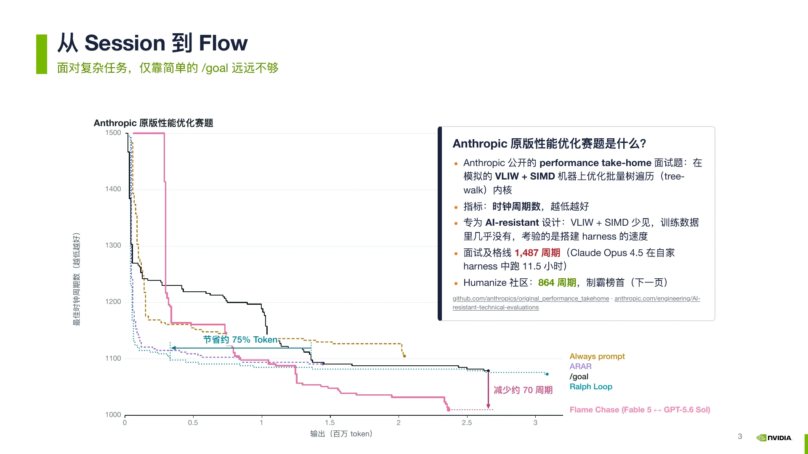

看上面这张曲线对比图：baseline 就是没有任何工作流、直接输入 `/goal` 让它“帮我完成这道题目”。相比直接 `/goal`，只要我们在 Flow 层面稍作优化，比如引入 `Ralph Loop` 或者 `ARAR`，在跑出相同周期数的前提下就能节省将近 **75% 的 token**；如果进一步用上 `Flame-Chase` 这样的工作流，在同样的预算和时间里还能把周期数再往下压约 **70 个周期**。

而且上面那张图还是比较早期的结果。从纯 API 调用的 `DeepSeek-V4-Pro`（2,401 周期）、单工具 `GPT-5.3-Codex`（1,711 周期）、1,487 的面试及格线、简单 `/goal`（1,311 周期），到我们一路迭代的 Humanize 1.0（1,250）、1.5（1,001）、2.0（994）、2.5（979），大约一个月前我们已经跑到了 **864 周期**，比面试及格线快了 **1.72×**。截至 2026 年 11 月 7 日，在 [vliw-challenge.fly.dev](https://vliw-challenge.fly.dev)（Without Indices）榜单并列第一的 9 个席位里，Humanize 社区成员占据了 5 个。这就是为什么我们必须研究 Flow——如果一直死磕单次 `/goal`，周期数永远下不去，还会白白烧掉海量 token。

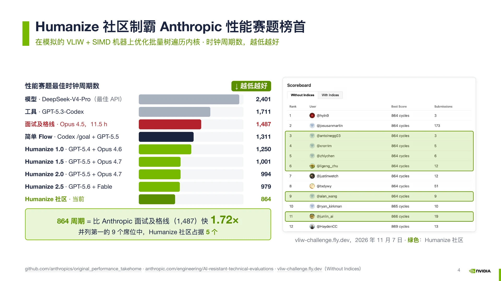

## Humanize 1：双范式演进

最初的 Humanize 1 是刘思皓（Sihao Liu，现在已经是 NVIDIA 的 Research Scientist）做的，相关工作总结在我们的论文 [Humanize: Judgement Engineering for Agentic Coding](https://arxiv.org/abs/2610.08900) 里。严格来说，Humanize 1 当时还算不上一个通用的 Flow 系统，它瞄准的是一个很具体的问题：如何在今年年初模型还比较弱的条件下，实现**许愿式编程（Wishful Coding）**。

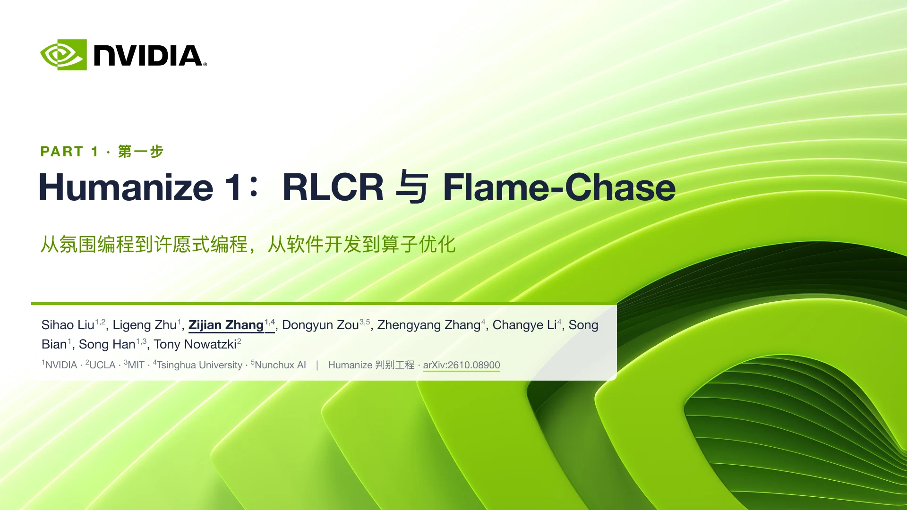

### RLCR 与许愿式编程

“许愿式编程”这个词最近很火。以前大家做 Vibe Coding（氛围编程），流程往往是人类提出一个需求、Agent 去实现、人类自己看有没有问题、不满意再提一轮。而我们年初设计的 **RLCR（Ralph Loop with Codex Review，带 Codex 审查的 Ralph Loop）**，就是想把人工反复验收的环节自动化，让你只需要“许一个愿望”，系统自己循环推进直到把愿望实现：

1. 用户提出一个想法，先由 `gen-idea` 结合代码库拓展出多方向草案；
2. 进入 `gen-plan` 阶段，多个 Agent 进行多轮辩论，打磨出一份相对靠谱的执行计划 `plan.md`；
3. 拿到计划后，交给 Claude 与大量子 Agent 组成的 Swarm，分别实现计划里的不同模块；
4. **最关键的一步**：实现完以后，不能让 Claude 自己判定“我写好了”，必须交给独立的 **Codex** 去验证到底做得好不好。

社区里经常把两款工具混着用的朋友肯定深有体会：虽然 Codex 从零写大段代码的能力远不如 Claude，但它在代码审查、挑刺、找 Bug 这件事上，很多时候比 Claude 强得多。我们当时就是抓住这个特性，专门用 Codex 去查缺陷、把关目标有没有真正完成；只要 Codex 报出 Bug 或者认为还没做完，就打回继续修改，直到彻底通过。

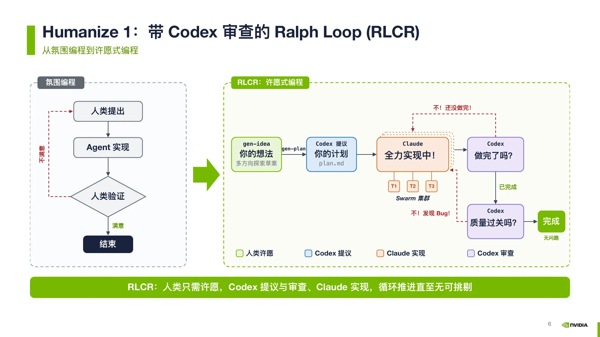

### 单一 Flow 的局限

在 RLCR 这套工作流下，我们已经基本实现了相对顺手的许愿式编程。可后来把这套东西推广到其他类型任务时，我们很快就撞墙了——**天底下没有免费的午餐，RLCR 这一套单一 Flow 解决不了所有问题**。

RLCR 最初就是为“从零搭建一个完整项目”设计的。常规软件项目从数学上看是一个**约束满足问题（CSP）**：我们列出一堆功能需求，要求它把所有功能都做出来，通过全部测试和静态检查（Lint）。至于代码内部写得够不够精炼、跑得有多快，很多时候我们其实没那么计较——哪怕它写出来的是一份带着冗余开销的 “AI Slop”，只要能跑通、符合所有需求，作为一个**可行解**就已经达标了。

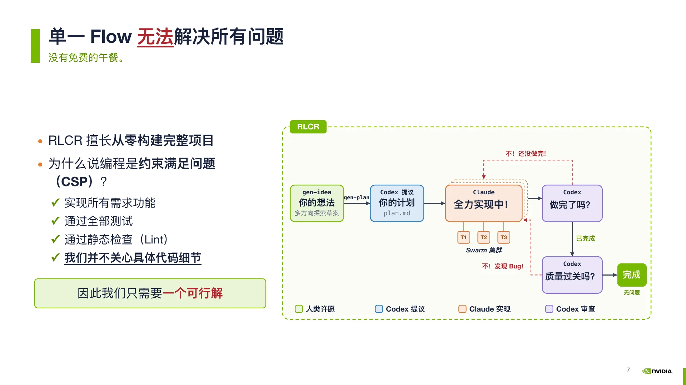

一旦把任务切换到写 CUDA Kernel 或者底层算子，AI Slop 绝对行不通，因为冗余实现会带来惨重的性能开销。而且还有两个根本区别：

第一，算子优化是个**最优化问题**，我们根本不知道它的性能下界在哪里，不可能对 Agent 说“你优化到 1,000 cycles 就收工”，必须不停地往下探底。

第二，检验约束的代价完全不同。写普通业务代码时，有没有隐蔽 Bug 很难用纯机械化的判定器查出来，所以需要 Codex 当 reviewer；可写算子完全不用这样——把算子丢到 GPU 上编译一下、真实跑一遍，结果对不对、跑得多快立刻就出来了。既然真实硬件运行已经天然保证了约束满足，再花大把时间让 Codex 做文本审查就纯属浪费，我们需要果断抛弃 reviewer，把全部精力压在“如何更快逼近更快实现”上。

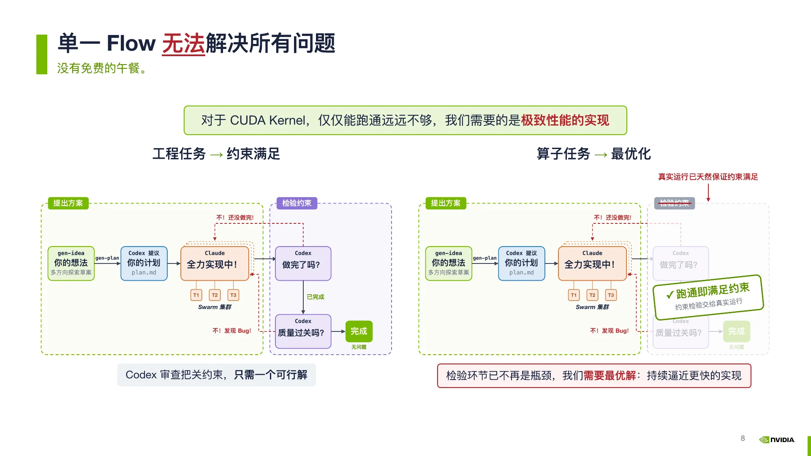

### Flame-Chase 与异构接力

今年大概 4 月份，我针对算子优化提出了另一个工作流——**逐火循环（Flame-Chase）**。这个名字的灵感来自游戏《崩坏：星穹铁道》里的“逐火之旅”：在游戏里，13 位黄金裔完成各自的试炼，依次提交火种。

放到算子优化里，我们把不同性格的模型和 CLI 组合到一起（比如 `Claude Code + Claude Fable 5` 搭档 `Codex + GPT-5.6 Sol`，也可以加入 `Kimi K3` 等其他模型），让他们轮流在同一个共享代码库上优化算子：

- `Claude Code + Claude Fable 5` 偏好大刀阔斧的重构，能跳出原有结构，但也容易把性能改退化；
- `Codex + GPT-5.6 Sol` 擅长精细调优，能一点点扣出周期，但也容易死守在局部最优里出不来。

每当某一轮跑出了更好的实测结果，就把成果提交到任务清单里，始终保留当前最好的版本。我们很快观察到一个很清晰的规律：单个模型的多样性终究是有限的，很容易陷在局部最优里打转；一旦引入不同的模型，它们推理时的输出分布不同、行为分布也不同，整体多样性一拉高，我们就能去赌“跳出当前局部最优”的概率，从而更快跃迁到更优的结果上。

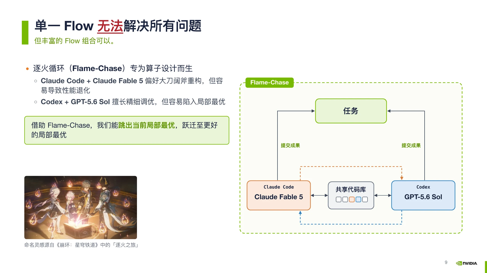

走到这里，我们手里就有了两套截然不同的 Flow：擅长求解约束满足问题的 RLCR，和擅长求解最优化问题的 Flame-Chase。很自然地，我们开始想：既然已经有了两个 Flow，未来肯定还会有第三个、第四个甚至成百上千个 Flow，那我们是不是该做一个统一的底层系统，把各式各样的 Flow 全部承载起来？

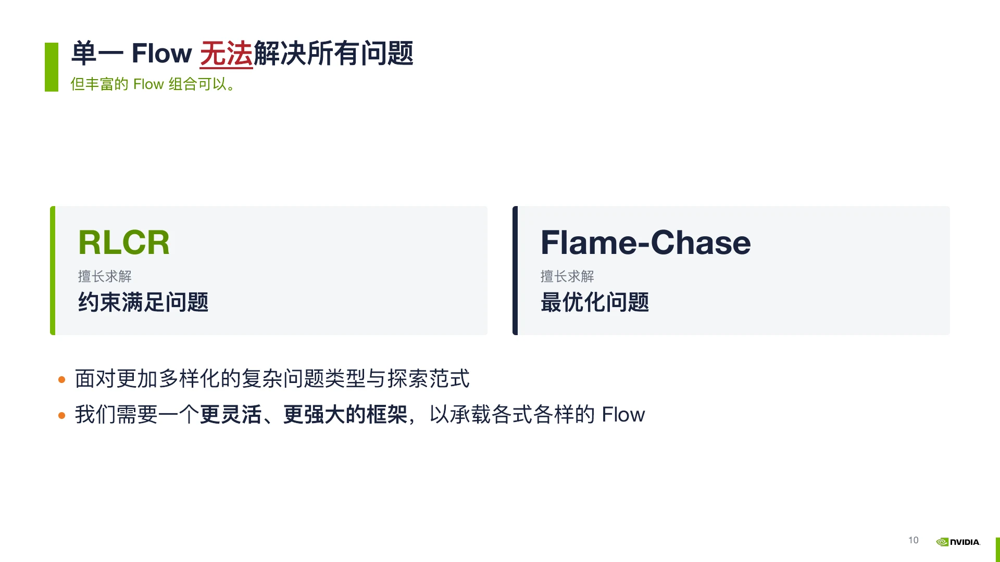

## Humanize 2：统一运行时

今年暑假，我们完成了从“作为单个 Flow 的 Humanize 1”到“作为统一 Flow Runtime 的 Humanize 2”的迁移。Humanize 2 开源在 [github.com/humanfia/humanize](https://github.com/humanfia/humanize)（Apache-2.0），可以运行任意用原生异步 Python 编排出来的 Flow，并配套建设了 `Flowverse` 生态。也正是有了这个顺手的运行时平台，我们随后才能系统开展 Flow 科学的研究。

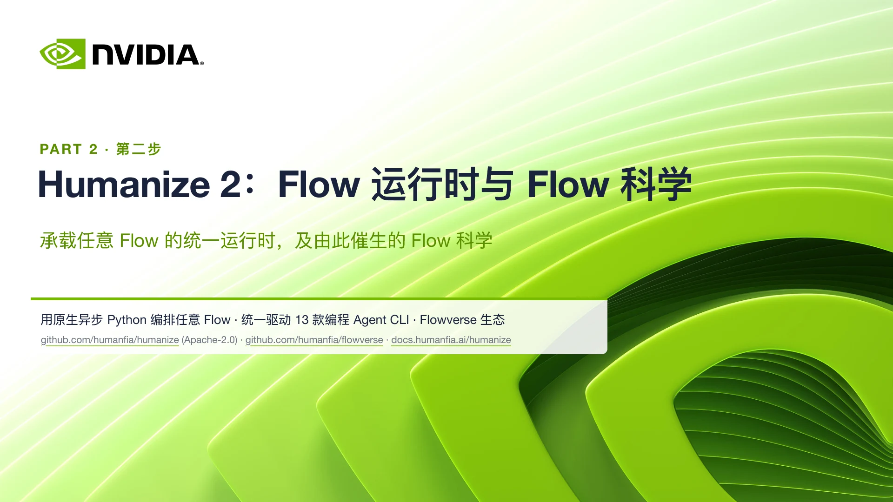

### 三层架构与原生 CLI

Humanize 2 的整体架构很清晰，我们把整个 Agent 运行过程抽象成三层：

1. **模型层**：也就是各个 Token Provider（如 OpenAI 的 GPT-6 Astra、GPT-5.6 Sol，Anthropic 的 Claude Fable 5.1、Claude Opus 5，以及 OpenRouter 下的 Kimi K3、DeepSeek-V4 Pro 等）；
2. **Harness 与 Flow 运行时层**：由 Humanize 负责拉取 `Flowverse` 或本地编写的 Flow，再调度具体节点执行；
3. **环境层**：Agent 实际执行命令、读写文件的物理环境，包括本地机器、远程机器以及容器里的目录和 Git Worktree。

Humanize 负责把这三层连接起来。和市面上很多其他 Harness 有一个很大的区别：许多框架都会直接调底层大模型接口、从头实现自己的工具调用循环；但**我们在 Humanize 2 里刻意不重造底层循环**。我们的想法很朴素——既然每一家模型厂商都在自己的 Harness 上专门训练和打磨过自家模型，直接用他们原生的 Harness 往往是个稳妥的选择，同时还能省下大量精力去研究更大规模、更顶层、更抽象的编排问题。

因此，我们把每一款不同的 Agent CLI（Claude Code、Codex、Grok Build 等）当作一个黑箱运行节点，只从外部去调度和控制这个黑箱；而在环境侧，我们实现了一套把 Agent CLI 映射到不同执行环境的机制（后面讲 CogAnchor 时会展开）。

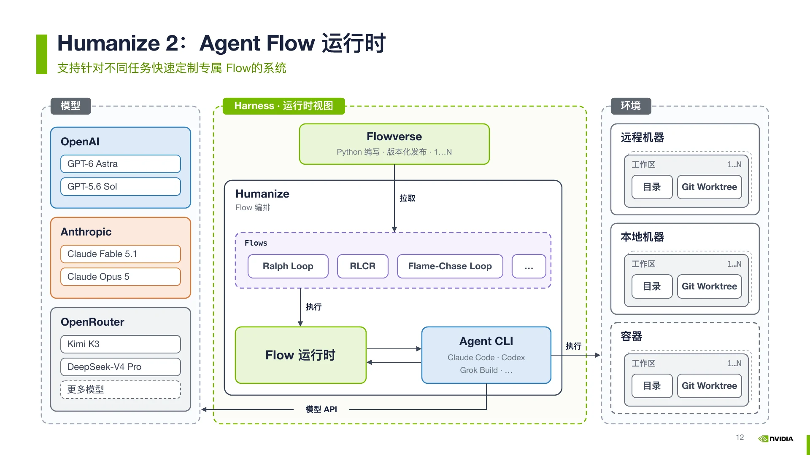

### 内置 Flow 与 Flowverse

有了 Humanize 2 这么一个平台，我们这几个月做各种实验、跑消融变得极快，顺手就积累出了非常丰富的内置 Flow 与社区 Flow（全部索引在 [github.com/humanfia/flowverse](https://github.com/humanfia/flowverse)）：

| 类别 | 代表 Flow | 核心机制 |
| --- | --- | --- |
| 内置基础 Flow | `ralph_loop`、`stateful_ralph`、`continue_loop`、`goal`、`flame_chase`、`rlar` | 涵盖经典的每轮重置会话、带状态保留会话、持续 continue、异构接力与独立审查 |
| Humanize 1 三阶段 | `humanize1:gen-idea`、`humanize1:gen-plan`、`humanize1:rlcr` | 按 Humanize 2 新格式完整重写的草案拓展、计划辩论与审查把关开发流程 |
| Flame-Chase 变体 | `agent_cleanup_ralph_loop`、`agent_cleanup_flame_chase`、`fixed_interrupt`、`parallel_git_pr`、`parallel` | 探索定期压缩清理工作区状态、固定轮数/时长打断、三路并行与 Git PR 门控合入 |
| 元 Flow 与数学证明 | `aot`、`recursive_lean_prover` | 元 Flow（用 Flow 去写、冒烟测试并审查新的 Flow）；递归规划与证明 Lean 定理 |

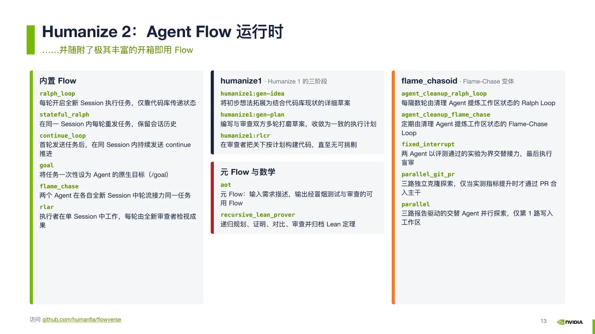

### 五步快速上手

我们能这么快长出这么多 Flow，很大程度上是因为 Humanize 2 的使用门槛非常低。整体上手分成五个阶段：安装、首次运行、无人值守、复用社区 Flow，以及编写自己的 Flow。

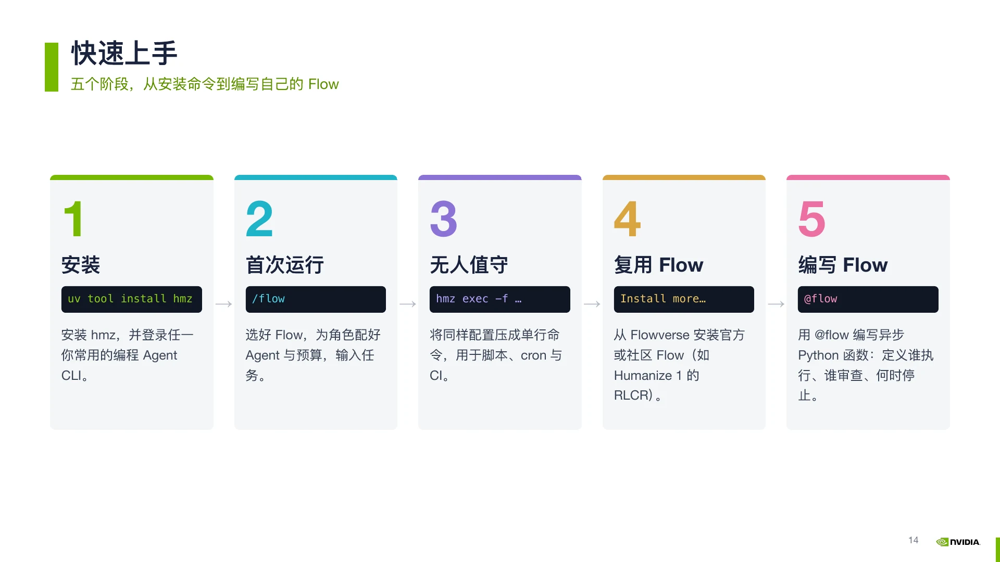

**第一步是安装。** 我们已经把 `hmz` 发布到了 PyPI，一条 `uv tool install hmz` 就能装好命令行（仓库里也有桌面端应用可以直接下载）。Humanize 2 有一个特别省心的特点：**它原生复用你本机各个编程 Agent CLI 自己的登录态，不保存 API Key，也不像不少其他 Harness 那样去劫持别的工具的登录**。这样一来，就不会出现因为违规代理登录而被厂商判定违规、惨遭封号的问题。目前我们已经支持驱动 **13 款** 编程 Agent CLI：`claude`、`codex`、`cursor-agent`、`agy`、`grok`、`kimi`、`qwen`、`opencode`、`dsh`、`mimo`、`mcode`、`pi` 和 `omp`。

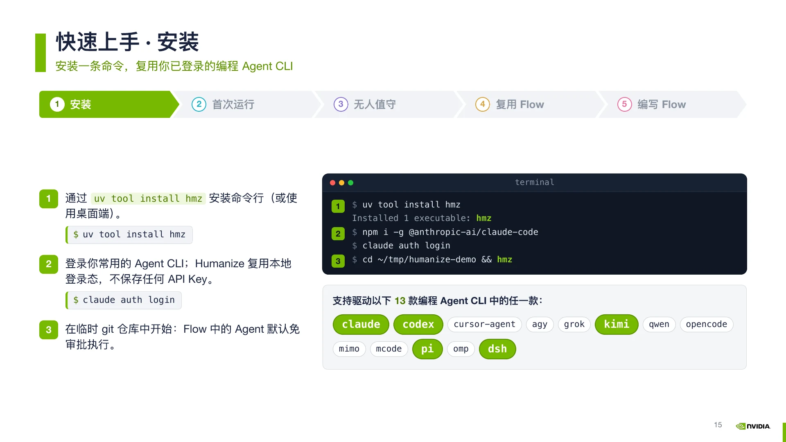

**第二步是首次运行。** 我们既提供了 CLI 界面，也在仓库里做了 GUI 界面（Humanize Desktop），两边操作逻辑非常一致。在项目目录里执行 `hmz`，输入 `/flow` 选一个工作流（比如 `ralph_loop`），然后给里面的每一个角色配好具体用哪个 Harness、哪个模型、什么推理档位（例如 `claude/claude-opus-5:high`），再顺手设一个预算（如 `20m, $0.50`）防止单个任务烧超。保存配置，输入任务回车，它就会自己吭哧吭哧一直跑下去，把任务解决好；想停的时候连按两次 `ctrl+c`，再用 `git diff start` 查看改动即可。

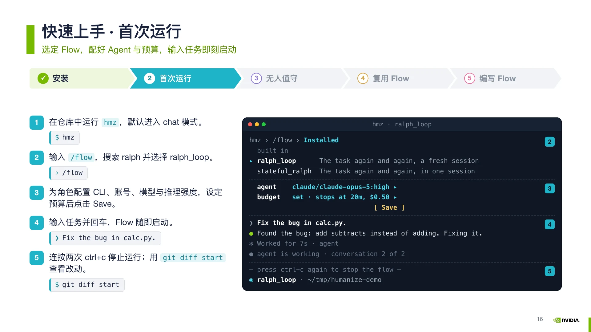

**第三步是无人值守模式。** 大家都知道，现在哪还有人愿意一台台登录远程服务器自己敲交互命令？引入 `hmz exec` 无人值守模式，一方面方便接入脚本、cron 和 CI 每日构建，另一方面大家完全可以在自己本机开一个 Claude 之类的 Agent，让它自己连上远程服务器去批量跑各种 Flow：

```bash
hmz exec -f ralph_loop \
  -a agent=claude/claude-opus-5:high \
  -p budget.duration=2h,budget.cost=10 \
  "$(cat TASK.md)"
```

在 CI 流水线里也是同样四步：安装 `hmz` 和对应 Agent CLI → 从 Secret 注入凭据 → 运行上面这条 `hmz exec` 命令 → 推送分支并自动提 Pull Request。

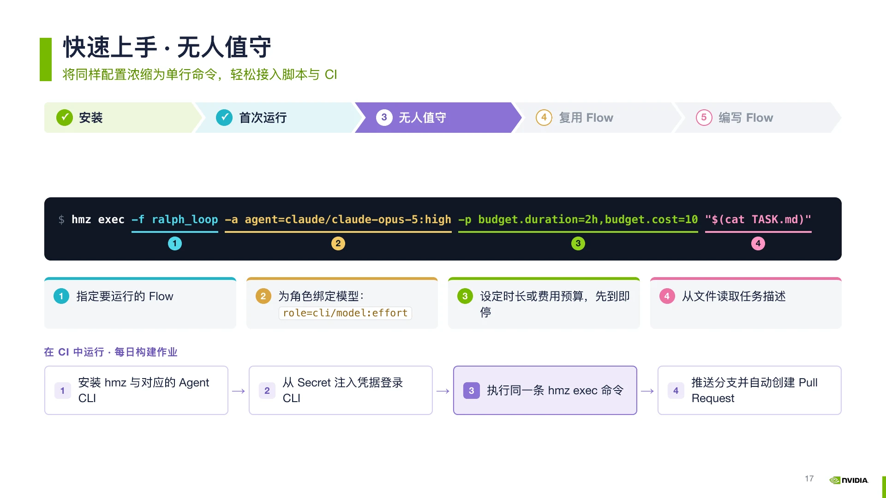

**第四步是复用 Flow。** 前面提到的那些官方和社区工作流我们都放到了 `Flowverse` 上，在 `hmz` 里选 `/flow → Install more…` 就能装下来直接跑，也可以不提前安装，直接按 git ref 指定版本拉起（比如 `git+https://github.com/humanfia/humanize1-flow@v0.2.0#humanize1:gen-idea`）。我们以前的 Humanize 1 也已经按新格式重写成了 `gen-idea`、`gen-plan`、`rlcr` 三个阶段，阶段之间直接通过工作区里的文件传递草案和计划。

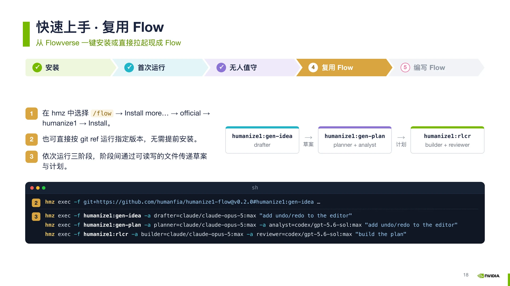

### 从 118 个文件到 7 个文件

写一个 Flow 到底有多简单？看下面这组前后对比最直观。以前没有 Humanize 2 的时候，为了在 `PolyArch/Humanize` 里实现一套 Humanize 1，我们整整写了 **118 个文件**——包括 14 个 hook、22 个脚本、4 个 agents 配置、5 个命令、6 个 skills、2 个配置文件和 64 个 prompt 模板文件。单是 `setup-rlcr-loop.sh` 就写了 1,541 行，`loop-codex-stop-hook.sh` 写了 2,221 行，到处是 bash、jq、JSON、正则解析、环境变量和进程信号拼出来的跨进程胶水代码。

换成 Humanize 2 之后，完全相同的一套 `humanfia/humanize1-flow` 只需要 **7 个文件**：1 个 Flow 代码文件加 6 个 prompt 文件。原来费劲巴拉写进 shell hook 里的拦截逻辑，现在直接调 Python API 里的 hook（比如 `builder.on_permission_request(guard)`）一行就搞定了，代码即工作流，所见即所得。

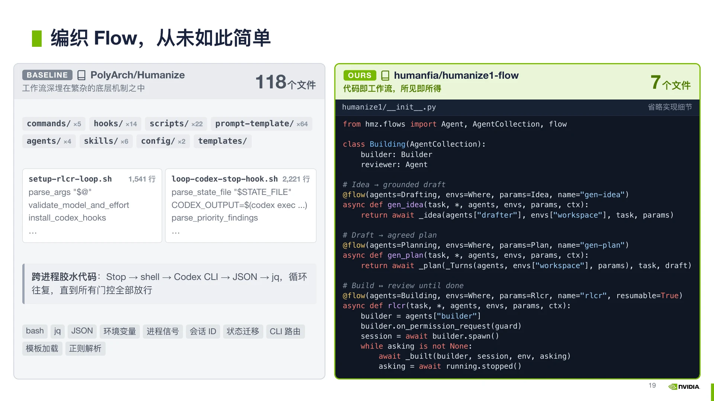

**第五步就是写自己的 Flow。** 看这个叫 `twice` 的小例子：在 `.hmz/flows/twice/__init__.py` 里声明好 `AgentCollection` 和 `EnvCollection`，写一个挂上 `@flow` 装饰器的异步 Python 函数——拿到 `builder` 和 `workspace`，调 `await builder.spawn()` 开启会话，先 `await builder.run(task, ...)` 做实现，再 `await builder.run("Now review what you just did...", ...)` 让它自己做一遍审查和修复。十几行代码就搭好了一个先实现再审查的工作流，比以前在 Claude 里折腾一堆 hook 或 skill 痛快得多。

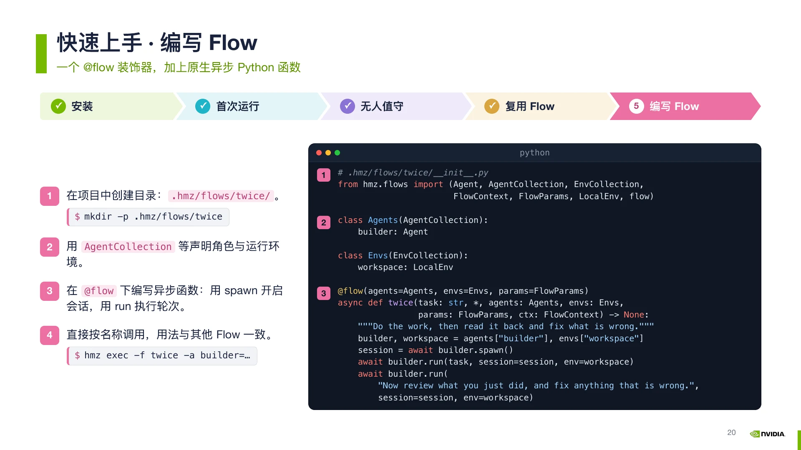

### 四大领域实绩

当把写一个 Flow 的成本打下来之后，我们就能专心致志去“拿大结果”了。今年 6 月到 10 月，我们大约 10 人的小团队在四个月里基于 Humanize 2 在四个领域拿到了相当亮眼的成绩：

1. **数学与形式化证明**：`Lean-Eval` 刷到第一（266/304），`PutnamBench` 刷满 100%，IMO 2026 满分（6/6），首次形式化四维挂谷猜想（4D Kakeya）等 8 道 OpenAI 难题，还完成了几何化猜想 Hamilton–Perelman 证明的形式化；
2. **科学奥赛与学科推理**：奥赛这一块基本就是平推满分——IOI 2026 满分（6/6）、IPhO 2026 全解（23/23）、IChO 2026 全形式化（68/68）、IBO 2024 满分，量子算法与量子信息论两项基准双双 100%，Physics Cup 80%，HLE 63%，SuperChem 62.4%；
3. **算子与系统性能优化**：CUDA 算子方向迁移到 Humanize 2 之后，在 MLSys FlashInfer 全赛道超越人类 SOTA，SOLExecBench L1 登顶并产出 71 个榜首算子，MSA Prefill 最高加速 14×、VAE 解码 2.7×，还优化了 40 多个 SGLang 算子、顺手修掉了 cuDNN 里的隐蔽 Bug；
4. **机器学习工程**：在偏科研的 `MLE-bench` 上取得 78.2% 夺牌率（五种对比方案第一）和 53.8% 金牌率，90.7% 任务超过人类中位数，6 种模型组合相比单 Agent 平均高出 6.4 个百分点，前身在 39 场 Kaggle 实赛里 3 次冲进最终榜前 5%。

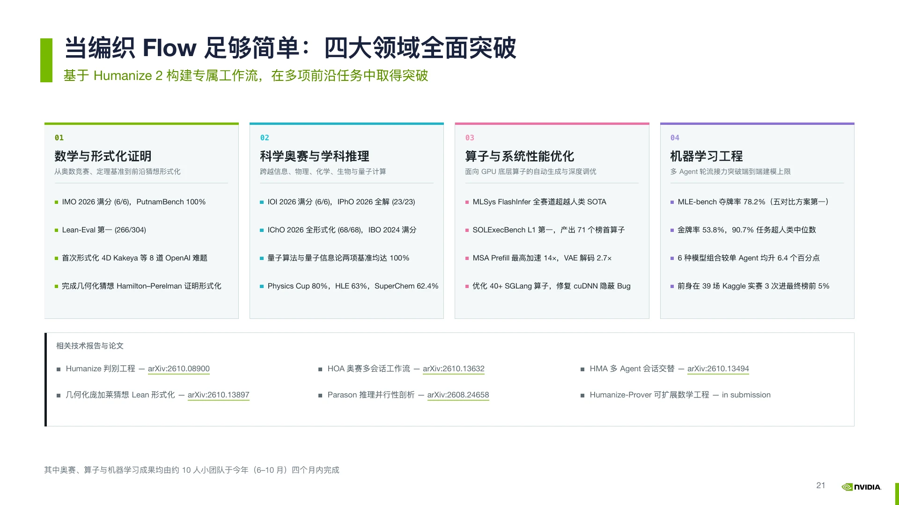

## Flow 科学

前面展示了这么多工作流，大家肯定会冒出一个很自然的疑问：这些 Flow 到底是不是 case by case 的脏活累活？难道每换一个任务就得从头手工写一套，还是里面藏着可以抽象出来的共性？说白了，**Flow 到底只是一种工程技巧，还是一门科学？**

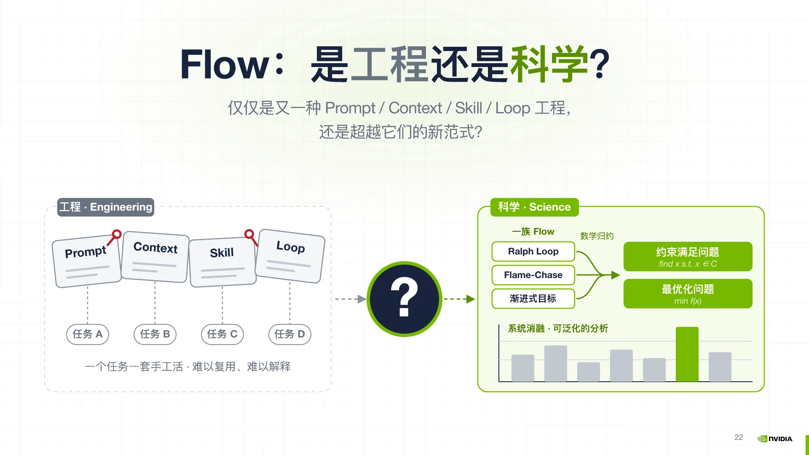

既然把这个问题摆上台面，我们的结论也很明确：**Flow 既是工程，更是一门科学（Flow Science）**。很多时候我们可以把具体任务归约到共通的数学模型上——例如软件工程归约为约束满足问题 `find x s.t. x ∈ C`，算子优化归约为最优化问题 `min f(x)`——于是像 Ralph Loop、Flame-Chase、渐进式目标这样的一族 Flow 就能跨任务泛化，让我们得以开展系统的消融实验和理论分析。

我觉得 **Flow 科学的本质其实就是 Agent 的管理学（The art of agents' management）**。你可以把每一个前沿 Agent 想象成一位非常聪明的人才，而 Harness 就是他的办公桌。在人类社会里，光靠一个人和一张办公桌肯定干不成大事，我们必须组建一家公司、设计好组织架构与协作机制，才能把事情做好做大。Flow 研究的正是同一件事：同样数量的 token，随手用和用一套好 Flow 去管理，最后的产出完全是两个世界。拿 `Flame-Chase` 来说，我们可以沿着**参与模型、模型顺序、调用比例、并行模式、协作模式、任务追踪**这六个维度系统做消融。

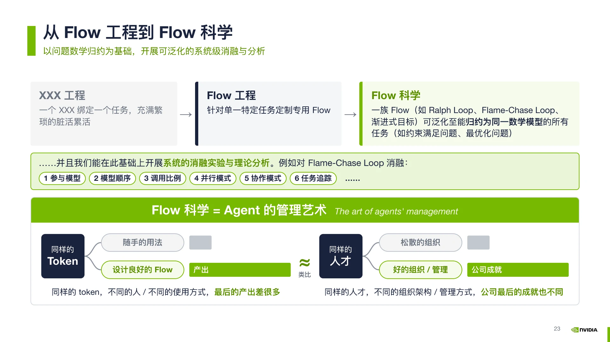

下面分享我们在大量消融实验里提炼出的五个核心发现。

### 不同问题匹配不同 Flow

这一点从头到尾反复被实验证实——天底下没有免费的午餐。我们在 `MLE-Bench`、`HLE`、`ProgramBench` 和 Anthropic 性能优化赛题四个基准上做了横向拉通测试：软件工程实现问题适合在审查者把关下逐步打磨的 RLCR，最优化问题适合异构交替的 `Flame-Chase` 及其变体；至于未来更多的抽象问题类型——判定问题、预测问题、博弈问题——每一类都需要匹配它自己的 Flow。

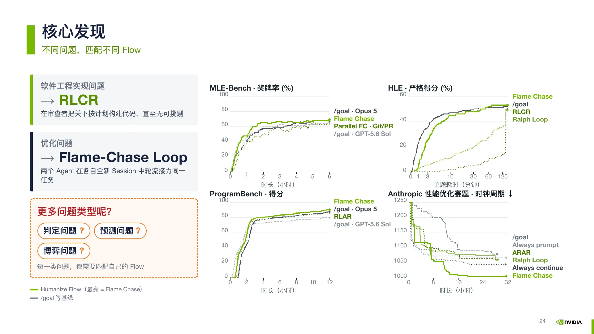

### 多样性带来更高得分

这是 `Flame-Chase` 最核心的论断。其实 `Flame-Chase` 最简形式简单到不可思议：把 `Ralph Loop` 里每轮都跑同一个模型，改成每轮换不同的模型和 Harness（只交接代码库）。就这么一个极小的改动，在 Anthropic 性能优化赛题上立刻带来巨大跃升：

- 单模型的 `Ralph · GPT-5.6 Sol` 和 `Ralph · Fable 5` 分别停在约 **1,040–1,060 周期**；
- `Flame-Chase` 一举降到约 **1,000 周期**，而且输出 token 更少（约 **2.7M vs 3.4–4.1M**），耗时更短（约 **24 小时 vs 28–29 小时**）。

本质原因在于不同模型的失误模式和探索习惯各不相同：混合交替让多样性拉高，单一模型的认知盲区就不会一路累积下去。

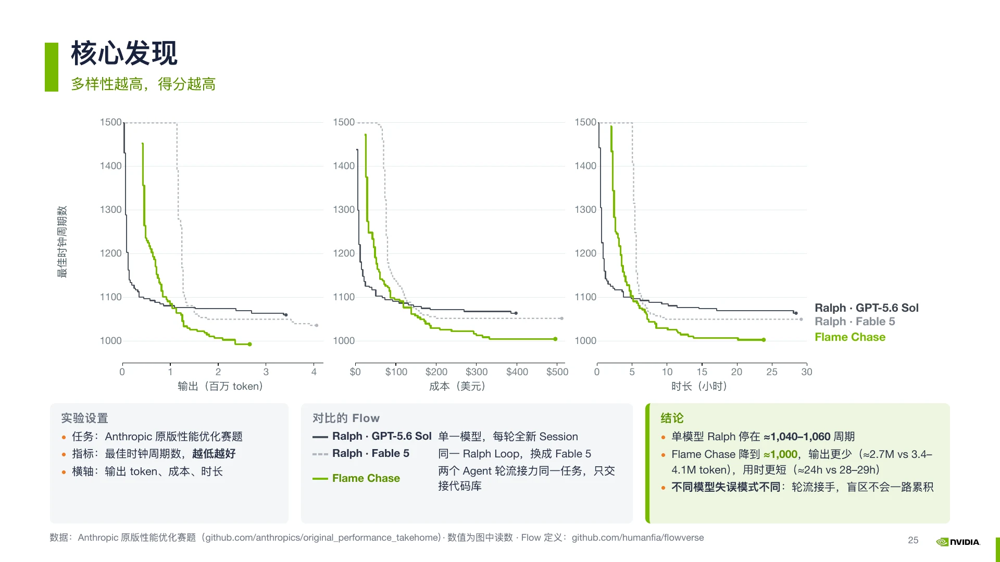

### 高效协作优于朴素并行

我们在 12 小时窗口内对比了三种不同协作模式的 `Flame-Chase`：

1. **传统单路 Flame-Chase**：两个 Agent 轮流接力，平均最佳约 **1,012 周期**；
2. **并行 Flame-Chase**：让多路一起跑，靠文本报告互通，仅第 1 路写入工作区（或者做完后粗暴合并选优）。结果出人意料——多消耗了 **3 倍以上** 的输出 token（约 **4.9M vs 1.5M**），成绩只勉强走到约 **1,005 周期**，相比单路并没有多大提升；
3. **Parallel FC · Git/PR Lite**：我们只改了一个小机制——三路各自在独立克隆里探索，**不直接粗暴覆盖工作区，而是只有实测指标真正提升时，才以 Git PR 的形式提上来合入主干**，让后续的 Agent 能够查阅这些 PR。仅仅这么一个改动，12 小时内平均最佳直接下探到约 **985 周期**。

光堆并行路数是不够的，只有用实测指标把关合入，多路探索的收益才能真正叠加。

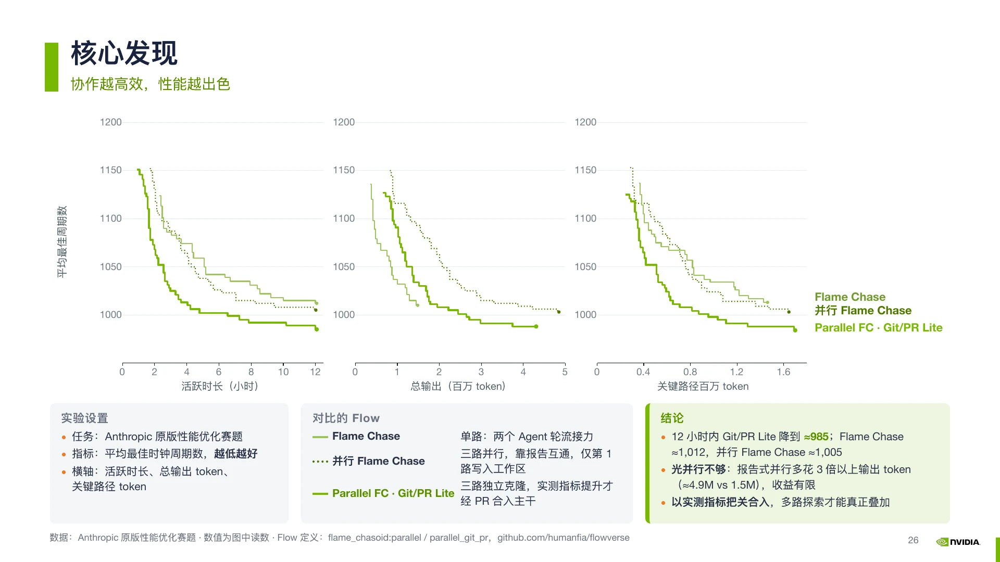

### 渐进式目标防止跑偏

这是我们在 `Ralph Loop` 上做的一个很有意思的对比。一种方式是给一个**固定目标**——从头到尾一直告诉它“冲到 1,000 周期”；另一种是**渐进式目标**——当前 1,500 周期时让它先刷到 1,300，到了 1,300 再让它刷到 1,200，到了 1,200 再刷到 1,100，依此类推。

为什么渐进式目标效果好得多？我们观察发现，设固定大目标时，Agent 很容易把那些**方向正确、但单步提升不够显著的改动自己否定掉**——它试出一个方案能降 100 周期，觉得离 1,000 还差得远，于是干脆放弃了。可参数优化里的梯度下降本来就是要一步一步慢慢往下走，不可能一口气直接跳到终点。实验结果非常清楚：固定目标停在约 **1,060 周期**（耗费约 **3.45M token**、**$400**、**28.7 小时**），渐进式目标不仅降到了约 **1,000 周期**，还更省钱更省时（输出约 **2.3M token**、成本约 **$325**、时长约 **24 小时**）。

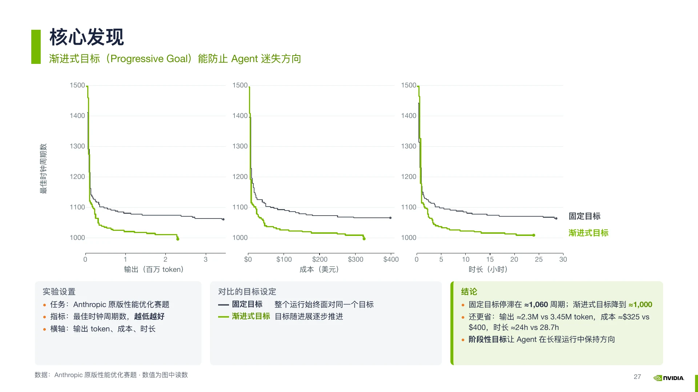

### 长程会话的思考预算缩水

这是我们最重磅的一个发现（详见论文 [Humanize MLE Agents: Multi-Agent Session Alternation Beyond Single-Agent Limits](https://arxiv.org/abs/2610.13494)）：为什么直接用一个 `/goal` 效果会那么差？其实不止 `/goal`，只要单个会话拉得太长，各种 Flow 都会出现**“逐步变笨”**的趋势——当任务执行到小时级别以后，Agent 每一轮的思考输出长度会变得越来越短。

我们在 6 款模型（GPT-5.6-sol、Claude Opus 5、DeepSeek V4 Flash、Kimi K3、GLM-5.3、DeepSeek V4.1 Flash）上测量了 30 分钟滑动窗口内的单次回复平均输出 token，发现在 0–2 小时到 3–5 小时之间，普遍缩水了 **29.8% 到 45.0%**。再看右侧 Claude Fable 5 的长程实验，把上面的“单次回复输出 token”和下面的“最佳时钟周期数”一一对应起来就能发现：**一旦单次回复缩到 100 token 左右，下方的性能曲线立刻彻底持平，往后再跑多少小时几乎都不会有任何提升了**。

相比单会话 `/goal` 仅保留 **60.7%** 的单次回复 token，重置上下文的 HMA 策略保留了 **86.4%**，而 `Flame-Chase` 靠不断注入多样性和随机性，也大幅延缓了思考预算的衰减。所以我们的经验原则非常干脆：**别死拉一个会话——果断结束它，把代码成果留在工作区里，重新开启新会话继续跑。**

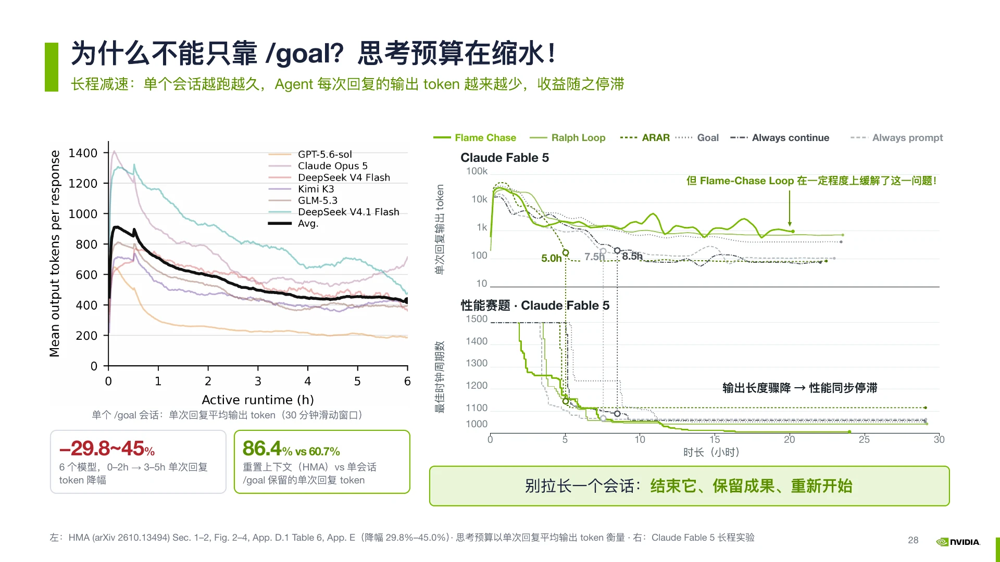

## Humanize NEXT：可扩展基础设施

讲完 Flow 科学，最后聊聊 Humanize 接下来往哪走。现在大家用最新一代前沿模型，很多时候直接就能做许愿式编程了——原因很简单，新一代模型已经把我们年初摸索出来的各种单机 Flow 技巧蒸馏进自己的模型能力里了。将来很多单机任务，也许真的一个 prompt 就能解决。

那 Humanize 还有没有存在的必要？当然有，而且空间大得多：**我们要做可扩展的大规模 Flow 基础设施**。现在大家一提 AI Infra，满口都是 Serving Infra，都在研究怎么更快地推理一个模型；却几乎没什么人在想怎么高效地 host 一个超大规模的 Agent Flow。OpenAI 做 Navier–Stokes 方程用了 10,000 个 Agent，Anthropic 做费马大定理形式化用了 1,000 个 Agent。借鉴这些前沿实践，我们正在推进 **Humanize NEXT**，从双 Agent 轮流接力走向大规模动态 DAG 协同并发。

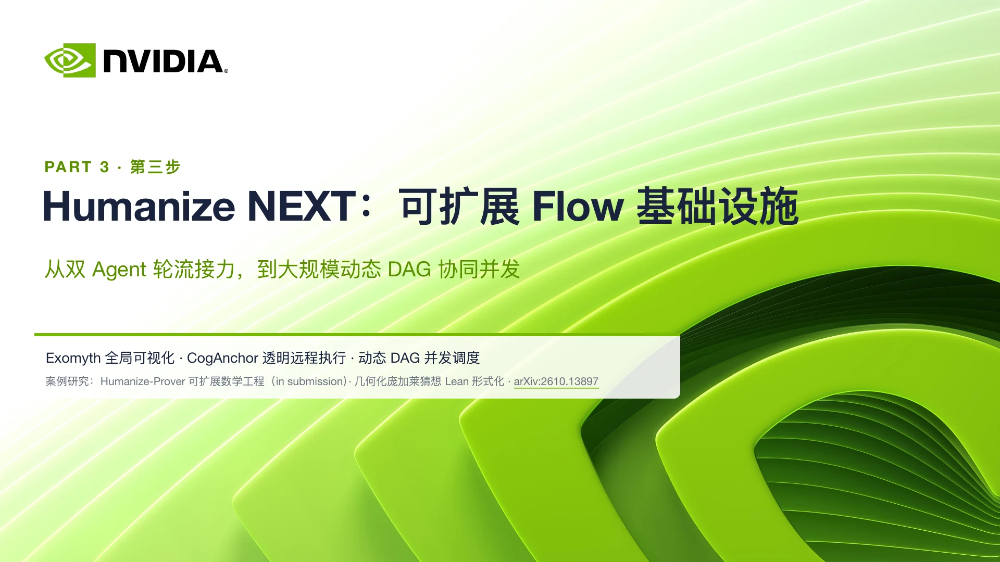

### 四大系统级需求

前面总结的每一条 Flow 科学规律，都直接变成了对底层基础设施的硬需求：

- **重置上下文优于超长单次会话** → Session 必须足够轻量、用完即弃，状态全部沉淀在代码工作区里。Humanize 现已支持 `spawn / run`、Git `worktree` 与 `reflink`，以及基于 `git ref` 的快照与回滚机制，方便在大规模并行探索失败时随时回退；
- **模型多样性带来显著收益** → 需要统一接口屏蔽异构模型池，并支持故障自动回退。我们已接入多款 CLI 和 `LiteLLM`，支持跨 CLI、跨账号、跨模型的回退链；
- **AND / OR 双重并行行之有效** → 需要支持投机执行、暂停与取消的动态 DAG 调度器。我们用 `asyncio` 调用树（`gather`、`TaskGroup`）、嵌套预算和上层 DAG 控制器搭起了这套调度能力；
- **验证环节成为系统瓶颈** → 运行环境和检查器的吞吐必须随 Agent 并发规模同步横向扩展。目前我们支持本地、SSH、Docker、Swarm、Slurm，并能按角色限制 CPU、GPU 和内存配额。

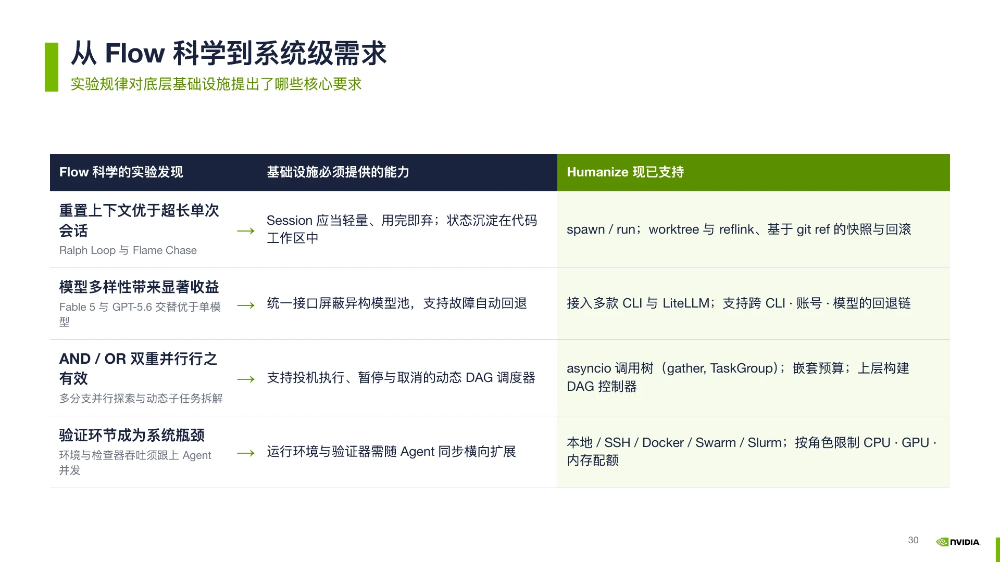

### Exomyth 全局可视化

这里重点介绍我们最核心的两项底层技术。第一项叫 **Exomyth（神话之外）**。后来 DeepSeek Harness 里也出现过一个跟它很像的东西，不过我们这套工具做得比他们早非常多。

思路其实非常直接：Agent 的执行过程本身不就是一个程序吗？只要是程序，就能做 **profiling**。我们把整条执行链路放在同一根时间轴上（`EPIC → SESSION → LANE → SPAN`）：顶层 Flow 调用是一个函数，里面的子 Flow 和每一轮次也是函数；下钻到每个 Agent（构建者 Claude Code、审查者 Codex），思考是一个函数，工具调用（`Bash`、`Edit`）是一个函数；而工具调用内部拉起的真实系统子进程——比如 `pytest -q` 跑了多久、`bench.py` 跑了多久、程序内部又执行了什么——全都一清二楚地呈现在同一张终端时间轴与火焰图里，支持缩放、平移和按名搜索，可以流畅渲染 **50,000 个 span**。分析超大规模 Flow 时，一眼就能看出它卡在哪个环节、哪些环境在白白空转。

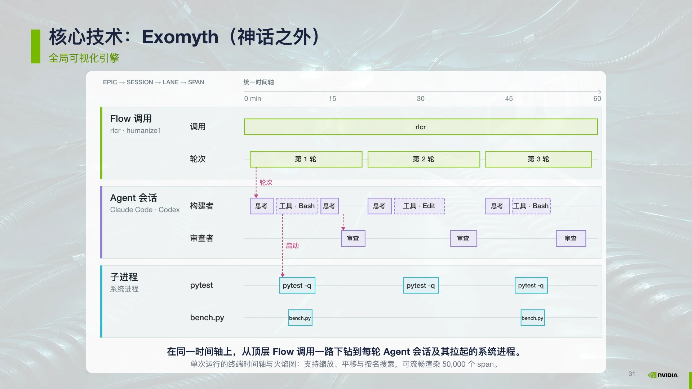

### CogAnchor 透明远程执行

第二项核心技术叫 **CogAnchor（识刻锚）**，也就是前面架构图里埋下伏笔的环境抽象机制。它会通过 `CogAnchor Hook` 把 Agent CLI 的所有行为和观测全部接管下来，再转发给远程机器或容器上的 `CogAnchor Worker` 去执行，最后把反馈原样回传给 Agent CLI，从而实现 Harness 跑在一台机器上、执行环境跑在另一台机器上。

这种解耦有两个非常实用的好处：

第一，很多时候我们的目标执行环境是内网机器，或者 FPGA 这类根本不方便直接装 Harness 的机器。通过 CogAnchor 把行为映射过去，就能让 Agent 以为自己正坐在目标机器上直接调试。

第二，**我们可以让同一个 Session 在不同的环境之间“飞”起来**。举个很具体的例子：Agent 想构建并测试一个 FPGA 工程，它可以先在多核大机器上把工程编译构建好，然后把会话无缝挪到 FPGA 小机器上跑实测，跑完拿到反馈再挪回大机器继续分析修改。

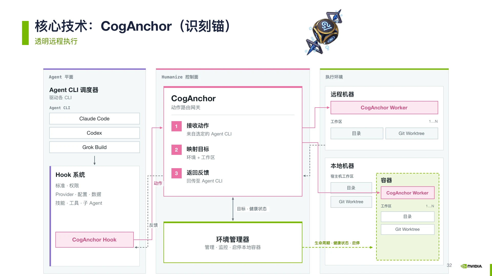

### Humanize-Prover 案例研究

把上述基础设施串起来，我们做出了第一个超大规模并发案例研究——**Humanize-Prover**。这是一个用于形式化数学证明的大型 Flow，目前已经能驱动数百个 Session 同时运行去攻克一道前沿大定理，核心由四个模块协同：

- **(A) 引理 AND 拆解**：把主定理递归拆成子引理树，所有必需分支并发推进；
- **(B) 多路 OR 投机**：对同一引理同时并行启动“继续拆解”和“由 GPT-6.1-Sol、Fable 5.1 等模型直接证明”多路竞速，谁先通过内核验证谁胜出，其余分支立刻取消；同时父定理还可以先假设子引理已成立提前起草；
- **(C) 实时引理检索引擎**：索引超过 350 万条既有引理与新证成果，支持从 4.9 ms（`instant`）到 4.3 s（`best`）五档检索，任何刚证出的引理立即可被全局搜索复用；
- **(D) Lean 核心与基建优化**：包括子树/链式合并与 Master–Worker 队列调度、编译模块缓存与已验证常量账本，以及 Lean 与 Nanoda 的单次环境装载并发内核重放。

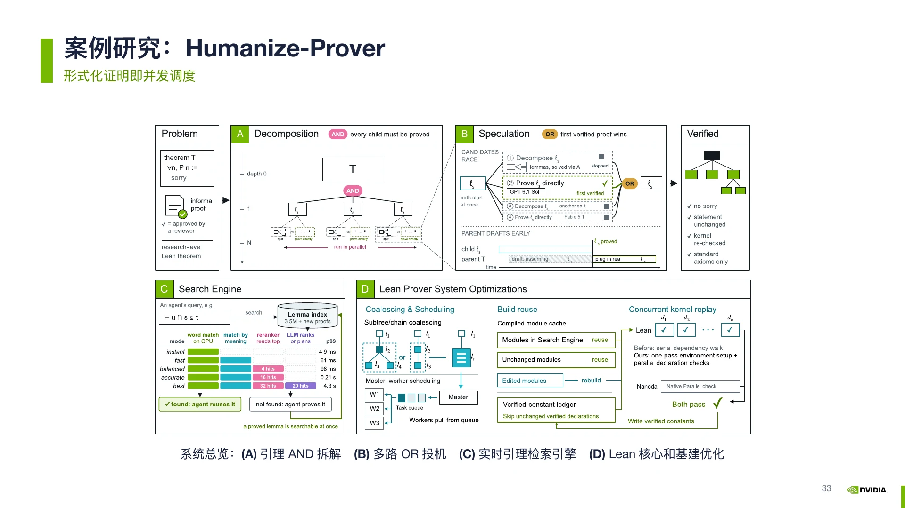

在这套系统上，我们完成了**四维挂谷猜想（OpenAI 问题 074）的首次 Lean 形式化**：

- 峰值并发 **141 个 Agent**，墙钟时间仅 **40.6 小时**；
- 共拆解处理 **296 个引理**（其中 **241 个通过**），生成 **138 万行 Lean 证明**；
- 把所有生成的 token 反推回来（按每行含探索约 1,000 token 折算，总计约 **13.8 亿 token**）：按照人类专家每分钟 200 token 不停歇书写，需要大约 **13 年**；按照单个 Opus 5.5 Agent 每秒 100 token 不停歇生成，也要花大约 **160 天**。Humanize-Prover 比单个 Agent 快了大约 **94 倍**。

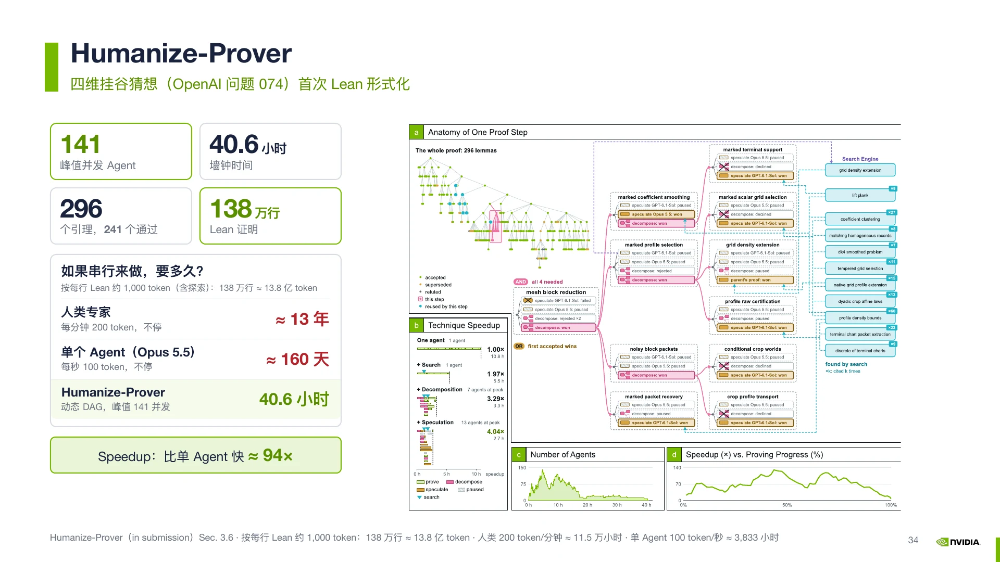

### 演进路线

回到当下，`hmz` 已经具备异步调用树、只追加日志与断点续跑，支持 `local`、`SSH`、`Docker`、`Swarm`、`Slurm` 和 `Apple container`，可按角色限制 CPU/GPU/内存配额并自动回收残留容器；安全层面内置了基于 `Landlock + seccomp / Seatbelt` 的 `Fence` 沙箱与统一网络代理；远程执行通过 `CogAnchor` 支持系统调用按需镜像、NAT 打洞和 `EasyTier` 组网。借助上层 DAG 控制器，当前单机运行时已实测支撑高达 **194 个并发 Session**。

往后看，我们的核心目标就是怎么做到更大、更稳——做出 Flow 层面的 Scaling Law：把动态 DAG 和投机执行沉淀为原生一等原语，实现配额感知的跨机、甚至跨数据中心全局调度；在运行环境侧像云原生服务一样做热环境池复用和跨运行缓存；并构建多机分布式日志与跨集群控制平面，真正迈向百万级 Agent 基础设施。

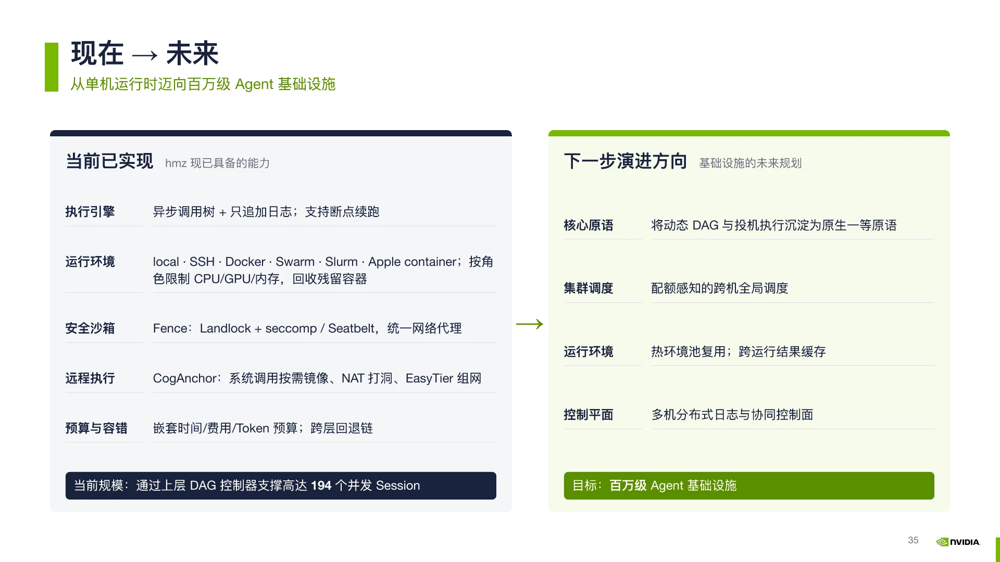

### 共建生态与愿景

现在我们也非常欢迎社区里的大家一起来共建 Humanize 生态。当下最值得投入的有三个方向：

1. **UI/UX 与移动端体验**：大家肯定都希望在健身房里掏出手机，就能一眼看到自己跑的实验和程序写得怎么样了，所以我们急需把交互可视化和轻量移动端监控操控体验打磨好；
2. **跨网络客户端–服务端互联**：集成 Tailscale、EasyTier 等主流异地组网工具，随时随地安全连上远端 Agent 运行时，同时也是为未来大规模集群做准备；
3. **探索更多特定负载的 Flow**：现在像前沿模型已经具备很强的 3D 建模、做视频、做动漫的多模态能力，以及大规模软件跨语言移植等长程工程场景，这些方向的专属 Flow 我们都还没来得及做完。

非常欢迎大家来 [github.com/humanfia/humanize](https://github.com/humanfia/humanize) 给咱们开 PR，或者提个 Issue 也可以——其实今天提 Issue 和开 PR 差不多，反正提了 Issue 我这边调 Agent 也可以做！如果你写了有意思的自研 Flow，也可以托管在自己的仓库里，再提 PR 收录进 [github.com/humanfia/flowverse](https://github.com/humanfia/flowverse)；当然也可以直接从 MFCP 任务广场里认领拆解好的实践任务入手。

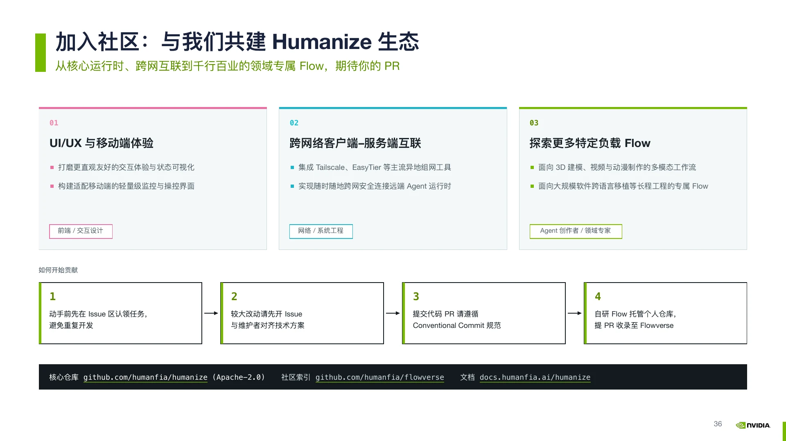

最后分享一下我们的宏大愿景：希望在 5 到 10 年之后，我们能在一个统一的 Flow 框架里，运行 **100T 参数模型**、达到 **1K TPS 吞吐**、调度 **100 万个并发 Agent** 在 **100 万个运行环境与容器** 上持续运行 **100 万分钟**，以这样的规模合力攻克一个人类终极难题——比如可控核聚变，或者攻克癌症。Ad Astra，让我们一起 Scale，奔赴星辰！

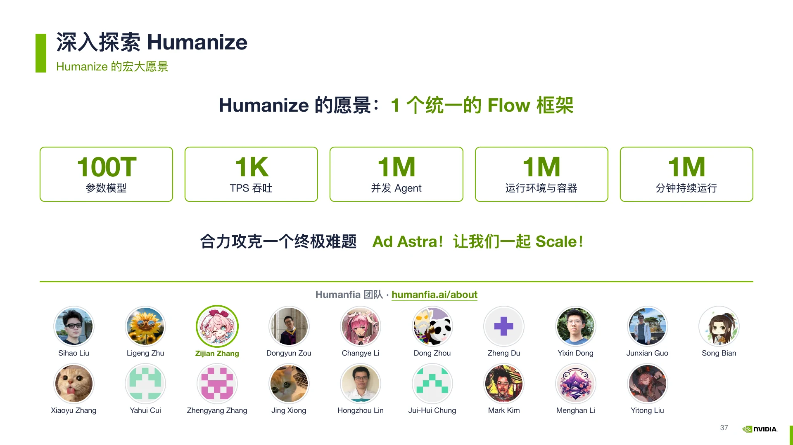

## 现场问答

分享结束后，主持人刘超（泽文）和线上的刘恺老师围绕科研工作流、操作系统研发、现有工具迁移以及长程任务防跑偏提出了几个非常切中要害的问题，这里一并整理保留下来：

### Auto-Research 工作流

**背景（刘超）**：用 Humanize 2.0 写代码、做规划已经很顺畅了，但很多高校同学想拿它做科研（Research），这种情况大概应该设计一个怎样的 Flow？

**我的回答**：这是个很好的问题。从两三个月前开始，Auto-Research 就在整个社区和学术界火得一塌糊涂——你看今年 ICLR 收到 6 万篇投稿，里面恐怕相当大一部分都有 Auto-Research 的影子。我们一开始也想过自己做 Auto-Research，不过受限于人手，还是优先聚焦在了核心运行时、算子和数学证明上。

完整的 Auto-Research 除了中间跑实验，还有前置的文献调研和后置的论文撰写，这几段我们目前确实还没做，但我非常认可这是一个极有价值的 Flow 方向，也很期待社区能一起贡献；我自己也是在读博士生，有时间肯定也想把这一块做出来。不过这里有个比较难受的痛点：现在的模型写学术文本还是不太“说人话”，即便最新的模型好了一些，很多时候拿到结果还是得再过一遍专门的润色改写。

### 复杂系统开发与 Outworlder

**背景（刘超、刘恺）**：在操作系统、编译器或者 Kubernetes 后端服务（同时涉及 controller、数据库和多后端服务协作）开发中，虽然用 `Flame-Chase` 做单点优化、分析和 Debug 非常强，可一旦扩展到整个系统设计，一方面功能繁杂、涉及任务调度与外部中断信号处理，很难有一个清晰收敛的 benchmark；另一方面我们对底层代码的可读性、可维护性和架构合理性有很高要求。往往一开始只能给一个比较粗的蓝图，模型跑着跑着就会突然“开脑洞”，跑到另一个完全意想不到的方向去实现——虽说勉强能达到功能效果，但在工程师看来特别别扭。主持人也分享了自己目前的实用做法：用外层 Agent 间接驱动 Humanize 编写 `Flame-Chase` 变种，前期先并行探索多轮实现，人工做 diff 挑出最好的一版架构，再用 `Flame-Chase` 做深度迭代。

**我的回答**：软件工程，尤其是操作系统和复杂系统 Infra 这一块，确实缺少一个纯粹客观的指标去衡量好坏，因此更需要一个顺手的人机协作体验。这里可以透露一个我 PPT 里还没来得及讲的新功能：大概一个月前，我们在 Humanize 底层做了一个改动，**把人类的地位提升到了和 Agent 一样的层级**。过去我们一直觉得人类就该是站在外面的观测者，盯着 Agent 怎么跑；现在我们加了一个叫 **`Outworlder`（世界之外的人）** 的组件，它在 Flow 内部直接以一个标准 Agent 的形式存在。

有了这个底座，后面就可以写出各种 `RLCR` 变种：在遇到架构选择、方案分歧或者关键阶段审查时，直接调用 `Outworlder` 问一问人类、请人类参与讨论和审查，防止它一路偏离我们的想法。目前基础设施已经做好了，只是受人手限制，基于 `Outworlder` 的具体上层 Flow 还没来得及写出来。同时我们也在打磨 **Humanize Desktop**，并在里面引入了类似“by-the-way Agent”的思路——你不用挨个去盯 Flow 里的每一个节点，直接问一个总代理 Agent，它替你去问各个具体执行的 Agent，汇总完再交给你审阅。

至于现场聊到的另一个槽点——“为什么现在很多 Agent 的弹窗提问功能，总在该问的时候不问、不该问的时候瞎问？”——第一位肯定还是模型本身的问题。理论上最理想的模型，在每一个你觉得它应该请示确认的节点上都该主动开口提问；在 Harness 和 Flow 这一层，我们能做的就是先把交互通道和原语赋予出来，再期待下一代模型把这种直觉真正训进去。

### 现有控制器迁移

**背景（刘恺）**：我们内部已经有一套确定性的 Code Review 控制器，接收事件、做确定性判断后再唤起 Agent 跑提示词做审查并返回结果。如果迁移到 Humanize 上，Humanize 是不是只负责中间多 Agent 数据流转，外部数据库接入、API 处理还得靠外面的工具来做？

**我的回答**：其实可以回头看那页写自定义 Flow 的代码——**Humanize 的一个 Flow 本质上就是一个普通的 Python 文件，一切能用 Python 实现的东西都可以直接写在 Humanize 里面**。不管你外面是 MySQL 数据库，还是别的业务 API 或内部 SDK，直接在 Flow 里 `import` 进来照常写就行。它就是一个正常的 Python 程序，只不过我们把 Agent CLI 的执行以及运行环境的分配，也抽象成了普通的参数和异步函数，所以完全可以直接把 Flow 当作你整个审查系统的核心主流程。

### 防止长程运行跑偏

**背景（刘恺）**：之前试过不少 CLI 的 loop 或 `/goal`，给了终极目标之后，模型跑到一半经常自己开脑洞跑偏到完全没想过的方向，用 Humanize Flow 能限制住吗？还是必须靠渐进式目标？

**我的回答**：这事要分两层来看。第一层先看模型——现场一问，果然当时用的是 GPT 系列的某个版本，长程跑偏很大程度上确实是特定模型本身的行为缺陷，Flow 只能尽量纠正，没办法百分之百根治。

第二层在 Flow 机制上，除了前面讲的渐进式目标，我们还有一个特别管用的机制叫做 **`fixed_interrupt`（固定打断）**。比如让它执行 30 分钟之后强行打断，然后带着同一个清晰的目标开启新会话继续做。因为在一个真实工程任务里，前面冗长的对话上下文其实没那么重要，真正重要的进展全都沉淀在代码工作区里了；定时强行打断并重置上下文，就能不断把它拉回“只盯着当前代码现状和原始目标”的清醒状态，很大程度上遏制跑偏。

当然，渐进式目标在算子优化这种有明确周期数的任务里非常好设，但换成复杂系统开发就不一定容易划出清晰的量化台阶。到了那种规模，就需要先让强模型把大目标拆成很多子任务分头执行——这就回到了 `Humanize-Prover` 的思路：一边拆解子目标（AND），一边做投机执行（OR，同时尝试直接解大目标和继续往下拆小目标），双管齐下推进。

## 相关资源

- **本次分享完整回放（B 站）**：[Humanize：让 AI Agent 从单次任务走向复杂工程协作](https://www.bilibili.com/video/BV1eyWB6FEkn/)
- **Humanize 核心仓库**：[github.com/humanfia/humanize](https://github.com/humanfia/humanize)（Apache-2.0）
- **Flowverse 工作流生态索引**：[github.com/humanfia/flowverse](https://github.com/humanfia/flowverse)
- **官方文档与主页**：[docs.humanfia.ai/humanize](https://docs.humanfia.ai/humanize) · [humanfia.ai](https://humanfia.ai)
- **相关技术报告与论文**：
  - [Humanize: Judgement Engineering for Agentic Coding](https://arxiv.org/abs/2610.08900)
  - [A Lean Formalization of the Hamilton–Perelman Proof of Thurston's Geometrization Conjecture](https://arxiv.org/abs/2610.13897)
  - [Humanize Olympiad Agents: A Multi-Session Workflow for Olympiad Problem Solving with Solve, Review, Wiki, Verify](https://arxiv.org/abs/2610.13632)
  - [Parason: Revealing Subtask and Trial Parallelism in LLM Reasoning](https://arxiv.org/abs/2608.24658)
  - [Humanize MLE Agents: Multi-Agent Session Alternation Beyond Single-Agent Limits](https://arxiv.org/abs/2610.13494)
  - Humanize-Prover（in submission）
