> This post is adapted from my October 30, 2026 talk at the MFCP Open-Source Practice Sharing session, *Linux Contribution Workflow*.

I'm Chen Miao (Lei Chen, GitHub `ChenMiaoi`), currently a Research Assistant at The Hong Kong Polytechnic University and an active upstream contributor to Linux, QEMU, and LLVM. I didn't start programming until my sophomore year of college, and I made my first real upstream contributions as a junior. In this post, I share a candid, newcomer-focused account of how I broke into the Linux kernel through Google Summer of Code (GSoC), how mailing-list patch workflows actually feel in practice, how Linux, QEMU, and LLVM treat AI-assisted contributions today, and two workflow tools I built along the way.

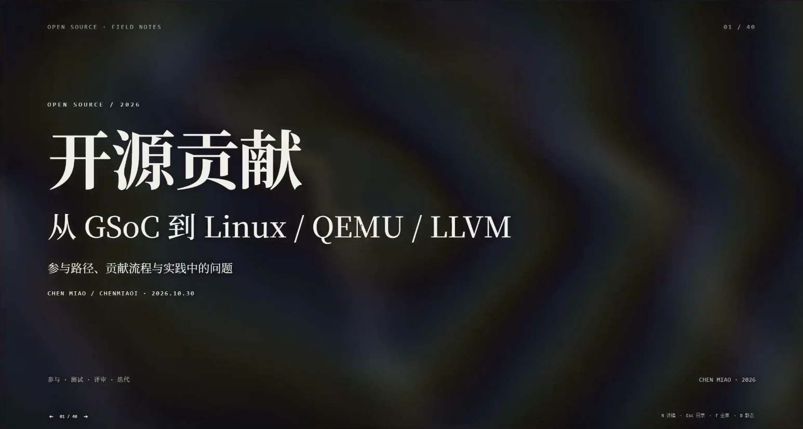

Here is the roadmap: first, getting into **GSoC**; second, navigating **Linux mailing-list workflows** through my real **OpenRISC** kernel patch series; third, comparing **Linux, QEMU, and LLVM** policies in the agentic era; and finally, a quick look at two personal tools I wrote to make upstream work smoother.

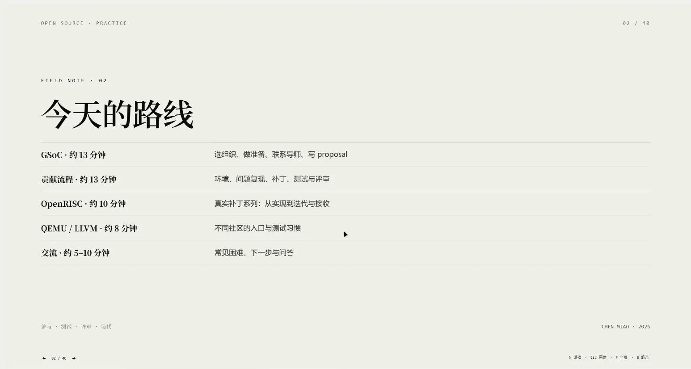

## Stop Asking Whether You're Qualified

I didn't apply for **GSoC** until 2025, even though I had known about it for years. Back before LLMs and coding agents took off, people around me kept saying, "Developers from all over the world compete for GSoC—as a beginner, you'll definitely get rejected." I wasted a lot of time believing that.

I kept circling the same three doubts: **Am I even qualified? Do I have the technical chops? And if I do get accepted, can I actually finish the project?** Almost every newcomer who has coded for a year or two without shipping upstream hits that exact mental wall.

Looking back, the answer is blunt: **just do it.**

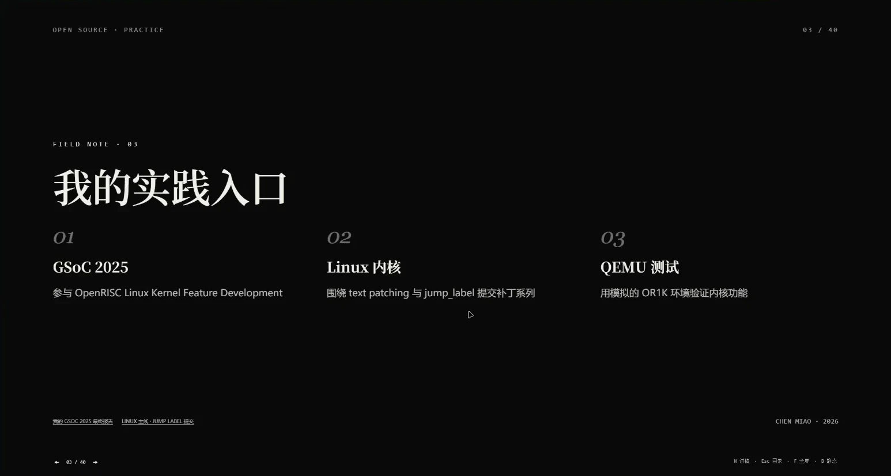

When I applied for the first time, I had zero Linux kernel development experience. I simply emailed the maintainer anyway—and he told me straight up that GSoC project ideas are *designed* for newcomers. In a maintainer's eyes, you are qualified the moment you show up, ask questions, and put in the effort.

## GSoC Timeline and Proposal

GSoC resembles MFCP in spirit: Google invites organizations to propose projects with mentors, who select contributors—except GSoC uses a competitive proposal process rather than open task claiming.

### Timeline, Slots, and Eligibility

Organizations submit applications to Google in January and February, the accepted list comes out in late February, contributor proposals open from mid- to late March, and selections are announced in May or June.

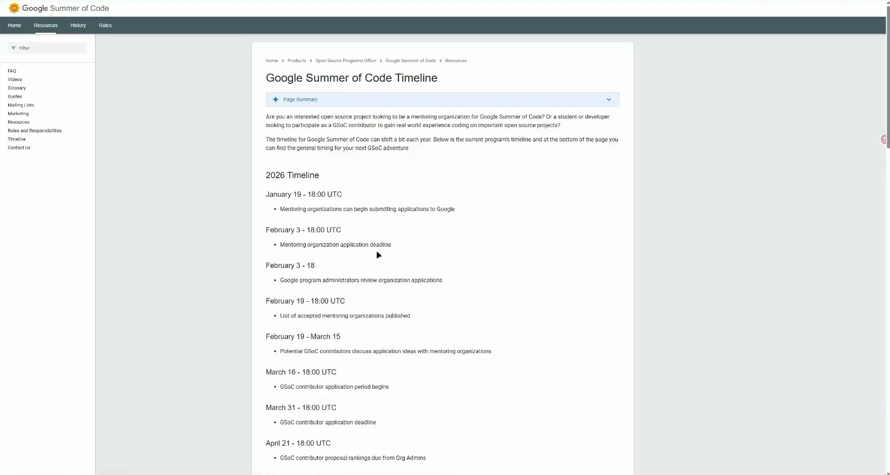

When browsing organizations—say searching for Linux and finding projects like the EROFS filesystem—keep one caveat in mind: an organization may list a dozen project ideas, yet Google only funds a handful of slots. Even a strong application can miss out if a specific task doesn't receive a slot, so treat that part as luck rather than personal failure.

If you are eyeing next year's cycle, you can already browse past organizations, email them to ask whether similar projects are planned, and submit small documentation fixes, bug patches, or tests to become a familiar name. That said, prior PRs are not strictly required—I didn't send warm-up patches for either of my two accepted applications; I simply picked projects I liked and reached out directly to the maintainers.

One welcome policy change: since 2025, GSoC no longer restricts applicants to university students. As long as you are 18+ and relatively new to open source—even if you have worked in industry for a year or two—you can still apply, depending on the mentoring organization. The stipends are generous as well (across my two summers, they amounted to roughly 10,000 RMB and nearly 30,000 RMB).

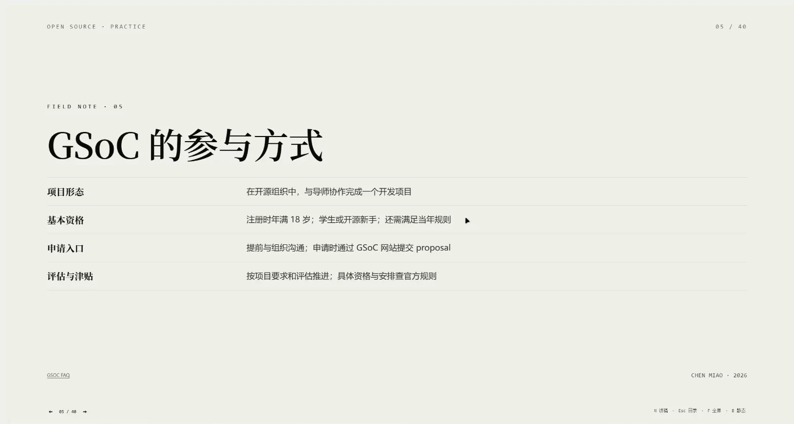

### Anatomy of My 14-Page Proposal

Because GSoC is proposal-driven, Google deliberately refuses to hand out a single template—they want to see how *you* plan an engineering project. For my first application to **The FOSSi Foundation** (*OpenRISC Linux Feature Development*, mentored by Stafford Horne), I drafted the proposal in Chinese first, translated it into English, and ended up with 14 pages:

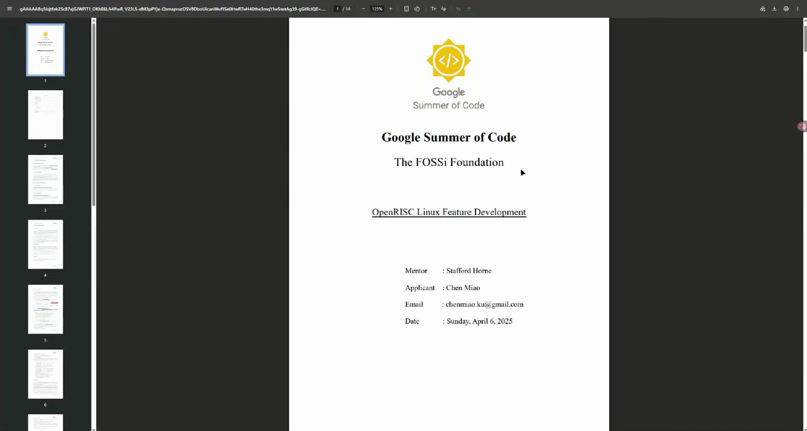

Every section served one purpose—**earning the community's trust that I could actually deliver**:

1. **Background and Experience**: Who I am, what tools I know, and prior projects or open-source experience.
2. **Deep Technical Analysis**: My task included bringing `jump_label` support to OpenRISC (the low-overhead patching mechanism behind `ftrace`). Before applying, I studied the Linux kernel's RISC-V implementation, broke down `static_key`, `jump_entry`, and `arch_jump_label_transform`, drew architecture diagrams, and ran small local experiments.
3. **Macro and Week-by-Week Timeline**: Both a high-level schedule and weekly milestones. Everyone knows timelines are estimates—some weeks slip, others finish early—but spelling them out proves you have thought through the work.
4. **Commitments and Post-GSoC Plans**: Availability and future goals (admittedly the most aspirational part—I originally planned to build much more on OpenRISC afterward, though my focus later shifted elsewhere).

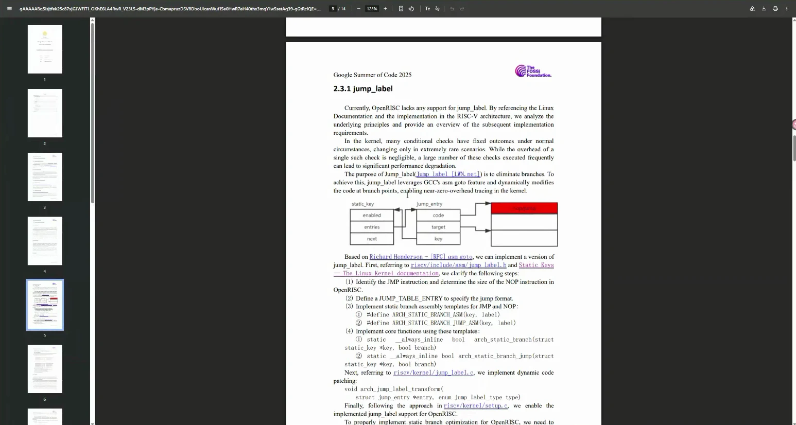

### Right-Sizing Scope and Never Going Radio Silent

Choosing an organization comes down to interest, technical fit, and how concrete the idea list is. One lesson I learned immediately: **don't overstuff your first proposal.**

My first draft ambitiously pledged to deliver all four sub-tasks in the idea list—including `kprobes` and `eBPF`/`BPF` on top of `jump_label` and `ftrace`. The maintainer replied bluntly: "Are you sure you can finish all four?" Talking it through quickly grounded me; I narrowed the scope to `jump_label` and `ftrace` and shipped both cleanly. Never be shy about asking maintainers early—getting candid pushback is simply part of open source.

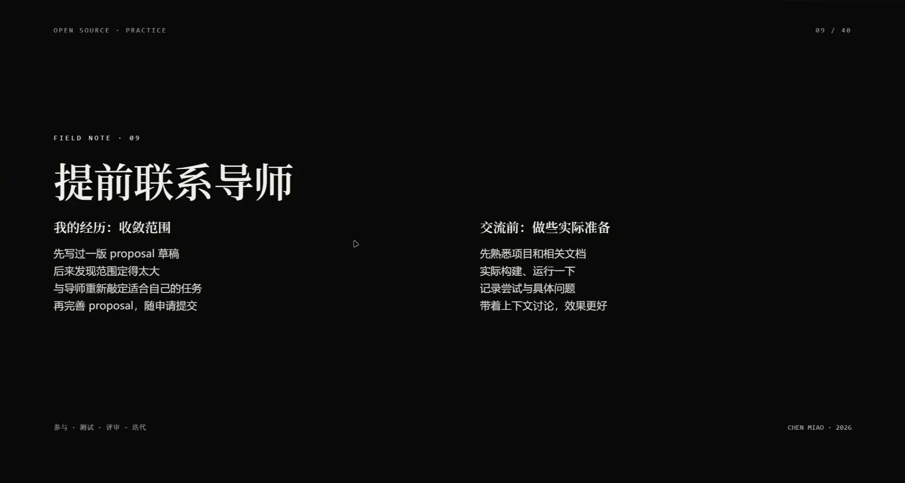

Once you start contributing, **keep a steady communication cadence**—weekly, biweekly, or even monthly—just so maintainers know you are still active. Reviewing PRs in LLVM today, I constantly stumble across year-old pull requests where a reviewer left careful feedback and the author simply vanished.

The same applies to `good first issue` claims across Rust, Cargo, LLVM, and KVM: so many people claim an issue and never submit a PR that many communities refuse to assign issues anymore. Open source isn't a binding contract—if you want to work on an issue, just build the fix and open the PR.

## Real-World Linux Mailing-List Workflow

### Why Kernel Contribution Feels Both Simple and Intimidating

Coming from modern GitHub UIs with polished issue trackers and PR threads, opening a Linux mailing-list archive on `lore.kernel.org` feels like stepping back in time. The first time I stared at raw patch diffs and nested plain-text replies, I honestly couldn't tell which email replied to which or what the code was even doing.

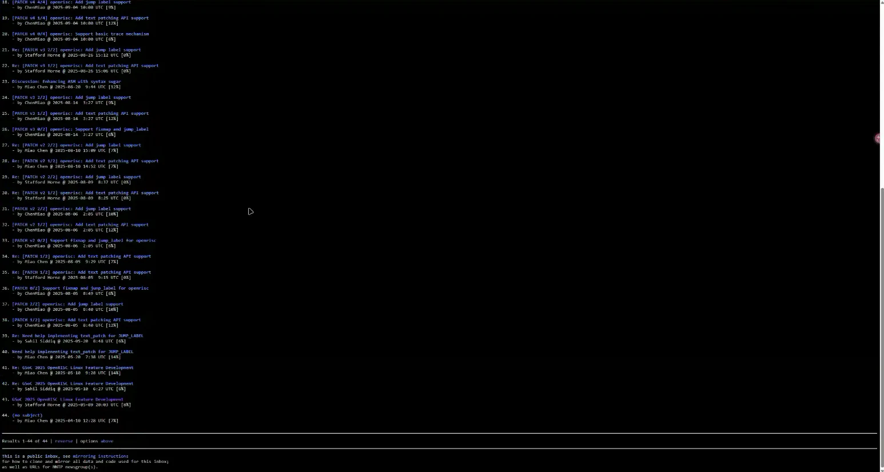

Beyond the learning curve of reading threads, email carries psychological friction: every time I send a patch, I still double-check `To` and `Cc` out of fear of spamming the wrong maintainers, worry about English phrasing, and wonder whether a subtle mistake might break someone's kernel.

That is why Linux feels **both simple and hard**: in the age of coding agents, writing the code itself is no longer the main bottleneck—**the real work has shifted to upstream communication, thorough testing, and navigating community norms.**

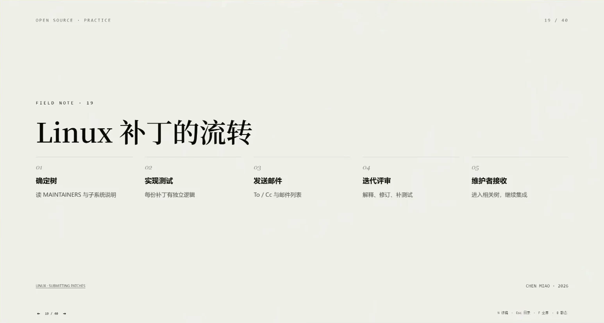

### One Patch, One Clear Story

Take my OpenRISC series on `lore.kernel.org`: starting with `[PATCH 1/2] openrisc: Add text patching API support` (adding `FIX_TEXT_POKE0`, `arch/openrisc/include/asm/insn-def.h`, and `arch/openrisc/kernel/patching.c`), iterating all the way to `[PATCH v5 0/4]` alongside basic `static ftrace` support before landing in `[GIT PULL] OpenRISC updates for 6.18`.

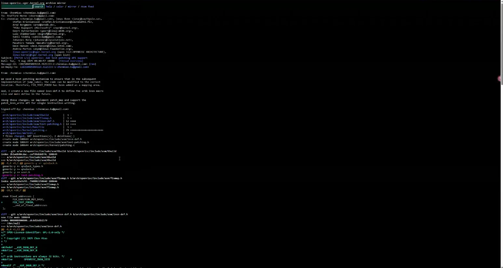

A few fundamentals make mailing-list submissions far smoother:

- **Atomic, buildable commits**: Keep each commit focused on a single logical change that compiles, runs, and passes tests on its own whenever possible.
- **Patch equals email**: Export commits with `git format-patch`; write a subsystem-prefixed subject and a body explaining the problem, trade-offs, and exact verification steps.
- **Plain text and versioned resends**: Double-check `To / Cc`, send strictly as **plain text (never HTML)** via `git send-email` or a plain-text client, and mark revisions cleanly (`[PATCH v2 ...]`, `[PATCH v5 ...]`) with a changelog of what changed since the previous version.

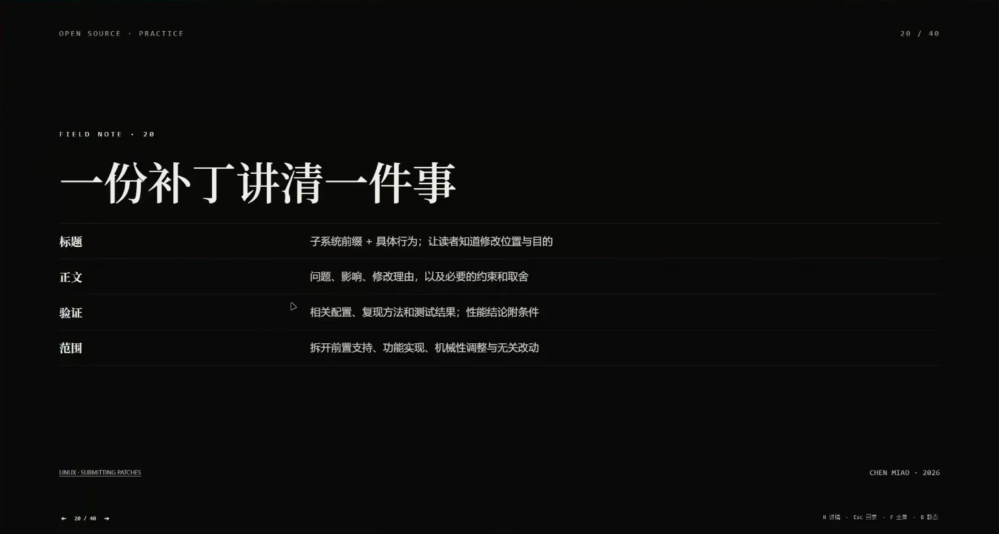

### Responding to Reviews: Don't Become an "Agent's Agent"

Two rules matter above all once reviewers reply to your patch.

First, **do not turn yourself into an agent's agent.** Right now I worry about a pattern becoming far too common among newcomers: letting an agent write a patch, shipping it blindly, replying "Yes, you're right, I'll fix it" to every review comment, copy-pasting the reviewer's words straight back into the agent, and sending the output back upstream without understanding any of it.

I don't insist that you type every character by hand—**I do insist that you read and understand every single line the agent wrote, and be able to explain why it belongs there.** That is basic respect for upstream reviewers who donate their time to help you. Imagine sitting on the other side one day, reviewing an AI-generated patch whose author cannot answer a single question about their own code.

Second, **don't let shyness stop you from pushing back politely.** If a reviewer questions a change and you know—backed by semantics, constraints, or test data—that your implementation is right, explain your reasoning calmly and clearly. That holds equally across Linux and QEMU mailing lists and LLVM GitHub PRs.

## Community AI Policies

Moving across Linux, QEMU, and LLVM makes it obvious that upstream communities are responding to AI in very different ways.

### Linux and QEMU: Full Human Accountability

Unlike QEMU's GitLab issue tracker, Linux has no central issue board—making it tough for newcomers to even discover what needs fixing. AI tools genuinely help here by helping you read unfamiliar subsystems and spot potential bugs to investigate.

Earlier on, the Linux community discussed requiring an `Assisted-by` trailer for AI-assisted commits, and later dropped the mandate. The takeaway is blunt: **the community doesn't police which tools you used, because *you* own full responsibility for every line you submit.** Flood the list with unreviewed "AI slop," and your email address and reputation will quickly burn out.

Watch closely for **AI bug-fixing hallucinations** too. Suppose a bug occurs when `A + B != C` at the end of a deep call chain. An AI will often jam a hacky special-case check into an intermediate function that was never buggy in the first place—passing a toy reproducer while completely missing the root cause. You can sometimes debate design preferences on a new feature, whereas fixing a bug in the wrong place gets spotted immediately. Likewise, tools like GPT love generating 100+ lines of bloated tests for a two-line fix; you need the judgment to trim what doesn't belong.

### LLVM: Rejecting "Extractive Contributions"

Under heavy review load, **LLVM** has taken a much stricter stance—including active RFC discussions about banning AI-generated code outright. Its official **LLVM AI Tool Use Policy** explicitly defines "extractive contributions": submissions that consume more maintainer review effort than the value they add.

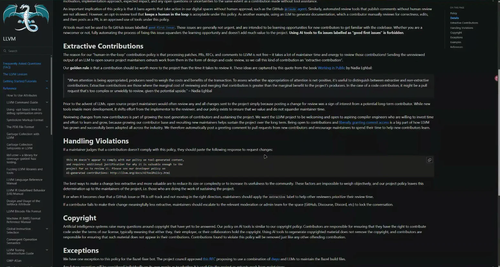

Key rules in LLVM today:

- **Human in the loop is mandatory**: Maintainers can close a PR outright if they believe it is purely AI-generated and the author cannot justify or explain it.
- **AI tools are forbidden on `good first issue` tickets**: You may use AI to learn concepts, not to automate fixes meant as onboarding exercises.
- **No copy-pasting review feedback into LLMs** to generate automated replies.

Used well, AI is an extraordinary tutor—let it explain tricky codebases and teach you the fundamentals, then own the changes yourself. Modifying a kernel driver you don't know how to use, or patching QEMU before you know how to build and run it, may earn a superficial commit count without teaching you anything lasting.

## Two Custom Workflow Tools

To smooth out my own day-to-day upstream friction, I ended up building two open-source tools—contributions and feedback are very welcome:

- **[ThreadLine](https://github.com/ChenMiaoi/threadline)**: Managing active PRs, review queues, and inbox notifications across massive repositories like `llvm/llvm-project` felt clunky in GitHub's default UI, so I built a focused local desktop workflow client.

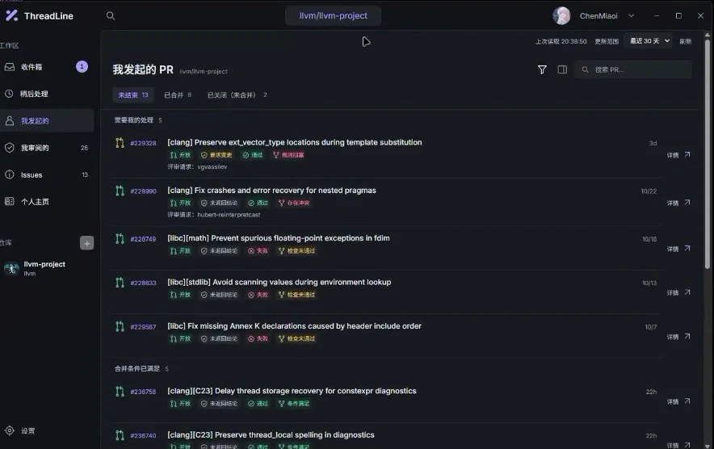

- **[CRIEW](https://github.com/ChenMiaoi/CRIEW)**: A Rust TUI client tailored for Linux kernel mailing lists. Subscribing your personal inbox directly to kernel lists brings hundreds of emails a day; CRIEW lets you follow selected subsystems and review patch threads cleanly from the terminal without setting up a traditional mail client.

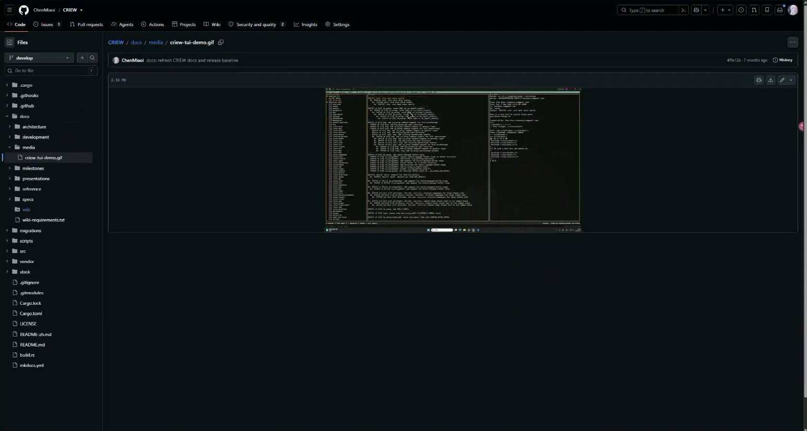

## Live Q&A

### What Is the Current State of OpenRISC, and Is It Worth Learning?

**Question (Shengyue Ni)**: OpenRISC has been around for many years—what does its community look like today, and is it still a good target for learning?

**My take**: I wondered the exact same thing and asked the maintainer directly. Candidly, OpenRISC's upstream activity is quite limited today—basically one reviewer keeping conservative maintenance going, with few new features and almost no commercial adoption as companies move toward RISC-V or ARM.

Even purely for learning, I wouldn't strongly recommend it. Driver development is mostly architecture-agnostic anyway, and if you want to learn a CPU architecture, OpenRISC has largely faded from the mainstream. Funny enough, when I first applied, I mistakenly thought OpenRISC was a fully open-source flavor of RISC-V—only to discover it isn't at all. Starting on a mature architecture like RISC-V, ARM, or x86 will pay off much more.

## Resources

- **Full Session Replay (Bilibili)**: [Linux Contribution Workflow](https://www.bilibili.com/video/BV15Zxi68Ecg/)
- **Linux OpenRISC Mailing-List Archive**: [lore.kernel.org/openrisc/?q=chen+miao](https://lore.kernel.org/openrisc/?q=chen+miao)
- **LLVM AI Tool Use Policy**: [llvm.org/docs/AIToolPolicy.html](https://llvm.org/docs/AIToolPolicy.html)
- **ThreadLine**: [github.com/ChenMiaoi/threadline](https://github.com/ChenMiaoi/threadline)
- **CRIEW**: [github.com/ChenMiaoi/CRIEW](https://github.com/ChenMiaoi/CRIEW)
