> 这篇博客文章整理自 2026 年 10 月 30 日 MFCP 开源实践分享《Linux 开源贡献流程分享》。

我是陈磊（上游提交署名 Chen Miao / `ChenMiaoi`），目前在香港理工大学担任 Research Assistant，平时活跃在 Linux、QEMU 和 LLVM 等上游开源社区。我其实大二才开始接触编程，大三才真正动手参与上游贡献。这次分享主要从一个曾经的“开源新手”视角出发，聊聊我怎么从 GSoC 敲开 Linux 内核大门、怎么在邮件列表里和上游维护者打交道、Agent 时代几个顶级社区对 AI 的真实态度，以及我自己在实战中踩过的坑和顺手写的两个小工具。

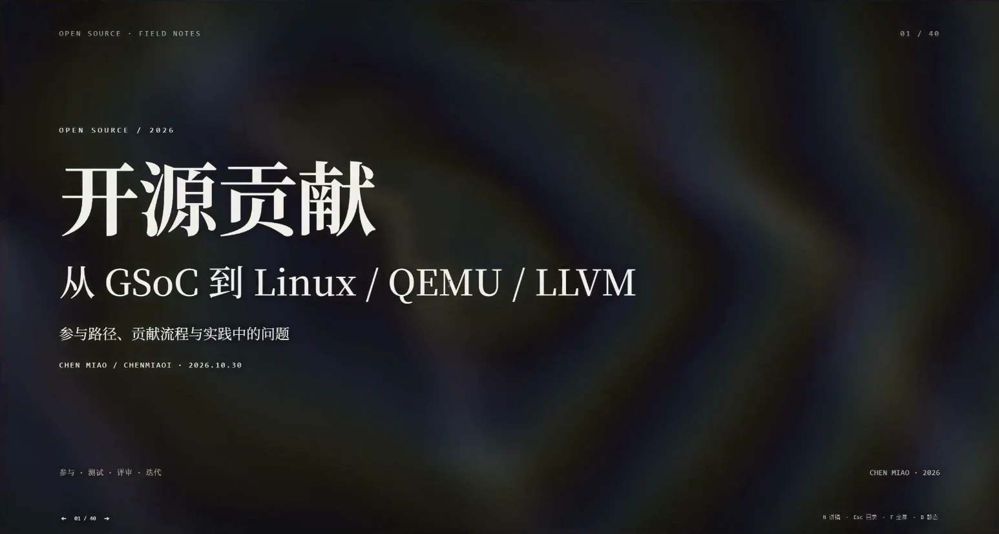

整个分享按四块展开：先聊 **GSoC** 的申请路径与避坑经验，再看 **Linux 邮件列表** 的补丁流转与我自己在 **OpenRISC** 上合入内核的真实补丁系列，接着对比 **Linux、QEMU 与 LLVM** 几个社区在 AI 时代的贡献边界，最后顺带展示两个我自己写着顺手的小工具。

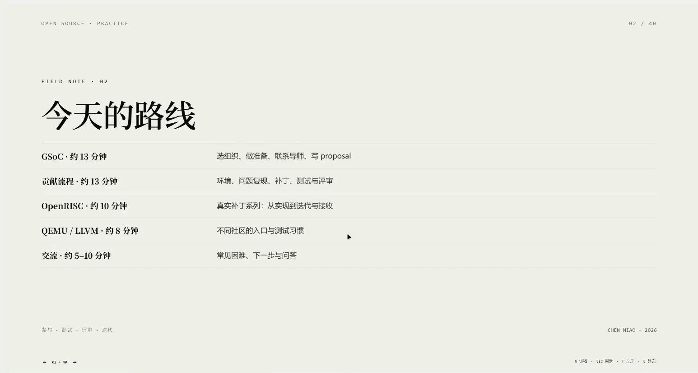

## 别先问自己“够不够格”

我是在 2025 年才第一次申请 **GSoC（Google Summer of Code）** 的，其实我早就知道这个活动，但前面白白浪费了不少时间。2025 年之前大模型和 Agent 还没像现在这样火起来，身边总有人说：“GSoC 是全世界开发者一起抢的，你一个新人去申请肯定会被拒。”

那段时间我反复在心里打转三个问题：**我真的够资格参加吗？我真的有能力做吗？就算申请上了，我真的能顺利做完结项吗？** 我相信很多学了一两年代码、但还没真正提过上游补丁的同学，现在也还在纠结这三件事。

真走下来之后，我的答案特别简单：**Just do it，直接去做就行了。**

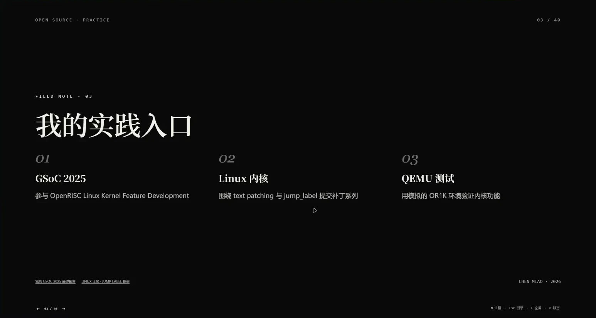

2025 年第一次申请时，我压根从来没有在 Linux 内核上开发过，跟那些早有内核经验的竞争者相比起点确实靠后。当时我硬着头皮直接给 Maintainer 发了封邮件去问，结果对方告诉我：GSoC 发布的任务本来就是面向新手设计的，在 Maintainer 和 Mentor 眼里，这些任务就该由新人来做。所以“够不够格”这件事，从来只需要你主动去问、主动去试。

## GSoC 申请时间线与 Proposal

GSoC 的运作方式和 MFCP 有点像：Google 邀请各大开源组织申报任务并提供导师，由导师决定人选，只不过 GSoC 走的是竞争申请制，而 MFCP 更偏向自愿认领。

### 吃透时间线与名额机制

按照官方节奏，每年 1 月到 2 月是各个开源组织向 Google 申报并审核任务的窗口期，2 月下旬公布入选组织列表；3 月中旬到 3 月底是贡献者提交申请的阶段，等到 5、6 月份公布最终录取结果。

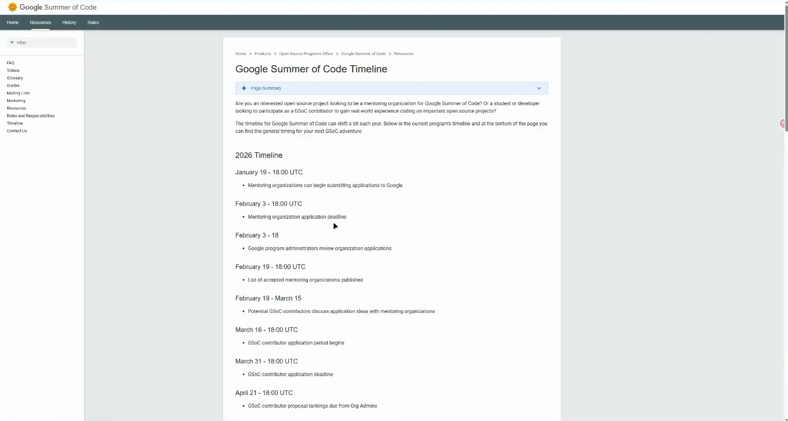

浏览组织列表时可以直接按关键词搜索感兴趣的方向——比如我搜 Linux 时，就看到过 EROFS 文件系统这类很有意思的题目。这里有个容易被忽略的细节：一个组织在初期可能会放出十几个备选任务，但 Google 最终只会批给它有限的资助名额。哪怕你和导师聊得很顺，如果这个项目最终没拿到 Google 的槽位，这次申请也会落空——这属于运气变量，心态放平就好。

如果打算冲击下一年的 GSoC，现在就可以先翻翻往年的组织清单，给感兴趣的社区发邮件问问明年是否有延续计划，顺手做一点文档修补、简单 Bug 修复或者测试补充，提前在社区混个脸熟。当然这并非硬性门槛——我自己两次中选其实都没提前刷 PR，都是看中了题目才直接去联系 Maintainer。

顺带提一下资格和补贴：2025 年之后，GSoC 已经不再强制要求申请者必须是在校学生，只要年满 18 岁、属于开源新手，哪怕已经工作一两年但之前很少参与开源社区，同样可以去试一试，具体还是看各社区 Maintainer 的考量。完成项目后的补贴也相当实在，我两次参与分别拿了大约一万和将近三万人民币。

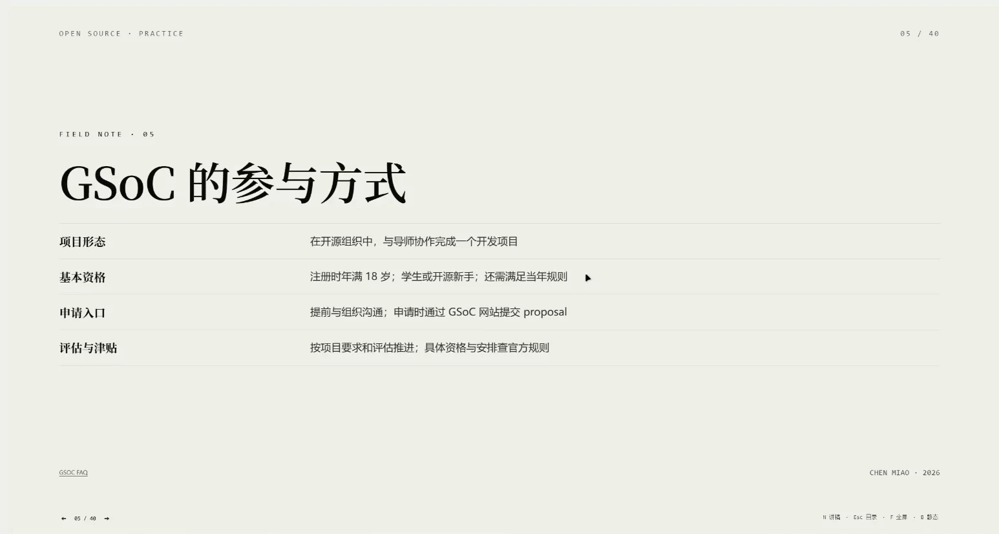

### 拆解我的 14 页申请草案

GSoC 申请最核心的材料是 **Proposal**。很有意思的是，Google 刻意不提供统一模板，因为他们认为每个开发者都该有自己的规划方式。我第一年申请 **The FOSSi Foundation** 的 *OpenRISC Linux Feature Development* 项目（导师 Stafford Horne）时，先用中文写完再译成英文，整份 Proposal 一共 14 页：

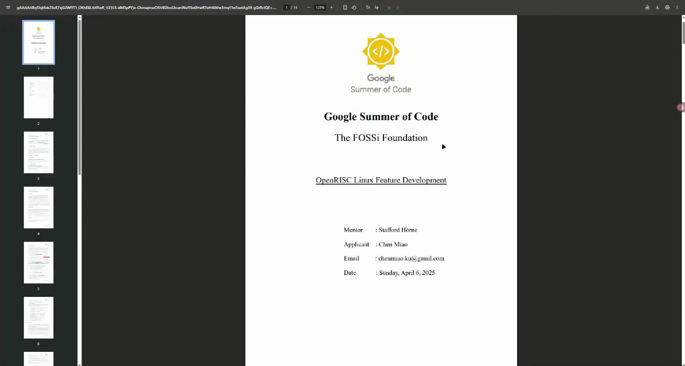

整份文档拆成四块，核心目标只有一个——**让社区相信你有能力把这件事交付出来**：

1. **个人介绍与过往经历**：交代自己是谁、熟悉什么工具、做过哪些相关练习或开源尝试；
2. **项目理解与底层源码调研**：我当时的核心目标之一是给 OpenRISC 加上 `jump_label` 机制（`ftrace` 这类低开销内核追踪就依赖它）。申请前我直接翻了内核源码，对照 RISC-V 的 `jump_label` 实现梳理了 `static_key`、`jump_entry`、`arch_jump_label_transform` 的工作机制，自己还画了结构图并动手做了实验验证；
3. **分阶段与按周拆解的时间线**：既给出宏观里程碑，也细化到每一周打算做什么——所有人都知道时间线只是预估，实际可能会超期也可能提前，但它能清楚展现你拆解工程问题的思路；
4. **个人承诺与后续规划**：写清楚每周能投入的时间以及结项后的持续参与打算（说实话，这部分往往带点理想色彩——我做完 OpenRISC 后原本也计划继续在上面做很多东西，后来因为其他方向投入，很多也就没接着做了）。

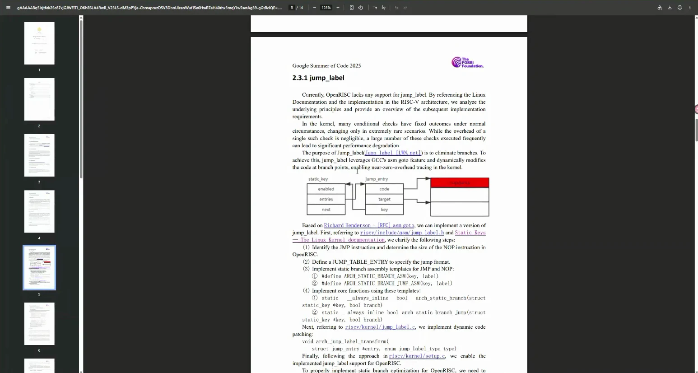

### 别把范围画太大，更别做完一半就失联

选组织终究看个人兴趣、技术基础以及任务本身够不够具体。有一个真实教训一定要提前分享：**第一次写 Proposal，千万别贪大。**

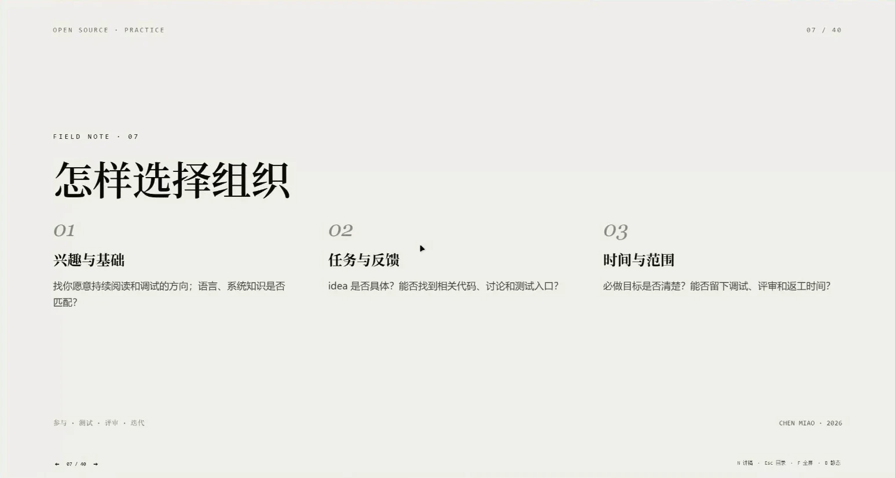

我第一次把草案写完发给 Maintainer 时，题目清单里本来列了四个子任务（除了 `jump_label` 和 `ftrace`，还包括 `kprobes` 和 `eBPF`），我一拍脑袋全写进了方案里。结果 Maintainer 直接回邮件问我：“这四个任务全做，你确定你做得下来吗？”讨论完我才冷静下来，后两个短期内确实啃不下来，于是果断收敛范围，专注把 `jump_label` 和 `ftrace` 做扎实。所以写方案时一定要大胆找 Maintainer 沟通——做开源必须具备不怕问的心态，就算偶尔被挑刺甚至被喷，其实都很正常。

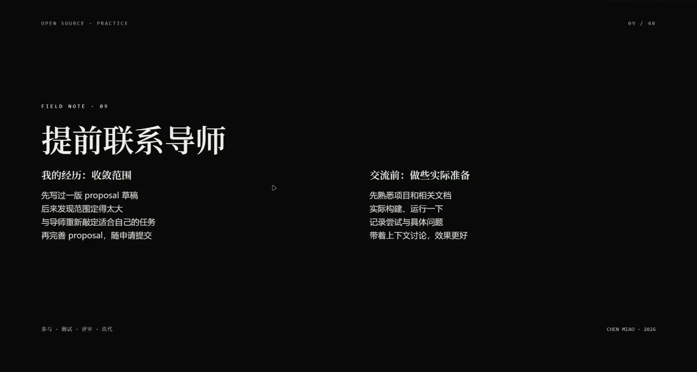

一旦项目启动，或者日常参与任何开源社区，**一定要和 Maintainer / Mentor 保持固定节奏的同步**——一周一次、两周一次，哪怕一个月一次都行，关键是让对方知道“你还在推进”。我在 LLVM 做 Review 时，经常见到一年前提交的 PR：Reviewer 认真写了一堆意见，结果原作者从此人间蒸发，不知道是答不上来还是没空继续，PR 就那样干晾了一整年。

另一个常见现象是 `good first issue` 占坑不交代码：无论是 Rust、Cargo、LLVM 还是 KVM，经常有人留言说“我来认领”，结果再也没见过对应的 PR。这类情况实在太多，现在很多社区干脆不再提前把 Issue assign 给你——**开源参与没有强制义务，想做就直接上手写完提 PR，不必干等分配。**

## Linux 内核邮件列表实战

聊完 GSoC，来看看真正给 Linux 内核提补丁是什么体验。

### 既简单又不简单的邮件工作流

对于习惯了 GitHub 图形界面、Issue 列表和 PR 页面的人来说，第一次打开 Linux 邮件列表归档（例如 `lore.kernel.org`）多半会发懵。我第一眼看那满屏纯文本线程和 `patch diff` 时，根本分不清哪封邮件回复了哪封，也看不出整段代码到底改了什么。

除了界面“复古”，邮件列表还带来很强的心理门槛：每次准备点发送，我都特别怕收件人 `To / Cc` 填错，一不小心把邮件群发给一大群无关开发者，被人家当成骚扰；也怕英语用词不够地道；更怕自己对内核理解不到位，一改把内核改崩了。

所以我觉得参与 Linux 内核**既简单又不简单**：在 Agent 普及的今天，单纯写代码的成本其实已经不高了，**真正的成本转移到了怎么与上游交流、怎么写清楚说明以及怎么扎实地做测试。**

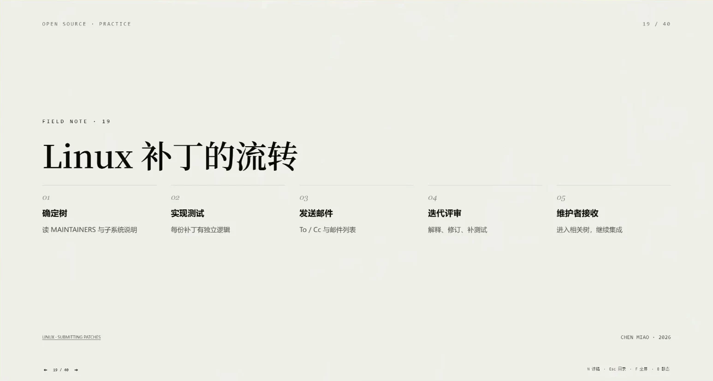

### 一个补丁讲清一件事

以我当年给 OpenRISC 提交的文本修改接口补丁 `[PATCH 1/2] openrisc: Add text patching API support`（新增 `FIX_TEXT_POKE0` 映射、`arch/openrisc/include/asm/insn-def.h` 与 `arch/openrisc/kernel/patching.c`）为例，从最初的 v1 一路迭代到 `[PATCH v5 0/4]`，再加上基础 `static ftrace` 支持，最终通过 Maintainer 的 `[GIT PULL] OpenRISC updates for 6.18` 进入主线。

在准备和发送内核补丁时，有几条基本规矩绕不开：

- **粒度清晰、独立可测**：尽量一个 commit 只完成一个独立功能，并且保证每个 commit 都能单独编译、运行和测试（实在存在前后依赖的系列补丁再拆成多封）；
- **补丁即邮件**：通过 `git format-patch` 把每个 commit 导出成独立 patch 文件，标题带子系统前缀与具体行为，正文讲清楚背景、影响、取舍与测试条件；
- **纯文本发送与版本标记**：发送前反复核对 `To / Cc` 收件人列表，使用 `git send-email` 或支持纯文本的客户端发送，**严格保证纯文本（TXT），绝不能带 HTML 渲染**；后续按评审意见修订重发时，在标题里递增版本号（如 `[PATCH v2 ...]`、`[PATCH v5 ...]`）并写清楚相对上一版的改动记录。

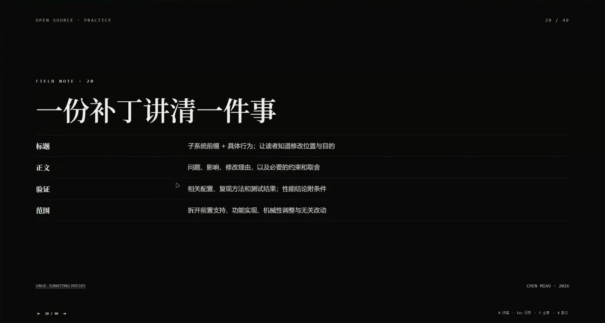

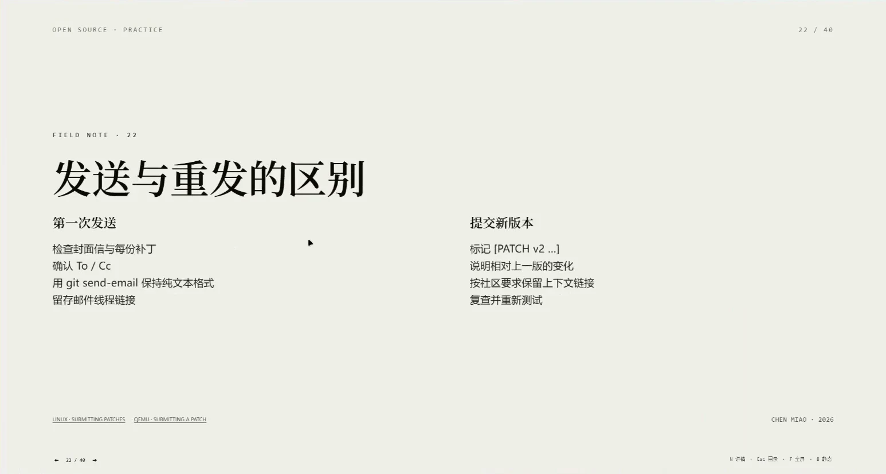

### 回应 Review：千万别当“Agent 的 Agent”

当你的补丁发出去、真的有人来给你做 Review 时，有两件事我特别想单独拎出来说。

第一，**千万不要把自己活成“Agent 的 Agent”**。现在我很担心一种在新人里越来越常见的操作：让 Agent 写完代码，自己扫都不扫直接发给上游；Reviewer 花时间逐行帮你找完问题，你张口就是“对的，你是对的，我马上去改”，转头就把 Reviewer 的原话复制粘贴回 Agent，改完再原封不动丢回上游。

我不要求每一行代码都必须纯手工敲出来，但**你一定要把 Agent 写下的每一行都看懂，搞明白它做了什么、为什么要这么改**。这首先是开源社区最基本的礼仪——Reviewer 是在消耗自己的业余或工作时间帮你把关，我们不能理所应当地把理解代码的责任全部甩给上游维护者。换位思考一下，等将来你开始 Review 别人的 PR，看到一份全由 AI 生成、问两句细节作者完全答不上来的代码，你也一样会觉得非常糟糕。

第二，**不要因为性格内向而不敢礼貌反驳**。如果 Reviewer 质疑你“这里是不是改错了、有没有必要”，而你经过充分验证确信自己的理解没错，千万别不好意思开口——大胆、有礼貌地把语义依据、边界条件或测试数据摆出来，心平气和地和对方讨论。无论是走邮件列表的 Linux、QEMU，还是走 GitHub PR 的 LLVM，这条原则完全通用。

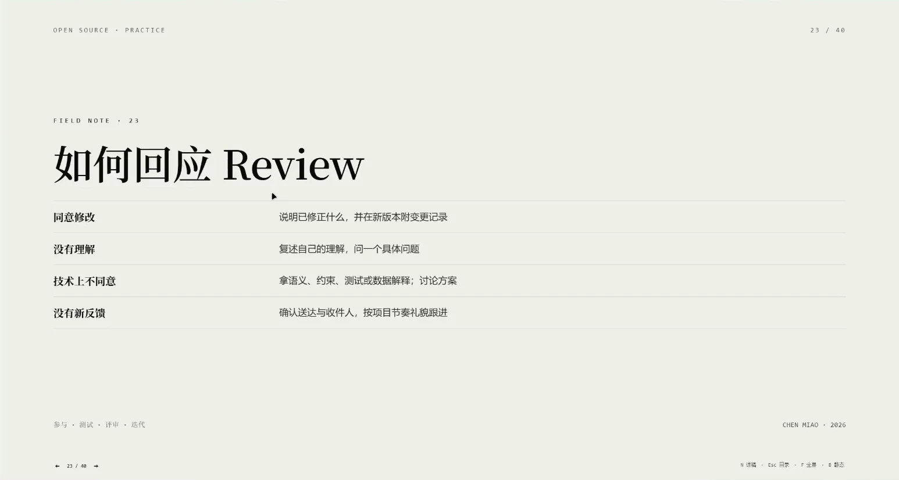

## Agent 时代的社区 AI 边界

这阵子我在 Linux、QEMU 和 LLVM 三个社区来回切换，明显能感受到大家面对 AI 时的处境和政策并不一样。

### Linux 与 QEMU：谁提交，谁负全责

客观说，Linux 对新手有个天然难点：不像 QEMU 有 GitLab Issue 列表可以翻，Linux 没有 Issue 也没有 PR，全靠邮件列表；如果不长期跟进源码，刚开始根本不知道该修什么。有了 AI 之后门槛确实低了一些——你可以让 AI 辅助你读代码、分析某个模块有没有潜在隐患，找到头绪后再自己动手验证。

之前 Agent 刚火起来时，Linux 社区一度讨论要求给 AI 协助的补丁加上 `Assisted-by` 标签，但后来又把这项强制规定取消了。背后的逻辑很干脆：**社区不管你的代码是不是 AI 写的，最终署名提交的人是你，责任完全由你承担。** 如果你不加审查就往邮件列表里狂发低质量的 “AI slop”，用不了几次，你的邮箱和名字在社区里基本就废了。

另外，用 AI 修 Bug 时要高度警惕**“错位修补”幻觉**：假设真实缺陷是经过多层函数调用后出现 `A + B != C`，AI 常常会在整条调用链中间某个本来完全正确的路径上硬塞一个特例判断，跑完它自己构造的简单用例就宣称“修好了”，实际上跟根因毫不相干。加新功能时改动面广，你或许还能和 Reviewer 争一争设计偏好；修 Bug 一旦修错位置，懂行的维护者一眼就能看穿。还有像我平时用 GPT 时，经常本体只改两行代码，它顺手就甩出一百多行测试代码，哪些该留、哪些该删，都必须自己心里有数。

### LLVM：抵制“榨取式贡献”，严禁 AI 做新手任务

相比之下，目前 Review 压力非常大的 **LLVM** 社区态度要严厉得多。社区不仅出现过全面禁止 AI 代码的 RFC 提案，官方文档 **LLVM AI Tool Use Policy** 也明确提出了“榨取式贡献（Extractive Contributions）”的概念——即审阅与合并所消耗的维护者成本远远大于改动本身带来的价值。

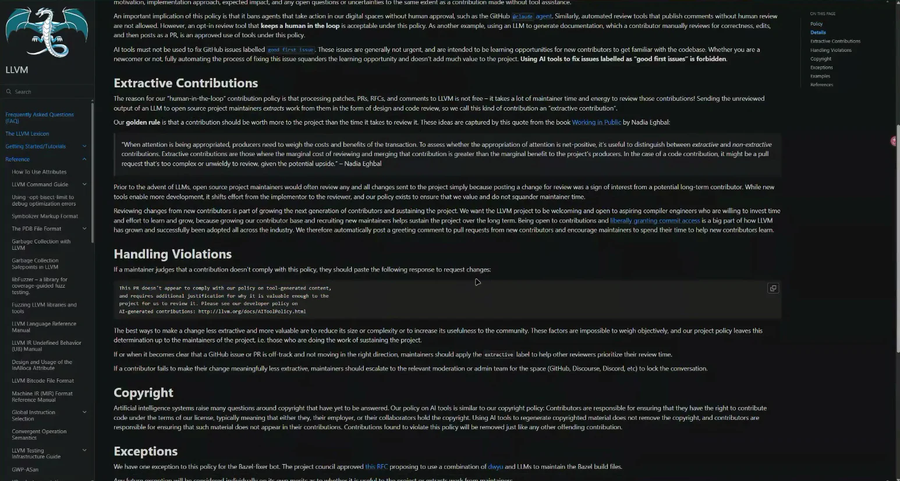

按照 LLVM 现行政策：

- 必须保持 **human in the loop**，维护者一旦判断 PR 完全由 AI 生成且作者说不清楚细节，可以直接关闭 PR；
- **明确禁止使用 AI 工具解决标注为 `good first issue` 的新手任务**（可以用 AI 辅助学习概念，但不能让 AI 直接替你做改动）；
- 严禁把维护者的评审评论直接丢给 AI 改完再生成回复套话。

说到底，我觉得 AI 时代最健康的用法，是**让 AI 当你的老师**——遇到看不懂的底层代码，让 AI 帮你拆解、把你教会，然后再由你来掌控修改。如果你连一个驱动怎么用、QEMU 怎么编译和运行都还没搞明白，就让 AI 帮你改出一段“看起来挺漂亮”的代码直接往上交，表面上看好像多了条提交记录，实际对你自己没有多大成长。想在底层开源领域长期走下去，核心原理终究得自己啃下来。

## 两个自研的开源协作小工具

最后顺便分享两个我最近在深度参与上游贡献时，因为用不顺手现有工具而自己写的小项目，如果大家有兴趣也欢迎一起折腾：

- **[ThreadLine](https://github.com/ChenMiaoi/threadline)**：参与 `llvm/llvm-project` 这种超大型仓库时，GitHub 原生界面在追踪“我发起的 PR”“我审阅的队列”“收件箱”和合并阻塞状态时不太顺手，我干脆自己写了一个专注个人工作流的本地工具；

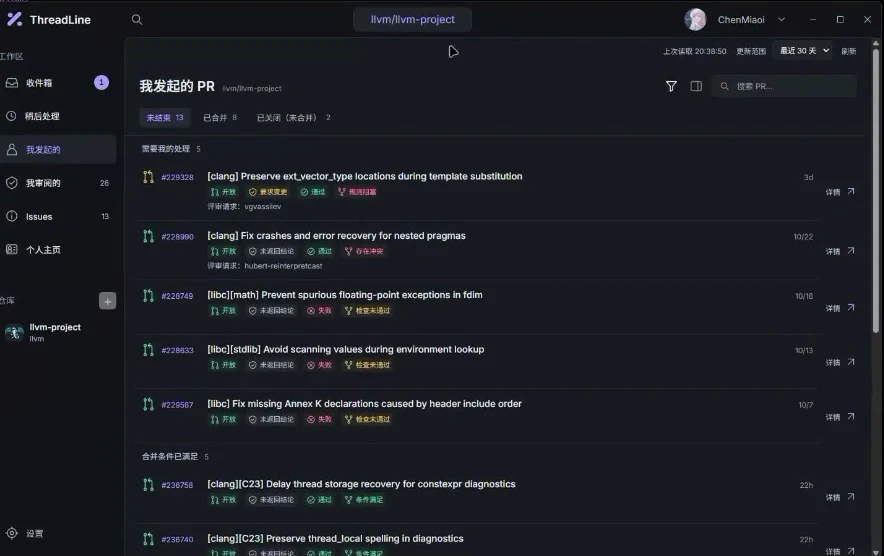

- **[CRIEW](https://github.com/ChenMiaoi/CRIEW)**：专门面向 Linux 内核邮件列表开发的 Rust TUI 工具。如果你直接用个人邮箱订阅内核邮件列表，每天几百封邮件涌进来根本看不过来；用 CRIEW 可以不依赖传统邮件客户端，直接按需订阅、筛选自己关心的子系统线程并在终端里做 Review。

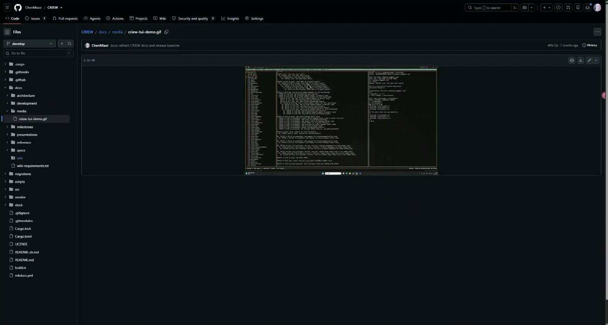

## 现场问答

### OpenRISC 现在的社区状态如何？适合拿来学习吗？

**问题（倪升跃）**：OpenRISC 也发展很多年了，现在社区整体处于什么状态？是不是大家基本都转向 RISC-V 了？适合拿来做学习吗？

**我的回答**：我参与的时候其实也有同样的疑问，专门和 Maintainer 聊过。实话讲，OpenRISC 目前在上游的活跃度和支持程度都不太理想，基本只剩一位 Reviewer 在做比较保守的日常维护，很少再增加新特性，生态远不如 RISC-V；商业上也很少有公司继续采用，大多已经转向 RISC-V 或 ARM。

如果打算拿它来学习，我其实也不太推荐——如果想学驱动开发，驱动本身和具体架构关系不大；如果想学体系结构本身，OpenRISC 如今已经相当小众甚至接近退出主流舞台了。说出来挺好笑的，我当初申请项目时甚至一度以为 OpenRISC 是 RISC-V 的完全开源版本，上手之后才发现完全不是一回事。所以如果现在起步学习，直接挑选 RISC-V、ARM 或 x86 这类更成熟的架构会划算得多。

## 相关资源

- **本次分享完整回放（B 站）**：[Linux 开源贡献流程分享](https://www.bilibili.com/video/BV15Zxi68Ecg/)
- **Linux OpenRISC 补丁归档示例**：[lore.kernel.org/openrisc/?q=chen+miao](https://lore.kernel.org/openrisc/?q=chen+miao)
- **LLVM AI 工具使用政策**：[llvm.org/docs/AIToolPolicy.html](https://llvm.org/docs/AIToolPolicy.html)
- **ThreadLine（个人 GitHub 协作客户端）**：[github.com/ChenMiaoi/threadline](https://github.com/ChenMiaoi/threadline)
- **CRIEW（Linux 内核邮件列表 Rust TUI 工具）**：[github.com/ChenMiaoi/CRIEW](https://github.com/ChenMiaoi/CRIEW)
