> This post is adapted from my November 6, 2026 talk at the MFCP Open-Source Practice Sharing session, *QEMU RISC-V Performance Optimization*.

I'm Wuxing Chen, an active contributor to the Gevico Open Source Community. Over the past few months, I have been working on an OSPP 2026 advanced project focused on accelerating **openRuyi** RISC-V package builds with **QEMU user-mode**. In this post, I walk through the methodology behind that effort—from tracking upstream mailing lists and isolating compiler workloads to profiling JIT hotspots with QEMU plugins and turning conservative translation paths into direct TB chains.

## Project Background and Build Pipeline

The real centerpiece of this project is speeding up `qemu-user`, with openRuyi serving as our real-world benchmark workload. openRuyi is an open-source Linux distribution targeting RISC-V. Because native RISC-V build hosts are still relatively scarce, packaging workflows frequently run on mainstream x86 hosts using `qemu-user` to execute RISC-V user-space build environments.

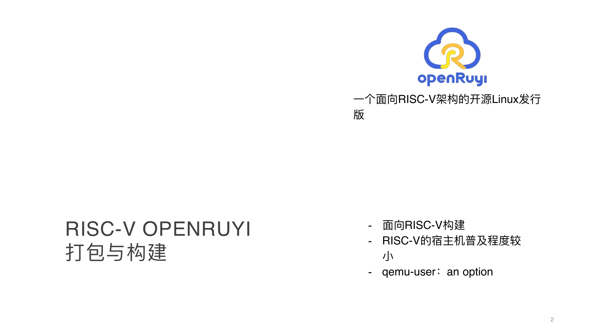

A typical openRuyi package build follows a straightforward pipeline: fetch the target tool and dependency sources along with packaging specs, initialize a RISC-V user-space environment (complete with a RISC-V GCC toolchain and linker), compile and package dependencies in topological order, install them into the build root, build and link the target tool, run staging checks and tests, and emit the final package.

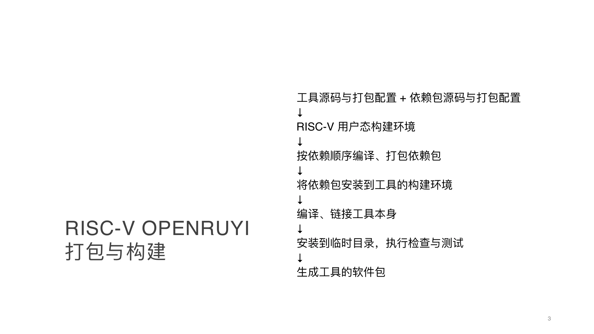

## Tracking Upstream Activity

Before diving into `qemu-user` internals, there is one general habit that pays off on every large open-source project—whether QEMU or Linux: **stay close to upstream**. Upstream mailing lists and patch reviews carry an enormous amount of signal, from API changes to regressions and half-finished ideas.

### Avoiding a Broken Baseline

I learned this the hard way right at the start of the project. In September, I began developing against a recent QEMU release branch and noticed that even trivial build workloads took one to three hours. At first I suspected my own machine was underpowered. Then I checked the `qemu-devel` mailing list and found a September 27 thread (`Re: [Stable-11.1.2 v2 64/92] linux-user/riscv: invalidate reservations after stores`) flagging a severe regression introduced in that exact baseline.

Once a guest spawned a second thread (`CF_PARALLEL`), `gen_store()` exited via `EXCP_ATOMIC` on every ordinary integer store—halting all other vCPUs through `cpu_exec_step_atomic -> start_exclusive`—and every store, single-threaded or not, called `helper_riscv_invalidate_reservations()` across all CPUs. On upstream's 2 MB `xz` compression test, `xz -T1` jumped from 5 s to 122 s, and `xz -T8` went from 1 s to hanging past 600 s with no output.

Reverting that single regression transformed my own openRuyi package build timings:

| Workload | Before Revert | After Revert | Ratio |
| --- | --- | --- | --- |
| `which` | 9m 24.474s | 9m 32.964s | 0.99× |
| `xz` | 56m 40.425s | 12m 18.934s | 4.60× |
| `zlib-ng` | 1h 1m 8.118s | 5m 49.359s | 10.50× |
| `file` | 26m 49.929s | 8m 42.081s | 3.08× |
| `lz4` | 3h 8m 29.682s | 6m 41.213s | 28.19× |
| `pcre2` | 1h 50m 58.990s | 18m 1.950s | 6.15× |

Working in isolation without watching upstream can easily trap you on a regressed baseline for weeks.

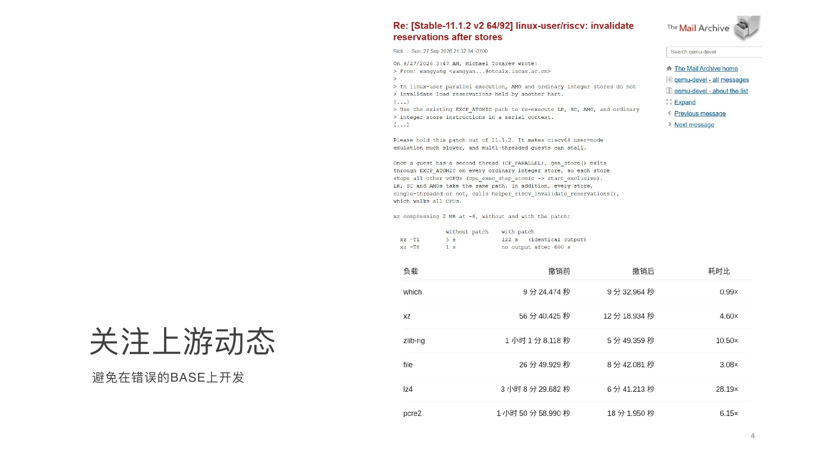

### Mining Old Threads for Optimization Ideas

There is a second payoff to reading upstream archives. In big projects, contributors frequently post promising patches, receive thoughtful guidance from maintainers, and then step away before finishing the series.

While digging through older threads, for instance, I came across an RVV v0.7.1 discussion analyzing whether `trans_vsetvli()` could use `gen_goto_tb()` to chain directly to the next TB and detailing the exact edge case hit at vector loop boundaries. Browsing historical mailing lists—or using an agent for targeted search—often turns stalled upstream discussions into a head start for your own optimizations.

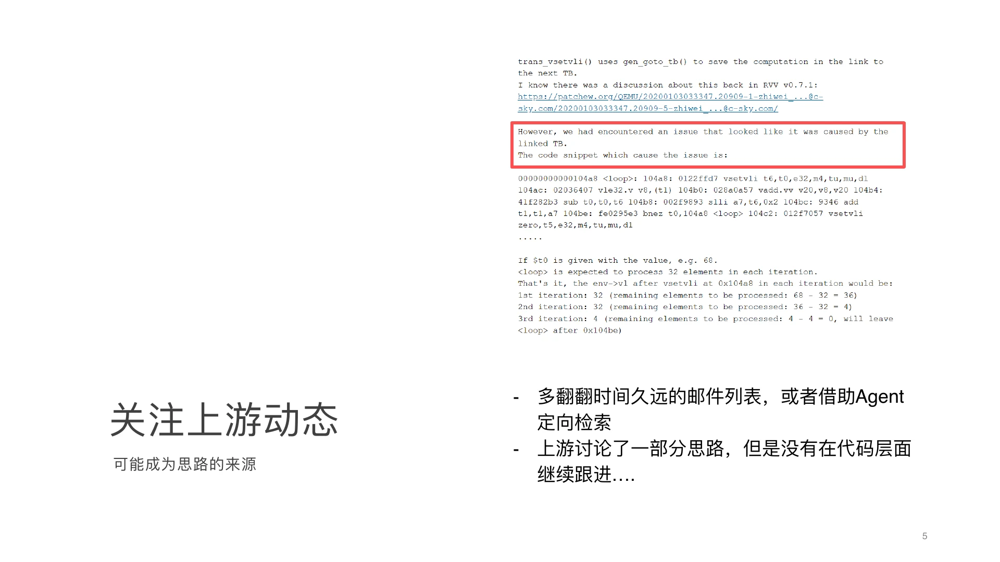

## Starting from Real Workloads and Isolating Tools

When optimizing `qemu-user` itself, the first trap to avoid is staring blindly at millions of lines of source code. Static inspection rarely points to the biggest wins. Instead, run real workloads under `perf` and narrow down hotspots hierarchically.

### Profiling at the Tool Granularity First

The coarsest level of profiling is simply asking which tools dominate wall-clock time during a package build. An openRuyi build invokes dozens of binaries—`cc1` (GCC's compiler frontend), `lto1` / `lto1-ltrans`, `rpmbuild`, `as`, `bash`, and file utilities.

Across seven build workloads (`which`, `xz`, `zlib-ng`, `file`, `lz4`, `pcre2`, and staged `QEMU`), the pattern was unmistakable: **`cc1` dominated almost everywhere**—accounting for **70.7%** in `lz4`, **61.6%** in `QEMU`, **53.2%** in `xz`, and **51.2%** in `zlib-ng`—followed by `lto1-ltrans`, `lto1`, and `rpmbuild`. Focusing on the hottest tool maximizes impact rather than wasting effort on binaries that barely register in total runtime.

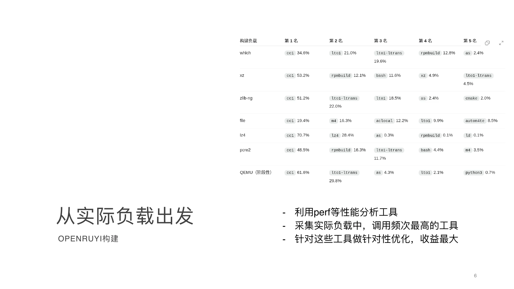

### Isolating the Tool and Controlling Benchmarks

Once `cc1` is isolated, re-running a full distro package build after every tweak is far too slow. I split my benchmarks into four tiers:

- **Fast debugging**: a small fixed `probe.c` compiled directly by the RISC-V `cc1` inside the build environment;
- **Compiler performance evaluation**: replaying a single expensive preprocessed input (such as a fixed `lz4.i` with the exact original GCC flags) directly through `cc1`;
- **End-to-end build verification**: returning to full openRuyi builds of `lz4`, `zlib-ng`, and `pcre2` to measure real packaging gains;
- **Correctness and edge-case testing**: targeted micro-tests exercising `vset*` loops, dynamic AVL values, cross-page boundaries, and exception recovery.

Disciplined benchmarking matters just as much as the optimization itself: lock identical inputs, identical baseline commits, CPU core pinning, concurrency, and clock frequency, warm up caches, and alternate run order between baseline and patched builds. Without those controls, benchmark numbers quickly lose meaning.

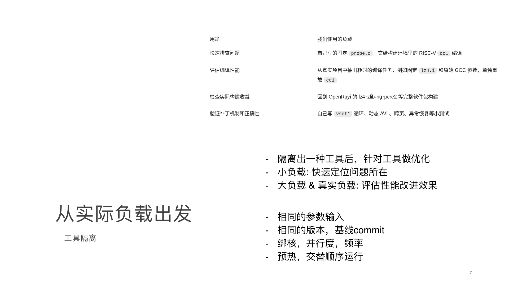

## Understanding `lookup helper` and TCG Execution Paths

Profiling isolated `cc1` runs led me straight to **`lookup helper`** inside `qemu-user`. Here is how it fits into QEMU's Tiny Code Generator (TCG).

TCG translates guest basic blocks into Translation Blocks (TBs). When a `source TB` finishes, QEMU needs the four-tuple translation context `(pc, flags, cflags, cs_base)` to locate the next `dst TB`:

- When that context is fully observable at **translation time**, TCG emits **Direct Chaining**, jumping straight from `source TB` to `dst TB` with minimal overhead.
- When an instruction takes a register operand and mutates state embedded in the translation context, the resulting state cannot be statically observed during translation. TCG falls back to emitting `lookup_and_goto_ptr`, which invokes `helper_lookup_tb_ptr` at **runtime** to inspect the live context and look up the next TB.

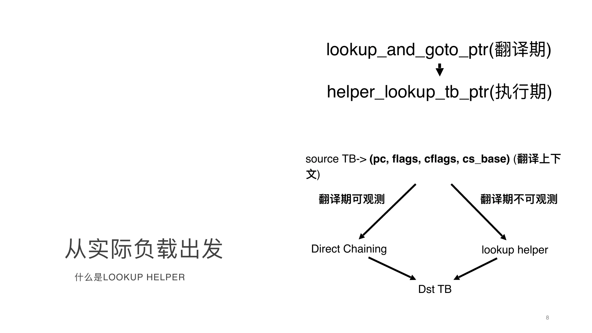

More broadly, guest instructions lower through TCG IR to host code along two paths: simple instructions like `add` become inline TCG operations compiled into fast inline host machine code, whereas complex instructions (floating-point operations or state-heavy instructions) typically emit a C helper call—simpler to implement, but noticeably slower at runtime.

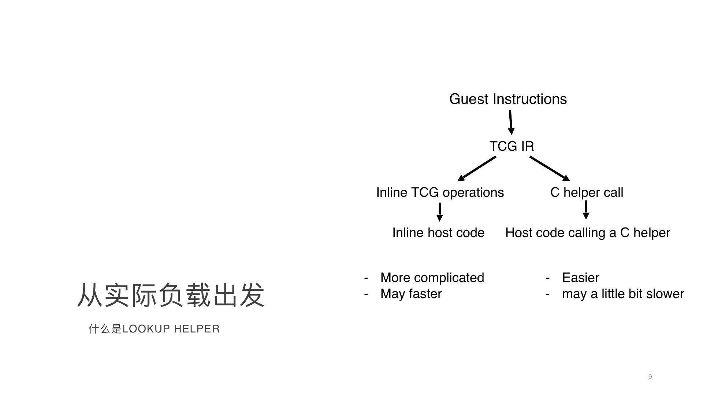

## Profiling JIT Hotspots with QEMU Plugins

Running `perf` on our isolated `cc1` workload surfaced a striking hotspot: `helper_lookup_tb_ptr` inside `qemu-riscv64` consumed **24.24%** of execution time (with inlined `tb_lookup` at 19.81% and `tb_jmp_cache_hash_func` at 17.35%).

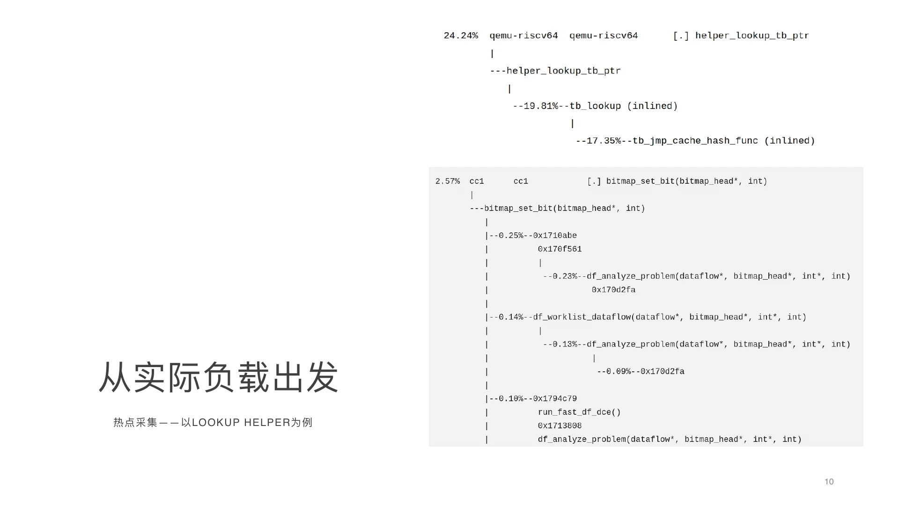

Once you spot a hotspot like that, two optimization strategies naturally present themselves:

1. **Speed up the hotspot itself**: lower the C helper into inline TCG IR. In practice, helpers exist for complex instructions whose semantics are tightly coupled to specific architectures, making generic IR lowering hard.
2. **Reduce how often execution enters the hotspot**: make the hotspot "less hot." That became the focus of my work.

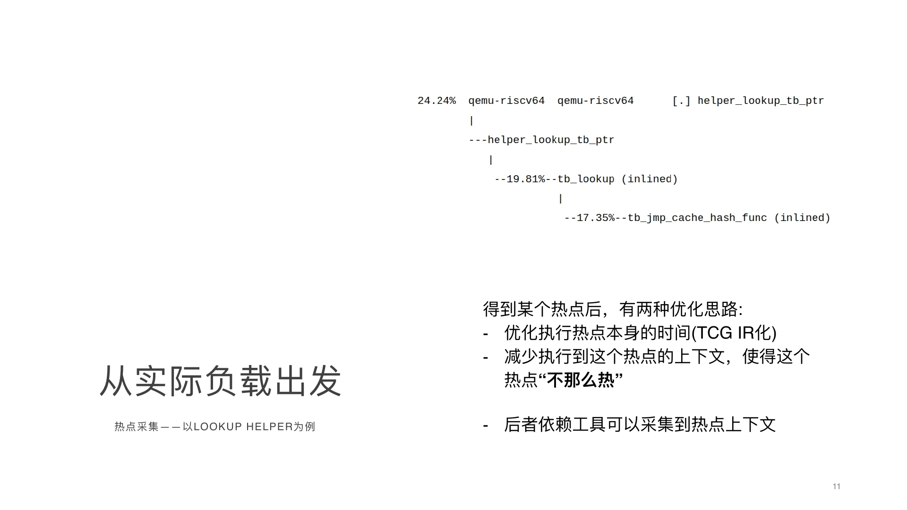

The catch is that reducing calls requires knowing *which* call sites trigger the helper—and plain `perf` struggles with QEMU's JIT. Compare the two `perf` traces above: on native `cc1`, `perf` cleanly reconstructs every caller reaching `bitmap_set_bit`; on `qemu-riscv64`, the callers of `helper_lookup_tb_ptr` disappear because they live in anonymous JIT-emitted host code lacking standard symbol metadata.

QEMU offers two ways past this blind spot: exposing JIT symbols via `perfmap` / `jitdump`, or instrumenting guest instructions with a **QEMU Plugin**. I went with the plugin approach.

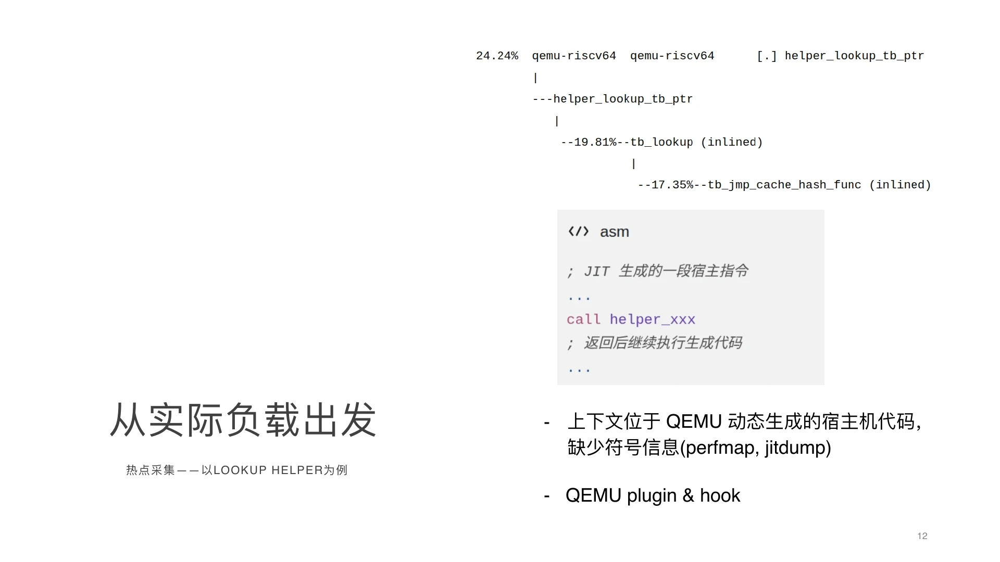

A QEMU plugin lets you attach a lightweight callback to specific guest instructions and increment a counter each time they execute. That closes the loop cleanly:

1. Use `perf` to identify `helper_lookup_tb_ptr` as the dominant hotspot.
2. Search the QEMU source tree for every guest instruction translator that emits this helper.
3. Instrument those candidate guest instructions with a QEMU plugin to measure their dynamic execution counts.
4. Rank the top offenders, inspect whether their conservative fallback can be eliminated, and validate the fix.

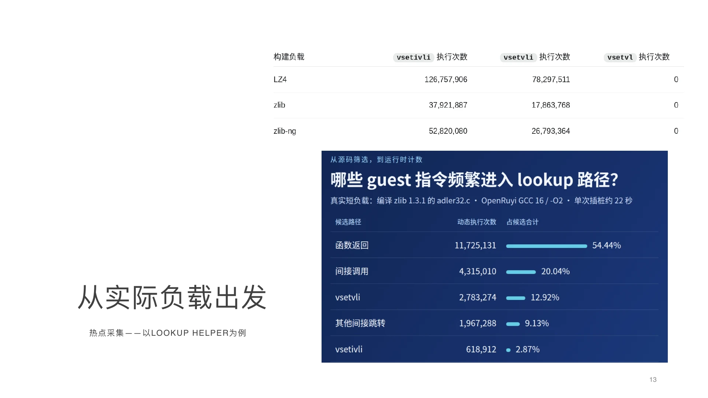

The numbers immediately pointed to concrete targets. On a short real-world run compiling `adler32.c` from `zlib 1.3.1` (openRuyi GCC 16 / `-O2`, ~22 seconds under instrumentation), the top candidates entering the lookup path were function returns (11,725,131; 54.44%), indirect calls (4,315,010; 20.04%), `vsetvli` (2,783,274; 12.92%), other indirect jumps (1,967,288; 9.13%), and `vsetivli` (618,912; 2.87%).

Scaled up to full package builds, `vsetivli` and `vsetvli` fire tens to hundreds of millions of times:

| Build Workload | `vsetivli` Executions | `vsetvli` Executions | `vsetvl` Executions |
| --- | --- | --- | --- |
| `LZ4` | 126,757,906 | 78,297,511 | 0 |
| `zlib` | 37,921,887 | 17,863,768 | 0 |
| `zlib-ng` | 52,820,080 | 26,793,364 | 0 |

By combining source-level filtering with plugin counters, we effectively recovered the missing caller context for `helper_lookup_tb_ptr`.

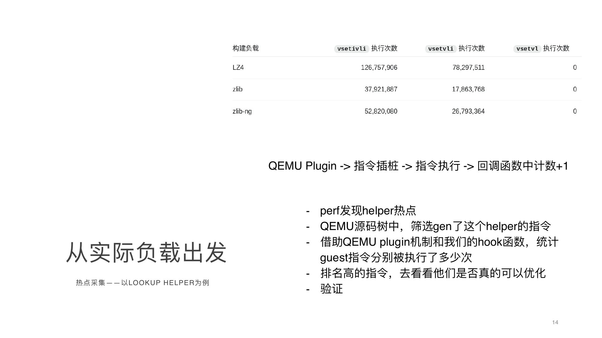

## From Conservative Fallbacks to Translation-Time Chaining

Pinpointing `vsetivli` and `vsetvli` raises the decisive question: **can these hotspots actually be optimized safely?**

In low-level systems software like QEMU, **correctness always comes before performance**. Upstream implementations often choose a conservative fallback—ending the TB and running a full `lookup`—precisely because it is guaranteed safe. That conservatism is also where real speedups hide: whenever we can prove at translation time that `(pc, flags, cflags, cs_base)` is fully determined, we can replace the runtime `lookup` with direct `goto_tb` chaining.

In my work so far, that extra translation-time certainty comes from two concrete sources:

1. **Immediate operands**: for instructions that update translation-context state using an immediate operand (such as `vsetivli`), we already know at translation time exactly which state fields change and what values they take—meaning the conservative `lookup` can be replaced with direct `goto_tb` chaining.
2. **Specific instruction sequences**: a subtler case occurs when the final instruction in a TB takes a register operand, yet an earlier instruction within the same TB loaded an immediate constant into that exact register. The register value is effectively constant at translation time, even though stock TCG does not track that fine-grained context on its own. By adding explicit tracking fields to the translation context, we can recover that static value and once again emit `goto_tb` instead of falling back to `lookup`.

Using this approach, I have recently submitted two patches upstream to QEMU and am iterating on reviewer feedback, with more patches planned next.

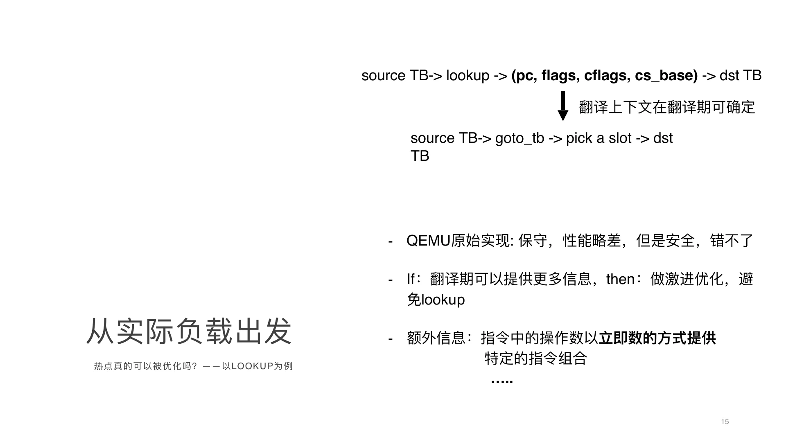

## Live Q&A

After the talk, our host Zevorn asked a question many contributors think about today: **how does AI help—or hurt—when contributing to massive upstream projects like QEMU?**

### Using AI Responsibly in Upstream Communities

My biggest impression is that huge open-source codebases like QEMU used to feel like impenetrable monoliths—all-English mailing lists, deep historical context, and intimidating technical debates that made it hard for newcomers to find a foothold. Today, AI acts as an approachable guide that helps you navigate the codebase, unpack mailing list history, and ease into upstream contribution.

The downside is just as real: some contributors chase quick merges by letting AI generate patches without genuinely understanding the underlying mechanics. That dumps heavy review burden onto upstream maintainers and robs the contributor of any real learning.

The right order is simple: **understand the fundamentals yourself first, then use AI to accelerate your analysis and contribution—never the other way around.**

As Zevorn also noted during the discussion, systems software patches may change only five or six lines of code while carrying deep side effects across subsystems. AI can assist with exploration and testing, yet every patch still requires human comprehension and refinement before it earns trust in an upstream community.

## Resources

- **Full Session Replay (Bilibili)**: [QEMU RISC-V Performance Optimization](https://www.bilibili.com/video/BV1224z6tE4s/)
- **QEMU Repository**: [gitlab.com/qemu-project/qemu](https://gitlab.com/qemu-project/qemu)
- **openRuyi Project**: [openruyi.org](https://openruyi.org/)
