> 这篇博客文章整理自 2026 年 11 月 6 日 MFCP 开源实践分享《QEMU RISC-V 性能优化经验分享》。

我是陈武星，格维开源社区的活跃贡献者。这段时间我在 OSPP 2026 进阶项目中，围绕利用 **QEMU user-mode** 加速 **openRuyi** 的 RISC-V 软件包打包与构建做了一系列性能优化工作。这篇文章完整梳理我在这次实践中的方法论、踩过的坑、工具链分析手段，以及最终沉淀下来的上游补丁思路。

## 项目背景与构建流程

这个项目真正的主角是 `qemu-user` 的执行加速，而 openRuyi 是我们的目标真实负载。openRuyi 是一个面向 RISC-V 架构的开源 Linux 发行版，需要持续完成大量 RISC-V 软件包的编译与打包。由于目前 RISC-V 宿主机在整个市场上的普及程度还比较有限，很多构建场景必须跑在 x86 等主流架构的宿主机上，通过 `qemu-user` 这样的用户态二进制转译工具来运行 RISC-V 构建环境。

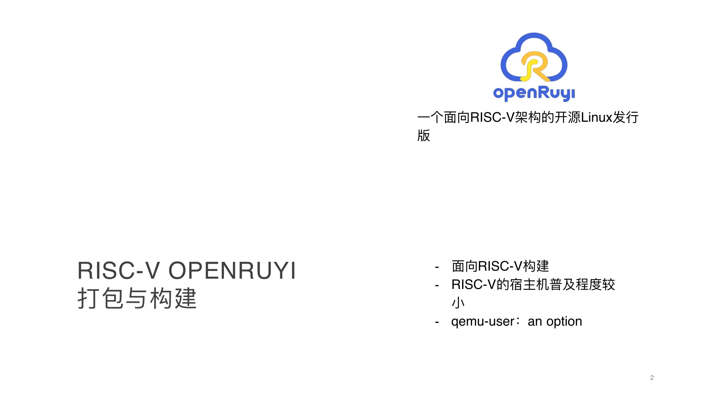

整个 openRuyi 的软件包构建流程可以概括为一条清晰的流水线：先拉取目标工具及其依赖包的源码和打包配置；接着初始化一个 RISC-V 用户态构建环境（包含面向 RISC-V 架构的 GCC、链接器等基础工具链）；随后按依赖顺序逐个编译、打包依赖包并安装进构建环境；再编译、链接目标工具本身；最后安装到临时目录，执行必要的检查与测试，产出最终软件包。

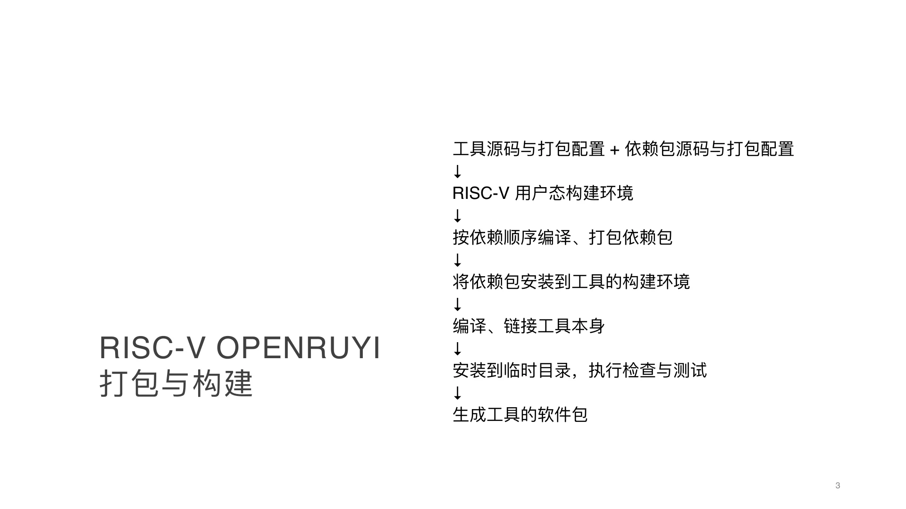

## 关注上游动态

在进入 `qemu-user` 的底层细节之前，我想先分享一条与具体底层实现无关、但极其重要的通用经验：**时刻关注上游动态**。

对于 QEMU、Linux 这类体量庞大的开源项目，上游邮件列表和提交记录里的信息量极其密集——无论是 API 变动、版本更迭还是正在评审的补丁，及时跟进都能帮你在正确的最新基线上开展工作。

### 避免在错误的基线上开发

我就亲身踩过一个非常典型的坑。9 月份项目初期，我在当时的一个 QEMU 发行版基线上做开发，结果发现哪怕跑一些很简单的负载，动辄也要跑上一个小时，甚至三个小时。一开始我还怀疑是自己机器性能太差，后来转念一想，去翻了翻 `qemu-devel` 邮件列表，果然查出了真相：9 月 27 日上游在讨论 `Re: [Stable-11.1.2 v2 64/92] linux-user/riscv: invalidate reservations after stores` 这封邮件里明确指出，之前合入的一笔补丁引发了灾难性的性能回退。

原因在于，一旦 guest 进程拉起第二个线程（标记 `CF_PARALLEL`），`gen_store()` 在每一条普通整数 store 指令上都会通过 `EXCP_ATOMIC` 退出，触发 `cpu_exec_step_atomic -> start_exclusive` 停掉所有其他 vCPU；并且无论单线程还是多线程，每条 store 都要调用 `helper_riscv_invalidate_reservations()` 遍历全部 CPU。上游实测压缩 2 MB 数据时，`xz -T1` 从 5 秒暴涨到 122 秒，`xz -T8` 从 1 秒直接卡到 600 秒无输出。

撤销这笔问题补丁前后，我在 openRuyi 的 6 个真实软件包构建负载上测出的耗时差异非常惊人：

| 负载 | 撤销前 | 撤销后 | 耗时比 |
| --- | --- | --- | --- |
| `which` | 9 分 24.474 秒 | 9 分 32.964 秒 | 0.99× |
| `xz` | 56 分 40.425 秒 | 12 分 18.934 秒 | 4.60× |
| `zlib-ng` | 1 小时 1 分 8.118 秒 | 5 分 49.359 秒 | 10.50× |
| `file` | 26 分 49.929 秒 | 8 分 42.081 秒 | 3.08× |
| `lz4` | 3 小时 8 分 29.682 秒 | 6 分 41.213 秒 | 28.19× |
| `pcre2` | 1 小时 50 分 58.990 秒 | 18 分 1.950 秒 | 6.15× |

如果不关注上游动态、闷头闭门造车，很可能在一块已经严重回退的基线上白白耗掉大量时间。

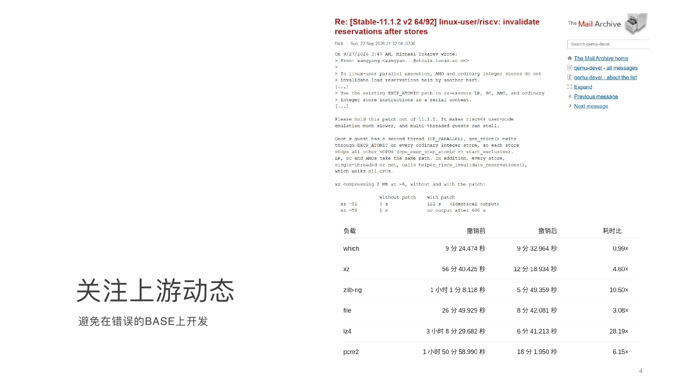

### 从历史讨论中发掘优化思路

关注上游动态还有第二个很大的好处。大型开源项目里经常出现这种情况：某位贡献者提了一个补丁，上游 reviewer 给出了非常有价值的专业建议，但原作者可能因为各种原因中途退出，补丁就一直停留在邮件列表里没有继续推进。

例如我在检索历史邮件时，就翻到过早在 RVV v0.7.1 时期社区围绕 `trans_vsetvli()` 能否使用 `gen_goto_tb()` 链接到下一个 TB、以及在向量循环边界上遇到的具体问题讨论。后来者完全可以多翻翻年代久远的邮件列表，或者借助 Agent 做定向检索——前人留下的分析与 reviewer 意见，往往就能成为我们打开局面的重要思路来源。

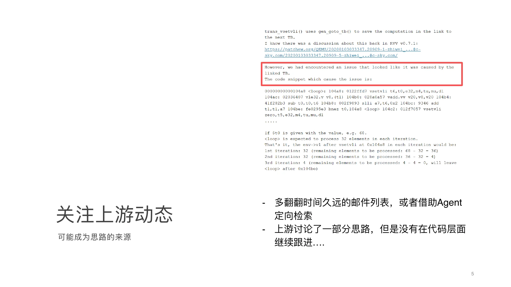

## 从实际负载出发与工具隔离

回到 `qemu-user` 本身的性能调优，第一条要避免的误区就是**盲目对着庞大源码库做纯静态阅读**。对着源码干看很难挖出真正高收益的优化点，必须借助 `perf` 这类性能分析工具，在真实负载上逐层采集热点。

### 分层定位高频工具

热点分析本身是分层次的。最粗的一层颗粒度，是统计整个构建过程里**到底哪些工具调用频次最高、耗时占比最大**。在一次 openRuyi 软件包构建中，会穿插调用 GCC 编译器前端 `cc1`、链接时优化 `lto1` / `lto1-ltrans`、打包工具 `rpmbuild`、汇编器 `as` 以及各种 shell 与文件工具。

在 7 组构建负载上的 `perf` 统计结果一目了然：`cc1` 在几乎所有负载中都稳居第一——在 `lz4` 中高达 **70.7%**，在阶段性 `QEMU` 构建中占 **61.6%**，在 `xz` 中占 **53.2%**，在 `zlib-ng` 中占 **51.2%**，其次是 `lto1-ltrans`、`lto1` 与 `rpmbuild`。先锁定 `cc1` 这类最高频工具做深入剖析，投入产出比最高，绝不要把精力消耗在占比微小的低频工具上。

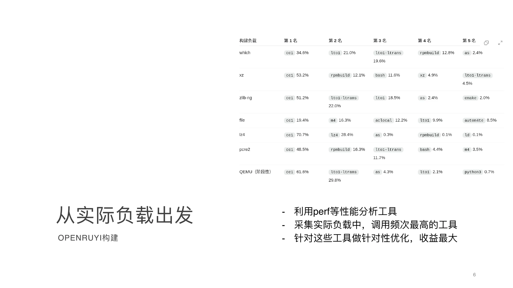

### 工具隔离与基准纪律

从大负载里把 `cc1` 隔离出来之后，下一步要合理拆分测试负载的粒度——每次改完代码就从头跑一遍完整的发行版打包既耗时间又低效。我在实践中按用途准备了四套负载：

- **快速排查问题**：自己编写固定的 `probe.c`，交给构建环境里的 RISC-V `cc1` 编译，秒级定位问题；
- **评估编译性能**：从真实项目里抽出耗时最长的预处理文件（例如固定 `lz4.i` 和原始 GCC 编译参数），单独重放 `cc1`；
- **检查实际构建收益**：回到 openRuyi 的 `lz4`、`zlib-ng`、`pcre2` 等完整软件包构建流程，验证端到端提速；
- **验证补丁机制与正确性**：针对 `vset*` 循环、动态 AVL、跨页与异常恢复等边界条件编写专项小测试。

做这类性能对比时，测试环境的一致性至关重要：必须保证完全相同的参数输入、相同的版本与基线 commit，同时把进程绑定到固定 CPU 核心、锁好并行度与主频，并在跑分前做好预热、采用交替顺序运行。忽略这些环境变量，测出来的数据就没有实际参考价值。

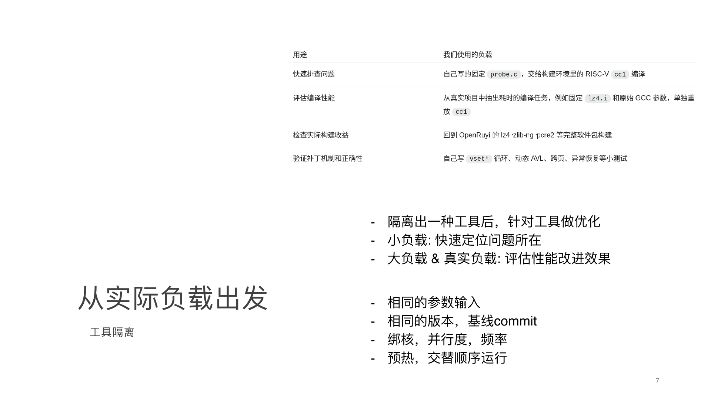

## 理解 `lookup helper` 与 TCG 路径

把 `cc1` 隔离出来做符号级剖析后，我这段时间的核心聚焦点落在了 `qemu-user` 里的 **`lookup helper`** 上。这里先快速理顺它在 QEMU TCG（Tiny Code Generator）里的工作原理。

TCG 会把 guest 代码按基本块翻译成一个个 TB（Translation Block）。当一个 `source TB` 执行完毕、准备跳转去执行下一个 `dst TB` 时，必须依赖当前的四元组翻译上下文：`(pc, flags, cflags, cs_base)`。

- 如果这套翻译上下文在**翻译期**就能完全观测确定，QEMU 就可以在翻译阶段直接把当前 TB 和目标 TB 链接起来，也就是 **Direct Chaining**，执行速度极快；
- 如果翻译期无法观测完整上下文——例如某条指令的操作数来自寄存器，而这条指令又会修改包含在翻译上下文里的处理器状态——翻译期就只能发射 `lookup_and_goto_ptr`，在**执行期**调用 `helper_lookup_tb_ptr`，手动查询当前的四元组上下文并检索出下一个 `dst TB`。

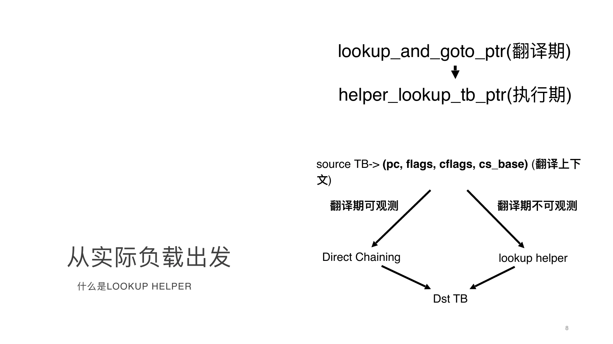

更广义地看，guest 指令经过 TCG IR 变成 host 宿主机指令有两条路径：对于像 `add` 这样极其简单的指令，TCG 会将其翻译为内联 TCG 操作，最终编译成内联的宿主机机器码，虽然实现更复杂，但执行效率非常高；而对于浮点指令或涉及复杂状态变更的指令，往往倾向于发射一个 C helper call，在宿主机上调一个普通 C 函数，写起来简单，代价是运行时开销明显更高。

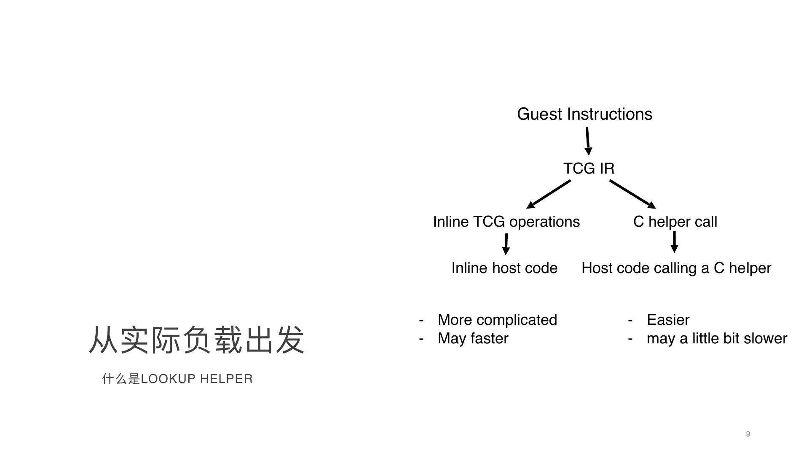

## JIT 热点采集与 QEMU Plugin 插桩

在隔离出的 `cc1` 负载上直接跑 `perf`，很快抓到了一个非常刺眼的大热点：`qemu-riscv64` 里的 `helper_lookup_tb_ptr` 竟然占了 **24.24%** 的时间（其中内联的 `tb_lookup` 占 19.81%，`tb_jmp_cache_hash_func` 占 17.35%）。

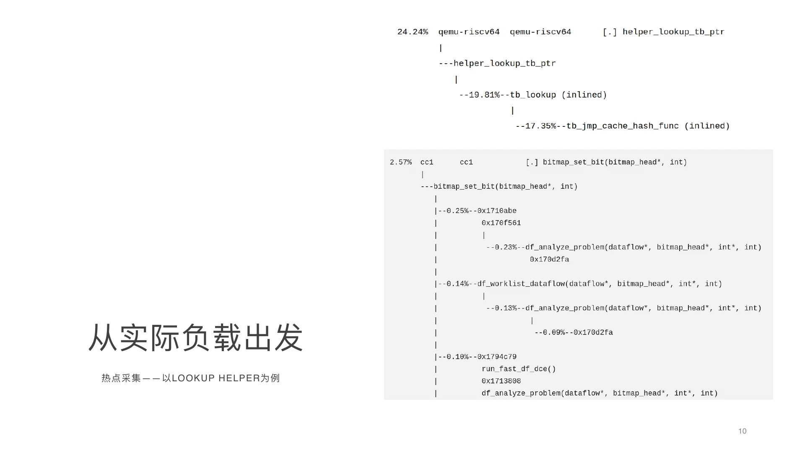

拿到这样一个大热点后，自然有两条优化思路：

1. **优化热点本身的执行时间**：也就是尝试把 C helper 做 TCG IR 化，变成内联宿主机代码。但这类 helper 往往对应复杂指令，如何 IR 化深度绑定于指令自身语义，很难总结出通用套路；
2. **减少进入这个热点的上下文次数**：让原本滚烫的热点“不那么热”。这是我近期工作的主攻方向。

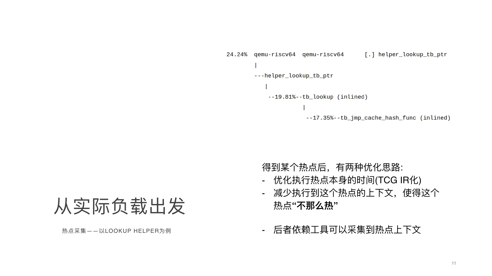

然而第二条路高度依赖“能够采集到是谁调用了这个热点”。好巧不巧，在 QEMU 这种带 JIT 编译器的特殊进程里，单靠通用的 `perf` 根本行不通。回头看前面两张 `perf` 截图的对比：在原生 `cc1` 进程里，`perf` 可以把到达 `bitmap_set_bit` 的多条上游函数路径全部还原出来；可到了 `qemu-riscv64` 里，`helper_lookup_tb_ptr` 的上游路径几乎完全断掉了。

原因在于 guest 指令经由 TCG 编译出的宿主机代码是一段动态生成的匿名 JIT 指令，缺少普通可执行文件具备的符号信息，所以 `perf` 很难跨过 JIT 边界重建调用上下文。

要补齐这部分上下文，在 QEMU 里有两条路：一是借助 QEMU 提供的 `perfmap` 与 `jitdump` 机制为 JIT 代码补充符号；二是直接利用 **QEMU Plugin 与回调插桩**。我选择了第二种方式。

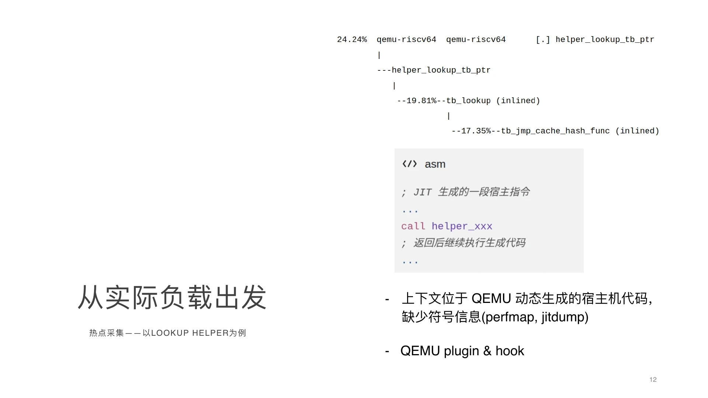

QEMU Plugin 机制允许我们在翻译或执行特定 guest 指令时挂载自定义回调函数。结合我们的目标，整套定位流程非常闭环：

1. 先用 `perf` 确认 `helper_lookup_tb_ptr` 是核心热点；
2. 到 QEMU 源码树中检索，筛选出所有在翻译期会发射该 helper 调用的 guest 指令；
3. 利用 QEMU Plugin 对这些候选 guest 指令做插桩，每执行一次就在回调函数里计数加一；
4. 按动态执行次数排序，把排在最前面的高频指令挑出来逐一分析是否能优化，最后做实测验证。

这组实测数据立刻把真相浮出了水面：在编译 `zlib 1.3.1` 的 `adler32.c`（openRuyi GCC 16 / `-O2`，单次插桩耗时约 22 秒）短负载中，进入 lookup 路径的候选指令依次为函数返回（11,725,131 次，54.44%）、间接调用（4,315,010 次，20.04%）、`vsetvli`（2,783,274 次，12.92%）、其他间接跳转（1,967,288 次，9.13%）以及 `vsetivli`（618,912 次，2.87%）。

放到完整的软件包构建负载上看，`vsetivli` 与 `vsetvli` 的动态执行量更是惊人：

| 构建负载 | `vsetivli` 执行次数 | `vsetvli` 执行次数 | `vsetvl` 执行次数 |
| --- | --- | --- | --- |
| `LZ4` | 126,757,906 | 78,297,511 | 0 |
| `zlib` | 37,921,887 | 17,863,768 | 0 |
| `zlib-ng` | 52,820,080 | 26,793,364 | 0 |

通过这种“源码筛选 + 插件计数”的方式，我们等于绕过了 JIT 符号缺失的限制，变相把 `helper_lookup_tb_ptr` 的真实调用上下文完整恢复了出来。

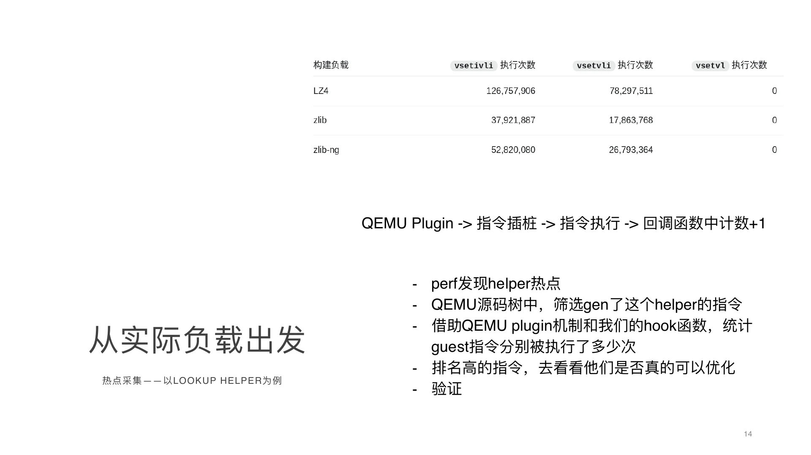

## 从保守实现到翻译期优化

锁定了 `vsetivli`、`vsetvli` 这类高频指令之后，下一个最自然的问题就是：**这些热点真的可以被优化吗？**

这里要理解像 QEMU 这种底层基础软件的一项铁律：**正确性永远优先于性能**。上游原始实现往往宁可写得保守一点、牺牲部分性能，也要保证翻译出来的程序绝对安全、错不了。而这种保守策略，恰恰为我们打开了优化的口子——只要我们通过分析证明某条指令在翻译期就能确定完整的四元组翻译上下文 `(pc, flags, cflags, cs_base)`，就能把原本无条件截断 TB 并触发 `lookup` 的保守路径，改造成更激进的 `goto_tb` 直接链接，彻底省掉这次 `lookup` 调用。

在我这段时间的实践里，翻译期能拿到的额外确定性信息主要来自两类场景：

1. **指令的操作数以立即数提供**：有些会修改翻译上下文的指令（例如 `vsetivli`），原始实现保守地无条件截断 TB 走 `lookup`；但因为它的操作数本身就是指令编码里的立即数，我们在翻译期其实已经完全清楚哪些状态被改了、改成了什么值，因此可以直接优化成 `goto_tb` 链接；
2. **特定的指令组合**：这一类更隐晦一些。有时候 TB 末尾的那条指令确实是通过寄存器来提供操作数的，但仔细看同一个 TB 里的前序指令，会发现这个寄存器刚在前几条指令里被装入了一个确定的立即数。也就是说，在这个 TB 的局部上下文里，该寄存器的值在翻译期本来就是确定的。只是原生 TCG 不会自动追踪这么细粒度的上下文信息，需要我们在翻译上下文结构体中手动扩展追踪字段，把原本看似动态的寄存器值还原成翻译期已知常量，从而同样转化成 `goto_tb` 直接链接。

沿着这套思路，我最近已经向 QEMU 上游提交了两个补丁，目前正在根据上游 reviewer 的反馈继续打磨完善，后续还会有更多优化补丁陆续提交上去。

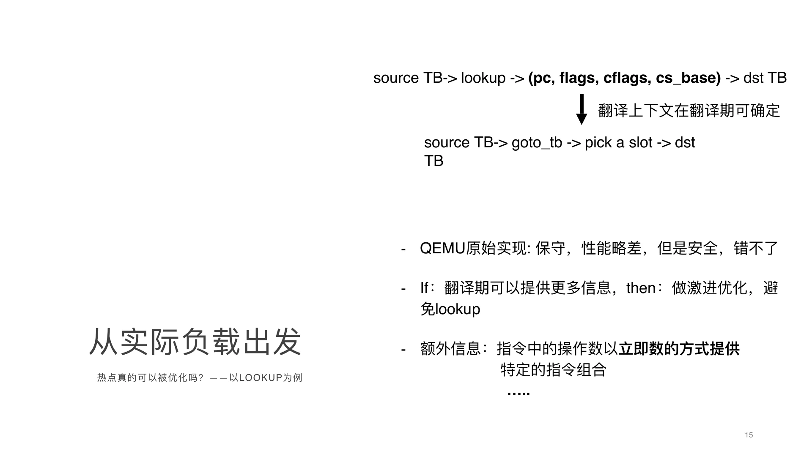

## 现场问答

分享结束后，主持人泽文和我聊起了一个现在很多开源贡献者都很关心的话题：**在 AI 普及的背景下，参与 QEMU 这类大型上游开源社区有哪些帮助，又有哪些值得警惕的地方？**

### 借助 AI 融入上游社区的利与弊

我最大的感受是，以前面对 QEMU、Linux 这样的大型开源项目，真的会有种面对“洪荒巨兽”的无力感——邮件列表全是英文，技术讨论跨度大、历史包袱深，新人想自然融入非常困难。有了 AI 之后，它可以陪你读源码、梳历史邮件、解释上下文，带你平滑地跨进社区贡献的大门，这是非常正向的帮助。

但不好的一面同样很明显：有些贡献者出于功利目的，自己对底层原理根本没理解透彻，就直接纯靠 AI 生成代码往上甩补丁。这种做法一方面给上游维护者和 reviewer 制造了沉重的评审负担，另一方面对贡献者自己也没有起到真正的学习作用。

我的体会很直接：**一定要先自己把原理真正搞懂，再借助 AI 提效并向上游提交贡献，这个顺序绝对不能颠倒。**

泽文在讨论中也补充了一个基础软件领域的共鸣：底层基础软件的补丁往往表面上只改了五六行代码，背后却牵动着复杂的边界效应、长期调研与严密测试。AI 可以帮我们做大范围检索和辅助验证，但产出的每一处改动都必须经过人自己的理解、消化与打磨，这样才能真正赢得上游社区协作者的信任。

## 相关资源

- **本次分享完整回放（B 站）**：[QEMU RISC-V 性能优化经验分享](https://www.bilibili.com/video/BV1224z6tE4s/)
- **QEMU 官方仓库**：[gitlab.com/qemu-project/qemu](https://gitlab.com/qemu-project/qemu)
- **openRuyi 项目**：[openruyi.org](https://openruyi.org/)
