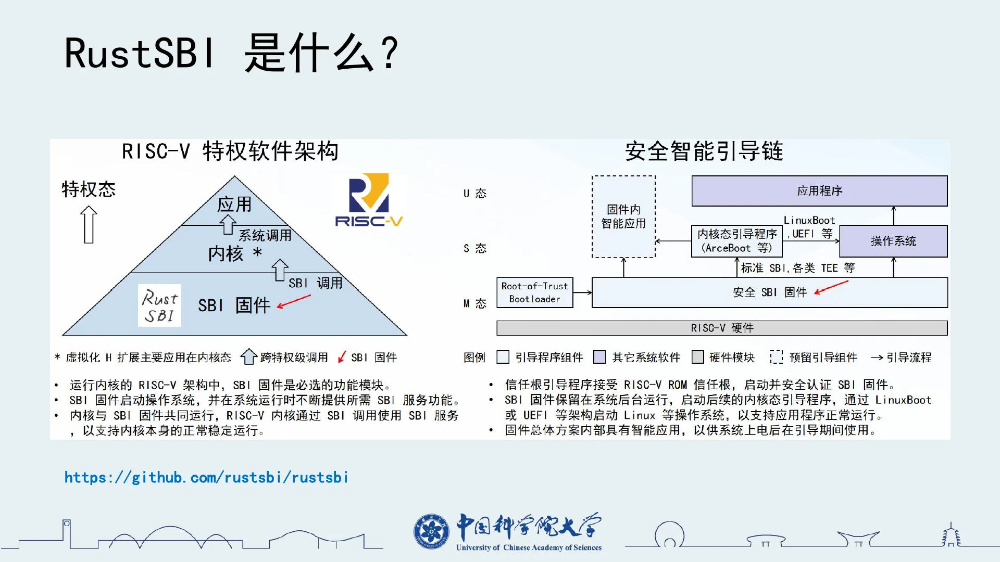
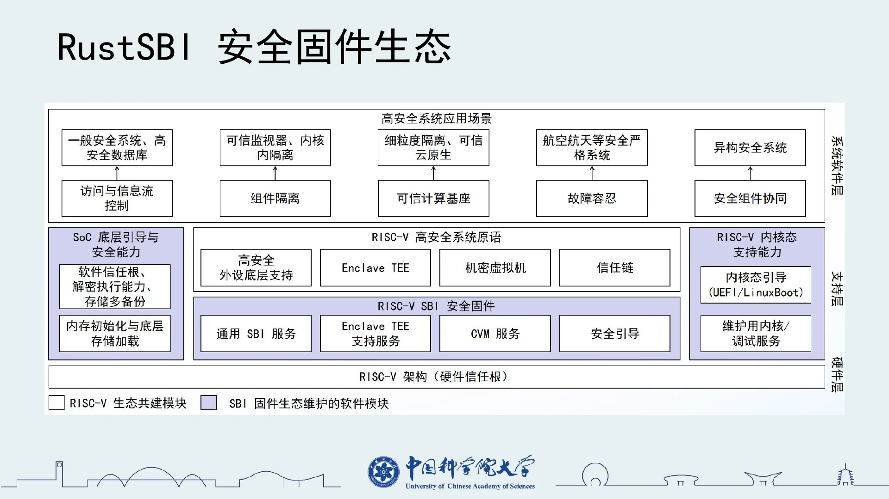
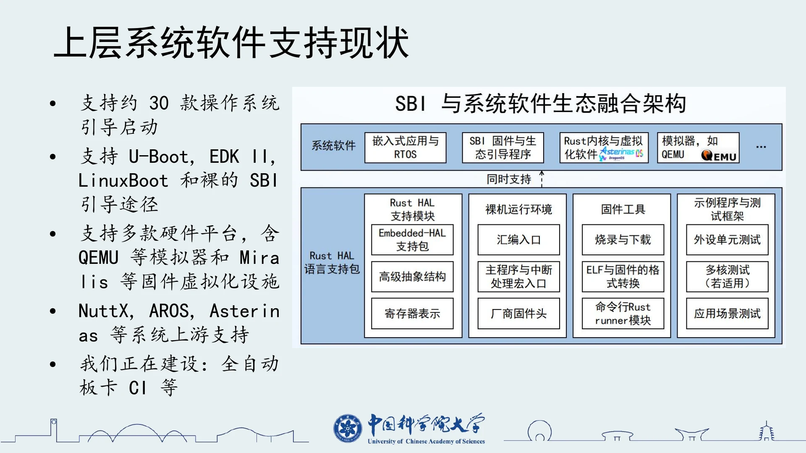
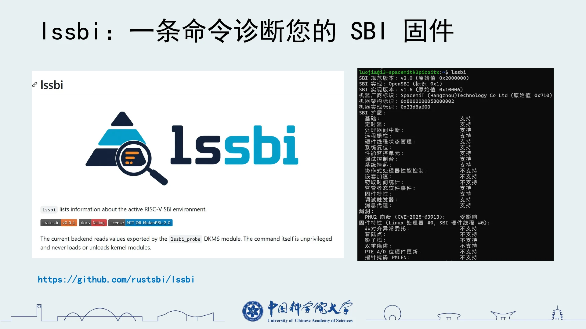
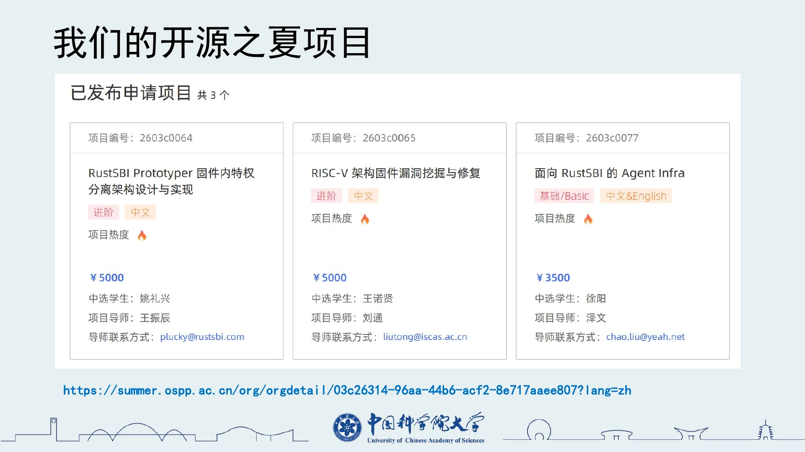

> This post is adapted from my November 20, 2026 talk at the MFCP Open-Source Practice Sharing session, *RustSBI 2026 Open-Source Security Firmware Progress Report*.

I'm Zhouqi Jiang (Luojia) from the Institute of Software, Chinese Academy of Sciences (ISCAS), and the creator and lead maintainer of **RustSBI**, an open-source security firmware implementation for RISC-V. In this post, I walk through why M-mode security firmware matters in the RISC-V software stack, share what our community accomplished in 2026—from booting ~30 operating systems and integrating with firmware virtualization to launching `lssbi` and mentoring OSPP projects—and highlight ways for open-source contributors to get involved.

## RISC-V Privilege Architecture and Boot Chain

### Why M-Mode Security Firmware Matters

Anyone who has studied operating systems knows the classic boundary between User Mode (U-mode) and Supervisor Mode (S-mode), bridged by system calls. Today, as large language models dramatically accelerate vulnerability discovery, relying solely on a monolithic OS kernel to protect applications is increasingly fragile. A kernel like Linux spans tens of millions of lines of code, carrying an enormous attack surface.

RISC-V took a remarkably forward-looking approach by introducing a higher privilege level beneath the kernel: **Machine Mode (M-mode)**. By extracting minimal boot routines and foundational security mechanisms out of the kernel into a compact M-mode firmware layer, the trusted codebase shrinks from tens of millions of lines down to a few tens of thousands. At that scale, exhaustive security audits, fuzzing, AI-assisted vulnerability analysis, and formal verification become genuinely tractable.

After years of early community debate around BBL and prototype firmware interfaces prior to 2020, RISC-V standardized the **Supervisor Binary Interface (SBI)**. On any S-mode RISC-V system capable of running an OS kernel (excluding pure M/U-mode microcontrollers), SBI firmware is mandatory: it boots the operating system and stays resident at runtime to serve timer, inter-processor interrupt, multi-core bring-up, and security SBI calls.

Of course, using M-mode firmware to protect the kernel only works if the firmware itself is trustworthy. Starting in 2020 from an early Rust SBI prototype in Tsinghua University's rCore ecosystem, I launched **RustSBI** to bring Rust's memory safety directly into M-mode firmware. Over the past six years, RustSBI has grown alongside the C-based OpenSBI project—both adhering to the same international SBI specification so teams can switch freely based on their needs.

### Trusted Boot Chains and Root of Trust

Looking across the full chain of trust, security firmware must stay minimal in both directions:

- **Downward to the Root-of-Trust Bootloader**: Every SoC ships with platform-specific ROM and bare-metal initialization code. Folding all of that into SBI firmware would violate the principle of least privilege and bloat M-mode. Instead, we treat stage-0/stage-1 bootloaders like rocket boosters: once the hardware ROM verifies and launches the Root-of-Trust Bootloader, it authenticates and hands off to the SBI firmware, then drops away so it never lingers at runtime.
- **Upward to S-Mode Bootloaders and Operating Systems**: Feature-rich bootloaders such as UEFI (EDK II) and LinuxBoot include networking, Wi-Fi, Bluetooth, and NVMe drivers—far too large for M-mode. They belong in S-mode, right alongside the OS kernel. From the SBI firmware's vantage point, an S-mode bootloader and an OS kernel share the same privilege boundary: LinuxBoot uses `kexec` to replace itself with the target Linux kernel, UEFI exposes an industry-standard boot interface, and lighter S-mode loaders like `ArceBoot` and `FStart` follow the exact same model.
- **In-Firmware Intelligent Applications**: Commercial UEFI implementations have already begun experimenting with remote LLM agents during boot—letting users ask how to tune overclocking settings directly from the BIOS menu, or inspect crash logs to diagnose and recover a broken OS before it boots. Our boot-chain diagram reserves a dedicated slot for in-firmware intelligent applications to support this emerging direction.

## Security Firmware Ecosystem

Guided by least privilege, we structure the RustSBI ecosystem across three clean layers—hardware, support, and system software:

1. **SoC Low-Level Boot and Security**: Anchored directly to the RISC-V hardware root of trust, handling memory initialization, storage loading, firmware signature verification, and fault-tolerant storage redundancy. In aerospace environments where cosmic radiation can trigger single-event upsets in flash memory, maintaining multi-copy or multi-flash firmware backups ensures a single bit-flip does not brick a satellite.
2. **RISC-V SBI Security Firmware and Primitives**: Delivers standard SBI services, Enclave TEE support, confidential VM (CVM) services, and secure boot, exposing isolation, trusted computing base (TCB), and chain-of-trust primitives to upper-layer workloads—from secure databases and intra-kernel isolation to confidential cloud-native stacks and safety-critical avionics.
3. **RISC-V S-Mode Support Capabilities**: Houses rich bootloaders (UEFI / LinuxBoot) as well as maintenance kernels and debugging services outside M-mode.

Looking ahead, maintenance kernels open intriguing possibilities for AI-native systems research: interactive agents that demystify low-level firmware consoles, or self-healing operating systems in the spirit of SpecOS—where memory snapshots from a kernel panic are exposed as an MCP service so a maintenance environment can diagnose the fault semantically, patch configuration, and reboot cleanly. Bringing those ideas into safety-critical domains will take sustained collaboration between academia and industry.

## Operating Systems and Hardware Platforms

Here is where RustSBI stands in 2026 across real-world operating systems, boot paths, simulators, and upstream integration:

- **~30 Operating Systems Booted**: Spanning mainstream Linux distributions, Rust kernels such as Asterinas, DragonOS, rCore, and ByteOS, real-time OSes including RTEMS, RT-Thread, and Apache NuttX, plus multiple hypervisors.
- **All Four RISC-V Boot Paths**: Full support for U-Boot, EDK II (UEFI), LinuxBoot, and direct raw-SBI boot.
- **Hardware, Digital-Twin Simulators, and Firmware Virtualization**: Beyond physical boards, RustSBI works tightly with QEMU, gem5, and Nanjing University's NEMU—enabling digital-twin simulation of complex multi-node systems like aircraft avionics, high-speed rail controllers, and satellite constellations. We also integrate with **Miralis**, the RISC-V virtual firmware monitor presented at SOSP '25 (*The Design and Implementation of a Virtual Firmware Monitor*). Miralis runs unmodified SBI firmware inside a formally verified minimal monitor, unlocking strong firmware isolation and automated firmware testing without manual reflashing. We have contributed multiple pull requests upstream to Miralis and enjoy close collaboration between the two communities.
- **First-Class Upstream OS Support**: **Apache NuttX** defaults to RustSBI on RISC-V so embedded developers do not need to wrestle with firmware setup, while **AROS** and **Asterinas** let users toggle effortlessly between OpenSBI and RustSBI thanks to the shared SBI standard.

Under the hood, we are aligning RustSBI tightly with Rust HAL support crates (Embedded-HAL, bare-metal runtime entrypoints, flashing/format tooling, and multi-core test harnesses) and evolving the architecture so silicon vendors no longer need to maintain diverging downstream forks. Once a vendor tapes out a new RISC-V chip, they can upstream clean board support rapidly and benefit from our community's ongoing security audits. Alongside simulator-based CI, we are building **fully automated physical board CI** to run real-hardware benchmarks and regression suites continuously.

## Firmware Diagnostics with lssbi

Earlier this year we released **[lssbi](https://github.com/rustsbi/lssbi)** (dual-licensed under MIT OR MulanPSL-2.0), a single-command Linux CLI utility for inspecting the active RISC-V SBI environment.

Checking which SBI implementation, specification version, extensions, and security features a board actually exposes used to require writing custom probe code. Running `lssbi` reports everything at a glance:

- SBI specification version, implementation identity (such as OpenSBI or RustSBI), and implementation version;
- Machine vendor ID, architecture ID, and implementation ID;
- Availability of every SBI extension—Base, Timer, IPI, RFENCE, HSM, System Reset, PMU, Debug Console, System Suspend, CPPC, Nested Acceleration, Steal-Time Accounting, SSE, Firmware Features, Debug Triggers, and MPXY;
- Known vulnerability checks matched against our curated database (for instance, flagging `CVE-2025-63913` PMU2 crash exposure on an OpenSBI v1.6 SpacemiT board in the slide above) so operators know immediately when to update firmware;
- Firmware security feature flags including misaligned exception delegation, landing pads, shadow stack support, double trap, hardware PTE A/D updates, and pointer masking (PMLEN).

`lssbi` is already packaged in SpacemiT's Bianbu distribution via `apt`, with packaging for openRuyi and other RISC-V distros underway. It supports structured JSON output for automation and ships in seven languages—including right-to-left Arabic. Today `lssbi` reads data exported by an unprivileged `lssbi_probe` DKMS kernel module; we are upstreaming standard `sysfs` query interfaces into the Linux kernel so future versions can run as a pure user-space binary.

## Community Contributions and OSPP 2026

In May 2026 we shipped **RustSBI 0.4.1**, backed by **32 contributors** across the year. A huge thank-you to everyone who drove the project forward: **Zhenchen Wang (`Plucky923`)** led the way with 225 commits and over 72,000 lines added, revitalizing the codebase; **Yapeng Wang (`yydawx`)** discovered and patched security vulnerabilities while stepping up as a reviewer; **Zevorn (`zevorn`)** ranked fourth overall; **Bing Han (`hanbings`)** pushed forward `ArceBoot`; and Chongbin Yu along with maintainers across five or six vendor BSP crates kept hardware support humming.

We also published three projects in **OSPP 2026 (Open Source Promotion Plan)** spanning intra-firmware privilege separation, vulnerability research, and agent infrastructure:

| Project ID | Topic | Difficulty | Selected Student | Mentor |
| --- | --- | --- | --- | --- |
| `2603c0064` | RustSBI Prototyper Intra-Firmware Privilege Separation Design & Implementation | Advanced | Lixing Yao | Zhenchen Wang |
| `2603c0065` | RISC-V Firmware Vulnerability Discovery & Remediation | Advanced | Nuoxian Wang | Tong Liu |
| `2603c0077` | Agent Infrastructure for RustSBI | Basic | Yang Xu | Zevorn |

Whether you are drawn to firmware security, formal verification, agent infrastructure, or systems programming in Rust, our community welcomes new contributors to help shape what RISC-V security firmware can do in the agentic era.

## Live Q&A

After the talk, our host Kai Liu and community attendees asked several practical questions covering hardware bring-up, formal verification, MCU boundaries, performance, and security architecture. Here is a recap.

### Hardware Porting Scope and Turnaround

**Question (Kai Liu)**: If a RISC-V chip already runs OpenSBI, how much driver work is needed to port RustSBI, how long does it take with AI assistance, and is there a matrix of supported chips on the website?

**My take**: Unlike porting Linux or an RTOS, SBI firmware only requires minimal peripherals: a serial console, multi-core startup synchronization primitives, and occasionally a security-specific peripheral dedicated to M-mode. Because RustSBI's shared core is mature, if the CPU core and basic peripherals (such as a standard 16550 UART) are already supported upstream, the porting footprint is tiny—with physical hardware and AI assistance, bring-up takes roughly **one day**. Our website's hardware compatibility matrix has lagged behind our CI updates; refreshing and automating that matrix is a top priority for **0.4.2**.

### Full Formal Verification at Firmware Scale

**Question (Junze Cao)**: Has RustSBI undergone formal verification?

**My take**: We are actively working on full formal verification and will share details once our research manuscripts are ready for publication. Prior academic efforts such as **SeSBI** verified a tiny ~100-line SBI implementation using ~600 lines of formal specifications. Scaling that ratio naively to a 50,000–70,000-line production firmware would require over 400,000 lines of proofs—far beyond what extra headcount or AI assistance alone can absorb. True full-scale verification calls for architectural breakthroughs rather than brute force.

### lssbi Portability and MCU Privilege Modes

**Question (Kai Liu & audience)**: Does `lssbi` work on OpenSBI as well, and can RustSBI run alongside RTOSes like NuttX on microcontrollers?

**My take**: `lssbi` targets the RISC-V SBI specification itself, so it works seamlessly with OpenSBI, RustSBI, KVM, or any compliant implementation.

For microcontrollers and RTOSes, the deciding factor is whether the chip implements **S-mode** (and remember that SBI runs *beneath* the RTOS, not inside it):

- Pure **M/U-mode** MCUs (such as GD32V, ESP32 RISC-V parts, and entry-level Zephyr targets) lack S-mode entirely; the RTOS runs directly in M-mode without SBI.
- Higher-end embedded chips, server BMCs, or MMU-less chips that *do* include **S-mode**—for example, HPMicro (HPM) chips, where the community ran Linux 6.6/6.7 no-MMU on top of RustSBI—work cleanly. Apache NuttX itself spans both S-mode and non-S-mode RISC-V targets.

### Performance, Legacy Compatibility, and Board Picks

**Question (Kai Liu & audience)**: Does switching to RustSBI improve performance? Is the Sophgo SG2042 (Milk-V Pioneer) supported, and which boards do you recommend for individual developers?

**My take**: Going back to China's National University System Capability Competition, teams that switched to RustSBI saw 20×–30× speedups on certain SBI call paths compared to early OpenSBI builds, with rock-solid compatibility—over half of first-prize winners in several editions ran our competition-tuned builds. RustSBI can also smooth over legacy RISC-V ISA quirks in firmware: on the Kendryte K210, handling compatibility inside RustSBI let developers boot mainline Linux kernels directly instead of maintaining backport patches.

We already support the peripherals needed for Sophgo SG2042. For individual developers looking for affordable hardware to hack on, good options include:

- Allwinner F101, V821, and V861 (the older D1 is now five or six years old)
- Sophgo SG2002
- Kendryte K230 (K510 is harder to source)
- ArtInChip D213
- SpacemiT K1 and K3 (even the auxiliary cores on K3 are worth experimenting with)

And if you do not have physical hardware on hand, QEMU—including the improvements Zevorn has contributed—is an easy way to start; feel free to open issues or PRs if you hit board-revision or device-tree quirks.

### Why RustSBI Offers Stronger Safety Than OpenSBI

**Question (audience)**: Beyond the choice of programming language, how does RustSBI approach security compared to OpenSBI?

**My take**: Rust's memory safety is our primary foundation. Architecturally, RustSBI makes a pragmatic trade-off today: it remains a monolithic M-mode firmware without non-standard hardware dependencies or unnecessary internal bloat. Through ongoing upstream refactoring, we concentrate `unsafe` operations inside a self-contained core runtime (roughly 8% of the codebase) while writing the vast majority of modules in Safe Rust, sharply reducing memory-corruption exposure.

We also admire **Asterinas** and its **Framekernel** design—splitting a system into a small, formally verifiable `frame` paired with Safe Rust `services`. That pattern translates naturally across Rust system software and offers a compelling roadmap for next-generation security firmware.

## Resources

- **Full Session Replay (Bilibili)**: [RustSBI Open-Source Practice Sharing](https://www.bilibili.com/video/BV1X1ysz9EkE/)
- **RustSBI Repository**: [github.com/rustsbi/rustsbi](https://github.com/rustsbi/rustsbi)
- **lssbi Diagnostic Tool**: [github.com/rustsbi/lssbi](https://github.com/rustsbi/lssbi)
- **RustSBI OSPP 2026 Organization Page**: [summer.ospp.ac.cn](https://summer.ospp.ac.cn/org/orgdetail/03c26314-96aa-44b6-acf2-8e717aaee807?lang=zh)
