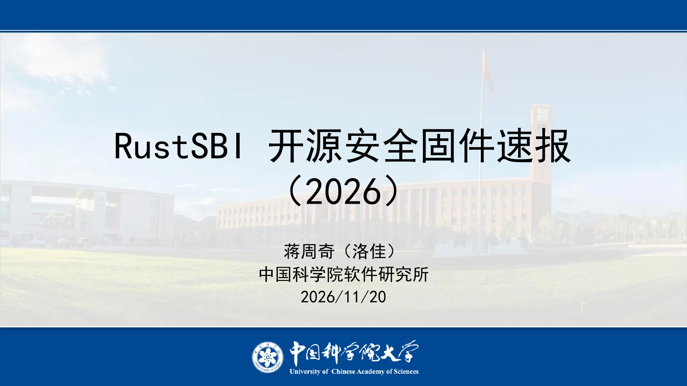
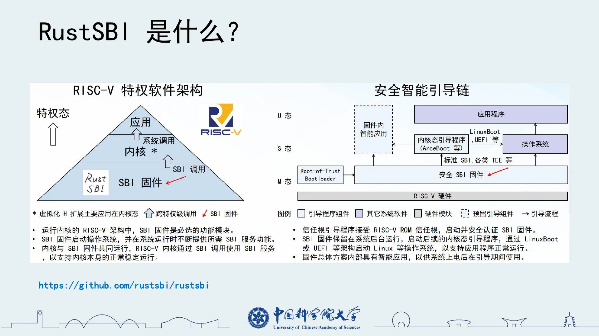
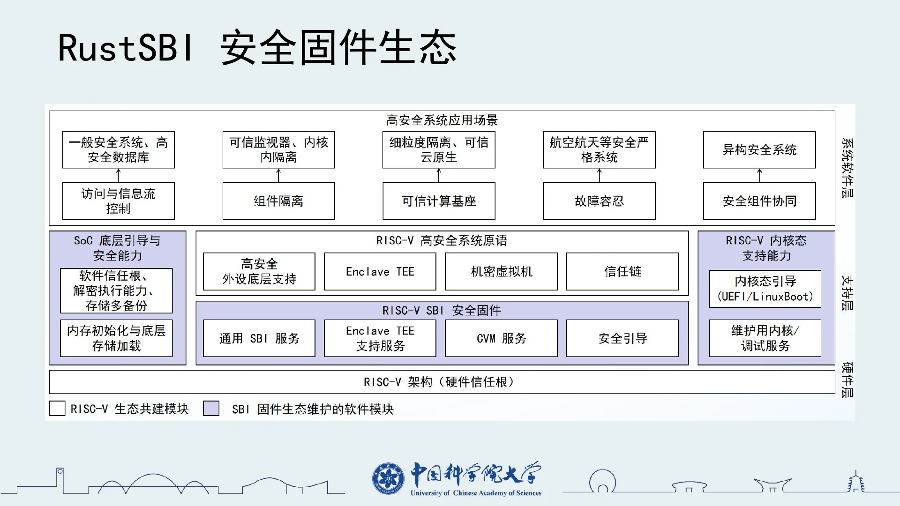
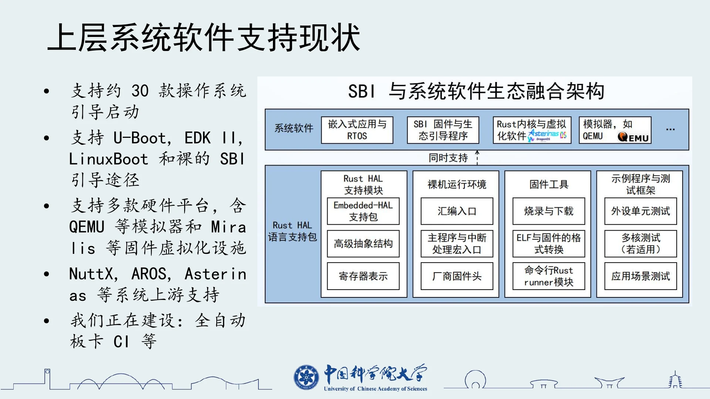
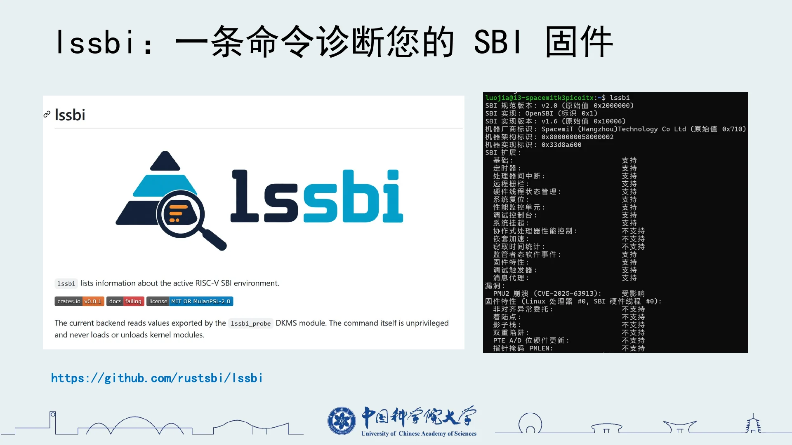
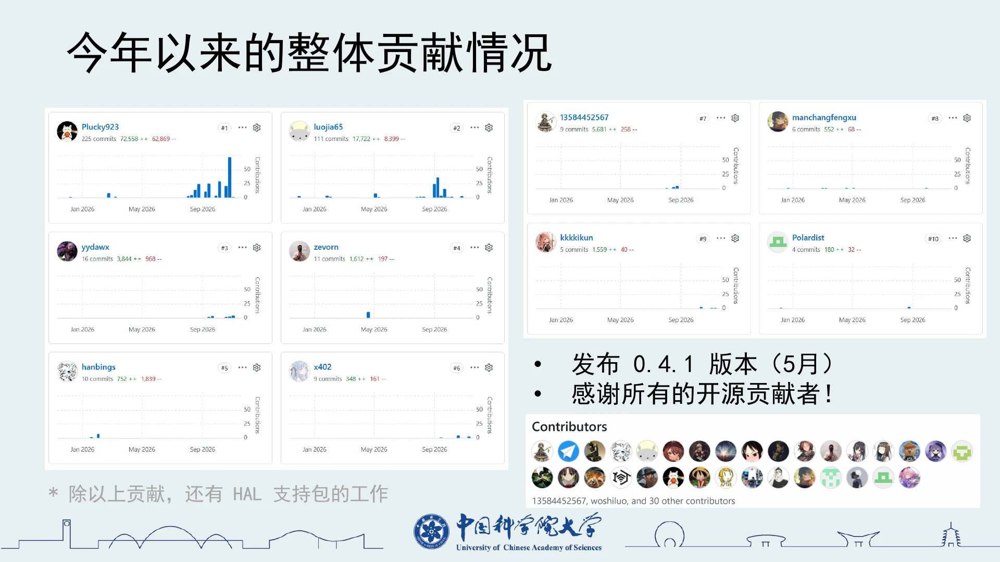
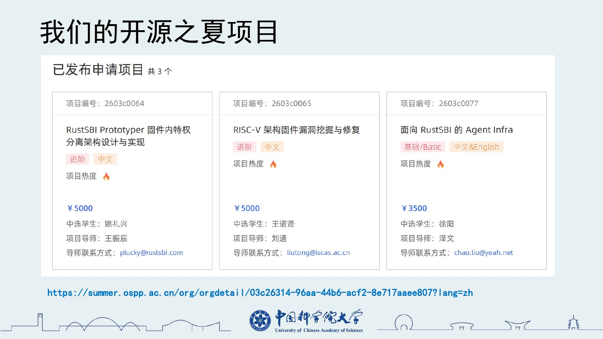

> 这篇博客文章整理自 2026 年 11 月 20 日 MFCP 开源实践分享《RustSBI 开源安全固件速报（2026）》。

我是蒋周奇（洛佳），来自中国科学院软件研究所，也是 RISC-V 开源安全固件项目 **RustSBI** 的发起人和主要作者。这篇文章简要回顾 RustSBI 过去六年的架构演进，并集中盘点我们在 2026 年围绕生态支持、诊断工具、社区贡献与开源之夏推进的各项工作，也希望为热心开源的开发者提供参与国际底层基础软件项目的切入点。

## RISC-V 特权架构与安全引导链

### 为什么需要 M 态安全固件

熟悉操作系统开发的同学都了解内核态（Supervisor Mode，S 态）与用户态（User Mode，U 态），应用程序通过系统调用请求内核服务。然而在当下大模型安全分析能力迅速增强的背景下，仅靠内核机制保护应用程序已经面临现实挑战：像 Linux 这样动辄上千万行代码的大型内核攻击面极广，客观上存在大量潜在漏洞。

RISC-V 架构在设计之初展现了很强的前瞻性，它在内核态之下单独划出了一层更高特权的**机器态（Machine Mode，M 态）**，将原本属于内核的一部分底层安全机制和最小启动能力剥离出来，交由代码体量小得多的固件承载。相比上千万行的操作系统内核，一个 SBI 固件通常只有数万行代码，更容易开展全量安全分析、Fuzz 测试、大模型漏洞挖掘乃至形式化验证。当底层固件本身足够可信时，就可以通过标准接口为上层内核与应用提供稳固的安全保障。

2020 年以前，社区围绕早期 BBL 与 SBI 雏形经历了长期讨论，最终沉淀出国际标准 **RISC-V SBI（Supervisor Binary Interface）**。只要是带 S 态、运行操作系统的 RISC-V 平台（除纯 M/U 态微控制器外），SBI 固件都是不可跳过的一环：它不仅负责启动操作系统，而且在系统开机后持续驻留后台，响应内核发起的时钟控制、多核管理与安全服务等 SBI 调用。

既然我们要依靠 M 态固件保护内核，固件自身的内存安全与可靠性就是前提。2020 年起步时，我基于清华大学 rCore 生态早期的 Rust SBI 原型改造出 **RustSBI**，借助 Rust 语言内生的内存安全机制构建高可信 SBI 实现，至今已经持续迭代了六年。同期社区还诞生了走 C 语言工业路线的 OpenSBI——两者在遵循同一份国际标准的基础上良性竞争、互为补充，让生态里的开发者可以根据团队技术背景自由选择。

### 安全智能引导链与信任根

从信任链（Chain of Trust）的角度看，SBI 固件在启动过程中承上启下，需要同时处理好向下的信任根与向上的丰富引导程序：

- **向下对接信任根引导程序（Root-of-Trust Bootloader）**：不同芯片平台的片上 ROM 与裸机启动代码各不相同。如果把所有平台的早期初始化代码都塞进 SBI 固件，就会违背最小特权原则、导致 M 态代码膨胀。因此我们把零阶段或一阶段引导类比为火箭助推器——由硬件 ROM 验签后拉起信任根引导程序，再由它认证并启动安全 SBI 固件，随后“助推器”功成身退，不再参与运行期执行。
- **向上一视同仁地支持 S 态引导程序与操作系统**：UEFI（EDK II）、LinuxBoot 等功能丰富的引导程序包含网络启动、Wi-Fi、蓝牙、NVMe 等海量驱动代码，同样不应放入 M 态，而应运行在 S 态。在安全 SBI 固件看来，S 态引导程序与操作系统处于同一特权级：LinuxBoot 通过 `kexec` 替换自身启动目标 Linux 内核，UEFI 则以工业级接口引导各类成熟系统，此外还有 `ArceBoot`、`FStart` 等多样化的 S 态引导组件。
- **面向引导期的固件内智能应用**：近来不少产品级 UEFI 固件已经开始探索接入远端大模型智能体——例如在 BIOS 界面直接用自然语言咨询超频参数，或在操作系统损坏无法开机时读取日志辅助诊断与修复配置。我们在引导链架构中专门预留了固件内智能应用的位置，为后续探索留出扩展空间。

## 安全固件生态与能力演进

围绕最小特权原则，我们将 RustSBI 的安全固件生态清晰划分为硬件层、支持层与系统软件层三个层级：

1. **SoC 底层引导与安全能力**：紧贴芯片硬件信任根，负责内存初始化、底层存储加载、固件签名验证以及高可靠容错机制。例如在航空航天场景下，宇宙射线可能引发闪存单粒子翻转，单份固件损坏就会导致整星无法启动，因此需要底层引导支持多闪存、多副本备份恢复。
2. **RISC-V SBI 安全固件与高安全系统原语**：在核心层提供通用 SBI 服务、Enclave TEE 支持服务、机密虚拟机（CVM）服务与安全引导，向上导出高安全外设底层支持、组件隔离、可信计算基座与信任链原语，支撑高安全数据库、可信监视器、内核内隔离、可信云原生以及航空航天等高安全系统场景。
3. **RISC-V 内核态支持能力**：将需要丰富外设和交互能力的模块放到 S 态，包括 UEFI / LinuxBoot 等内核态引导，以及维护用内核与调试服务。

在维护用内核与智能化方向上，社区和学术界还有不少值得持续探索的前沿构想：例如借助交互式智能体降低底层调试台的使用门槛；甚至探索类似 SpecOS 方向的自愈型操作系统——当系统发生崩溃时，将崩溃现场的内存上下文以 MCP 服务暴露出来，由具备语义理解能力的维护环境定位故障并自动修复重启。将这类能力真正引入高安全关键系统，还需要工业界与学术界长期协作打磨。

## 上层系统软件与硬件平台支持

回到 2026 年的工程进展，RustSBI 目前在操作系统兼容、引导路径、硬件与仿真平台以及上游生态融合上都已经形成了扎实的积累：

- **支持约 30 款操作系统引导启动**：涵盖主流 Linux 发行版，Asterinas、DragonOS、rCore、ByteOS 等各类 Rust 操作系统内核，RTEMS、RT-Thread、Apache NuttX 等实时操作系统，以及多款 Hypervisor。
- **覆盖全部主流 RISC-V 引导途径**：完整支持 U-Boot、EDK II（UEFI）、LinuxBoot 以及裸 SBI 四种启动路径。
- **支持真实硬件、数字孪生模拟器与固件虚拟化**：除了真实开发板，RustSBI 深度适配了 QEMU、gem5 以及南京大学 NEMU 等主流模拟器，能够支撑大飞机航电、高铁控制或卫星星座等大规模系统的数字孪生联合仿真。同时，RustSBI 积极适配了发表在 SOSP '25 的 RISC-V 固件虚拟化监视器 **Miralis**（论文见 *The Design and Implementation of a Virtual Firmware Monitor*）。Miralis 借助经过形式化验证的极简底层监视器将未修改的 SBI 固件虚拟化运行，既支持更强的隔离与安全策略，也能在不依赖人工反复烧录的前提下实现固件自动化测试；我们向 Miralis 上游提交了多个 PR，双方社区保持了紧密互动。
- **系统上游原生支持**：**Apache NuttX** 在 RISC-V 上默认选用 RustSBI，开发者无需额外折腾固件配置；**AROS** 与 **Asterinas** 等项目则支持在 OpenSBI 与 RustSBI 之间一键切换，充分体现国际标准带来的生态互通价值。

从架构设计上，我们也在推进与 Rust HAL 语言支持包（Embedded-HAL、裸机运行环境、烧录转换工具与多核测试框架）的深度融合，并规划进一步解耦厂商定制代码，避免芯片厂商反复维护难以合入上游的私有分支。芯片厂商完成流片后，只需按规范补充少量板级实现即可快速合入 RustSBI 上游，并复用社区长期协作的安全评审力量。除了现有的模拟器自动化回归测试，我们今年正在建设**全自动真实板卡 CI**，在实体硬件上持续运行性能基准与回归验证。

## lssbi 固件诊断工具

今年我们发布了一款面向 Linux 用户的实用小工具 **[lssbi](https://github.com/rustsbi/lssbi)**（采用 MIT OR MulanPSL-2.0 双许可），让用户用一条命令即可全面诊断当前机器运行的 RISC-V SBI 环境。

过去想确认一块 RISC-V 主板底层跑的是哪家 SBI 实现、版本号是多少、开启了哪些扩展和安全特性，往往需要自己编写测试程序发起 SBI 调用。现在只需运行 `lssbi`，终端就会清晰输出：

- SBI 规范版本、具体 SBI 实现（例如 OpenSBI 或 RustSBI）及其实现版本；
- 机器厂商标识、架构标识与实现标识；
- 基础、定时器、处理器间中断、远程栅栏、性能监控单元、调试控制台、系统挂起、消息代理等全部 SBI 扩展的支持状态；
- 已知漏洞匹配提示（如幻灯片演示中在 SpacemiT 主板上直接检出 OpenSBI 存在 `CVE-2025-63913` PMU2 崩溃风险），帮助运维与开发者及时升级固件；
- 非对齐异常委托、着陆点、双重陷阱、PTE A/D 位硬件更新、指针掩码 PMLEN 等固件安全特性状态。

`lssbi` 已经进入进迭时空（SpacemiT）的 Bianbu 发行版软件源，可直接通过 `apt` 安装，我们也在同步推进合入 openRuyi 等其他 RISC-V 发行版。工具同时提供 JSON 格式化输出方便自动化脚本集成，并支持包括阿拉伯语（从右到左排版）在内的七国语言。目前 `lssbi` 后端通过 `lssbi_probe` DKMS 内核模块读取信息，命令本身无需特权权限；我们正在向 Linux 内核上游贡献标准的 `sysfs` 查询接口，合入后 `lssbi` 将演进为纯用户态工具。

## 2026 社区贡献与开源之夏

2026 年 5 月，我们正式发布了 **RustSBI 0.4.1** 版本，全年共有 **32 位**学生与工程师参与主仓贡献。在此特别感谢核心贡献者们的投入：排名第一的**王振辰（`Plucky923`）**以 225 次提交、超过七万行代码改动让 RustSBI 焕然一新；**王雅鹏（`yydawx`）**不仅挖掘并修复了安全漏洞，也成长为社区代码审核者；**泽文（`zevorn`）**位列年度贡献前四；**韩冰（`hanbings`）**持续推进 ArceBoot 等生态组件；还有于崇斌以及维护五六个厂商 BSP 支持包的一众社区伙伴。

今年我们同样在**开源之夏（OSPP 2026）**发布了三个面向安全架构、漏洞挖掘与智能体基础设施的项目，由社区核心导师一对一指导：

| 项目编号 | 项目名称 | 难度 | 中选学生 | 项目导师 |
| --- | --- | --- | --- | --- |
| `2603c0064` | RustSBI Prototyper 固件内特权分离架构设计与实现 | 进阶 | 姚礼兴 | 王振辰 |
| `2603c0065` | RISC-V 架构固件漏洞挖掘与修复 | 进阶 | 王诺贤 | 刘通 |
| `2603c0077` | 面向 RustSBI 的 Agent Infra | 基础 / Basic | 徐阳 | 泽文 |

无论你对底层固件安全、形式化验证、智能体基础设施还是 Rust 系统编程感兴趣，都非常欢迎加入 RustSBI 社区，与我们一起探索智能体时代安全固件的更多可能。

## 现场问答

分享结束后，现场主持刘恺以及多位社区同学围绕硬件移植、形式化验证、MCU 适用边界、性能优势与安全架构提出了非常务实的问题，以下整理核心讨论要点。

### 硬件移植范围与开发周期

**问题（刘恺）**：把 RustSBI 移植到一块已经能跑 OpenSBI 的 RISC-V 芯片上，需要做多全的外设驱动？在有 AI 辅助的今天大概需要多长时间？官网是否可以查询完整支持芯片列表？

**我的回答**：SBI 固件并不需要像移植 Linux 或 RTOS 那样补全所有外设驱动，只需要最基础的串口、多核启动硬件同步机制，以及极少数专为 M 态安全固件设计的专用外设即可。目前 RustSBI 的公共架构代码已经比较成熟，只要芯片使用的 CPU 核与基础外设（如标准 16550 串口）在上游已有支持，移植工作量非常小——手头有自动化调试硬件并配合 AI 辅助的情况下，大约**一天**就能跑通。官网现有的硬件支持矩阵因为与 CI 联动尚未完善，目前容易滞后，我们计划在接下来的 **0.4.2** 版本中重点补齐和持续同步这份支持列表。

### 工业级固件的全量形式化验证

**问题（曹君泽）**：RustSBI 是否做过形式化验证？

**我的回答**：我们正在推进全量形式化验证工作，相关成果会在后续论文投稿和公开时与社区分享。已有学术工作中，像 **SeSBI** 这类面向小型 SBI 固件的验证项目，大约 100 行实现代码就需要编写 600 行形式化约束；如果直接套用到 5 万至 7 万行规模的工业级固件上，40 多万行证明代码显然无法靠单纯堆人力或只靠 AI 减负来完成，必须在架构层面引入突破性设计才能真正做到可扩展的全量验证。

### lssbi 的通用性与 MCU 适用边界

**问题（刘恺与线上同学）**：`lssbi` 只能检测 RustSBI 还是也支持 OpenSBI？单片机上装 NuttX 等 RTOS 时，是否都可以运行 RustSBI？

**我的回答**：`lssbi` 完全面向 RISC-V SBI 国际标准实现，只要底层固件遵循标准，无论是 RustSBI、OpenSBI 还是 KVM 虚拟化环境都可以正常识别诊断。

至于单片机与 RTOS 场景，关键要看芯片是否具备 **S 态**（且需要注意 SBI 运行在 RTOS 之下，为上层系统提供底层服务）：

- 纯 **M/U 态**微控制器（如兆易创新 GD32V、乐鑫 ESP32 系列，以及部分运行 Zephyr 的中低端 MCU）硬件上没有 S 态，RTOS 直接跑在 M 态，不需要 SBI 接口；
- 具备 **S 态**的高端嵌入式芯片、服务器 BMC 或无 MMU 但带 S 态的芯片（例如先楫半导体 HPM 部分芯片，社区此前就曾在无 MMU 的 S 态芯片上用 RustSBI 跑通了 Linux 6.6/6.7 no-MMU 内核）则完全可以运行 RustSBI。像 Apache NuttX 本身就同时覆盖带 S 态与不带 S 态两类 RISC-V 平台。

### 性能表现、旧架构兼容与开发板推荐

**问题（刘恺与线上同学）**：切换成 RustSBI 后性能会有提升吗？算能 SG2042（Milk-V Pioneer）是否支持？个人开发者入门开发有哪些推荐的开发板？

**我的回答**：早在参与全国大学生系统能力竞赛期间，不少参赛队伍换用 RustSBI 后，在部分 SBI 调用开销指标上相比早期 OpenSBI 提升了二三十倍，既不拖累上层系统性能，兼容性也更稳定，许多一等奖队伍都采用了我们针对大赛深度优化的固件版本。此外，RustSBI 还能在固件层屏蔽老旧 RISC-V 架构的兼容差异——例如在嘉楠 K210 上，我们直接在 RustSBI 中完成了兼容适配，让开发者得以直接运行主线 Linux 内核，省去了反复给内核打向后移植补丁的麻烦。

算能 SG2042 对应的外设支持我们已经具备，可以直接尝试切换。对于个人开发者练手，如果觉得 SG2042 成本偏高，可以考虑以下性价比较高的 RISC-V 开发板：

- 全志 F101、V821、V861（D1 年代略早）
- 算能 SG2002
- 嘉楠 K230（K510 市场相对难买）
- 匠芯创 D213
- 进迭时空 K1、K3（K3 板载的辅助小核也可以尝试部署）

如果手头暂时没有实体开发板，直接用泽文参与贡献的 QEMU 模拟器上手同样非常方便，遇到板卡修订版差异或设备树兼容问题，欢迎随时提交 Issue 或 PR。

### 为什么 RustSBI 相比 OpenSBI 更安全

**问题（线上同学）**：在安全性设计上，RustSBI 相比 OpenSBI 做了哪些具体考量？

**我的回答**：首先是 Rust 语言天然的内存安全保障。目前 RustSBI 在架构上采取务实取舍，保持单特权态宏固件形态，避免引入非标准硬件依赖或让固件过度膨胀；在此基础上，上游代码经过持续重构，把必须使用 `unsafe` 的底层可信核心收敛到极小范围（约 8% 的集中运行环境），绝大部分功能模块全部使用 Safe Rust 编写，从语言和结构上显著降低了内存破坏类漏洞风险。

我们也十分认可 **Asterinas** 提出的 **Framekernel**（将内核划分为可做形式化验证的极简 `frame` 与全部用 Safe Rust 编写的 `services`）架构理念——这种把可信底座极小化、外围服务安全化的组合方法，非常值得在 Rust 系统软件与安全固件中进一步借鉴和演进。

## 相关资源

- **本次分享完整回放（B 站）**：[RustSBI 开源实践分享](https://www.bilibili.com/video/BV1X1ysz9EkE/)
- **RustSBI 开源仓库**：[github.com/rustsbi/rustsbi](https://github.com/rustsbi/rustsbi)
- **lssbi 固件诊断工具**：[github.com/rustsbi/lssbi](https://github.com/rustsbi/lssbi)
- **RustSBI 开源之夏 2026 社区页**：[summer.ospp.ac.cn](https://summer.ospp.ac.cn/org/orgdetail/03c26314-96aa-44b6-acf2-8e717aaee807?lang=zh)
