> This post is adapted from the October 23, 2026 MFCP Open-Source Practice Sharing session, *Zephyr Contribution Workflow*, co-presented by Zevorn and upstream Zephyr contributor Hongquan Li.

In this session, we introduce how the **Mission Forge Contributor Program (MFCP)** works and walk through the complete upstream contribution workflow for **Zephyr RTOS**—from registering as a participant and booting your first QEMU sample to passing local compliance checks, iterating through upstream code reviews, and earning L0–L4 contributor progression using a real merged pull request as our case study.

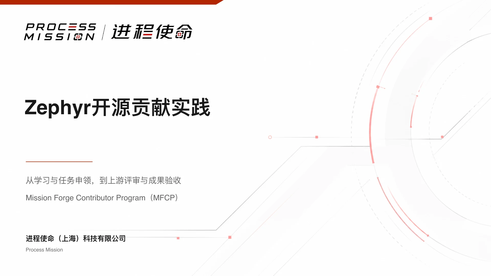

## Why Start with Zephyr

As AI coding agents take over routine, repetitive coding tasks, beginners face a real dilemma: many of the entry-level exercises developers once used to build engineering intuition are disappearing. Open-source communities remain one of the best places to learn by doing. That motivated us to launch **MFCP**—not as a lecture course or a traditional internship, but as a task-driven contributor program where mentors work alongside participants on real upstream issues in Zephyr, Linux, Yocto, and other leading projects.

We chose **Zephyr** as the first stop for three reasons:

- **Modern engineering workflow**: Although Zephyr is a real-time operating system (RTOS), it brings modern software engineering practices and CI/CD pipelines straight into embedded development.
- **Agent-friendly tooling**: Thanks to strict, automated CI verification, contributors can pair effectively with AI agents without hitting the manual bottlenecks common in legacy embedded workflows.
- **Fast community feedback**: Zephyr's upstream community is highly active; PRs routinely receive maintainer or reviewer feedback within one or two days.

Every MFCP task tracks a real upstream issue in GitHub, with scope and acceptance criteria confirmed upfront by a mentor. Along the way, contributors gain four tangible outcomes:

1. **Permanent upstream attribution**: Merged patches stay forever in the upstream git history of Zephyr and partner repositories.
2. **Transparent L0–L4 progression**: Levels follow published annual rules backed by public evidence on GitHub.
3. **End-to-end review experience**: Hands-on mastery of CI checks, code review iterations, and rebasing.
4. **Written mentor feedback**: Structured evaluation at the end of every completed task.

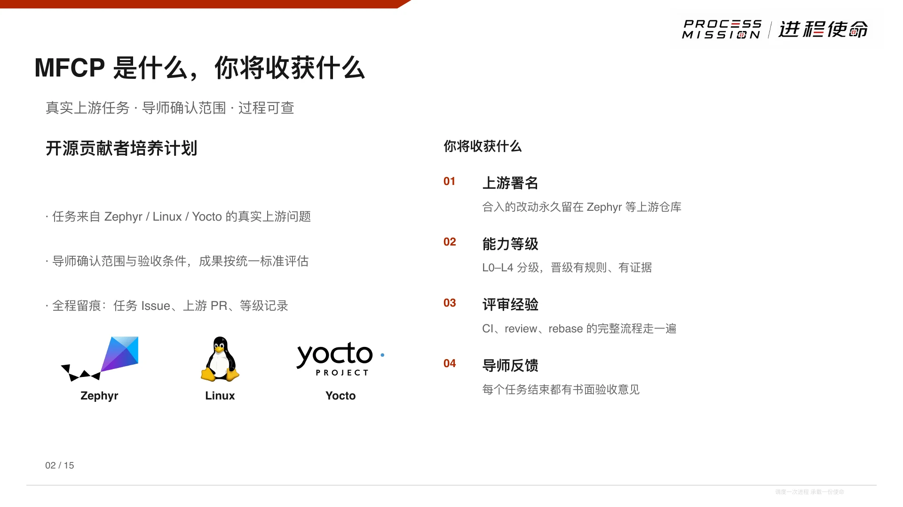

## Six-Step Contribution Workflow

Every contribution moves through six stages—**Register → Learn → Claim → Implement → Upstream Review → Acceptance**—tracked transparently inside a GitHub task issue while actual code lands upstream.

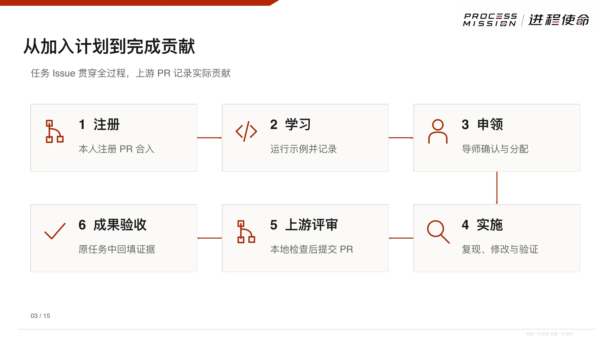

### Prerequisites: Environment, Time, and Skills

Before claiming your first task, three fundamentals set you up for a smooth start:

- **Development environment**: Use native Linux or WSL2 with `Git`, `Zephyr SDK`, and `QEMU` installed. Native Windows lacks support for several Zephyr build and test utilities, so sticking to Linux or WSL2 avoids unnecessary friction.
- **Weekly commitment**: Tasks progress on a weekly cadence. State your realistic availability when claiming a task so your mentor can plan accordingly—never promise hours you cannot deliver.
- **Baseline skills**: Comfort reading English technical documentation and writing basic C or Python is enough to begin; you do not need to be a kernel or driver expert beforehand.

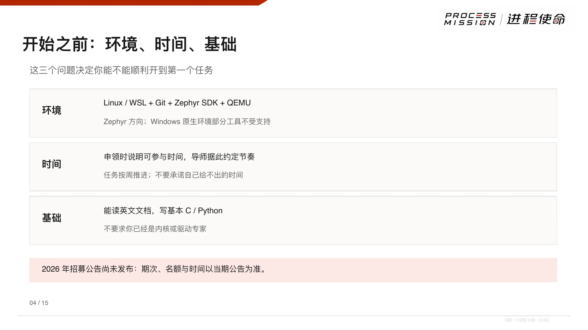

### Step 1: Register as a Participant

Getting started requires zero application code—just a GitHub account:

1. Fork the MFCP repository to your personal GitHub account.
2. Add a single identity file at `participants/<login>.json` containing your numeric `github_id` and lowercase `github_login` (matching the filename).
3. Commit with the subject `participants: register <username>` and a `-s` DCO sign-off, push, and open your registration PR.

Once merged, you automatically advance to **L1**. Note that issues opened by unregistered accounts are automatically closed, so always complete registration first.

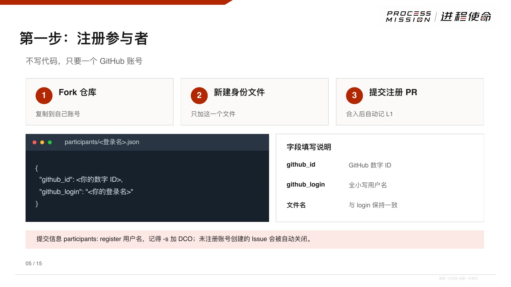

### Step 2: Run Hello World on QEMU

If you are new to Zephyr, validate your toolchain by building and running the `hello_world` sample on QEMU before picking a task:

```sh
west build -b qemu_x86 samples/hello_world
west build -t run
```

Seeing `Hello World! x86` confirms your environment works (to exit QEMU, press `Ctrl+A`, release, then press `X`). Because QEMU emulates target instructions on your host machine, you need no physical board to get started, the exact same commands reproduce cleanly across machines, and targeting real hardware later is often as simple as swapping `-b qemu_x86` for a board name.

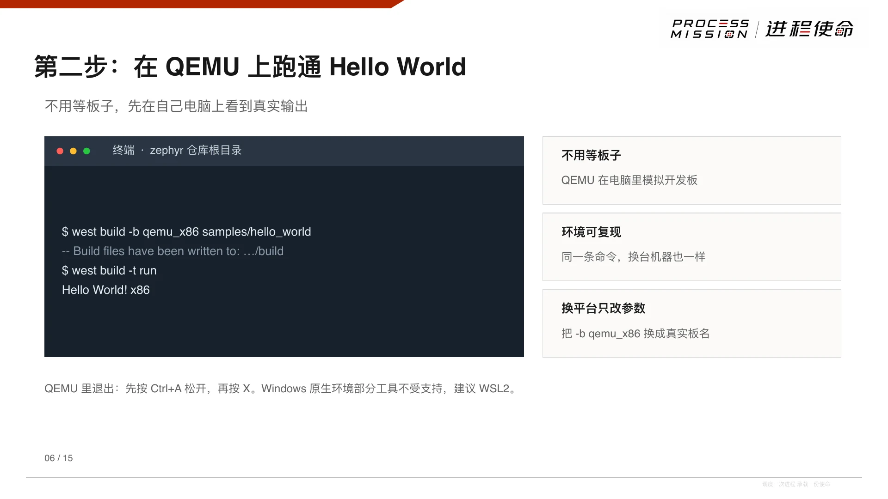

### Step 3: Pick a Task and Align with a Mentor

Next, browse open issues labeled `kind/task`. For your first task, look for three hallmarks: **reproducible local steps, clear expected output, and an explicit scope stating both what to change and what to leave untouched**.

Leave a concise application comment covering five points:

1. Relevant experience;
2. Available weekly hours;
3. Development setup (OS, emulator, or hardware);
4. Your understanding of the task;
5. Where you would like mentor guidance.

Wait until the mentor confirms scope and acceptance criteria and you are assigned as the issue's **Assignee** before starting implementation. Keep all questions and progress updates inside the original issue thread.

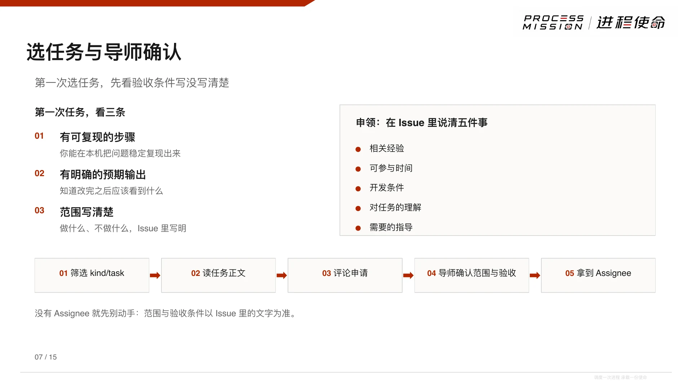

## Case Study: MFCP #1 to Upstream Merge

To see every piece in action, let's trace **MFCP #1 (UTF-8 boundary decoding in QEMU Twister output)** all the way into upstream Zephyr.

### Task Breakdown and L1 Scope

In Zephyr's `twister` test runner, QEMU output was read and decoded byte by byte. Because UTF-8 uses multi-byte sequences—for example, the Greek letter `δ` is encoded as two bytes `CE B4`—splitting on a single-byte boundary caused decoding to fail, aborting output collection and failing CI.

The task requires Python, Zephyr SDK, and QEMU, with deliverables covering reproduction steps, the fix, and verification evidence under a real DCO sign-off. It is graded **L1** because its boundaries are explicitly defined, reproduction and expected output are straightforward, and the fix handles byte boundaries without requiring architectural redesign.

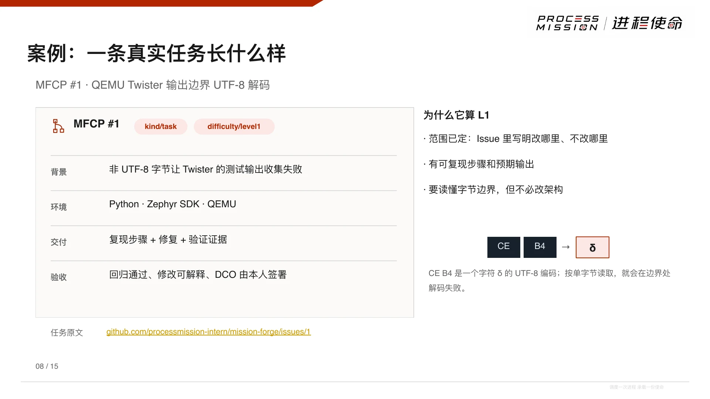

### Commit Formatting and Local Compliance Checks

Upstream Zephyr enforces a clean three-part commit message structure:

- **Subject**: `module: subject` (e.g., `scripts: twister: ...`), summarizing the change within 72 characters per line;
- **Body**: Separated by a blank line, explaining why the change is needed, trade-offs, and exact verification commands and results;
- **Sign-off**: Separated by another blank line, containing your `Signed-off-by` trailer (`git commit -s`, matching your commit author email), plus a mentor sign-off when required by the task.

Always run Zephyr's local compliance checker before pushing:

```sh
python scripts/ci/check_compliance.py -c HEAD~1..HEAD
```

This script already wraps `checkpatch` and commit formatting rules. Running it locally saves long CI wait cycles; if anything fails, amend your commit and re-run until clean.

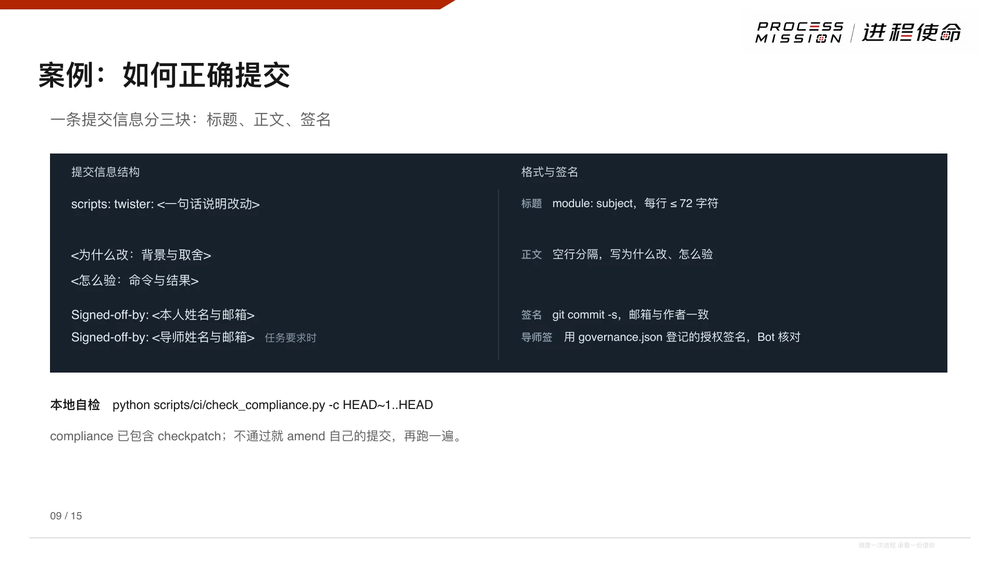

### Opening the Upstream PR and Reporting Results

Once local checks pass, follow the five-step handoff: **commit on a branch → push to your fork → open the upstream PR → report deliverables in the MFCP task issue → mentor acceptance**. Write your upstream PR description clearly around four items:

- **Problem**: Symptoms, reproduction steps, background, and relevant logs;
- **Scope**: Which subsystems or files changed, and what is intentionally out of scope;
- **Verification**: Tests executed, exact commands, and observed output;
- **Issue link**: End with `Fixes zephyrproject-rtos/zephyr#<number>` so merging automatically closes the upstream issue.

Remember that opening the upstream PR is only an intermediate step—post a deliverable submission comment back on your original MFCP issue (never open a duplicate issue). Experience points settle once the patch merges upstream and passes mentor review.

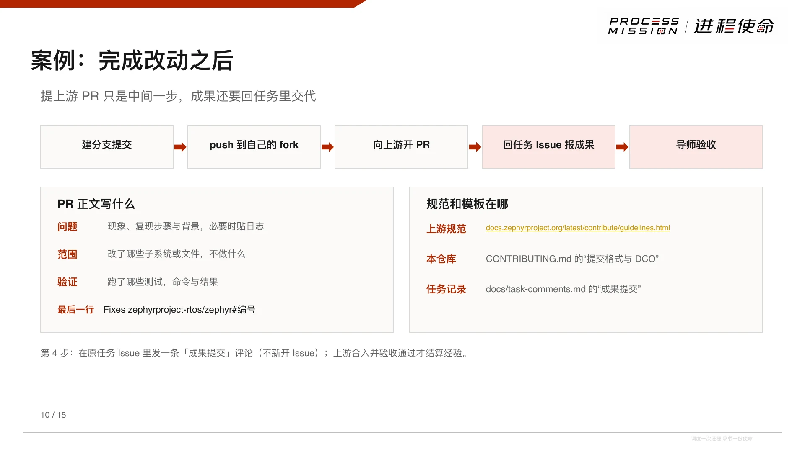

### CI Checks, Review Iterations, and Merge

In our real case study—upstream **PR #121551**, merged into `zephyrproject-rtos/zephyr` on October 13, 2026—the fix updated output decoding in a single file to use `errors="replace"` so a stray byte never tears down the entire output collector thread.

Three practical tips for surviving real-world upstream reviews:

- **Unrelated CI failures**: Inspect the raw CI logs rather than stopping at a red status icon.
- **Multi-round reviews**: After pushing updates, reply inline to every review comment explaining what changed; if a PR sits idle, politely ping the relevant subsystem maintainer or reviewer.
- **Branch conflicts**: Rebase your commits onto latest upstream `main` and force-push cleanly.

After your very first merged Zephyr PR, you can also claim an official Zephyr Contributor badge to showcase on LinkedIn and developer profiles.

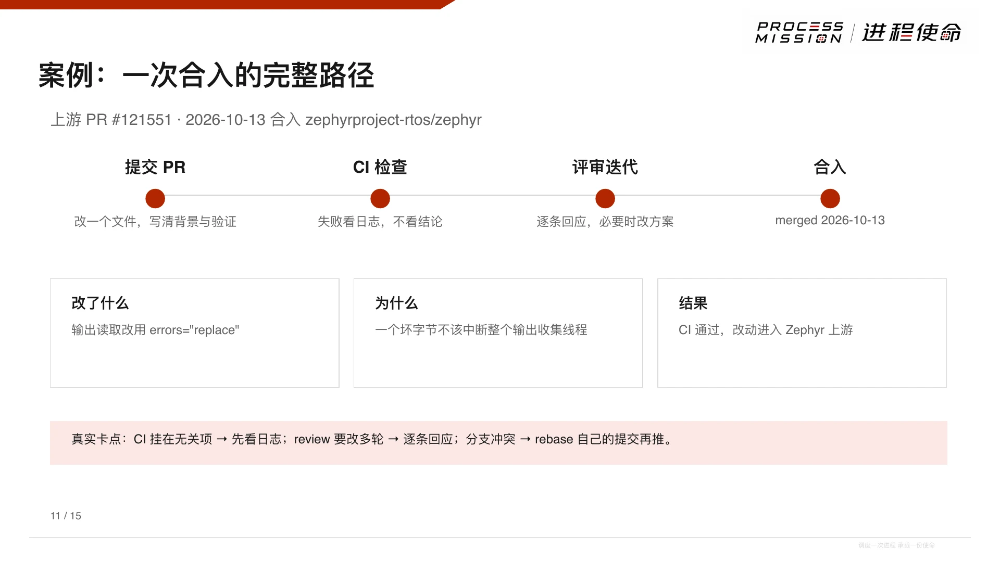

## Acceptance and L0–L4 Progression

When reporting completion back in the MFCP issue, map your evidence directly against every acceptance criterion (versions, commands, test output, known limitations, and upstream review links). Mentors evaluate six dimensions: **problem understanding, engineering quality, verification rigor, community collaboration, deliverable value, and autonomy**.

MFCP organizes contributor growth across five levels (**L0–L4**):

| Level | Title | Criteria and Progression |
| --- | --- | --- |
| L0 | Learner | Prepare registration and learn Git and open-source workflows |
| L1 | Apprentice Contributor | Automatic upgrade once your registration PR merges |
| L2 | Contributor | 6 accepted tasks, 6 upstream merges, at least 2 L2+ tasks, and 100 XP (automated via Bot) |
| L3 | Senior Contributor | 12 tasks, 12 upstream merges, 300 XP, plus a review interview and manual approval |
| L4 | Maintainer Track | Invitation-only, requiring at least two nominations and review |

As Zevorn highlighted during the session, the level ladder is designed to guide long-term growth rather than serve as a rigid exam:

- **L0 → L1** verifies baseline open-source fluency (Git, forks, PRs, and issue etiquette).
- **L1 → L2** encourages exploring across multiple subsystems—and even multiple projects—to broaden skills and discover what excites you.
- **L2 → L3** shifts from isolated bug fixes to deep ownership across two or three subsystems, where you become known in the community and start reviewing peers' PRs.
- **L3 → L4** transitions from individual contributor to community maintainer and mentor, validated through face-to-face retrospective discussions and peer recognition—the same path that creates respected voices at flagship gatherings like the Linux Plumbers Conference (LPC).

Progression from **L0 through L2** runs automatically via CI—giving rapid, game-like feedback as you claim tasks, merge patches, and accumulate experience—while cultivating the community collaboration and engineering judgment that coding agents cannot easily replace.

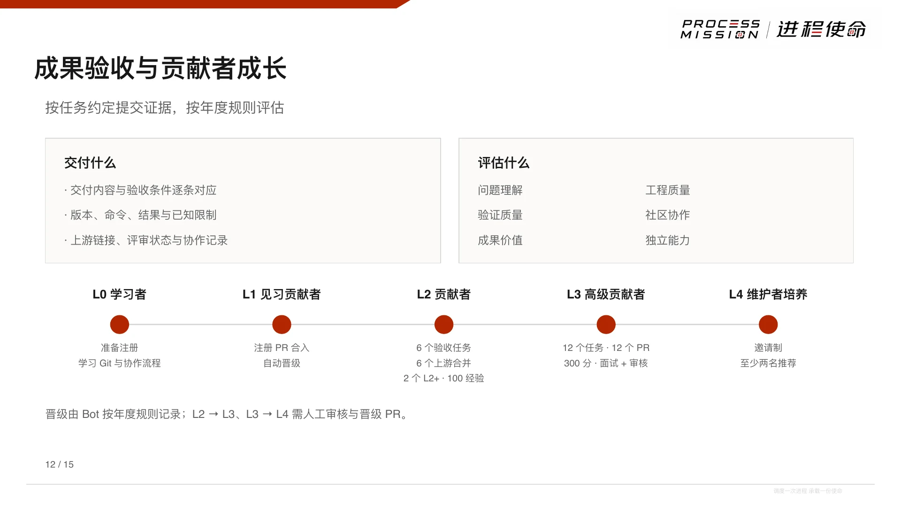

### Action Plan and Learning Resources

A simple three-week ramp-up gets you moving immediately: **tonight**, open your registration PR; **this week**, run `hello_world` on QEMU to verify your environment; **next week**, apply for your first task.

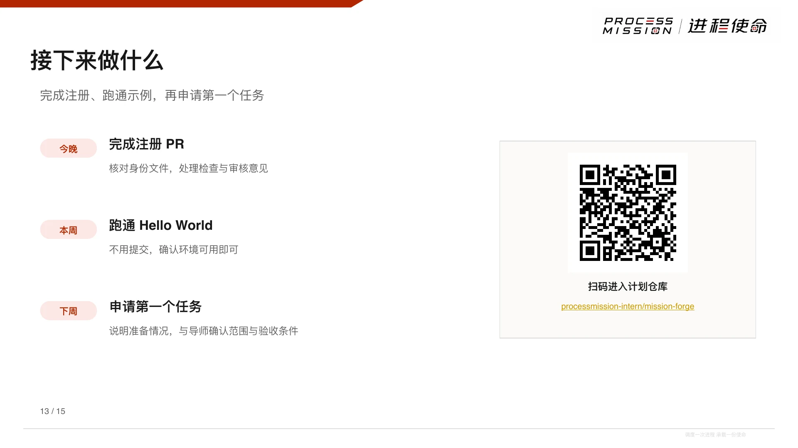

Zephyr's documentation is built directly from its source repository. Follow the official four-step path before diving into tasks:

1. **Environment & Build**: Install prerequisites (`CMake 3.28+`, `Python 3.12`, `dtc 1.4.6+`) and `Zephyr SDK`.
2. **Source & First Build**: Run `west init`, `west update`, `west sdk install`, and `west build`.
3. **Configuration & Hardware Description**: Learn how `Kconfig` controls what gets compiled and how `Devicetree` describes board hardware.
4. **Testing & Submission**: Run `Twister` test suites and submit CI-clean PRs following the contribution guidelines.

For Chinese-speaking developers, the community maintains translated Zephyr documentation, blog walkthroughs, and Zevorn's 22-episode Bilibili video series *Zephyr RTOS Development Practice* (keep in mind translations can lag slightly behind upstream, so always check the English docs for exact version details).

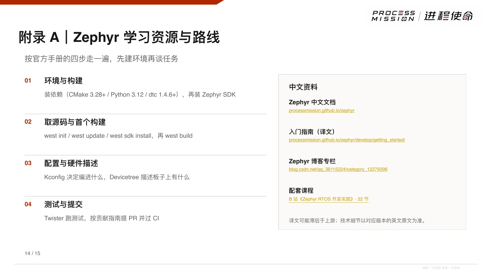

### Working with Mentors and AI Tools

We encourage smart use of AI tools for reading code, diagnosing bugs, and drafting patches, provided contributors respect a three-stage workflow: **AI-assisted analysis and drafting → personal inspection and verification → mentor guidance and upstream review**. Especially for newcomers, getting your hands dirty builds far deeper retention than handing the wheel over completely.

Zephyr upstream also requires disclosing AI assistance explicitly in commit messages using the trailer:

```text
Assisted-by: <Agent Name>:<Model Version> [Tools]
```

Regardless of tooling, **the DCO sign-off must always be made by a real human contributor** who understands and stands behind every line submitted.

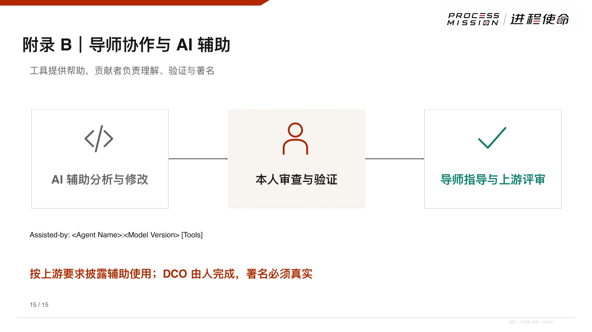

## Live Q&A

### Eligibility and Upstream Collaboration Model

**Question (Junjie Cao)**: Is MFCP only open to university students, or can industry developers join too? And does mentoring happen privately in the MFCP repo before submitting upstream?

**Zevorn**: MFCP is open to everyone across the community—not limited to students and not a company internship.

We curate upstream issues by difficulty in the MFCP repository so newcomers can browse and pick tasks easily. Once you start working on a task, however, mentors collaborate with you **directly on the upstream project's public channels** (GitHub PRs or mailing lists), rather than behind closed doors. Public reviews keep your PR active, invite valuable feedback from maintainers across diverse backgrounds, and let mentors step in whenever reviews stall. Once merged, MFCP's CI automates settlement and credit tracking so part-time contributors stay motivated and build a verifiable open-source track record.

### Community Group Planning

**Question (Kai Liu)**: Will there be a Feishu group where participants can chat day to day?

**Zevorn**: Yes—a dedicated community Feishu group is already in the works and will be announced on the GitHub repository and community channels shortly.

## Resources

- **Full Session Replay (Bilibili)**: [Zephyr Contribution Workflow](https://www.bilibili.com/video/BV1kmn865EBQ/)
- **MFCP Repository**: [github.com/missionhub-oss/mfcp](https://github.com/missionhub-oss/mfcp)
- **Zephyr Contribution Guidelines**: [docs.zephyrproject.org/latest/contribute/guidelines.html](https://docs.zephyrproject.org/latest/contribute/guidelines.html)
- **Zephyr Chinese Docs & Getting Started**: [processmission.github.io/zephyr](https://processmission.github.io/zephyr) · [Getting Started](https://processmission.github.io/zephyr/develop/getting_started/)
- **Zephyr Blog Series**: [blog.csdn.net/qq_36115224/category_12279396](https://blog.csdn.net/qq_36115224/category_12279396)
