> 这篇博客文章整理自 2026 年 10 月 23 日 MFCP 开源实践分享《Zephyr 开源贡献流程介绍》。

这篇文章由泽文与 Zephyr 上游核心贡献者李洪全共同分享，面向初次接触大型开源项目或希望进入嵌入式开源社区的开发者，系统介绍 **MFCP（Mission Forge Contributor Program）** 的运作机制，并以 Zephyr RTOS 为切入点，结合一条已经合入上游的真实任务，手把手梳理从注册账号、搭建环境、申领任务到通过上游 CI 评审与成果验收的完整流程。

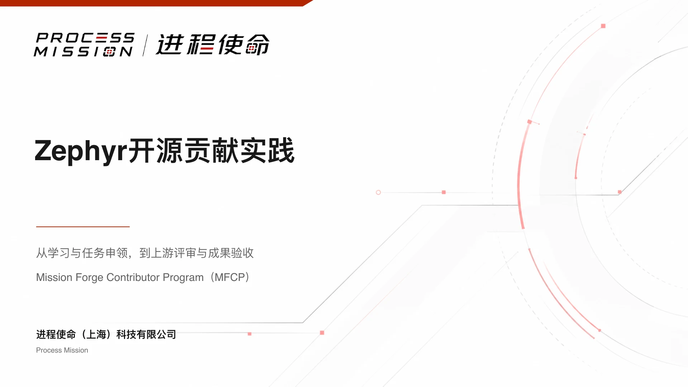

## 为什么从 Zephyr 开启开源实践

进入 Agent 时代后，大量基础、重复的编码工作正逐渐被智能体工具接管，这带来了一个很现实的问题：初学者过去用来打基础、攒经验的练手机会变得越来越少。与此同时，顶级开源社区依然保有大量真实且开放的工程实践场景。正是出于这个背景，我们发起了 **MFCP（Mission Forge Contributor Program）**：它以真实上游任务为驱动，由经验丰富的导师带领大家参与 Zephyr、Linux、Yocto 等顶级开源项目，在平等协作中锻炼工程能力与社区协作能力。

之所以把 **Zephyr** 选为开源实践的第一站，主要有三点原因：

- **现代化协作体验**：Zephyr 虽然是一个实时操作系统（RTOS），却把现代应用开发的协作方式完整带入了嵌入式领域，拥有非常完善的 CI/CD 基础设施；
- **对 Agent 工具友好**：依托强大的自动化检查体系，参与者可以顺畅借助智能体辅助分析与开发，不必受限于传统嵌入式流程中的繁琐人工约束；
- **社区反馈高效**：Zephyr 社区非常活跃，通常提交 PR 后一两天内就会收到维护者或评审者的反馈，正循环来得很快。

在 MFCP 中，所有任务均源自 Zephyr、Linux、Yocto 等上游仓库的真实问题，通过仓库 Issue 统一跟踪，开做之前由导师确认范围与验收条件，最终带来四项清晰可见的收获：

1. **上游永久署名**：合入后的改动与署名永久保存在 Zephyr 等上游仓库的提交历史中；
2. **L0–L4 能力等级**：按年度规则自动记录晋级历程，每一步都有公开证据可查；
3. **完整评审经验**：亲手走通 CI、代码评审（Review）与变基（Rebase）全套上游协作流程；
4. **导师书面反馈**：每个任务结项后都会获得导师按统一标准给出的验收意见。

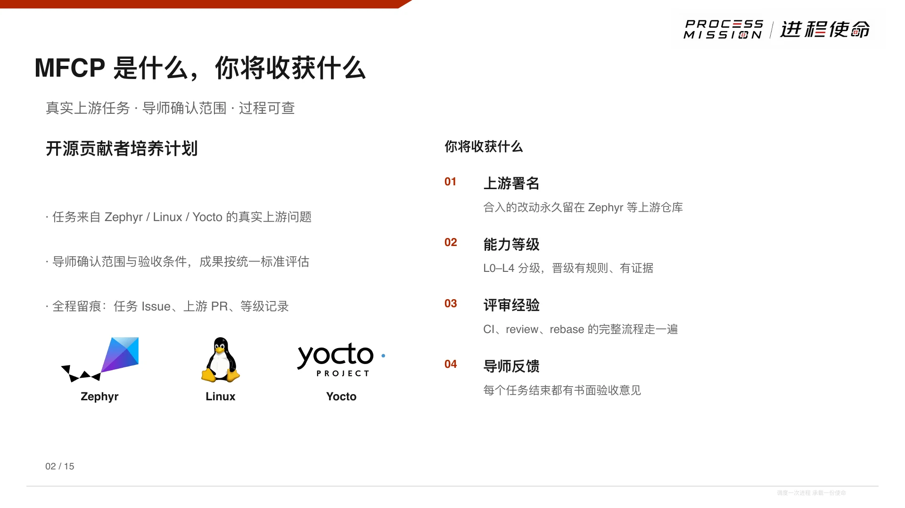

## 从加入计划到完成贡献

整条贡献链路围绕任务 Issue 展开，分为 **注册 → 学习 → 申领 → 实施 → 上游评审 → 成果验收** 六个阶段：所有过程透明记录在 GitHub Issue 上，实际代码与文档贡献直接提交到上游仓库。

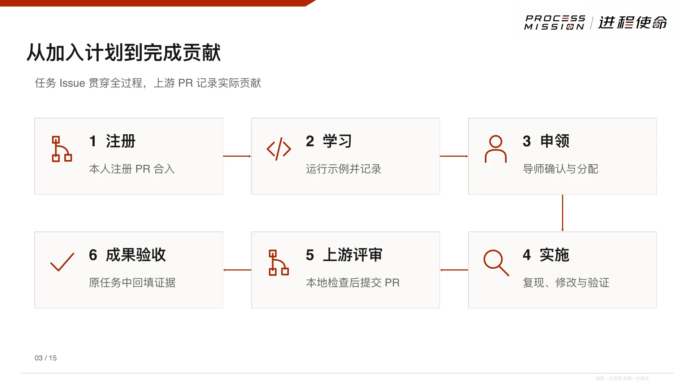

### 环境、时间与基础准备

正式动手之前，有三项准备工作决定你能否顺利开启第一个任务：

- **开发环境**：Zephyr 方向推荐使用原生 Linux 或 WSL2，提前配置好 `Git`、`Zephyr SDK` 与 `QEMU`。Windows 原生环境对部分构建和测试工具存在兼容性问题，使用 Linux / WSL2 可以避开大多数环境坑；
- **时间投入**：任务按周推进，申领时如实说明自己每周可投入的时间，方便导师据此安排节奏，不要承诺自己无法兑现的时间；
- **知识基础**：能够读懂基本英文文档、编写基础 C 或 Python 程序即可起步，不要求提前成为内核或驱动专家。

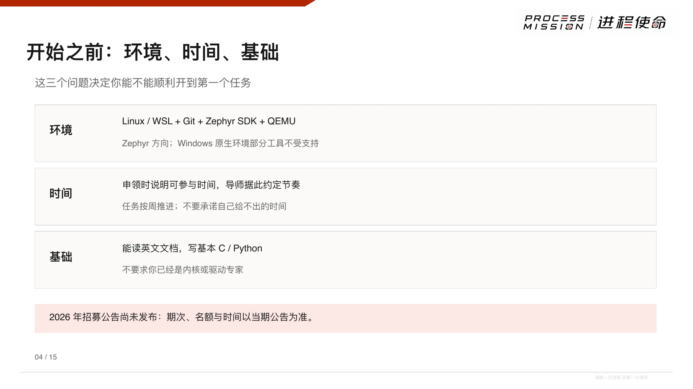

### 第一步：注册参与者

加入计划不需要先写代码，只要有一个 GitHub 账号即可完成注册：

1. Fork MFCP 仓库到自己的 GitHub 账号下；
2. 新建唯一的身份文件 `participants/<登录名>.json`，写入自己的 GitHub 数字 ID（`github_id`）与全小写用户名（`github_login`），确保文件名与 `github_login` 保持一致；
3. 使用 `participants: register 用户名` 作为提交标题，记得加上 `-s` 添加本人 DCO 签名，推送后提交注册 PR。

注册 PR 合入后，系统会自动将账号记为 **L1**。需要注意，未注册账号在仓库中创建的 Issue 会被自动关闭，因此务必先完成注册这一步。

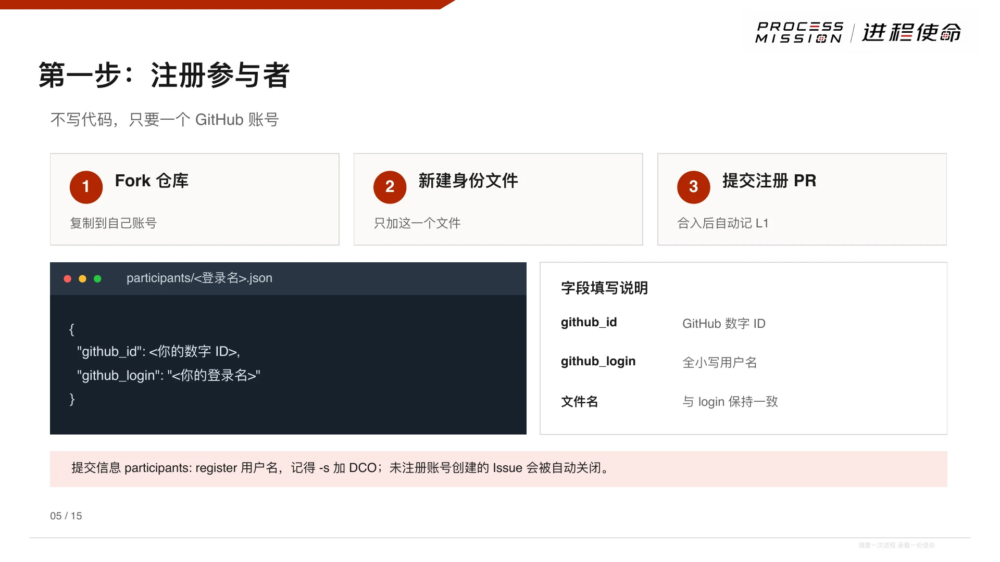

### 第二步：在 QEMU 上跑通 Hello World

如果此前没有接触过 Zephyr，完成注册后先在已搭好的环境中用 QEMU 跑通官方 `hello_world` 示例：

```sh
west build -b qemu_x86 samples/hello_world
west build -t run
```

终端输出 `Hello World! x86` 即说明构建工具链与仿真环境均已就绪（退出 QEMU 的快捷键是先按 `Ctrl+A` 松开，再按 `X`）。QEMU 作为指令级模拟器，可以在没有实体开发板的情况下将目标架构指令翻译到宿主机运行，既保证了同一条命令跨机器可复现，以后切换到真实开发板时也只需把 `-b qemu_x86` 换成对应板卡名称即可。

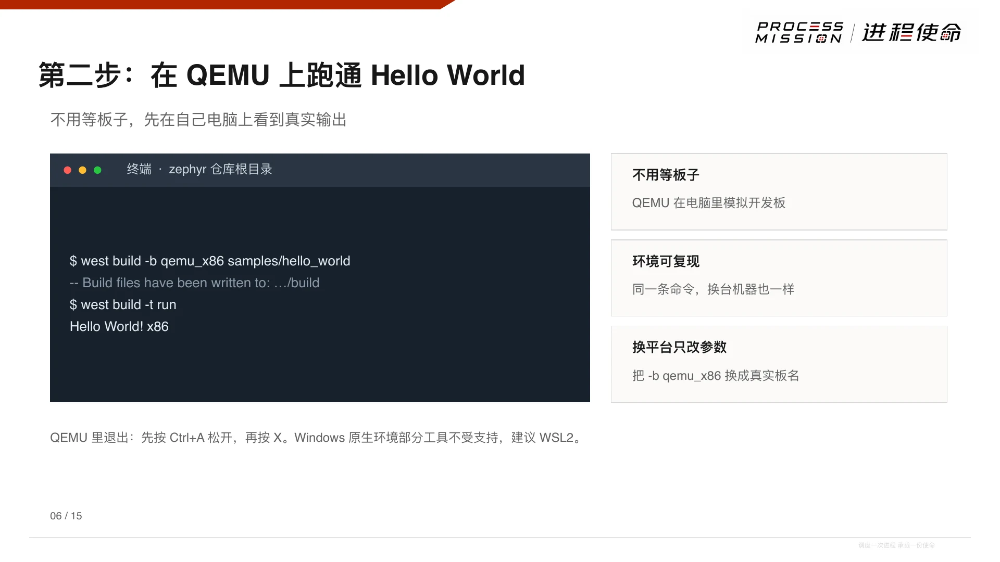

### 第三步：选任务与导师确认

跑通示例后，就可以在仓库里筛选带有 `kind/task` 标签的任务 Issue。首次选题建议重点看三条：**本地有可复现的步骤、有明确的预期输出、任务正文把做什么和不做什么写清楚**。

看准合适的任务后，在原 Issue 下评论申请，把五件事说清楚：

1. 相关经验；
2. 每周可参与的时间；
3. 本地开发条件（系统、仿真器或硬件板卡）；
4. 对这个任务问题的理解；
5. 希望导师提供哪方面的指导。

流程按 **筛选 `kind/task` → 读任务正文 → 评论申请 → 导师确认范围与验收条件 → 获得 Assignee** 顺序推进。在尚未拿到 Assignee 之前不要贸然开始编码，后续范围与验收条件均以 Issue 中的书面文字为准，实施期间遇到疑问也全部留在原 Issue 下公开讨论。

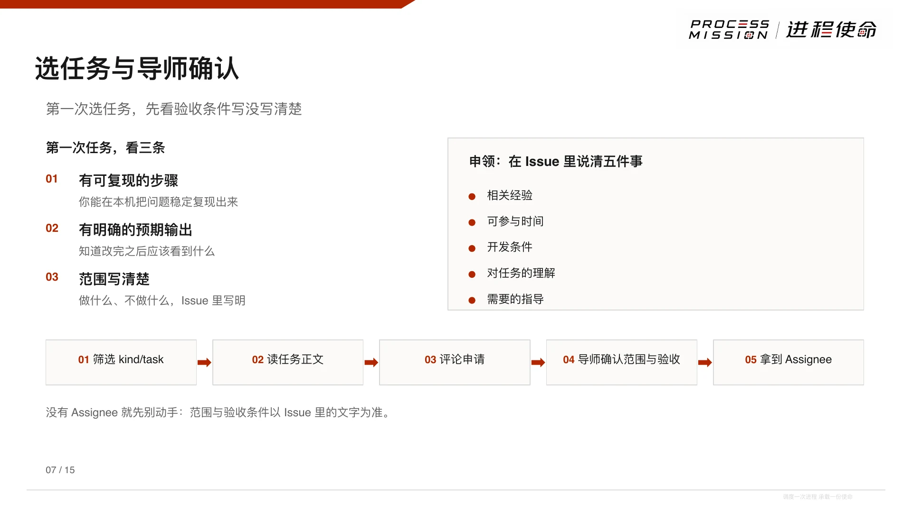

## 案例：MFCP #1 上游合入

为了让整个流程更具体，下面以仓库中的 1 号真实任务 **MFCP #1（QEMU Twister 输出边界 UTF-8 解码）** 为例，拆解从问题分析到合入 Zephyr 主线的每一步。

### 任务拆解与难度评定

这个任务的背景很直观：在 Zephyr 的测试框架 Twister 中，程序收集 QEMU 输出时按单字节读取并直接解码；而 UTF-8 属于可变长编码——例如希腊字母 `δ` 由 `CE B4` 两个字节组成，按单字节切分会在字节边界处触发解码失败，进而导致测试输出收集异常、CI 意外退出。

任务所需环境为 Python、Zephyr SDK 与 QEMU，交付物要求包含复现步骤、修复改动与验证证据，验收条件则是回归测试通过、改动逻辑可解释且由作者本人签署 DCO。之所以将它评定为 **L1**，是因为该任务范围边界清晰（明确说明改哪里、不改哪里）、给出了可复现步骤与预期输出，需要读懂字节边界处理却无需改动整体架构。

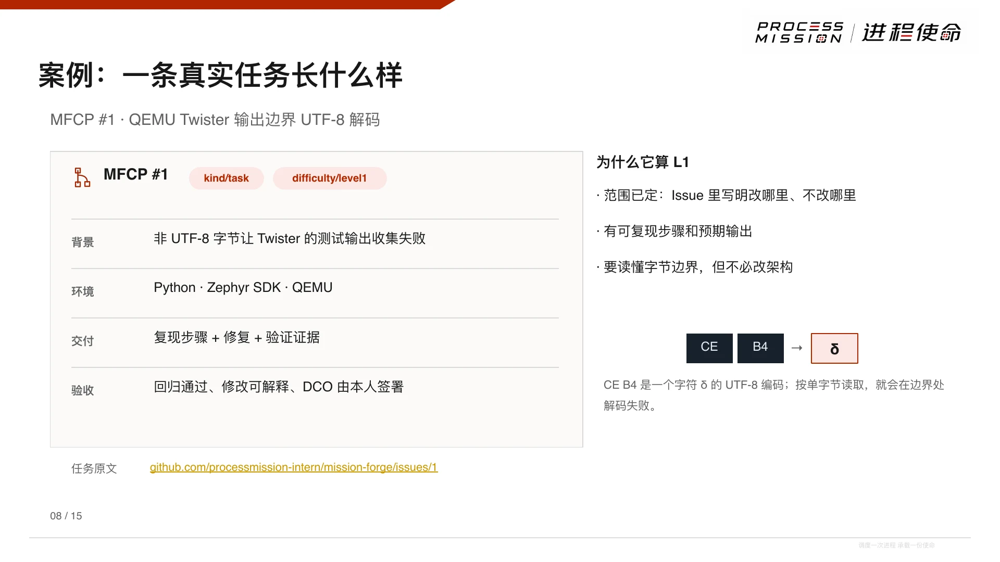

### 规范提交与本地合规自检

解决完问题准备提交时，务必严格遵循 Zephyr 上游的提交信息格式，整体分为标题、正文与签名三块：

- **标题**：采用 `module: subject` 形式（例如 `scripts: twister: ...`），精准标明改动模块与目的，每行不超过 72 个字符；
- **正文**：与标题空一行，写清问题背景、方案取舍以及具体的验证命令与结果；
- **签名**：空一行后附上作者本人的 `Signed-off-by`（使用 `git commit -s` 自动生成，确保邮箱与提交作者一致）；若任务另有要求，按登记信息附加导师签名。

正式推送前，一定要先在本地运行 Zephyr 自带的合规检查脚本：

```sh
python scripts/ci/check_compliance.py -c HEAD~1..HEAD
```

`check_compliance.py` 已经内置 `checkpatch` 与提交格式检查。如果跳过本地自检直接提 PR，往往要等上游 CI 跑很久才暴露格式问题，来回修改徒增时间成本；本地不通过时直接 `git commit --amend` 修正后再跑一遍即可。

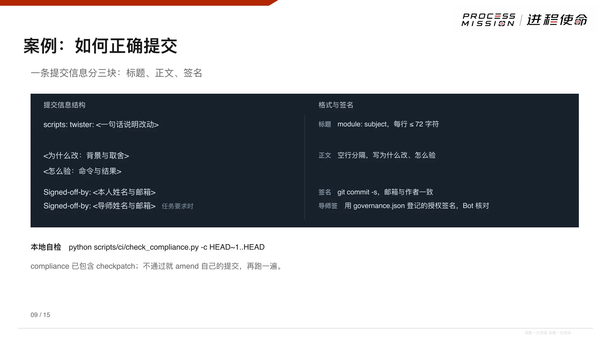

### 提交上游 PR 与回任务报成果

本地自检通过后，按照 **建分支提交 → push 到个人 Fork → 向上游开 PR → 回任务 Issue 报成果 → 导师验收** 的顺序推进。向上游提交 PR 时（尤其是包含测试、修复、文档的多补丁系列），在 PR 正文中写明四个部分：

- **问题**：故障现象、复现步骤与背景，必要时附上关键日志；
- **范围**：改动了哪些子系统或文件，明确不涉及哪些内容；
- **验证**：运行了哪些测试、具体命令与实测结果；
- **关联编号**：在最后一行写上 `Fixes zephyrproject-rtos/zephyr#<编号>`，便于上游维护者合入时自动关闭对应 Issue。

开出上游 PR 只是中间一步，完成后还需要回到原来申领的 MFCP 任务 Issue 下发表一条「成果提交」评论（不要新开 Issue），等上游正式合入并经导师验收后才会结算经验。

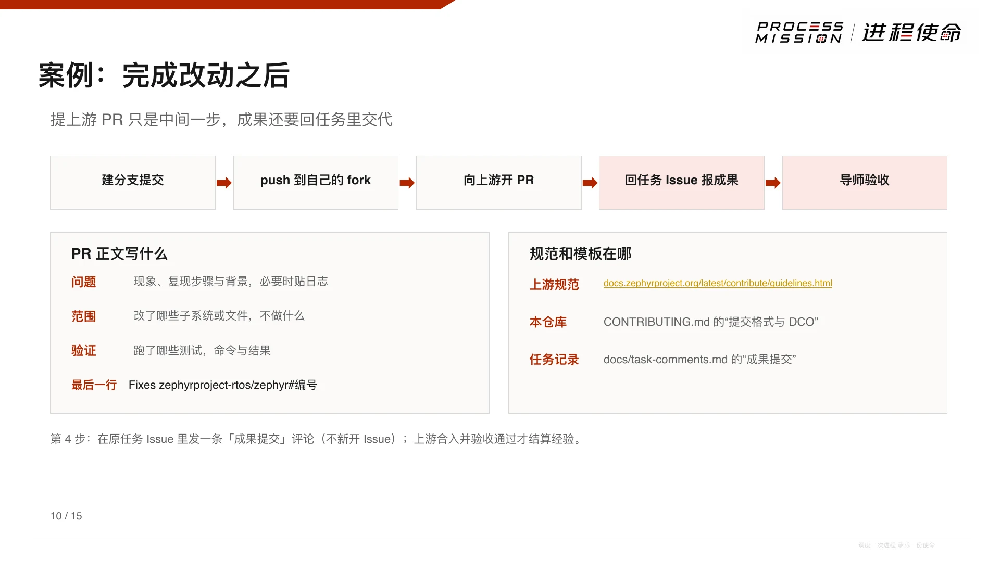

### CI 检查、多轮评审与最终合入

回到 MFCP #1 对应的真实上游 **PR #121551**：改动聚焦在一个文件，核心是在输出读取处改用 `errors="replace"`，避免单个坏字节中断整个输出收集线程。提交 PR 后依次经历 CI 检查、多轮评审迭代，最终于 2026 年 10 月 13 日成功合入 `zephyrproject-rtos/zephyr`。

在实际参与上游评审时，经常会遇到三个卡点：

- **CI 失败在无关项**：不要只看红叉结论，先点开具体日志确认是否与自己的改动相关；
- **评审意见需要多轮修改**：针对每条意见修改并重新推送后，务必在对应评论下逐条回复说明改了什么；如果一段时间无人响应，可以礼貌抄送相关模块的 Maintainer 或 Reviewer；
- **主干更新导致分支冲突**：及时同步上游并 `rebase` 自己的提交后重新推送。

值得一提的是，在 Zephyr 社区首次有 PR 合入后，还可以申领官方颁发的贡献者徽章，展示在领英等个人主页上，作为参与顶级开源项目的长期记录。

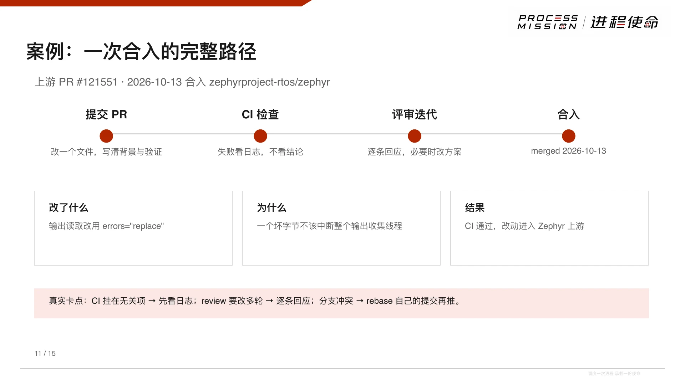

## 成果验收与 L0–L4 成长路径

上游合入后，回到原任务 Issue 按约定核对交付证据（逐条呼应验收条件、写明版本、命令、结果与已知限制，并附上上游链接与评审记录），导师会从**问题理解、工程质量、验证质量、社区协作、成果价值与独立能力**六个维度进行综合评估。

MFCP 将贡献者成长划分为 **L0 至 L4** 五个等级：

| 等级 | 名称 | 核心要求与晋级方式 |
| --- | --- | --- |
| L0 | 学习者 | 准备注册，学习 Git 与开源协作流程 |
| L1 | 见习贡献者 | 注册 PR 合入后自动晋级 |
| L2 | 贡献者 | 完成 6 个验收任务、6 个上游合入、至少 2 个 L2+ 任务并累计 100 经验，由 Bot 自动记录 |
| L3 | 高级贡献者 | 完成 12 个任务与 12 个上游合入、累计 300 经验，通过面对面复盘面试与人工审核 |
| L4 | 维护者培养 | 邀请制，需至少两名核心成员推荐并通过审核 |

泽文在分享中特别补充了这套等级体系的设计初衷：等级本身只是一种激励路径，核心目标是帮大家沿着清晰台阶成长，减少摸索弯路：

- **L0 → L1** 检验基础开源工具使用（Git、Fork、PR、回复规范），跨过这一步就具备了参与开源的基础工程能力；
- **L1 → L2** 鼓励大家在多个模块、子系统甚至不同项目间广泛探索，在真实任务中拓展技术视野、锻炼动手与协作能力；
- **L2 → L3** 转向深度投入，聚焦两到三个感兴趣的方向持续深耕，从修小补丁成长为既能攻克子系统开发、也能帮他人评审 PR 的活跃贡献者；
- **L3 → L4** 则迈向社区影响者与维护者角色，通过面对面沟通复盘经验教训，并依靠在真实社区中的持续投入赢得同行认可——正如 Linux Plumbers Conference（LPC）等顶级开源盛会上广受尊敬的社区明星贡献者一样。

整个 **L0 到 L2** 的接任务、交任务与经验结算均由 CI 自动化驱动，像游戏升级一样提供即时正反馈；而持续深耕所积累的社区沟通、公开评审与工程判断力，也是 Agent 长期难以替代的核心软技能。

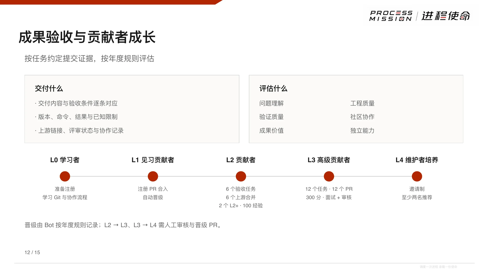

### 行动清单与学习资源

如果你准备现在就开始，可以按三周节奏稳步推进：**今晚**完成注册 PR，**本周**在本地跑通 QEMU `hello_world` 确认环境可用，**下周**挑选并申请你的第一个任务。

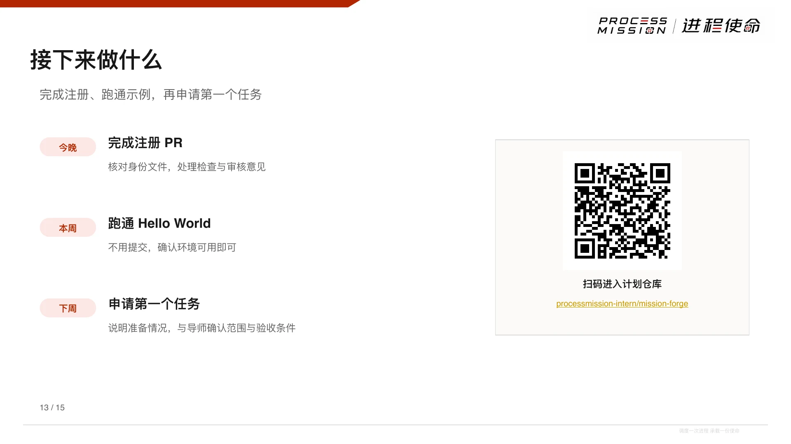

Zephyr 官方文档随源码仓库自动同步构建，非常详尽。建议顺着官方手册的四步路线先建环境再谈任务：

1. **环境与构建**：安装基础依赖（`CMake 3.28+`、`Python 3.12`、`dtc 1.4.6+`）及 `Zephyr SDK`；
2. **取源码与首个构建**：执行 `west init`、`west update`、`west sdk install` 后运行 `west build`；
3. **配置与硬件描述**：理解 `Kconfig`（决定编进哪些模块）与 `Devicetree`（描述板卡硬件资源）；
4. **测试与提交**：用 `Twister` 运行测试套件，按贡献指南提交 PR 并通过 CI。

社区同步维护了中文文档、入门译文、博客专栏以及泽文录制的 22 节 B 站《Zephyr RTOS 开发实践》系列教程供大家参考（译文可能略滞后于上游，关键技术细节仍以对应版本英文原文为准）。

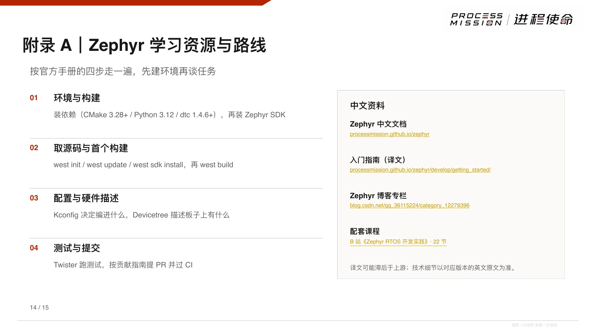

### 导师协作与 AI 辅助规范

在 Agent 普及的背景下，我们非常鼓励合理使用 AI 工具辅助分析源码、定位问题和起草修改，但整条协作链路必须守住 **AI 辅助分析与修改 → 本人审查与验证 → 导师指导与上游评审** 这道底线。对于初学者而言，亲自动手复现、调试和修改才能真正沉淀理解，让 AI 充当建议者而非替代品。

同时，Zephyr 上游明确要求在提交信息中如实披露 AI 辅助工具的使用情况，格式为：

```text
Assisted-by: <Agent Name>:<Model Version> [Tools]
```

无论是否借助了 AI 辅助，最终的 **DCO 签名必须由人类贡献者本人确认并真实签署**，对所提交的每一行代码负责。

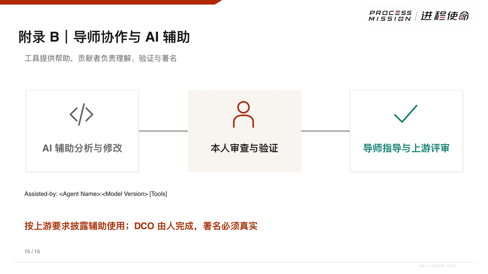

## 现场问答

### 面向人群与上游公开协作模式

**问题（曹俊杰）**：MFCP 活动是只面向在校学生开放，还是社会开发者也可以参与？具体协作方式是不是把上游需求集中到 MFCP 仓库、导师评审后再提交给上游？

**泽文**：MFCP 面向全社会所有开发者开放，不限于在校学生，也不属于企业实习。

具体协作分为两层：我们会把上游已有的合适 Issue 和有趣特性按难度整理到 MFCP 仓库，供大家挑选和学习；但真正进入实施与评审阶段时，导师会直接和参与者一起在**上游项目对应的公开平台**（如 GitHub PR 或邮件列表）协作，避免在私下或封闭通道里闭门造车。公开互动既能持续维持 PR 的活跃度，吸引社区里不同技术背景的维护者参与讨论、给出意想不到的好建议，也能在流程出现阻塞时由导师及时推动；任务完成后再回到 MFCP 仓库通过 CI 自动化完成经验结算与记录，帮助业余时间做开源的开发者保持节奏和成就感，实现个人工程成长与社区影响力提升的双赢。

### 社区交流群规划

**问题（刘恺）**：后续是否会建立飞书群方便大家日常交流？

**泽文**：专门的飞书交流群已经在规划推进中，建立后会第一时间贴在 GitHub 仓库并通过社区渠道通知大家。

## 相关资源

- **本次分享完整回放（B 站）**：[Zephyr 开源贡献流程介绍](https://www.bilibili.com/video/BV1kmn865EBQ/)
- **MFCP 计划仓库**：[github.com/missionhub-oss/mfcp](https://github.com/missionhub-oss/mfcp)
- **Zephyr 官方贡献指南**：[docs.zephyrproject.org/latest/contribute/guidelines.html](https://docs.zephyrproject.org/latest/contribute/guidelines.html)
- **Zephyr 中文文档与入门指南**：[processmission.github.io/zephyr](https://processmission.github.io/zephyr) · [入门指南](https://processmission.github.io/zephyr/develop/getting_started/)
- **Zephyr 博客专栏**：[blog.csdn.net/qq_36115224/category_12279396](https://blog.csdn.net/qq_36115224/category_12279396)
