> This post is adapted from my November 26, 2026 talk at the MFCP Open-Source Practice Sharing session, *Zephyr ivshmem-flat Driver Development Practice*.

I am Kai Liu (`LiuKai29`) from Harbin Institute of Technology. Before joining MFCP, I had never worked with Zephyr RTOS and was still learning how large upstream open-source communities operate. With Zevorn's mentorship and the task scope in [MFCP #140](https://github.com/missionhub-oss/mfcp/issues/140), I designed, implemented, tested, and documented the PCI-less `ivshmem-flat` driver for Zephyr and submitted it upstream in [zephyrproject-rtos/zephyr#125507](https://github.com/zephyrproject-rtos/zephyr/pull/125507).

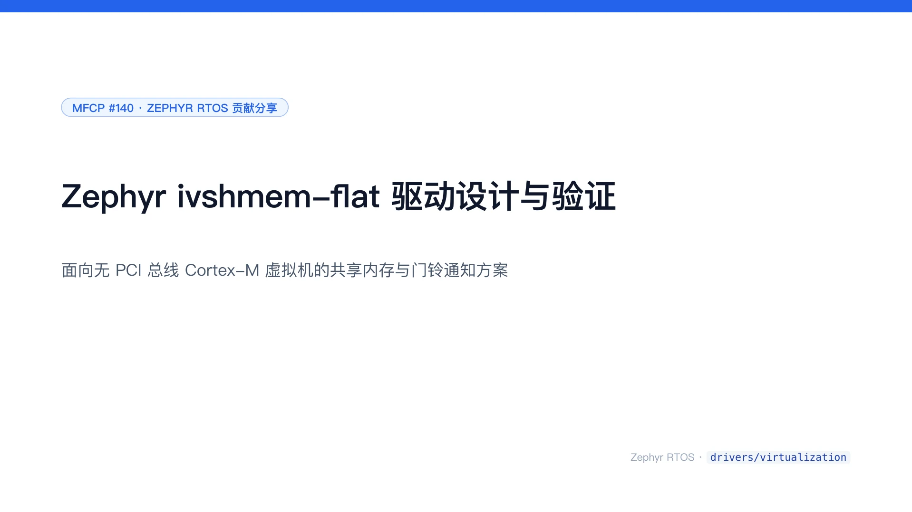

In this post, I cover four main areas: the original task requirements and QEMU hardware constraints, the driver and devicetree design, how to test the driver thoroughly under Twister without a patched QEMU or external server, and the end-to-end two-VM 100-round ping-pong sample with a local QEMU wiring patch. I also share a few lessons learned from following up on upstream reviews and automated feedback.

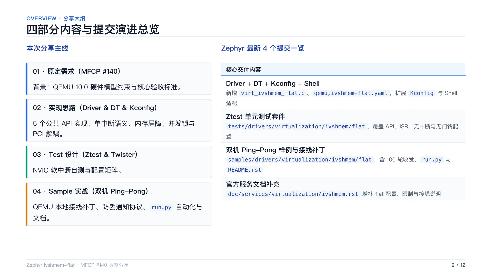

## Background and Hardware Constraints

When I started investigating the task, I first compared what already existed in QEMU and Zephyr. The goal was straightforward: bring a memory-mapped (MMIO) `ivshmem-flat` driver to MCU targets without a PCI bus, such as ARM Cortex-M, while reusing Zephyr's existing public `ivshmem` API for compatibility and delivering the complete package of driver, devicetree binding, unit tests, two-VM sample, and documentation.

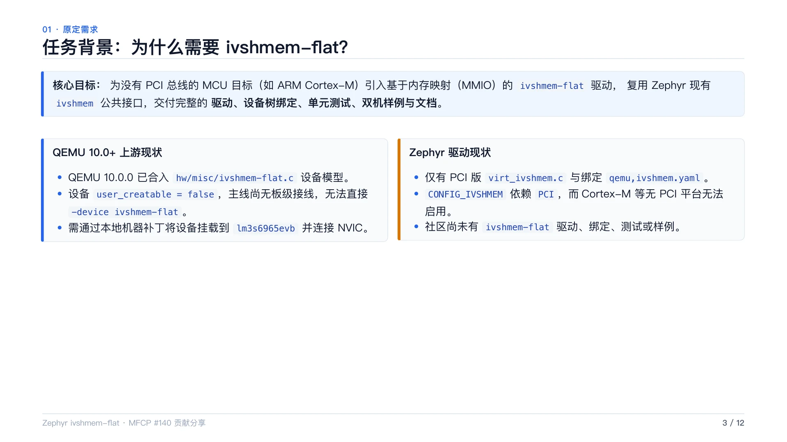

On the QEMU side, version 10.0.0 already includes the `hw/misc/ivshmem-flat.c` device model, but it sets `user_creatable = false` and is not wired into any upstream board yet. You cannot simply instantiate it with `-device ivshmem-flat`; end-to-end verification requires a small local machine wiring patch on `lm3s6965evb` to map the device and connect it to the NVIC. On the Zephyr side, only the PCI-based `virt_ivshmem.c` driver and `qemu,ivshmem.yaml` binding existed, and `CONFIG_IVSHMEM` depended on PCI, leaving Cortex-M targets unable to enable it.

The hardest part of the initial design was understanding the hardware constraints around interrupts. Unlike PCI `ivshmem` with MSI-X vectors, QEMU's `ivshmem-flat` exposes a `0x10`-byte MMIO register block, a dedicated shared-memory region, and at most one optional output IRQ line.

| Offset | Register | Access and Semantics |
| --- | --- | --- |
| `0x00` | `INTMASK` | Reserved: reads return `0`, writes are ignored |
| `0x04` | `INTSTATUS` | Reserved: reads return `0`; cannot mask, acknowledge, or identify sources |
| `0x08` | `IVPOSITION` | Read-only: holds the local Peer ID assigned by `ivshmem-server` |
| `0x0C` | `DOORBELL` | Notification register: bits `[31:16]` hold target `peer_id`, bits `[15:0]` hold `vector` |

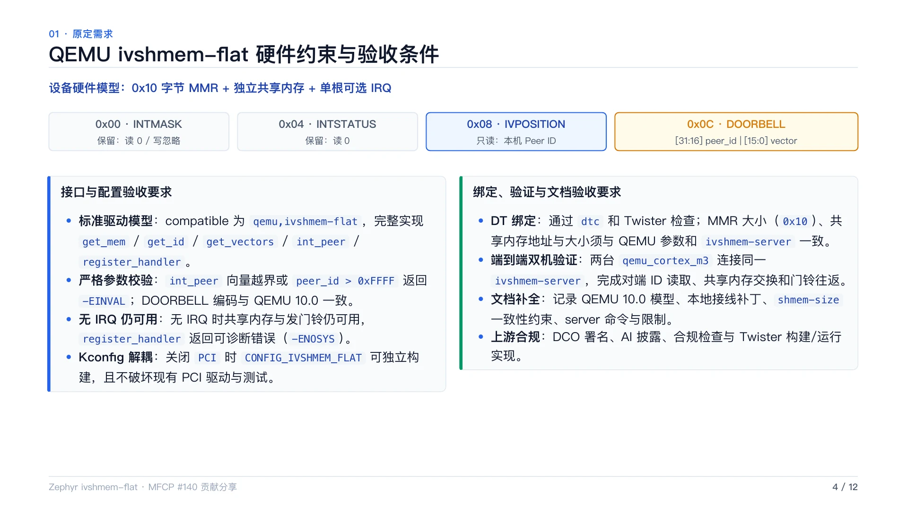

Those constraints shaped the acceptance criteria:

- **Standard driver model**: bind to `qemu,ivshmem-flat` and implement all five public APIs (`get_mem`, `get_id`, `get_vectors`, `int_peer`, `register_handler`) so application code never touches hardware registers directly.
- **Strict argument validation**: return `-EINVAL` when `int_peer` receives an out-of-range vector or `peer_id > 0xFFFF`, matching QEMU 10.0's doorbell encoding.
- **Usable without an IRQ**: when no receive IRQ is configured, shared-memory access and sending doorbells must keep working, while `register_handler` returns `-ENOSYS`.
- **PCI-free Kconfig decoupling**: `CONFIG_IVSHMEM_FLAT` must build cleanly with PCI disabled without breaking the existing PCI driver or its tests.

## Driver Design: Public API Reuse and Single-IRQ Semantics

In `drivers/virtualization/virt_ivshmem_flat.c`, the driver implements Zephyr's standard `DEVICE_API(ivshmem, ...)` and maps each of the five public functions directly to the flat device capabilities.

| Public API | `ivshmem-flat` Implementation | Edge Cases and Error Semantics |
| --- | --- | --- |
| `ivshmem_get_mem()` | Returns `DEVICE_MMIO_NAMED_GET(dev, shmem)` and `shmem_size` from devicetree | Mapped at init with `K_MEM_CACHE_NONE \| K_MEM_PERM_USER` |
| `ivshmem_get_id()` | Reads `mmr + 0x08` (`IVPOSITION`) and converts via `sys_le32_to_cpu()` | Reflects the Peer ID assigned by `ivshmem-server` |
| `ivshmem_get_vectors()` | Returns `DEV_CFG(dev)->irq_config != NULL ? 1 : 0` | Returns `1` only when `CONFIG_IVSHMEM_DOORBELL` is enabled and an IRQ exists in devicetree; otherwise `0` |
| `ivshmem_int_peer()` | Calls `barrier_dmem_fence_full()`, then writes little-endian `(peer_id << 16) \| vector` to `0x0C` | Returns `-ENOSYS` if DoorBell is disabled; `-EINVAL` if `vector != 0` or `peer_id > 65535` |
| `ivshmem_register_handler()` | Stores `data->signal = poll_signal` under `K_SPINLOCK(&data->lock)` | Returns `-ENOSYS` without IRQ; `-EINVAL` if `vector >= 1`; `NULL` unregisters the handler |

Following the pattern of Zephyr's existing `ivshmem` driver, `ivshmem_flat_init()` uses `DEVICE_MMIO_NAMED_MAP` to map `mmr` (kernel-only, uncached) and `shmem` (uncached, user-accessible). A compile-time helper macro `IVSHMEM_FLAT_IRQ_ENABLED(n)` checks `CONFIG_IVSHMEM_DOORBELL && DT_INST_IRQ_HAS_IDX(n, 0)` so instances without an interrupt do not even emit an `irq_config` function.

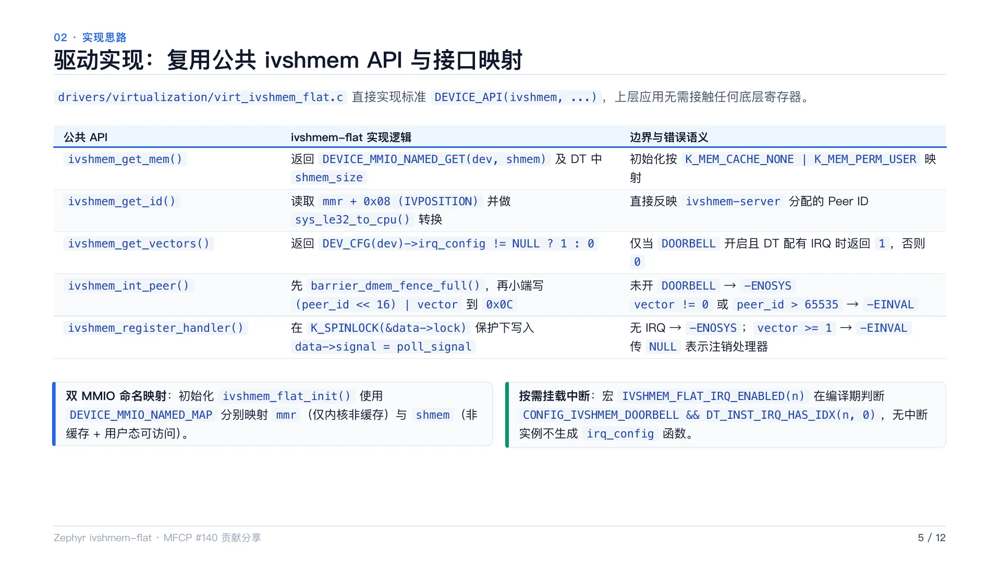

Interrupt handling took the most careful thought. Because `ivshmem-flat` provides only a single output IRQ line and keeps `INTMASK` and `INTSTATUS` reserved, the ISR cannot tell which peer or which eventfd vector triggered the interrupt.

Accordingly, the devicetree binding constrains `num-vectors` to `enum: [1]` and requires running the server with `-n 1`. The driver supports only vector `0`, and the ISR raises the registered `k_poll_signal` with value `0` without reading or writing either reserved register.

Two concurrency and ordering details were equally critical:

1. **Full memory barrier before ringing the doorbell**: `ivshmem_flat_int_peer()` calls `barrier_dmem_fence_full()` before writing `DOORBELL` so shared-memory payload writes are globally visible before the peer receives its interrupt. Both `IVPOSITION` and `DOORBELL` use explicit `sys_le32_to_cpu` and `sys_cpu_to_le32` helpers for endian portability.
2. **Spinlock protection against unregistration races**: `ivshmem_register_handler()` (thread context) and `ivshmem_flat_isr()` (interrupt context) both access `data->signal`. Guarding both paths with `K_SPINLOCK(&data->lock)` prevents the ISR from raising a dangling `k_poll_signal` pointer after unregistration or teardown.

```c
static int ivshmem_flat_int_peer(
	const struct device *dev, uint32_t peer_id,
	uint16_t vector)
{
	if (!IS_ENABLED(CONFIG_IVSHMEM_DOORBELL)) {
		return -ENOSYS;
	}
	if ((vector != 0) || (peer_id > UINT16_MAX)) {
		return -EINVAL;
	}
	/* Publish shmem writes before doorbell */
	barrier_dmem_fence_full();
	sys_write32(
		sys_cpu_to_le32((peer_id << 16) | vector),
		DEVICE_MMIO_NAMED_GET(dev, mmr) + IVSHMEM_FLAT_DOORBELL);
	return 0;
}

static void ivshmem_flat_isr(const struct device *dev)
{
	struct ivshmem_flat_data *data = dev->data;

	K_SPINLOCK(&data->lock) {
		if (data->signal != NULL) {
			k_poll_signal_raise(data->signal, 0);
		}
	}
}
```

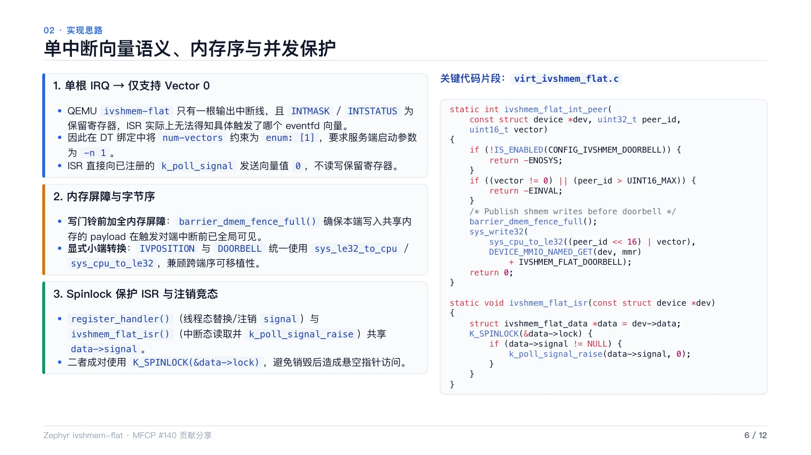

To catch misconfigured devicetree nodes at build time, the driver instantiation macro enforces four `BUILD_ASSERT` checks: exactly 2 register regions, `mmr` size equal to `0x10`, non-zero `shmem` size, and at most 1 interrupt.

On the Kconfig side, `CONFIG_IVSHMEM_FLAT` depends on `DT_HAS_QEMU_IVSHMEM_FLAT_ENABLED` and `!IVSHMEM_V2` with zero PCI dependency. The shared configuration block expands to `if IVSHMEM || IVSHMEM_FLAT` so logging, `CONFIG_IVSHMEM_DOORBELL` (which selects `POLL`), and `CONFIG_IVSHMEM_SHELL` are reused cleanly, while PCI-only options (`IVSHMEM_MSI_X_VECTORS` and `IVSHMEM_INT_PRIORITY`) are narrowed to `depends on IVSHMEM && IVSHMEM_DOORBELL`. In `virt_ivshmem_shell.c`, the shell prefers a PCI `qemu_ivshmem` device and falls back to `qemu_ivshmem_flat` when none is present.

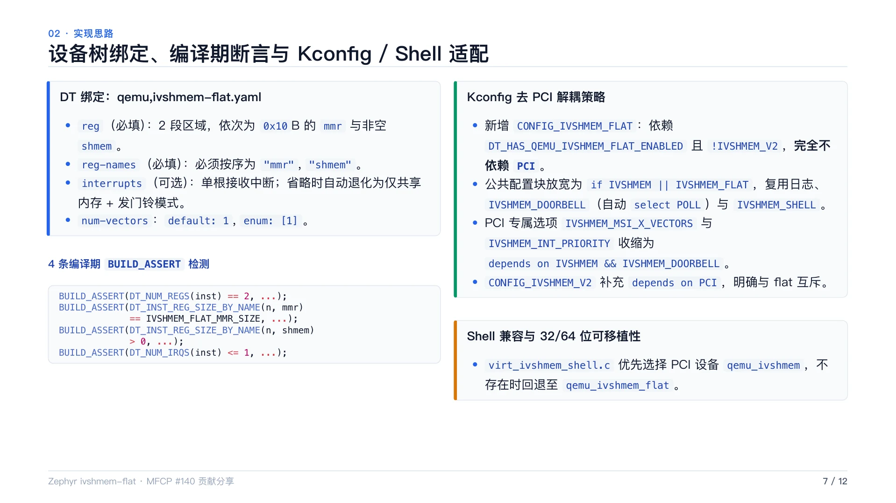

## Unit Testing: SRAM Slicing and Software-Triggered NVIC IRQs

Initially I considered placing the two-VM ping-pong test inside `tests/`, but separating unit tests from the multi-VM sample turned out to be much cleaner. In upstream CI, `west twister -p qemu_cortex_m3 -T tests/drivers/virtualization/ivshmem/flat` runs against stock, unpatched `qemu_cortex_m3`, with no `ivshmem-flat` hardware wiring, no `ivshmem-server`, and no second VM.

To exercise every API path and the real ISR out of the box under Twister, the test suite combines SRAM slicing with software-pending NVIC interrupts:

- **Simulated MMR and shared memory in SRAM**: `boards/qemu_cortex_m3.overlay` shrinks `&sram0` to `0x20000000` (`0xf000`, 60 KiB) and carves the trailing 4 KiB into three instances: `flat0` (with IRQ 25, ID = 17), `flat1` (with IRQ 26, ID = 18 for multi-instance isolation), and `flat_no_irq` (no `interrupts`, ID = 19).
- **Real ISR execution**: tests call `NVIC_SetPendingIRQ()` on IRQ 25 and IRQ 26 to trigger the registered `ivshmem_flat_isr()` directly.
- **Sentinel guards**: before each case, `prepare()` resets signals and writes sentinel values (`0xa5a55a5a` / `0x12345678`) to catch out-of-bounds writes or unintended access to reserved registers.

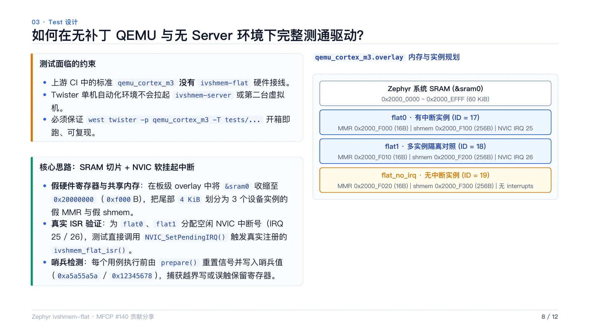

The suite contains five Ztest cases driven across four Twister scenarios in `tests.yaml`:

| Ztest Case | What It Verifies |
| --- | --- |
| `test_memory_and_id` | `get_mem` address, size, and read/write (`0xfeedface`); dynamic `get_id` reads (`17`, `65535`) and isolation from `flat1` (`18`) |
| `test_vectors_and_doorbell` | Upper-16-bit DoorBell encoding (`0x1234`, `0xffff`); `-EINVAL` for `vec=1`, `vec=0xffff`, `peer=0x10000`; `-ENOSYS` when DoorBell is disabled |
| `test_no_irq` | `get_vectors == 0` and `register_handler` returning `-ENOSYS` on an IRQ-less device while shared memory and sending doorbells still work |
| `test_reserved_registers` | After exercising every API, verifies `INTMASK` remains `0xa5a55a5a` and `INTSTATUS` remains `0` |
| `test_signal_lifecycle_and_isolation` | Uses `NVIC_SetPendingIRQ` to verify `k_poll` wakeup, isolation of `flat1`, replacing an active signal, `-EAGAIN` timeout after `NULL` unregistration, and independent triggering of `flat1` |

The four Twister scenarios cover `ivshmem.flat` (full DoorBell + IRQ), `ivshmem.flat.no_irq` (applies `no_irq.overlay` to drop `interrupts`), `ivshmem.flat.no_doorbell` (`CONFIG_IVSHMEM_DOORBELL=n`), and `ivshmem.flat.shell` (`build_only: true` with `CONFIG_SHELL` and `CONFIG_IVSHMEM_SHELL`).

```bash
west twister \
  -p qemu_cortex_m3 \
  -T tests/drivers/virtualization/ivshmem/flat \
  --outdir twister-out-ivshmem-flat \
  -i
```

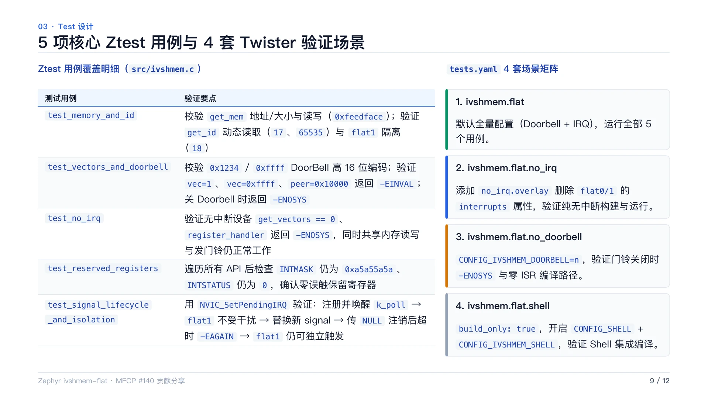

## End-to-End Two-VM Ping-Pong Sample and Local QEMU Wiring

The full two-VM demonstration lives under `samples/drivers/virtualization/ivshmem/flat/`. A single `ivshmem-server -F -l 1M -n 1` distributes a 1 MiB shared-memory file descriptor and bidirectional Vector 0 eventfds to two `qemu_cortex_m3` instances running the same `zephyr.elf` image (VM 0 / Peer 0 as initiator, VM 1 / Peer 1 as responder).

Because upstream QEMU 10.0.0's `lm3s6965evb` machine does not wire `ivshmem-flat` yet, the sample includes a minimal local patch to `hw/arm/stellaris.c`. It instantiates `TYPE_IVSHMEM_FLAT` only when a `chardev` named `ivshmem` is supplied on the command line, mapping the `0x10`-byte MMR region at `0x40010000`, the `1 MiB` shared-memory region at `0x60000000`, and the output interrupt to NVIC `IRQ 25`. The QEMU `shmem-size` property, devicetree `app.overlay` region size, and server `-l 1M` flag must all match.

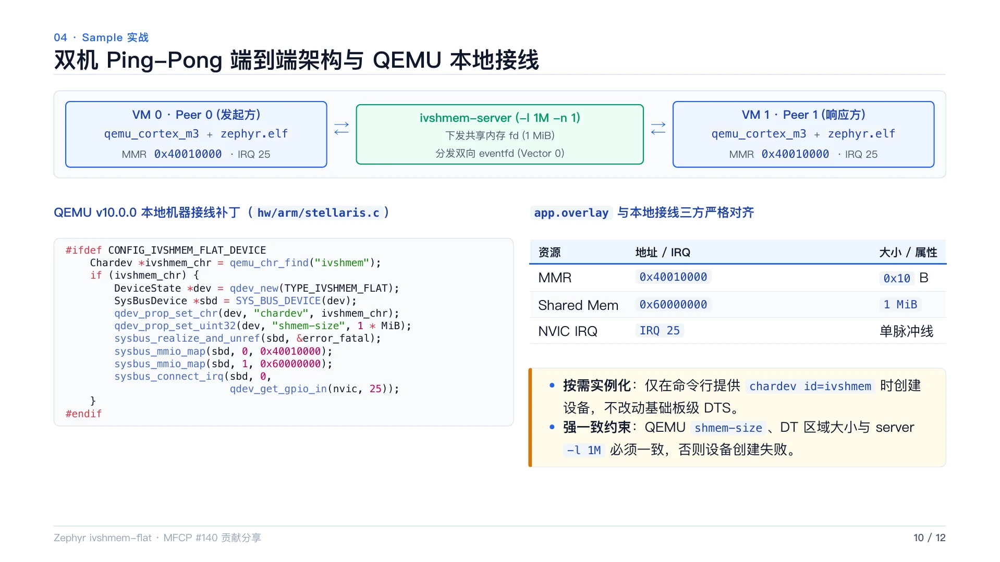

The shared-memory protocol in `src/ivshmem.c` is built around three safeguards:

- **Split-slot ownership**: each peer writes only to `slots[id]` and reads only from `slots[1 - id]`, with five fields (`ready`, `sequence`, `payload`, `checksum`, `done`) to eliminate write races.
- **Readiness handshake and 100-round verification**: each peer writes `ready = 0x49565348` and polls for its counterpart (30-second startup timeout) so both peers have valid eventfds before ringing the doorbell. Peer 0 then writes `payload = 0x5a5a0000 ^ seq` and an XOR `checksum`, publishes `sequence` after a memory barrier, and calls `ivshmem_int_peer()`. Peer 1 verifies and echoes each round, and both peers complete a final `done` handshake after round 100.
- **Race-free `wait_value` pattern**: to prevent missed or coalesced notifications, the receiver resets the poll signal, executes a full memory barrier, re-checks shared memory, and only calls `k_poll` if the expected value has not arrived yet. Sequence numbers remain the source of truth even when multiple interrupts coalesce.

```c
k_poll_signal_reset(event->signal);   // 1. Reset signal first
event->state = K_POLL_STATE_NOT_READY;
barrier_dmem_fence_full();
if (*value == expected) return 0;     // 2. Re-check shared memory
k_poll(event, 1, K_MSEC(remaining));  // 3. Sleep only if still pending
```

To make reproduction effortless, `run.py` automates the full lifecycle: it creates a private temporary directory for `server.sock` and the backing file, launches `ivshmem-server`, starts VM 0 and waits for `Peer 0 ready` on UART so it reliably receives Peer ID 0, then launches VM 1 and monitors both consoles (90-second total timeout). It exits `0` only when both peers print `PASS: peer 0/1 completed 100 rounds`, and cleans up every child process in `finally` while preserving `server.log`, `vm0.log`, and `vm1.log`.

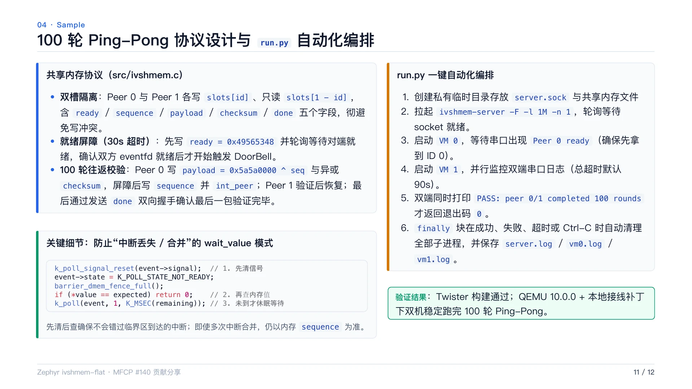

## Documentation and Upstream Contribution Lessons

The final step was updating `doc/services/virtualization/ivshmem.rst` and `samples/drivers/virtualization/ivshmem/flat/README.rst` with Kconfig requirements, devicetree properties, the Vector 0 / `-n 1` constraint, `-ENOSYS` behavior without an IRQ, incompatibility with `IVSHMEM_V2`, and complete instructions from building QEMU 10.0.0 to running `run.py`. One subtle CI detail came up here: because the QEMU patch embedded in `README.rst` references `#ifdef CONFIG_IVSHMEM_FLAT_DEVICE`, Zephyr's `KconfigBasic` check flagged it as an undefined Kconfig symbol until we added the file to `scripts/ci/undef_kconfig_files_allowlist.txt`.

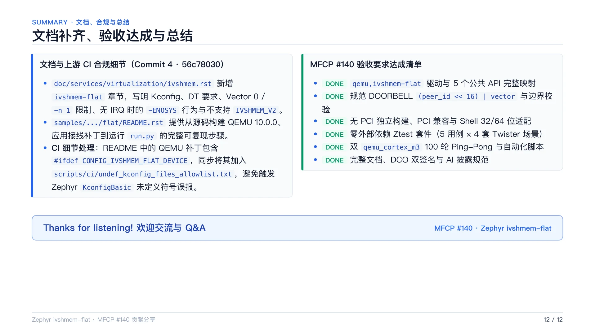

Looking back at the upstream process, two practical habits stood out:

- **Stay patient and responsive during review**: large upstream projects like Zephyr often have long review queues. While waiting for maintainers, keep tracking CI failures and automated review comments (such as GitHub Copilot hints) and address small issues promptly so reviewers can see active follow-through.
- **Verify automated suggestions critically**: at one point I applied an automated documentation suggestion without checking it closely and ended up introducing an error that required a follow-up fix. Automated feedback is useful for spotting issues, but every change still needs manual verification against the codebase.

## Live Q&A

**Zevorn: Coming into Zephyr for the first time, how did working with its devicetree bindings and driver model compare to your prior experience?**

I had not used other RTOSes before, though I had some exposure to Linux development workflows. Working on the `qemu,ivshmem-flat` binding and driver felt very familiar because Zephyr follows the same industry-standard devicetree and driver-model concepts used in Linux, which made it easy to transfer existing knowledge.

**Zevorn: You also used Zephyr's Twister framework, which unifies `native_sim` white-box tests, QEMU driver tests, and hardware farms. What was your impression of it?**

I did notice that unified design, and for this task I focused on running the four Twister configurations on `qemu_cortex_m3`. The overall workflow felt much closer to modern Linux or desktop development than a bare-bones RTOS kernel setup.

**Zevorn's note on following up upstream:**

Zephyr currently has over 2,000 open PRs compared to roughly 400 maintainers and reviewers, so review bandwidth is tight. Although this PR is still awaiting final merge, it has already received maintainer approval. Whenever a PR stalls upstream, it helps to politely ping the bot-assigned maintainers or collaborators in the PR comments to keep momentum moving.

## Resources

- Upstream Zephyr PR: [zephyrproject-rtos/zephyr#125507](https://github.com/zephyrproject-rtos/zephyr/pull/125507)
- MFCP Task Issue: [missionhub-oss/mfcp#140](https://github.com/missionhub-oss/mfcp/issues/140)
- QEMU `ivshmem-flat` Documentation (Chinese): [QEMU ivshmem-flat Device](https://processmission.github.io/qemu/system/devices/ivshmem-flat.html)
- Author GitHub: [LiuKai29](https://github.com/LiuKai29)
