> 这篇博客文章整理自 2026 年 11 月 26 日 MFCP 开源实践分享《Zephyr ivshmem-flat 驱动开发实践》。

我是来自哈尔滨工业大学的刘楷（GitHub ID：`LiuKai29`）。在参加 MFCP 之前，我没有接触过 Zephyr RTOS 开发，对大型开源社区的提交流程也还在摸索阶段。在泽文的指导和社区任务 [MFCP #140](https://github.com/missionhub-oss/mfcp/issues/140) 的推动下，我完成了面向无 PCI 总线目标的 Zephyr `ivshmem-flat` 驱动设计、测试、双机验证与文档编写，并向上游提交了 [zephyrproject-rtos/zephyr#125507](https://github.com/zephyrproject-rtos/zephyr/pull/125507)。

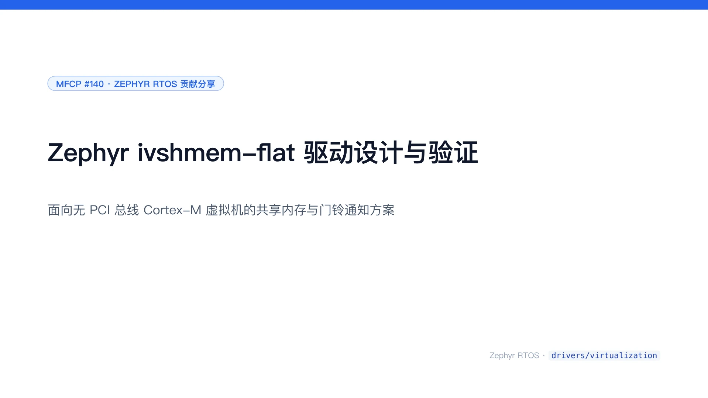

这次分享围绕四条主线展开：原定需求与硬件模型约束、驱动与设备树实现思路、不依赖外部环境的 Ztest 与 Twister 单元测试设计，以及基于 QEMU 本地接线补丁的双机 100 轮 Ping-Pong 端到端样例验证，最后也聊聊我在上游提 PR、跟进评审和甄别自动反馈时积累的一些真实体会。

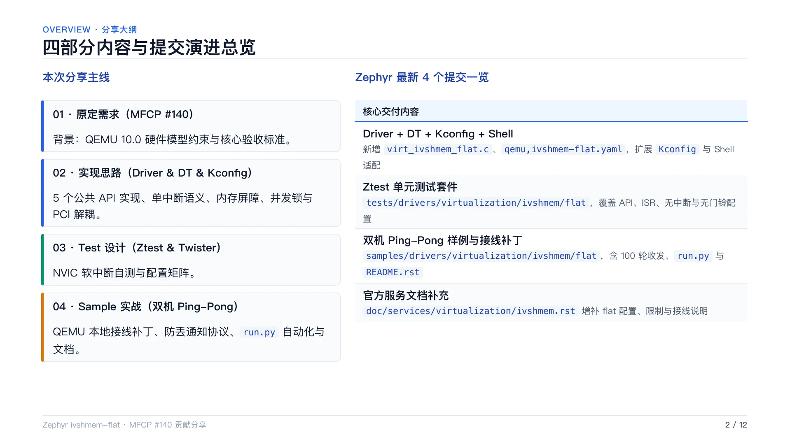

## 任务背景与硬件约束

接手这个任务时，我先对比了 QEMU 上游和 Zephyr 主线两边的现状。核心目标很明确：为没有 PCI 总线的 MCU 目标（例如 ARM Cortex-M）引入基于内存映射寄存器（MMIO）的 `ivshmem-flat` 驱动，同时为了保持生态兼容，直接复用 Zephyr 现有的 `ivshmem` 公共接口，并交付完整的驱动、设备树绑定、单元测试、双机样例和官方文档。

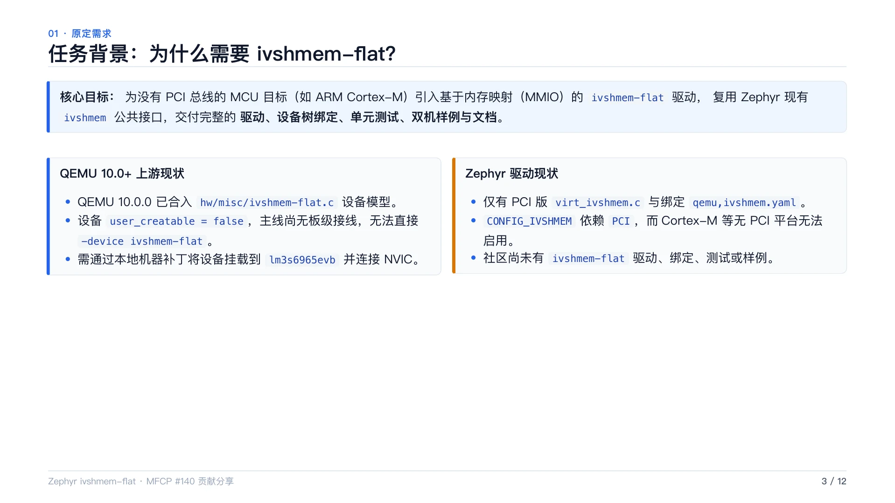

在 QEMU 10.0.0 中，上游其实已经合入了 `hw/misc/ivshmem-flat.c` 设备模型，但它的 `user_creatable` 属性为 `false`，主线也还没有把它接到具体的板级机器上，因此无法直接通过命令行 `-device ivshmem-flat` 创建，验证阶段需要自己打一个本地机器接线补丁把它挂载到 `lm3s6965evb` 并接入 NVIC。而在 Zephyr 侧，当时只有 PCI 版本的 `virt_ivshmem.c` 与 `qemu,ivshmem.yaml`，`CONFIG_IVSHMEM` 强依赖 PCI，Cortex-M 这类无 PCI 平台根本无法启用。

前期调研时，我觉得最难啃的部分在于硬件模型尤其是中断机制的约束。和带 PCI/MSI-X 多向量的传统 `ivshmem` 不同，QEMU 的 `ivshmem-flat` 模型只有 `0x10` 字节的 MMIO 寄存器区、一块独立共享内存和一根可选的输出 IRQ 中断线。

| 寄存器偏移 | 名称 | 访问约束与语义 |
| --- | --- | --- |
| `0x00` | `INTMASK` | 保留寄存器：读返回 `0`，写操作被忽略 |
| `0x04` | `INTSTATUS` | 保留寄存器：读返回 `0`，无法屏蔽、确认或识别通知来源 |
| `0x08` | `IVPOSITION` | 只读：保存由 `ivshmem-server` 分配的本机 Peer ID |
| `0x0C` | `DOORBELL` | 门铃触发：`[31:16]` 为目标 `peer_id`，`[15:0]` 为通知 `vector` |

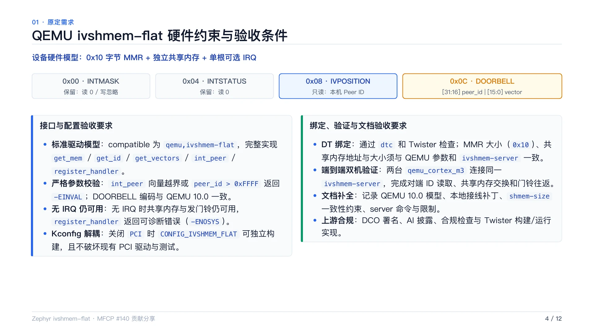

围绕这些硬件特性，方案需要同时满足几项核心验收标准：

- **标准驱动模型**：设备树 `compatible` 定为 `qemu,ivshmem-flat`，完整实现 `get_mem`、`get_id`、`get_vectors`、`int_peer` 与 `register_handler` 五个公共 API，让上层应用无需接触任何底层寄存器。
- **严格参数校验**：`int_peer` 遇到向量越界或 `peer_id > 0xFFFF` 时必须返回 `-EINVAL`，门铃编码格式与 QEMU 10.0 保持一致。
- **无 IRQ 仍可用**：当设备树未配置接收中断时，共享内存读写与发送门铃依然可用，调用 `register_handler` 时返回可诊断错误 `-ENOSYS`。
- **Kconfig 解耦**：关闭 PCI 时 `CONFIG_IVSHMEM_FLAT` 能够独立构建，并且不破坏现有的 PCI 驱动与回归测试。

## 驱动实现：复用公共 API 与单中断语义

在 `drivers/virtualization/virt_ivshmem_flat.c` 中，我直接对接了 Zephyr 标准的 `DEVICE_API(ivshmem, ...)`，把五个公共接口逐一映射到 `ivshmem-flat` 的硬件能力上。

| 公共 API | `ivshmem-flat` 实现逻辑 | 边界条件与错误语义 |
| --- | --- | --- |
| `ivshmem_get_mem()` | 返回 `DEVICE_MMIO_NAMED_GET(dev, shmem)` 及设备树中的 `shmem_size` | 初始化按 `K_MEM_CACHE_NONE \| K_MEM_PERM_USER` 映射 |
| `ivshmem_get_id()` | 读取 `mmr + 0x08`（`IVPOSITION`）并执行 `sys_le32_to_cpu()` 转换 | 直接反映 `ivshmem-server` 分配的 Peer ID |
| `ivshmem_get_vectors()` | 返回 `DEV_CFG(dev)->irq_config != NULL ? 1 : 0` | 仅当 `CONFIG_IVSHMEM_DOORBELL` 开启且设备树配有 IRQ 时返回 `1`，否则返回 `0` |
| `ivshmem_int_peer()` | 先调用 `barrier_dmem_fence_full()`，再小端写入 `(peer_id << 16) \| vector` 到 `0x0C` | 未开启 DoorBell 返回 `-ENOSYS`；`vector != 0` 或 `peer_id > 65535` 返回 `-EINVAL` |
| `ivshmem_register_handler()` | 在 `K_SPINLOCK(&data->lock)` 保护下写入 `data->signal = poll_signal` | 无 IRQ 配置返回 `-ENOSYS`；`vector >= 1` 返回 `-EINVAL`；传 `NULL` 注销处理器 |

初始化函数 `ivshmem_flat_init()` 参考了 Zephyr 原有驱动的组织方式，使用 `DEVICE_MMIO_NAMED_MAP` 分别映射 `mmr`（仅内核非缓存）与 `shmem`（非缓存且允许用户态访问）。中断挂载通过宏 `IVSHMEM_FLAT_IRQ_ENABLED(n)` 在编译期判断 `CONFIG_IVSHMEM_DOORBELL && DT_INST_IRQ_HAS_IDX(n, 0)`，没有中断配置的实例干脆不生成 `irq_config` 函数。

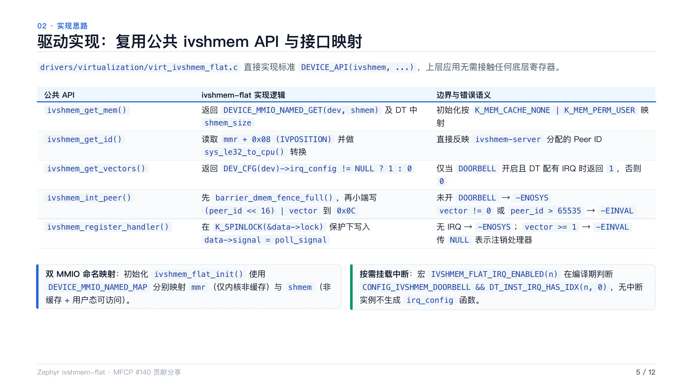

中断部分是我反复推敲最久的地方。由于 `ivshmem-flat` 只有一根输出中断线，且 `INTMASK` 与 `INTSTATUS` 都是保留寄存器，进入 ISR 时驱动程序实际上无法通过 eventfd 区分具体是哪一台机器、哪一个向量触发了中断。

因此我在设备树绑定中将 `num-vectors` 约束为 `enum: [1]`，要求服务端启动时显式传入 `-n 1`，驱动仅支持 `vector 0`；ISR 触发后不读写保留寄存器，直接向已注册的 `k_poll_signal` 发送向量值 `0`。

在并发和内存序上还有两个容易踩坑的细节：

1. **写门铃前插入全内存屏障**：在 `ivshmem_flat_int_peer()` 写入 `DOORBELL` 寄存器之前，必须先调用 `barrier_dmem_fence_full()`，确保本端写入共享内存的 payload 在触发对端中断前已经全局可见；同时对 `IVPOSITION` 和 `DOORBELL` 统一使用 `sys_le32_to_cpu` / `sys_cpu_to_le32` 做小端转换，兼顾跨端序可移植性。
2. **用自旋锁保护 ISR 与注销竞态**：线程态调用 `ivshmem_register_handler()` 替换或注销 `signal` 时，与中断上下文的 `ivshmem_flat_isr()` 共享 `data->signal`。两者成对使用 `K_SPINLOCK(&data->lock)`，避免信号对象销毁后 ISR 出现悬空指针访问。

```c
static int ivshmem_flat_int_peer(
	const struct device *dev, uint32_t peer_id,
	uint16_t vector)
{
	if (!IS_ENABLED(CONFIG_IVSHMEM_DOORBELL)) {
		return -ENOSYS;
	}
	if ((vector != 0) || (peer_id > UINT16_MAX)) {
		return -EINVAL;
	}
	/* Publish shmem writes before doorbell */
	barrier_dmem_fence_full();
	sys_write32(
		sys_cpu_to_le32((peer_id << 16) | vector),
		DEVICE_MMIO_NAMED_GET(dev, mmr) + IVSHMEM_FLAT_DOORBELL);
	return 0;
}

static void ivshmem_flat_isr(const struct device *dev)
{
	struct ivshmem_flat_data *data = dev->data;

	K_SPINLOCK(&data->lock) {
		if (data->signal != NULL) {
			k_poll_signal_raise(data->signal, 0);
		}
	}
}
```

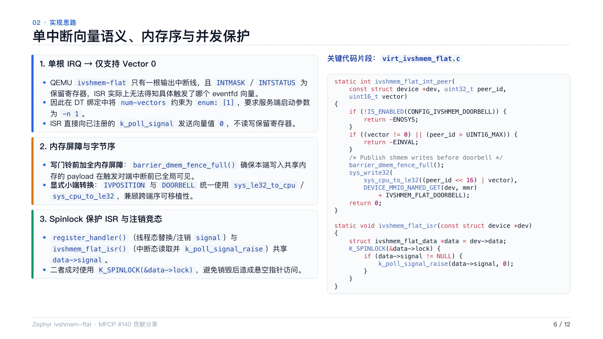

为了让不合法的设备树配置在编译阶段就能及时暴露，我在驱动实例化宏里加入了 4 条 `BUILD_ASSERT` 断言，分别检查寄存器段数是否为 `2`、`mmr` 大小是否等于 `0x10`、`shmem` 大小是否大于 `0` 以及中断数是否不超过 `1`。

在 Kconfig 解耦方面，我新增了 `CONFIG_IVSHMEM_FLAT`，仅依赖 `DT_HAS_QEMU_IVSHMEM_FLAT_ENABLED` 且与 `IVSHMEM_V2` 互斥，完全脱离 PCI 依赖；同时把公共配置块放宽为 `if IVSHMEM || IVSHMEM_FLAT`，复用了日志、`CONFIG_IVSHMEM_DOORBELL`（自动 `select POLL`）和 `CONFIG_IVSHMEM_SHELL`，再把 PCI 专属的 `IVSHMEM_MSI_X_VECTORS` 与 `IVSHMEM_INT_PRIORITY` 收缩回 `depends on IVSHMEM && IVSHMEM_DOORBELL`。`virt_ivshmem_shell.c` 则调整为优先选择 PCI 设备 `qemu_ivshmem`，不存在时自动回退到 `qemu_ivshmem_flat`。

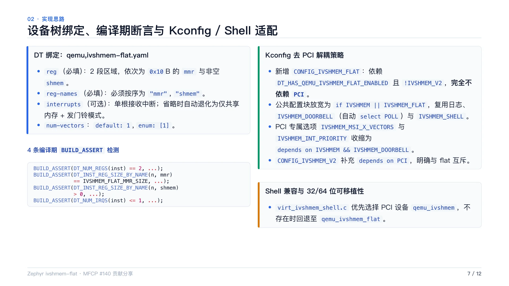

## 单元测试设计：SRAM 切片与 NVIC 软中断

一开始我也考虑过把双机 Ping-Pong 直接放进 `tests/` 里，但很快意识到测试与样例的边界要分清楚：上游 CI 跑 `west twister -p qemu_cortex_m3 -T tests/drivers/virtualization/ivshmem/flat` 时，用的是标准无补丁的 `qemu_cortex_m3`，既没有 `ivshmem-flat` 硬件接线，也不会拉起 `ivshmem-server` 或第二台虚拟机。

为了让单元测试在无补丁 QEMU、无外部服务的环境下也能开箱即跑并完整验证真实 ISR，我采用了「SRAM 切片 + NVIC 软挂起中断」的思路：

- **模拟硬件寄存器与共享内存**：在 `boards/qemu_cortex_m3.overlay` 中将 `&sram0` 收缩至 `0x20000000`（长度 `0xf000`，即 60 KiB），把尾部 4 KiB 划给三个设备实例作为模拟 MMR 与 shmem：`flat0`（有中断，ID = 17，IRQ 25）、`flat1`（多实例隔离对照，ID = 18，IRQ 26）以及 `flat_no_irq`（无中断实例，ID = 19）。
- **触发真实 ISR**：在测试用例中直接调用 `NVIC_SetPendingIRQ()` 软挂起 IRQ 25 或 IRQ 26，驱动真正执行注册好的 `ivshmem_flat_isr()`。
- **哨兵值检测**：每个用例执行前由 `prepare()` 重置信号并写入哨兵值（`0xa5a55a5a` / `0x12345678`），用于捕获越界写或误触保留寄存器的问题。

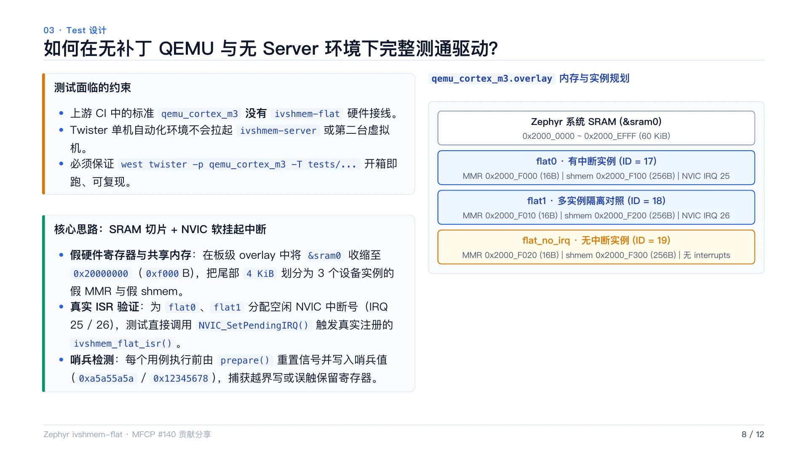

整套测试拆成 5 个 Ztest 用例，配合 `tests.yaml` 中的 4 套 Twister 场景矩阵覆盖全量、无中断、关闭 DoorBell 和 Shell 集成编译路径：

| Ztest 用例 | 核心验证点 |
| --- | --- |
| `test_memory_and_id` | 校验 `get_mem` 地址、大小与读写（`0xfeedface`）；验证 `get_id` 动态读取（`17`、`65535`）以及与 `flat1`（`18`）的隔离 |
| `test_vectors_and_doorbell` | 校验 `0x1234` / `0xffff` 的 DoorBell 高 16 位编码；验证 `vec=1`、`vec=0xffff`、`peer=0x10000` 返回 `-EINVAL`；关闭 DoorBell 时返回 `-ENOSYS` |
| `test_no_irq` | 验证无中断实例的 `get_vectors == 0`、`register_handler` 返回 `-ENOSYS`，同时共享内存读写和发门铃正常工作 |
| `test_reserved_registers` | 遍历全部 API 后检查 `INTMASK` 仍为 `0xa5a55a5a`、`INTSTATUS` 仍为 `0`，确认零误触保留寄存器 |
| `test_signal_lifecycle_and_isolation` | 通过 `NVIC_SetPendingIRQ` 验证注册唤醒 `k_poll`、`flat1` 不受干扰、替换新 signal、传 `NULL` 注销后超时返回 `-EAGAIN`，以及 `flat1` 独立触发 |

Twister 矩阵包含 `ivshmem.flat`（默认 DoorBell + IRQ 全量 5 个用例）、`ivshmem.flat.no_irq`（加载 `no_irq.overlay` 删除 `interrupts` 属性）、`ivshmem.flat.no_doorbell`（`CONFIG_IVSHMEM_DOORBELL=n` 验证 `-ENOSYS` 与零 ISR 编译路径）和 `ivshmem.flat.shell`（`build_only: true` 验证 `CONFIG_SHELL` + `CONFIG_IVSHMEM_SHELL` 集成编译）。

```bash
west twister \
  -p qemu_cortex_m3 \
  -T tests/drivers/virtualization/ivshmem/flat \
  --outdir twister-out-ivshmem-flat \
  -i
```

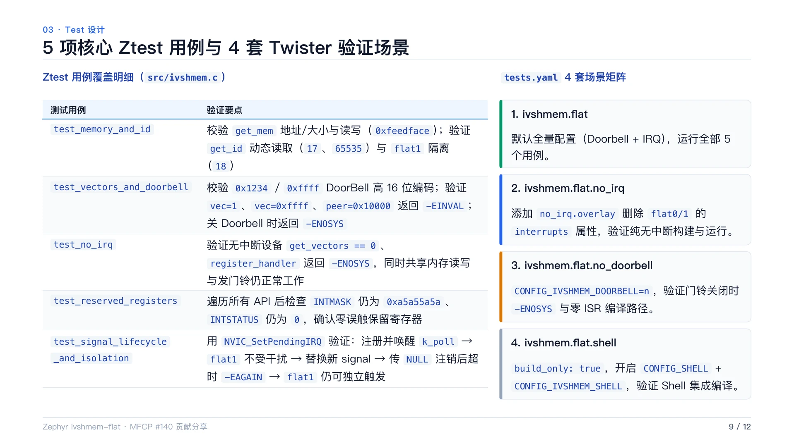

## 双机 Ping-Pong 端到端验证与 QEMU 本地接线

真正把两台虚拟机连起来跑通，放在了 `samples/drivers/virtualization/ivshmem/flat/`。架构上由一个 `ivshmem-server -F -l 1M -n 1` 统一分配 1 MiB 共享内存文件描述符和双向 eventfd（Vector 0），连接两台运行同一份 `zephyr.elf` 镜像的 `qemu_cortex_m3` 虚拟机（VM 0 / Peer 0 作为发起方，VM 1 / Peer 1 作为响应方）。

由于 QEMU 10.0.0 的 `lm3s6965evb` 主线代码里尚未接入 `ivshmem-flat`，我们在 `hw/arm/stellaris.c` 中提供了一个按需生效的本地接线补丁：只有命令行显式传入 `chardev id=ivshmem` 时才实例化 `TYPE_IVSHMEM_FLAT`，把 MMR 映射到 `0x40010000`（`0x10` 字节）、共享内存映射到 `0x60000000`（`1 MiB`），并将输出中断接入 NVIC `IRQ 25`。QEMU 的 `shmem-size`、`app.overlay` 里的设备树区域大小以及 `ivshmem-server` 的 `-l 1M` 三方必须严格一致，否则设备创建会失败。

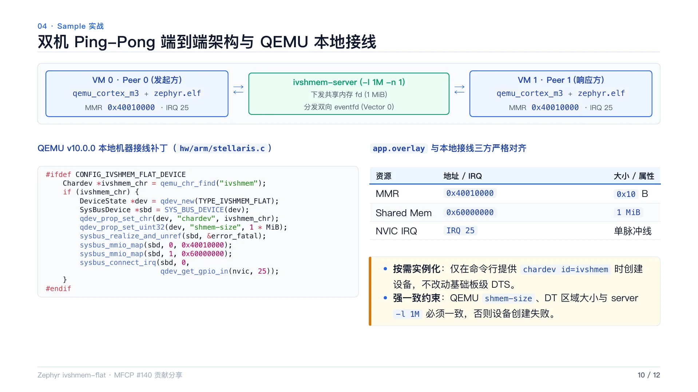

在双机共享内存通信协议设计上，我做了三层保障：

- **双槽位隔离**：Peer 0 与 Peer 1 各自只写 `slots[id]`、只读 `slots[1 - id]`，每个槽位包含 `ready`、`sequence`、`payload`、`checksum`、`done` 五个字段，彻底避免双端并发写冲突。
- **就绪握手与 100 轮往返校验**：启动后先写入 `ready = 0x49565348` 并轮询等待对端就绪（30 秒超时），确认双端 eventfd 都建立后再按门铃。之后 Peer 0 写入 `payload = 0x5a5a0000 ^ seq` 与异或 `checksum`，加内存屏障后更新 `sequence` 并调用 `ivshmem_int_peer()`；Peer 1 校验通过后回写响应；全部 100 轮结束后，双方再通过 `done` 信号完成双向握手，确认最后一包数据校验完毕。
- **防中断丢失与合并的 `wait_value` 模式**：等待对端更新时，严格遵循「先清信号 → 加全内存屏障 → 复查内存值 → 未满足才调用 `k_poll` 休眠」的顺序。即使中断在临界区提前到达，或者多次门铃通知发生合并，程序也不会永久阻塞，并且始终以共享内存中的 `sequence` 为准。

```c
k_poll_signal_reset(event->signal);   // 1. 先清信号
event->state = K_POLL_STATE_NOT_READY;
barrier_dmem_fence_full();
if (*value == expected) return 0;     // 2. 再查内存值
k_poll(event, 1, K_MSEC(remaining));  // 3. 未到才休眠等待
```

为了方便复现，我还写了一个一键编排脚本 `run.py`：自动创建临时目录存放 `server.sock` 和共享内存文件，拉起 `ivshmem-server`，先启动 VM 0 等串口打印 `Peer 0 ready`（确保拿到 Peer ID 0），再启动 VM 1 并并行监控双端串口日志（总超时默认 90 秒）；只有双端都打印 `PASS: peer 0/1 completed 100 rounds` 才返回退出码 `0`，并在 `finally` 块里清理全部子进程、保留 `server.log`、`vm0.log` 与 `vm1.log` 便于排错。

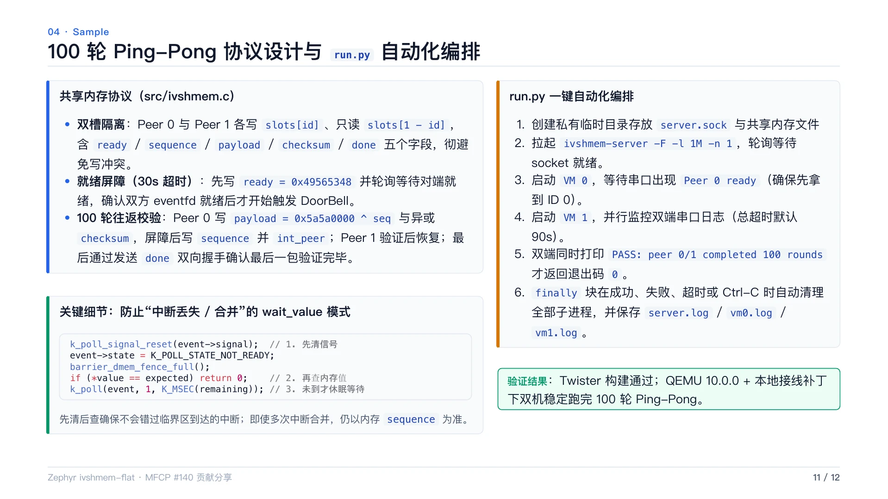

## 文档补齐与上游开源贡献体会

最后一块工作是补齐 `doc/services/virtualization/ivshmem.rst` 与 `samples/drivers/virtualization/ivshmem/flat/README.rst`，把 Kconfig 依赖、设备树要求、`Vector 0 / -n 1` 限制、无 IRQ 时的 `-ENOSYS` 行为、不支持 `IVSHMEM_V2` 以及从源码构建 QEMU 10.0.0 到运行 `run.py` 的步骤完整写清。这里还碰到一个很有意思的 CI 细节：`README.rst` 里贴的 QEMU 补丁代码包含 `#ifdef CONFIG_IVSHMEM_FLAT_DEVICE`，触发了 Zephyr 的 `KconfigBasic` 未定义符号检查，因此同步把该文档加入 `scripts/ci/undef_kconfig_files_allowlist.txt` 才通过了上游 CI。

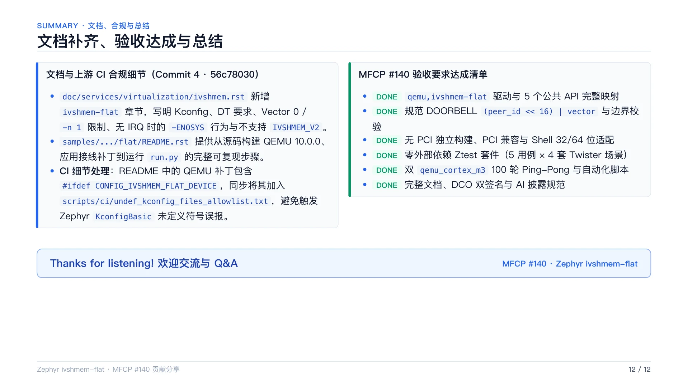

回顾整个上游提交流程，我最大的感受有两点：

- **对维护者评审保持耐心，并持续跟进细节**：Zephyr 社区体量非常大，维护者评审有时需要等一段时间。在等待人工评审期间，不要干等，可以先盯紧 CI 和自动评审工具（例如 GitHub Copilot 的提示）报出的语法、格式或边界问题，自己及时修复并推送，让维护者看到你在持续跟进这个 PR。
- **对自动评审建议要独立甄别，不能照单全收**：有一次我没仔细核对 GitHub Actions / 自动评审工具给出的文档修改建议就直接应用了，结果反而引入了新错误，只能重新修改提交一次。工具的意见值得看，但每条改动还是要结合代码和上下文自己核实一遍。

## 现场问答

**泽文：你在这次贡献中接触了 Zephyr 的驱动与设备树开发，相比之前接触过的开发方式，有什么特别的体验？**

我之前没有接触过其他 RTOS，不过此前了解过一些 Linux 内核与设备树开发流程。写 `qemu,ivshmem-flat` 设备树绑定和驱动模型时，发现 Zephyr 沿用了与 Linux 非常接近的工程范式，这类方法是行业通用的，也帮我把前面积累的知识直接迁移过来了。

**泽文：这次你也用到了 Zephyr 的 Twister 测试框架，它能把 `native_sim` 白盒测试、QEMU 驱动测试和真实硬件农场统一在一套框架下，你在实践中对 Twister 有什么感受？**

确实注意到了这一点。这次我主要围绕 `qemu_cortex_m3` 用 Twister 跑通了四套配置矩阵和单元回归测试，整体开发与验证体验很现代化，和在桌面或 Linux 环境下做工程开发相比差异没有想象中那么大。

**泽文补充（关于上游评审推进）：**

目前 Zephyr 仓库同时打开的活跃 PR 有 2000 多个，而维护者和评审者大约 400 多位，评审压力确实比较大。这次 PR 虽然尚未最终合入，但已经获得了维护者的 approve。如果在后续上游贡献中遇到 PR 停滞，可以在评论区礼貌地 `@` 机器人分配的 maintainer 或 collaborator，主动同步最新进展请他们推进。

## 相关资源

- 上游 Zephyr PR：[zephyrproject-rtos/zephyr#125507](https://github.com/zephyrproject-rtos/zephyr/pull/125507)
- MFCP 实践任务：[missionhub-oss/mfcp#140](https://github.com/missionhub-oss/mfcp/issues/140)
- QEMU 官方设备说明（中文）：[QEMU 虚拟机间平坦共享内存设备（ivshmem-flat）](https://processmission.github.io/qemu/system/devices/ivshmem-flat.html)
- 讲者 GitHub：[LiuKai29](https://github.com/LiuKai29)
