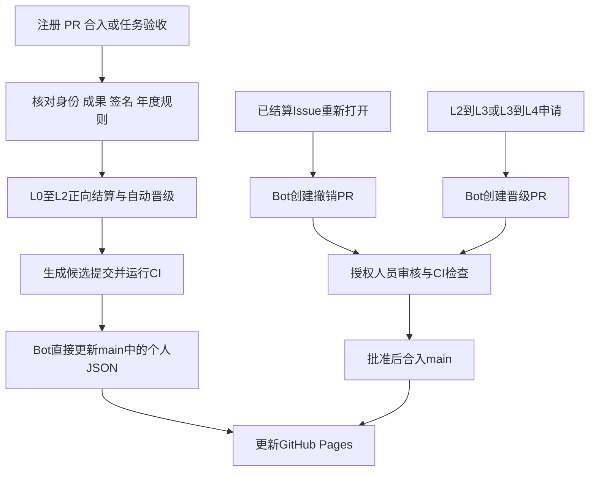

<!-- SPDX-FileCopyrightText: Copyright (c) 2026 Process Mission -->
<!-- SPDX-License-Identifier: MIT -->

# 开源贡献者年度晋级与成果记录方案

状态：设计提案。本文规定拟采用的运行流程；年度数值及审核名单须由组织者正式发布后生效。

## 目标与术语

参与者统一称为“开源贡献者”。贡献者等级为 L0–L4，任务难度为 `difficulty/level0` 至 `difficulty/level4`。等级反映已获认可的能力与社区职责，任务难度描述具体任务的要求。

系统由年度规则、贡献者 JSON、GitHub App 和 GitHub Pages 组成。CI 校验事实并计算经验值。L0–L2 的正向经验结算及 L0→L1、L1→L2 晋级由 Bot 直接提交到 `main`；经验撤销及 L2→L3、L3→L4 晋级通过 PR 审核合入。Pages 展示默认分支中的正式记录。

本方案中的积分统一对应贡献者 JSON 的 `experience`，表示已经确认的经验值。

贡献者可以互相推荐、评审成果和提供反馈。任务验收及 L3、L4 晋级审批由年度规则指定的授权人员执行，申请人不能批准自己的成果或晋级。L0 → L1 仅需本人注册 PR 从 Fork 提交并成功合入，无需导师参与；L1 → L2 根据已验收的成果自动判定。

## 年度规则组织

| 文件 | 用途 |
| --- | --- |
| `docs/levels.md` | 稳定的等级含义、任务难度定义、各年度晋级规则入口 |
| `programs/README.md` | 年度计划索引 |
| `programs/<year>/README.md` | 当年计划说明、有效规则版本和贡献者页面入口 |
| `programs/<year>/progression.md` | 当年的积分、任务数量、合入数量、评审与推荐要求 |
| `programs/<year>/rules/v1.json` | 当年规则的机器可读版本 |
| `programs/<year>/governance.json` | 当年面试人员、评审人员和组织者的 GitHub 数字 ID，以及导师 DCO 签名资料 |

年度规则包含规则 ID、年份、版本、生效时间、任务分值、各级晋升条件、合入贡献认定标准、审核职责和跨年规则。时间以 `Asia/Shanghai` 判定。

已经发布的规则版本保持不可修改。调整规则时增加 `v2.json` 等新版本，并明确生效时间、适用范围与迁移安排。CI 校验 `progression.md` 的条件表与机器规则一致。`levels.md` 通过年度链接引导读者查看具体条件。

## 2026 年度建议条件

### 积分

| 任务难度 | 正式验收后的积分 |
| --- | --- |
| L0 | 0，记录参与和学习成果 |
| L1 | 10 |
| L2 | 30 |
| L3 | 60 |
| L4 | 100 |

任务分值在开放申领前由导师确认，绑定任务规则版本。实施中确需调整范围时，由导师和组织者审批合同变更，保存原因及新版本。编辑 Issue 标签本身不会改变已确认积分。

### 晋级

| 路径 | 建议条件 | 决定方式 |
| --- | --- | --- |
| L0 → L1 | 完成 Fork，提交本人身份文件的注册 PR，通过身份检查和维护者审核，合入默认分支；无需导师 | Bot 直接更新 JSON 中的等级及晋级记录 |
| L1 → L2 | 累计至少 6 个已验收独立任务、6 个独立上游合入 PR，至少 2 个 L2 或以上任务，正式积分至少 100 | 条件满足后 Bot 直接更新 JSON |
| L2 → L3 | 累计至少 12 个已验收独立任务、12 个独立上游合入贡献、至少 6 个 L2 或以上任务，其中至少 2 个 L3 或以上任务，正式积分至少 300；技术面试、导师能力评估及内部审核全部通过 | Bot 创建晋级 PR，人工批准后合入 |
| L3 → L4 | 已达到 L3，由组织者发出邀请；具有公开可核查的持续社区贡献、带教成果及独立推荐，内部委员会批准 | Bot 创建晋级 PR，邀请和审核完成后合入 |

以上数量均为累计值。L1→L2 的建议门槛已经按提高任务及 PR 数量的要求设置；4 个 L1 任务与 2 个 L2 任务对应 100 分。L2→L3 的数值属于本方案建议。

注册只产生一次 L1 晋级，不计入 L1→L2 的任务、PR 数量或积分。MFCP 的成果记录 PR 和 Bot 的晋级记录 PR 同样不计入上游贡献数量。

## 任务分段与验收

每个任务使用原 Issue 组织沟通，任务合同保存负责人、导师、难度、规则版本、预期成果和验收条件。一个独立交付目标对应一个计分任务。

| 阶段 | 页面进度 | 验收依据 |
| --- | --- | --- |
| 复现与方案确认 | 20% | 真实复现记录、问题分析及导师确认 |
| 修改与验证完成 | 70% | 补丁、实际运行结果、适当的回归验证及导师确认 |
| 上游合入与最终验收 | 100% | 官方合入证据、任务验收、要求的签名及组织者复核 |

百分比用于表示阶段进度。正式积分在最终验收时一次计入，晋级条件读取正式积分。

目前已发布任务的作者与导师 DCO 签名要求继续适用。检查读取上游提交或已合入补丁的真实 `Signed-off-by`，结合双方确认核对身份。签名字符串存在本身不能证明本人授权，导师验收必须由其实际 GitHub 身份完成。Squash、rebase 等合入方式需要保留最终合入提交与评审补丁之间的可追溯关系。

贡献者在原任务评论中提交成果链接。导师使用结构化验收入口确认阶段与最终成果，系统读取评论作者的数字 ID，并按任务合同检查权限。自由文本评价作为说明材料，结构化命令与确认记录作为可处理的事件。

Mentor 资格由 `processmission-intern/mentors` Team 的有效成员身份确定。
所有 Bot 命令及晋级审核均核对当前成员身份；非成员、待接受邀请的账号
及查询失败的情况均不执行操作。年度名单中的任务管理、面试和审核职责
继续限制对应操作。注册 PR 合入后的 L0 → L1 自动晋级不要求 Team 身份。

Bot 根据已核验成果计算经验值。贡献者当前处于 L0–L2 时，将正向结算和符合条件的自动晋级放在同一次直接提交中，原子更新其 JSON。默认分支写入成功后正式生效。L3/L4 的经验记录采用审核 PR，除非当年的公开规则另有明确规定。

## 上游合入证据与重复计数

GitHub 项目以允许的官方仓库中的 merged PR 为合入证据，核对 PR 作者、合入目标分支、merge commit、实际贡献者以及任务关联。关闭 Issue 和关闭 PR 均不能替代 merged 状态。

Linux 与 Yocto 的核心贡献流程包含邮件补丁。[Linux 提交流程](https://docs.kernel.org/process/submitting-patches.html)和 [Yocto 提交流程](https://docs.yoctoproject.org/contributor-guide/submit-changes.html)说明了对应方式。建议年度规则将经过维护者确认的“已合入补丁系列”登记为一个等价合入贡献，保存讨论链接、补丁系列标识、正式仓库、目标分支及最终提交。年度条件表可将这类等价贡献计入合入数量，Pages 分别展示 PR 与补丁系列数量。该等价规则需要随年度规则明确发布。

一个上游 PR 或补丁系列对应一个唯一合入记录。重复引用、重新提交、cherry-pick、backport 和拆分同一交付目标均不能生成重复的正式积分。回移维护若具有独立目标，需要事先批准为单独任务并明确认定规则。

每个计分任务确定一名主责贡献者，任务积分与完成次数记入主责人；协作者与导师记录各自协作、评审和带教成果。多人分别承担独立交付时，先定义独立任务及其合入证据。Mentor 的 DCO 签名不自动产生代码作者积分。

任务为零分、上游修复已有实现、成果未合入、证据尚未完整、验收未完成时，页面保留真实进展，正式积分保持不变。

## 晋升记录存储

每位贡献者统一使用 `participants/<小写用户名>.json`，身份、等级、经验值、贡献明细和晋升说明保存在同一文件。任务合同保存在原任务 Issue 的受控配置及导师确认记录中；每次结算将所使用的合同版本、来源和摘要保存到贡献者 JSON。

| JSON 字段 | 内容 |
| --- | --- |
| `schema_version` | 文件结构版本 |
| `github_id`、`github_login` | 稳定账号身份与当前用户名 |
| `level` | 当前正式等级 |
| `experience` | 根据有效结算与撤销记录计算的经验值 |
| `contributions` | 任务、上游合入证据、验收人员、规则版本、确认经验值、有效状态 |
| `promotions` | 原等级、新等级、适用规则、达标证据、晋升说明、审核依据和时间 |
| `adjustments` | 撤销或纠正记录，关联原结算、原因和审批 PR |
| `updated_at` | 最近一次有效更新的时间 |

注册 PR 提交真实身份及固定的初始状态：L0、经验值为零、贡献和晋升数组为空。CI 检查初始值，注册 PR 合入后由 Bot 直接生成 L1 晋级记录。该流程无需分配导师、导师签名或导师评估，晋级证据为本人注册 PR 及其合入提交。已有双字段文件通过经过审核的迁移 PR 扩展结构，初始等级按真实历史依据确认。

每条记录带唯一 ID，并保存贡献者数字 ID、来源事件、原始任务配置、规则文件 Git SHA 和核验时间。晋级记录额外保存达标条件、说明、审核人员与审批来源。直接更新记录使用提交来源事件定位，Git 历史提供实际提交 SHA；PR 路径同时记录对应 PR 编号。

自动晋级说明由确定性模板生成，列出本次满足的条件和对应证据。人工晋级说明由评审人员提供公开摘要。面试原始记录、内部评价和其他非公开材料存放在有权限控制的内部系统，公开仓库只记录审批结论与受控材料编号。

贡献、晋级和调整历史保留在 JSON 数组中。发现错误时通过审核 PR 增加调整记录，并更新相关贡献的有效状态。经验值和完成数量从有效记录重新计算，避免只修改总分。身份关联使用数字 ID，用户名更改时移动同一 JSON 文件并保留历史。

### 重新打开 Issue 与撤销结算

已经结算的任务重新打开时，Bot 创建撤销 PR，列明原结算 ID、原确认经验值、需要撤销的任务及合入数量、重新打开的来源事件和原因。审核确认任务确实未完成后，合入 PR 执行扣除。未发生结算的任务重新打开时无需扣分。

撤销使用原结算实际加分值，不按最新标签或新年度分值计算。一个结算只能有效撤销一次。原记录继续保留，经验值、有效任务数量和有效合入数量同时重算。

撤销 PR 等待审核期间，当前正式经验值保持原值，页面显示“结算待复核”，相关贡献暂停用于新的自动晋级。正常讨论或行政整理造成的重新打开可以由审核人员关闭撤销 PR，恢复该成果的正常状态。

若撤销影响既有晋级依据，PR 明确列出受影响的晋升记录，并由审核人员决定是否调整等级。任何扣分或降级均通过该 PR 或后续审核 PR 生效。L3/L4 等级变化须由相应内部评审人员批准。

任务完成补充工作后可以再次验收。Bot 仅在原撤销 PR 已合入且新验收有效时生成新的结算 ID，并关联原结算；重复关闭同一有效结算的任务不会再加分。待审撤销 PR 遇到新的验收时先重新核对事实，不能直接取消扣分或重复加分。

## 跨年与规则变更

- 已获等级跨年保留。
- 历史成果保存原任务规则版本和当时确认的积分。
- 新年度的晋级条件适用于该年度启动的晋级判断；默认累计历史有效成果与正式积分。
- 已经启动的人工评审固定其规则版本，审核过程继续使用该版本。
- 跨年任务的分值依据任务合同中的规则版本，验收时间用于年度成果统计。
- 新年度缺少生效规则时，系统继续保存贡献证据，暂停新的自动晋级，并显示规则尚未发布。
- 规则版本需要更改累计窗口或历史成果认定方法时，必须发布明确的迁移条款，不能仅修改阈值文件后隐式重算。

现有已登记账号需要一次迁移核对：有真实合并注册 PR 的账号可生成相应 L1 事件；其他账号由组织者提交有依据的初始等级决定。系统不根据管理员权限推断等级。

## L3 与 L4 的人工决定

L3 达到量化条件后，Bot 标记“可申请评审”，由贡献者申请或导师推荐。审核包括：技术面试、导师能力报告和内部审核结论。面试重点覆盖问题分析、独立验证、方案取舍与社区评审处理。

导师与面试人员应由不同人员担任。最终决定需要年度治理名单中的两名不同审核人员批准，申请人不能审批本人记录。审批关联明确的候选等级和规则版本；修改决定内容后重新审核。未通过时提供公开的后续成长方向，内部材料继续受访问控制。

L4 由组织者邀请进入评审，需要至少两名独立推荐人提供具体贡献记录。评审材料包括持续技术贡献、带教过程与结果、对他人评审的帮助、社区协作反馈。内部委员会形成决定，Bot 校验审批完整性并记录结果。积分作为背景信息展示。

贡献者之间的推荐和评价保存为证据。系统不会根据点赞数、评论数量或互相填写的等级直接晋升。

## GitHub App 的写入与审核权限

建议应用名称为 `MFCP Progress Bot`，最终名称取决于 GitHub 注册时的可用性。使用 GitHub App installation token，以独立应用身份进行已授权的直接提交和记录 PR 操作。

应用只安装到本仓库。请求 Contents 读写、Pull requests 读写、Issues 读权限和必要的 Metadata 读权限。若需要发布任务验收反馈，再明确启用 Issues 写权限。应用不需要管理员权限或上游仓库写权限。

为实现直接更新 `main`，使用针对该分支的规则集，将这个 App 加入“必须通过 PR”规则的绕过名单。普通账号继续通过 PR 修改。禁止强制推送和删除分支的规则单独设置，并对 Bot 同样生效。已有经典分支保护与规则集叠加执行，迁移时必须检查其实际效果，防止经典规则继续阻止已授权的 Bot 提交。

直接提交先在候选分支生成，再由可信 CI 检查该提交的完整差异和业务条件。保留必需状态检查且限制来源为 GitHub Actions；候选提交满足检查后，Bot 只以 fast-forward 方式更新 `main`。如果 `main` 已前进，基于最新版本重新计算并重新校验。候选分支不需要创建 PR。

GitHub 的 App 绕过名单不能识别 JSON 内部的经验增减或等级值。业务范围由可信校验程序和持有写入凭据的工作流强制检查：仅允许修改对应参与者 JSON 的规定字段、保留身份与历史、增加已核验经验、将等级提升至最高 L2。撤销、降级、L3/L4 晋升及其他路径的修改都必须转为 PR。App 凭据属于可信写入权限，需要限制在这一执行路径中使用；这不是 GitHub 提供的字段级权限。

若启用 Issue 自动反馈，参与者检查须按应用的固定 App ID 识别可信系统评论；该身份仅用于 Bot 自身反馈，不授予人工验收或晋级审批资格。其他账号继续按参与者登记检查。

应用私钥保存在默认分支可信工作流可以使用的受控 secret 中。外部 PR 的代码与配置不接触该私钥。提议中的治理规则、评分规则和校验代码以默认分支的可信版本执行。

写入规则：

| 操作 | 写入方式与前置条件 |
| --- | --- |
| 注册参与 | 本人提交注册 PR，身份检查与维护者审核通过后合入 |
| L0–L2 正向经验结算 | 校验成果、签名、验收身份、去重和年度规则后，Bot 直接更新 `main` |
| L0→L1、L1→L2 | 达到条件后，与贡献记录一起直接更新 JSON，无需额外晋级 PR |
| 经验撤销及降级 | Bot 创建 PR，审核批准和检查通过后合入 |
| L2→L3、L3→L4 | 必须创建晋级 PR，包含内部评审或邀请推荐的批准依据 |
| L3/L4 经验记录 | 通过记录 PR；如需其他方式，由年度规则明确授权 |
| 年度规则、审核名单、工作流及程序修改 | 普通 PR 与维护者审核 |

Bot 对撤销和高等级晋级 PR 可以在人工审核通过后请求自动合入，人工批准是必需条件。Bot 不能自行批准这些操作，也不能修改评分规则来改变当前结算结果。

保留当前 `JSON format and fields` 与 `validate` 检查并扩展到新的参与者文件结构，新增 `Progression integrity` 检查。检查根据可信来源区分注册 PR、人工审核 PR 和 Bot 正向候选提交；Bot 身份本身不足以使记录通过校验。PR 路径根据实际变更检查授权人员的批准，直接提交路径只接受规定的正向操作。

年度规则、治理名单、工作流和校验程序通过 CODEOWNERS 和必需审核保护。撤销及 L3/L4 晋级发生在参与者 JSON 内，由 `Progression integrity` 按变更内容检查授权审核，不能仅按文件路径推断批准条件。

注册审核可以由授权维护者在 PR 中作出真实 APPROVED review；CI 独立核对该审核身份、当前 PR head SHA 和注册内容。通过后 Bot 请求 GitHub 的自动合入。普通资料 PR 继续走正常人工评审。

现有注册程序需要扩展 JSON schema 和变更检查：注册只允许初始状态；本人更名只允许更新本人用户名与文件名，原有等级、经验和历史必须保留；维护者删除身份文件继续通过审核 PR。普通注册者不能借身份更新修改自己的经验或晋升记录。

## 事件与 CI/CD 流程

注册 PR 合入、任务成果提交、授权验收、人工决定获批均触发相应工作流。官方上游 PR 状态每六小时进行一次只读查询，并提供手动同步入口；本仓库不能依赖其他组织主动安装应用或发送事件。定时任务只检查已登记的任务和成果链接。

所有入口使用唯一事件 ID；同一上游合入和同一次等级转换重复收到事件时只产生一个结果。写入以当前 `main` 的提交 SHA 为前提，发生并发更新时重新读取并计算。处理队列保留所有待处理事件，并通过周期性核对补齐；不能用会丢弃排队事件的并发配置代替持久去重。

撤销和晋级 PR 等待期间如果个人 JSON 发生变化，Bot 基于最新文件重新生成差异，保留后来增加的有效成果，并重新取得适用的人工审核。所有更新采用完整语义检查，避免旧 PR 覆盖新经验。

自动晋级事件以贡献者数字 ID、原等级、新等级和有效成果集合识别，已有相同决定时停止生成。直接提交或 PR 合入触发后续工作流时重新计算，内容无变化则结束。Bot 结算事件引发的再次关闭或评论不会生成重复经验。

## GitHub Pages

Pages 使用静态站点展示默认分支中的正式记录，默认英文，提供中文入口。默认部署来源为 GitHub Actions，部署环境只允许默认分支。

页面包含：

- 贡献者目录：GitHub 用户名、头像、当前等级、主要项目、正式积分、验收任务数和合入贡献数。
- 个人页面：晋级时间线、每次晋级使用的年度规则、成果链接、导师与公开评审说明、下一等级各项条件的完成情况。
- 年度视图：当年规则、当年成果及累计成果，区分统计口径。
- 任务视图：可申请任务、负责人、难度、进展阶段、导师及成果链接。
- 数据说明：更新时刻、来源 Git commit、规则版本和异常提示。

L0 表示注册准备阶段。公开目录收录注册已合入的贡献者；待注册者在注册 PR 中查看进展。内部面试材料与薪酬资料不进入公开页面或页面构建产物。

## 失败、纠正与审计

API 超时、限流或证据暂时不可访问时，事件标记待核验，保持上一次正式记录和已发布页面。程序必须区分“查询失败”和“证据不符合条件”。

上游 PR 被 revert、归属发生争议、验收被撤回时，生成撤销或纠正 PR 并暂停该贡献用于新的晋级。审核人员通过该 PR 决定经验及等级处理，JSON 保留历史记录。

被删除的 Issue 评论和外部链接可能失效，因此事件保存当时核验的必要字段、来源标识、时间和内容摘要。原始敏感资料不复制到公开仓库。

规则与审批记录的完整性检查独立于 Bot 的提交逻辑，依据可信默认分支、真实 GitHub 用户身份、上游查询和授权 review 重新计算。页面只消费通过检查并已写入默认分支的记录。推送后的审计检查属于补充；直接提交的业务校验必须在更新 `main` 前完成。

## 实施前确认与验收

发布年度规则前，需要确认 2026 年的数量门槛、L3/L4 审核名单、Linux/Yocto 等价合入标准和初始贡献者等级。当前数字是完整建议值，可作为年度规则审批对象。

接入时核对 GitHub App 安装身份、分支保护、必要 secrets、官方上游仓库列表与 Pages 部署环境。API 当前返回仓库 `processmission-intern/mission-forge`，数字 ID 为 `1428030862`；本地 origin 仍为旧组织地址。应用按数字 ID 识别仓库，并从 API 读取当前名称。现有固定仓库名称的工作流和脚本需要同步迁移后启用。

验收需验证：注册 PR 合入后直接记录 L1 且只晋升一次；L0–L2 正向结算和自动晋级不产生额外 PR；未合入、重复、无权验收的成果不能计分；同一 Issue 重开只生成一次有效撤销；扣除原经验和数量必须在审核 PR 合入后发生；L3/L4 审批缺失时无法晋级；直接写入拒绝经验减少、身份修改、历史删除及晋升到 L3/L4；并发写入和待审 PR 保留最新成果；跨年规则可追溯；API 故障保持已确认状态；用户名更改保留历史；Pages 与正式记录一致。

## 技术依据

- [GitHub App 权限](https://docs.github.com/en/apps/creating-github-apps/registering-a-github-app/choosing-permissions-for-a-github-app)
- [Code owners 与必需审核](https://docs.github.com/en/repositories/managing-your-repositorys-settings-and-features/customizing-your-repository/about-code-owners)
- [受保护分支](https://docs.github.com/en/repositories/configuring-branches-and-merges-in-your-repository/managing-protected-branches/about-protected-branches)
- [GitHub Pages 自定义工作流](https://docs.github.com/en/pages/getting-started-with-github-pages/using-custom-workflows-with-github-pages)
