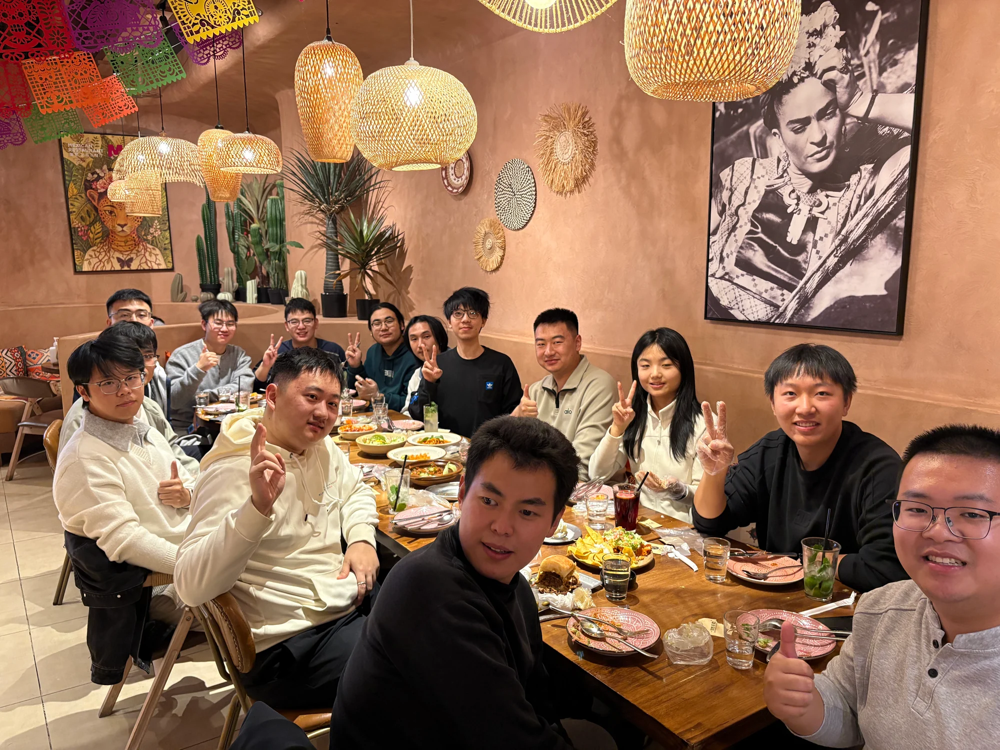
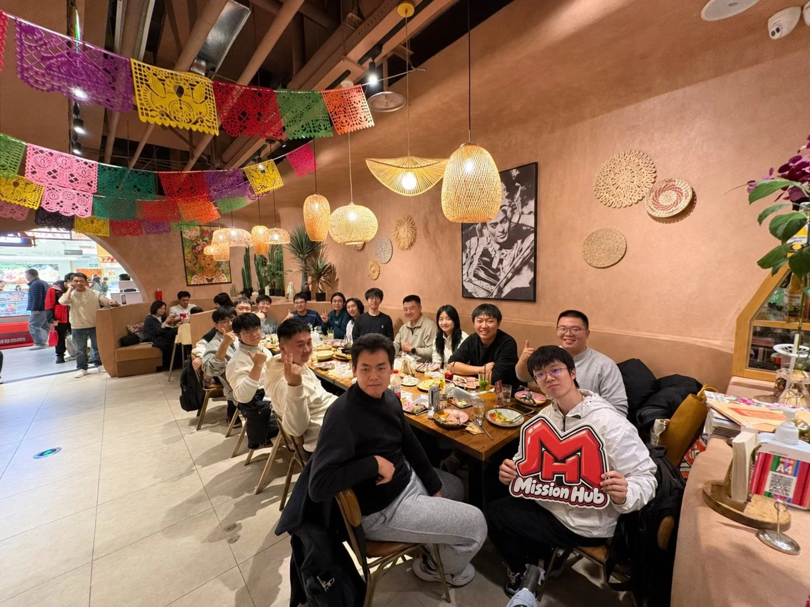

2026 年 11 月 14 日，MissionHub 开源社区 MFCP 计划在北京举行线下聚会。活动预计参加 20 人，实际到场 16 人。

到场社区成员包括在进程使命、百度、Google 工作的从业者，清华大学、中北大学、河南科技大学等高校的学生，以及计算所、软件所的工程师。现场照片记录了成员围桌相聚的场景。

MFCP 面向希望参与开源贡献的学习者与开发者，通过导师指导和真实项目任务，支持参与者向上游贡献成果、锻炼个人实践能力。实践项目包括 Zephyr、Linux、Yocto、Humanize 和 QEMU。

> **参会说明：** 所有人均以社区成员个人身份参会。文中的单位名称仅用于说明个人学习或工作背景，参会及交流内容不代表所在单位意见。

